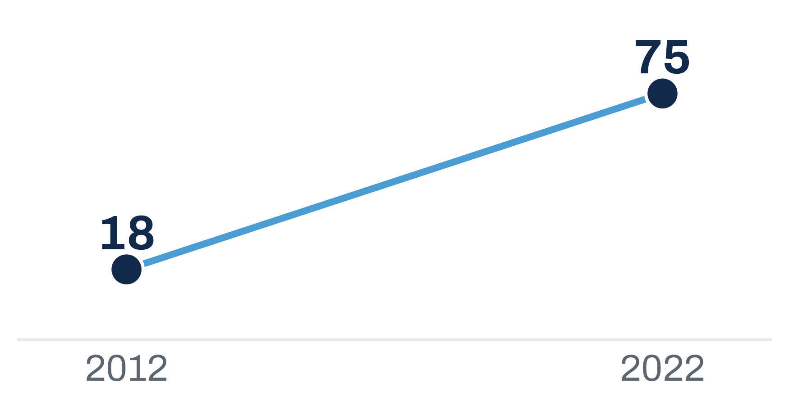
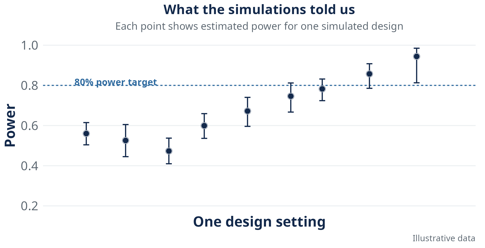
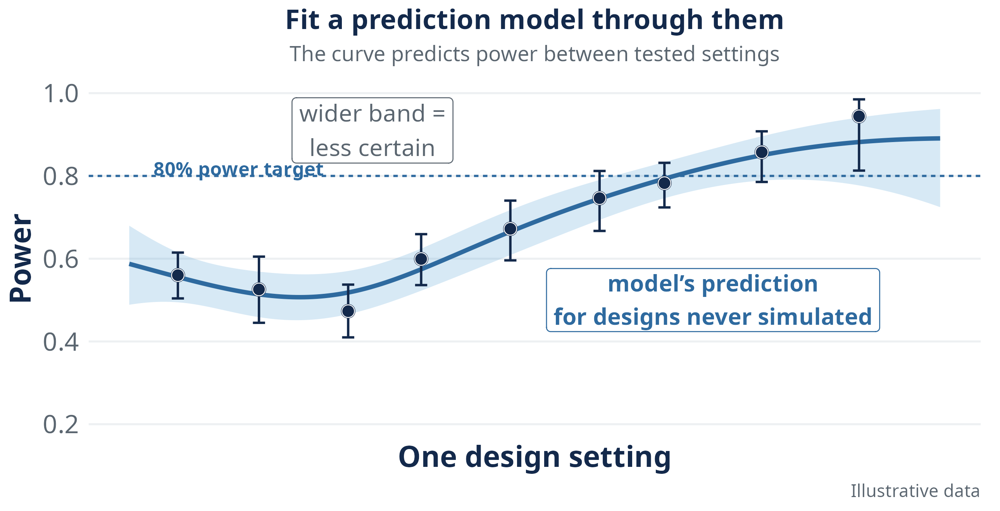
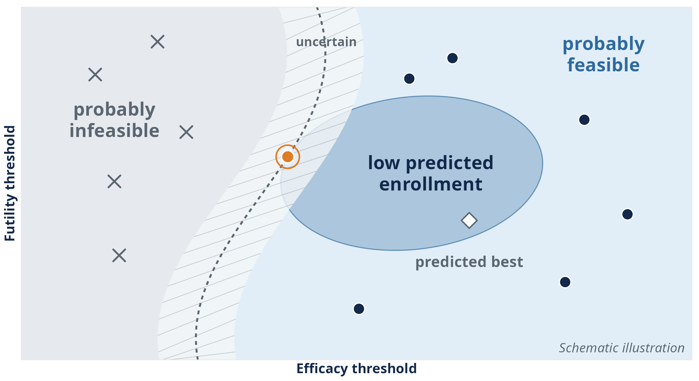
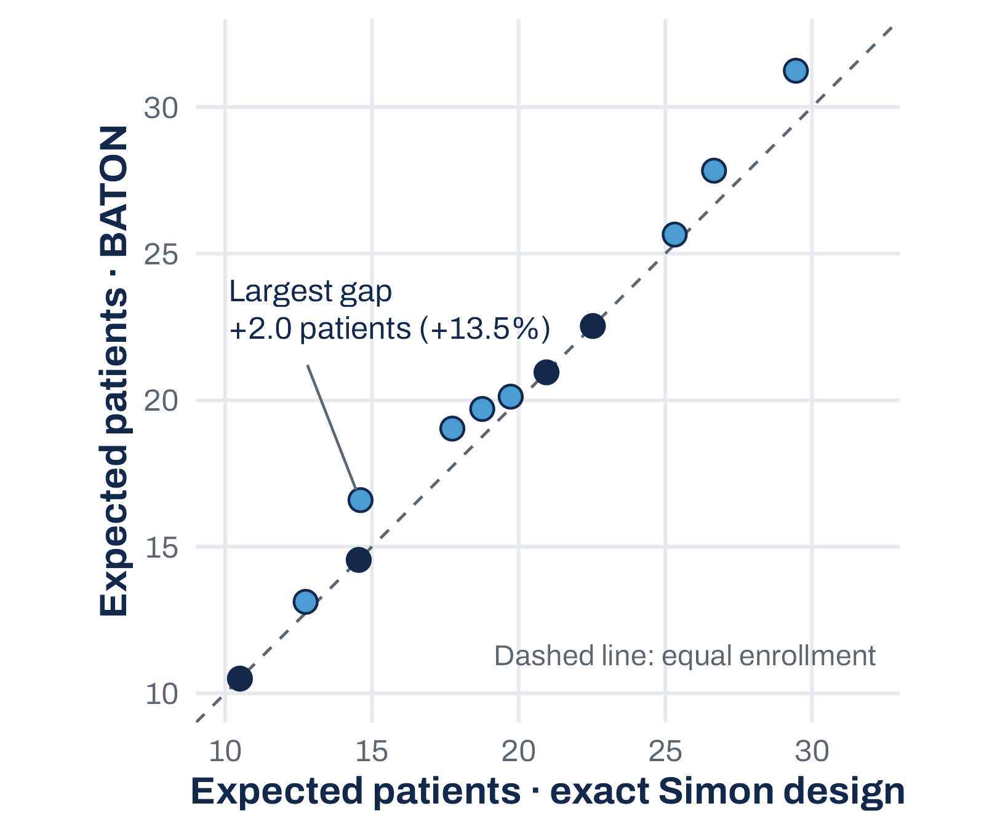
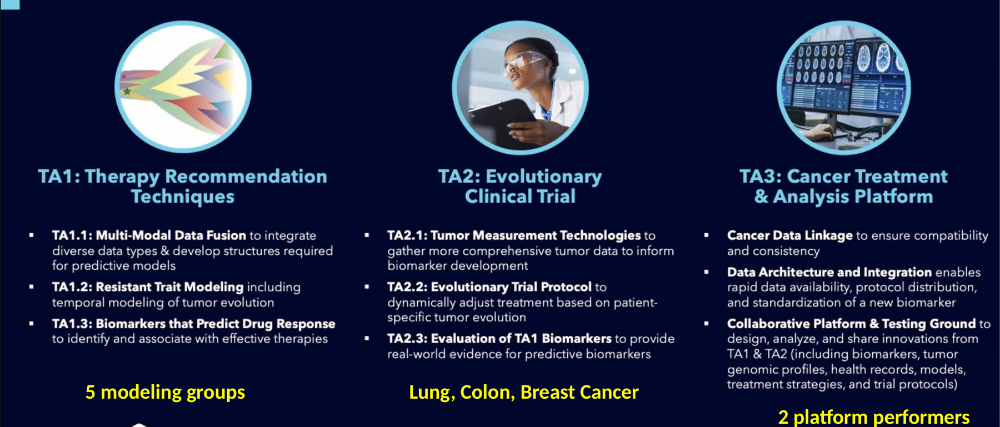
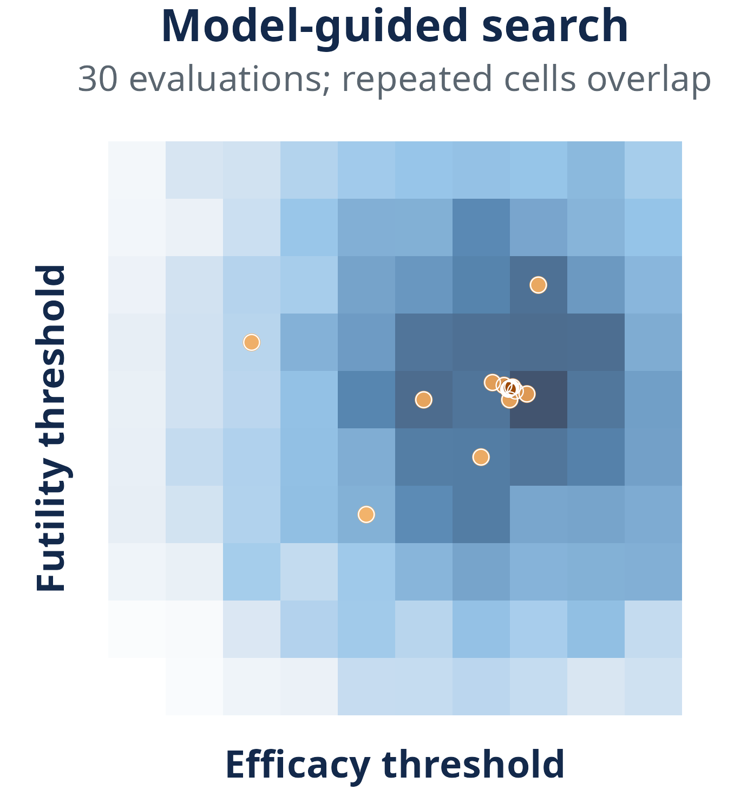

## {.title-slide-custom data-menu-title="Title" data-state="hide-footer"}

::: {style="text-align: center; margin-top: 1.2em;"}


<h1 class="ts-title">Planning under uncertainty</h1>

<p class="ts-subtitle">AI-guided design of efficient clinical trials with BATON</p>

<p class="ts-author">Naim Rashid</p>
<p class="ts-affil">Department of Biostatistics · Lineberger Comprehensive Cancer Center · UNC Chapel Hill</p>

<p class="ts-meta">NextGen TriBix Symposium · November 17, 2026</p>


:::

::: {.notes}
**Pull-from-if-needed:** The [FDA sotorasib review](https://www.accessdata.fda.gov/drugsatfda_docs/nda/2021/214665Orig1s000MultidisciplineR.pdf) describes the postmarketing comparison.

**Q&A pockets:** *What is AI-guided here?* A statistical model guides which candidate design to simulate next, before the trial enrolls.

**Delivery:** Open with “A cancer drug was approved at 960 mg. What would you want to know before deciding whether 240 mg was a better choice?” Pause for a moment. “I’ll come back to that drug. First, let’s look at the choices early trials have to make.”
:::


## {.section-divider data-state="hide-footer" data-background-color="#13294B" data-menu-title="Overview"}

::: {.divider-inner}
::: {.divider-kicker}
Overview
:::
::: {.divider-rule}
:::
```{=html}
<div class="divider-outline" style="font-size: 1.3em;">
<div class="ol-row" style="color: #FFFFFF; padding-block: 0.28em;"><span class="ol-num">1</span><span class="ol-name">The stakes</span></div>
<div class="ol-row" style="color: #FFFFFF; padding-block: 0.28em;"><span class="ol-num">2</span><span class="ol-name">The design problem</span></div>
<div class="ol-row" style="color: #FFFFFF; padding-block: 0.28em;"><span class="ol-num">3</span><span class="ol-name">BATON</span></div>
<div class="ol-row" style="color: #FFFFFF; padding-block: 0.28em;"><span class="ol-num">4</span><span class="ol-name">The evidence and the limits</span></div>
<div class="ol-row" style="color: #FFFFFF; padding-block: 0.28em;"><span class="ol-num">5</span><span class="ol-name">Looking to the future</span></div>
</div>
```
:::


::: {.notes}
**Pull-from-if-needed:** The first section divider and phase diagram follow this overview.

**Q&A pockets:** Point to the section names if someone wants to know where the AI trade-offs appear.

**Delivery:** Use the roadmap as one beat. Say “We’ll start with what early trials need to teach us, then look at how BATON helps teams design them.” Advance through the first section divider without reading the list.
:::


## {.section-divider data-state="hide-footer" data-background-color="#13294B" data-menu-title="Section 1: The stakes"}

::: {.divider-inner}
::: {.divider-kicker}
Section 1
:::
::: {.divider-rule}
:::
```{=html}
<div class="divider-outline">
<div class="ol-row ol-current"><span class="ol-num">1</span><span class="ol-name">The stakes</span></div>
<div class="ol-q">What do we need to learn before committing?</div>
<div class="ol-row"><span class="ol-num">2</span><span class="ol-name">The design problem</span></div>
<div class="ol-row"><span class="ol-num">3</span><span class="ol-name">BATON</span></div>
<div class="ol-row"><span class="ol-num">4</span><span class="ol-name">The evidence and the limits</span></div>
<div class="ol-row"><span class="ol-num">5</span><span class="ol-name">Looking to the future</span></div>
</div>
```
:::


## Drug development usually follows three phases before approval {data-menu-title="Phases"}

```{=html}
<div style="display: flex; align-items: stretch; justify-content: center; gap: 0.5em; margin: 3.1em auto 0 auto; width: 100%;">
<div style="flex: 1 1 0; border: 2px solid #13294B; background: #F4F6F8; padding: 0.9em 0.9em; text-align: center; min-height: 8.4em;"><div style="font-weight: 800; color: #13294B; font-size: 1.15em;">Phase I</div><div style="color: #1A202C; font-size: 0.86em; line-height: 1.4; margin-top: 0.5em;">First trials in people. Is it safe, and at what dose?</div></div>
<div style="flex: 0 0 auto; color: #4B9CD3; font-size: 1.6em; align-self: center;">&rarr;</div>
<div style="flex: 1 1 0; border: 2px solid #13294B; background: #F4F6F8; padding: 0.9em 0.9em; text-align: center; min-height: 8.4em;"><div style="font-weight: 800; color: #13294B; font-size: 1.15em;">Phase II</div><div style="color: #1A202C; font-size: 0.86em; line-height: 1.4; margin-top: 0.5em;">Is there a sign that it works?</div></div>
<div style="flex: 0 0 auto; color: #4B9CD3; font-size: 1.6em; align-self: center;">&rarr;</div>
<div style="flex: 1 1 0; border: 2px solid #13294B; background: #F4F6F8; padding: 0.9em 0.9em; text-align: center; min-height: 8.4em;"><div style="font-weight: 800; color: #13294B; font-size: 1.15em;">Phase III</div><div style="color: #1A202C; font-size: 0.86em; line-height: 1.4; margin-top: 0.5em;">Often the pivotal trial. Is there convincing evidence of benefit?</div></div>
<div style="flex: 0 0 auto; color: #4B9CD3; font-size: 1.6em; align-self: center;">&rarr;</div>
<div style="flex: 0 0 auto; align-self: center; border: 2px solid #2E6A9F; color: #2E6A9F; font-weight: 700; padding: 0.5em 0.7em; font-size: 0.9em;">Approval</div>
</div>
<svg viewBox="0 0 1000 70" preserveAspectRatio="none" style="display: block; width: 100%; height: 64px; margin-top: 0.7em;" role="img" aria-label="Schematic band that narrows from left to right under the three phases, showing that fewer candidate drugs continue at each step, not to scale."><polygon points="0,0 1000,26 1000,44 0,70" fill="#4B9CD3" fill-opacity="0.35" stroke="#4B9CD3" stroke-width="1"/></svg>
<div style="text-align: center; color: #5B6670; font-size: 0.62em; margin-top: 0.4em;">Fewer candidates continue. Schematic.</div>
<div class="story-question">Phases can overlap or be combined.</div>
```

::: {.notes}
**Say aloud:** "Drug development is commonly organized into three phases before approval. Phase I is the first trials in people. They are small and ask whether the drug is safe and at what dose. Phase II asks whether there is a sign that it works. Phase III typically provides pivotal evidence, the main evidence used to judge whether a treatment works. It also adds information on safety. Approval decisions depend on the total evidence. The phases can overlap or be combined. The design question is what evidence we need before making each decision."

**Pull-from-if-needed:** The 10.5 years on slide 6 runs from the start of phase I to approval. BIO 2021 splits it as 2.3 years in phase I, 3.6 in phase II, 3.3 in phase III and 1.3 in regulatory review (VERIFIED row of tribix-opening-facts.md).

**Q&A pockets:** *Is it always three separate phases?* [ICH E8(R1), Section 4.3](https://www.ema.europa.eu/en/documents/scientific-guideline/ich-e-8-general-considerations-clinical-trials-step-5_en.pdf) describes phases as an organizing convention and explains that they can overlap or be combined. Section 5 returns to how the final claim determines what earlier studies need to learn.

**Pull-from-if-needed (the band):** The narrowing band only says that fewer candidates continue at each step. Its widths carry no proportions. If a rate is wanted, use the BIO 2021 figure in the slide 6 notes.

**Delivery:** One beat per box. Then say “Start with Phase I. Where those first trials happen is getting attention right now.”
:::


## The U.S. is concerned about its lead in early clinical research {data-menu-title="Operation TrialBlazer"}

::: {.columns .media-pair style="align-items: center; margin-top: 2em; padding-top: 1em;"}
::: {.column width="45%"}
::: {.frame-box style="font-size: 1.03em;"}
**U.S. Department of Health and Human Services**

HHS reports that China's global share of Phase I trials first exceeded the U.S. share in 2021.

[Operation TrialBlazer roadmap, 2026](https://www.hhs.gov/sites/default/files/operation-trialblazer.pdf)
:::
:::
::: {.column width="49%"}


[Adult solid-tumor Phase I trials with an Australian site. [Hitchen et al., 2024](https://pubmed.ncbi.nlm.nih.gov/38923830/)]{style="display:block; text-align:center; font-size:0.75em; color:#5B6670; margin:0.25em auto 0;"}
:::
:::

::: {.notes}
**Pull-from-if-needed:** HHS’s Operation TrialBlazer roadmap is the source for the US leadership concern and the relative-share statement. The underlying series has not been independently verified. The Hitchen et al. chart counts adult solid-tumor Phase I trials with an Australian site in two years. See the verified entries in tribix-opening-facts.md. Page 6 of the [HHS roadmap](https://www.hhs.gov/sites/default/files/operation-trialblazer.pdf#page=6) discusses alternative trial designs and recruitment.

**Q&A pockets:** *Why do sponsors go abroad?* Industry testimony to Congress cites cost and speed to a first signal. These slides describe two observations and do not estimate their causes.

**Delivery:** About 35 seconds. Attribute the U.S. concern to HHS and give the Australian counts as a separate observation. Then say “That’s one pressure on the earliest stage. Zoom out to the full path from the first trial in people to approval.”
:::


## Developing one new therapy is slow and expensive {data-menu-title="Time and cost"}

```{=html}
<div style="display: flex; justify-content: center; gap: 1.7em; margin-top: 4.9em;">
<div style="flex: 0 0 44%; text-align: center;"><span style="font-size: 3.25em; white-space: nowrap; font-weight: 800; color: #13294B; line-height: 1;">10.5 years</span><br/><span style="display:block; margin: 0.4em auto 0 auto; font-size: 0.8em; color: #5B6670;">from Phase I to approval, based on successful transitions</span></div>
<div class="fragment" style="flex: 0 0 44%; text-align: center;"><span style="font-size: 3.25em; white-space: nowrap; font-weight: 800; color: #13294B; line-height: 1;">$1.1 billion</span><br/><span style="display:block; margin: 0.4em auto 0 auto; font-size: 0.8em; color: #5B6670;">median cost per approved drug, failed candidates included (2018 dollars)</span></div>
</div>
```

::: {.landing .fragment}
Each year of development is a year patients wait.
:::

[BIO, Informa, QLS Advisors 2021 · Wouters, McKee, Luyten, JAMA 2020, corrected 2022]{.muted style="display:block; text-align:center; font-size:0.62em; margin-top: 1.2em;"}

::: {.notes}
**Sources (VERIFIED rows of tribix-opening-facts.md):** (1) Biotechnology Innovation Organization, Informa Pharma Intelligence, QLS Advisors. Clinical Development Success Rates and Contributing Factors 2011 to 2020. February 2021. https://go.bio.org/rs/490-EHZ-999/images/ClinicalDevelopmentSuccessRates2011_2020.pdf. Mean 10.5 years from phase I to approval, based on 6,151 successful phase transitions, 2011 to 2020 (2.3 years phase I, 3.6 phase II, 3.3 phase III, 1.3 regulatory). Oncology 10.3 years. Trade-association report, not peer reviewed. (2) Wouters OJ, McKee M, Luyten J. Estimated Research and Development Investment Needed to Bring a New Medicine to Market, 2009-2018. JAMA. 2020;323(9):844-853. doi:10.1001/jama.2020.1166, corrected 20 September 2022 (JAMA. 2022;328(11):1110). Median capitalized R&D investment $1141.7 million (95% CI 888.1 to 1480.8), 2018 dollars, failed trials included, 63 of 355 drugs approved 2009 to 2018 with public R&D data.

**Say aloud:** "A drug that makes it from its first trial in people to approval takes about ten and a half years on average. Each approved drug costs a median of about 1.1 billion dollars once the failures are counted."

**Pull-from-if-needed:** Use 1.14 billion if pressed, never the 985 million in the uncorrected abstract. For cancer drugs the same paper gives a median of about 2.77 billion, from a small subgroup with a wide interval. If a success rate is wanted, about 5% of oncology drugs entering phase I reach approval (5.3%, BIO 2021). These are the public concerns behind current federal attention to clinical development, time, cost, early trials moving abroad, and patients waiting. The previous slide names Operation TrialBlazer.

**Q&A pockets:** *Does BATON shorten this?* No result says so. This talk is about one part of the problem, the design of each trial, and the close says which part. *Those cost numbers are contested.* Yes. The sample skews to smaller firms and to products with public filings.

**Delivery:** Say each number with its denominator. Then say “Even after a drug has made it through the early studies, the biggest test can still be ahead.”
:::


## Problems often emerge late {data-menu-title="Late failure"}

```{=html}
<div style="display: flex; align-items: center; justify-content: center; gap: 2.4em; margin-top: 1.2em;">

<div style="max-width: 620px; text-align: left;">
<span style="font-size: 3.6em; font-weight: 800; color: #13294B; line-height: 1;">54%</span><br/>
<span style="display: block; margin-top: 0.4em; font-size: 0.95em; color: #5B6670;">failed in late-stage development<br/>640 therapeutics that entered pivotal trials in 1998–2008</span>
<span style="display: block; margin-top: 0.5em; font-size: 0.62em; color: #5B6670;">Hwang et al., JAMA Internal Medicine 2016</span>
</div>
</div>
```

::: {.landing .fragment data-fragment-index="0"}
What can we learn while we still have options?
:::

[Early choices can leave questions that later trials inherit.]{.fragment fragment-index="0" style="display:block; max-width: 74%; margin: 1.3em auto 0 auto; padding: 0.45em 0.9em; text-align:center; font-size: 0.8em; color: #13294B; font-weight: 600; border-left: 4px solid #4B9CD3; background: #F4F6F8;"}


::: {.notes}
**Pull-from-if-needed:** Hwang et al. tracked 640 therapeutics entering phase 3 or other pivotal trials from 1998 through 2008. The study reported inadequate efficacy as the reason for 57% of the failures.

**Q&A pockets:** *Is this a current rate?* It describes this historical cohort. *What do the dots represent?* Each dot represents one percentage point.

**Delivery:** Give the historical denominator and the result. Some late failures are the right conclusion. Now ask “What could we learn while we still have options? Let’s go back to the 960 mg decision from the opening.”
:::


## Early decisions become downstream commitments {data-menu-title="Sotorasib"}

```{=html}
<div class="story-intro">Sotorasib · KRAS G12C lung cancer</div>
<div class="story-flow dose-timeline dose-timeline-with-results">
  <div class="story-card"><strong>Phase I</strong><span class="dose-selected">960 mg</span><small>Highest tested</small></div>
  <span class="story-arrow" aria-hidden="true">&rarr;</span>
  <div class="story-card"><strong>Accelerated approval</strong><span class="dose-selected">960 mg</span></div>
  <span class="story-arrow fragment" data-fragment-index="0" aria-hidden="true">&rarr;</span>
  <div class="story-card story-result fragment" data-fragment-index="0">
    <strong>Postapproval comparison</strong>
    <div class="dose-comparison"><span class="dose-selected">960 mg</span> vs <span class="dose-comparator">240 mg</span></div>
    <small>FDA-required</small>
  </div>
</div>
```

```{=html}
<div class="fragment dose-results" data-fragment-index="1">
  <table aria-label="Results of the randomized phase II sotorasib dose comparison">
    <thead><tr><th scope="col">Phase II results</th><th scope="col">960 mg</th><th scope="col">240 mg</th></tr></thead>
    <tbody>
      <tr><th scope="row">Median progression-free survival</th><td>5.4 months</td><td>5.6 months</td></tr>
      <tr><th scope="row">Grade 3+ treatment-related adverse events</th><td>35.6%</td><td>19.2%</td></tr>
      <tr><th scope="row">Tumor response rate</th><td>32.7%</td><td>24.8%</td></tr>
    </tbody>
  </table>
  <div class="dose-results-note"><span>Descriptive comparison</span> <span><a href="https://pubmed.ncbi.nlm.nih.gov/39029295/">Trial</a> · <a href="https://www.fda.gov/media/172698/download" title="FDA advisory committee briefing, Table 29">FDA</a></span></div>
</div>
```

::: {.notes}
**Pull-from-if-needed:** The [FDA review](https://www.accessdata.fda.gov/drugsatfda_docs/nda/2021/214665Orig1s000MultidisciplineR.pdf) and [FDA authors’ retrospective](https://ascopubs.org/doi/10.1200/JCO.24.00310) describe the accelerated approval and dose comparison. The [randomized study](https://pubmed.ncbi.nlm.nih.gov/39029295/) reports the progression-free survival and tumor response estimates. The [ODAC briefing, Table 29](https://www.fda.gov/media/172698/download) reports grade 3 or higher treatment-related adverse events (37 of 104 at 960 mg and 20 of 104 at 240 mg). The Phase II comparison was descriptive and was not powered for formal hypothesis testing. [Collins et al.](https://pubmed.ncbi.nlm.nih.gov/38085161/) counted a broad range of postmarketing requirements for additional dosing information, including interactions, dosing in specific groups, and dose comparisons.

**Q&A pockets:** *Did the comparison lead FDA to change the dose?* The FDA authors report that the totality of the evidence did not lead to a dose change.

**Delivery:** Name sotorasib as the drug from the opening. Show the Phase I dose and the accelerated approval, which lets FDA approve earlier based on an outcome expected to predict clinical benefit. Ask “What evidence would you want before carrying that dose into a larger trial?” Give the room a moment, then reveal the comparison requirement. Patients would be assigned to the two doses by chance. On the next click, show the study results. Define progression-free survival as the time until the cancer worsens or the patient dies. The observed medians were close. The lower dose had fewer severe treatment-related adverse events, and the higher dose had a numerically higher tumor response rate. The study did not establish equivalence. Land on the timing: the balance between activity and side effects was still an open question at approval. Close with “What would we learn about 240 mg by enrolling more patients at 960 mg?” If time permits, state that 78 of 132 novel oncology drugs approved from 2012 to 2022 had a postmarketing requirement to collect additional dosing information.
:::


## How best to design early trials for later success is not yet clear {data-menu-title="The open question"}

```{=html}
<div class="story-flow dose-question">
  <span class="dose-selected">960 mg</span><span>More patients at this dose</span>
  <span class="story-arrow" aria-hidden="true">&rarr;</span>
  <span>What do we learn about</span><span class="dose-comparator">240 mg</span><span>?</span>
</div>
```

::: {.columns style="align-items: center;"}
::: {.column width="60%"}
[**Different signals**]{style="display:block; text-align:center; color:#13294B; font-size: 0.9em;"}

:::
::: {.column width="40%"}
::: {.frame-box .fragment data-fragment-index="0" style="text-align: center; font-size: 0.86em;"}
**Separate designs**<br/>Each phase has different targets.
:::
::: {.frame-box .fragment data-fragment-index="0" style="text-align: center; font-size: 0.86em; margin-top: 0.6em;"}
**Too many paths**<br/>Many ways to divide patients across phases.
:::
:::
:::

::: {.landing .fragment data-fragment-index="1"}
Information debt is a question later enrollment alone may leave unanswered.
:::

::: {.notes}
**Say aloud (the open question, PI 2026-11-14):** "So why not just design early trials with the later ones in mind? Because it is not yet clear how best to do it. Early trials are small and read out short-term signals, tumor shrinkage and side effects, while later trials are judged on long-term outcomes such as survival, so the link from an early signal to late success is uncertain. Each phase is designed on its own, to its own targets, often by different teams. And the number of ways to divide patients and decisions across phases is too large for a formula. We come back to this at the end."

**Pull-from-if-needed:** The schematic replaces the first box's sentence, "Early signals are short-term. Later trials are judged on longer-term outcomes." The trial sizes in it are not to scale. Sotorasib on the previous slide is one example of the first reason. The dose came from phase I, which reads short-term signals, and the later question was about longer-term benefit.

**Q&A pockets:** *Has anyone solved this?* Say that it is an open problem and that this talk does not claim a solution. No numbers here.

**Delivery:** Start with the question from the previous slide. More patients at 960 mg can improve our estimate for that dose. To learn how it compares with 240 mg, we may need to reopen the comparison. Name information debt, then say “If we want earlier trials to answer better questions, we need a way to test how their rules will behave before enrolling anyone.”
:::


## More efficient trials exist. They are harder to design. {data-menu-title="The turn"}

::: {.columns .balanced-panels style="margin-top: 2em;"}
::: {.column width="50%"}
::: {.frame-box style="min-height: 7.4em; font-size: 0.95em; border-color: #2E6A9F;"}
**They offer**

- Adaptive: fewer patients on failing drugs
- Platform: several drugs, one protocol
- Seamless: screen and confirm in one trial
:::
:::
::: {.column width="50%" .fragment}
::: {.frame-box style="min-height: 7.4em; font-size: 0.95em; border-color: #E07C24;"}
**The designer pays**

- Interacting settings
- Often no formula
- Evaluate many possible rules
:::
:::
:::

::: {.thesis-line .fragment style="margin-top: 1.1em;"}
One bottleneck is finding an efficient trial design that still meets the evidence requirements. That is a search problem.
:::

::: {.notes}
**Say aloud first:** “We can change how a trial is designed. Each change gives us more choices about when to look, what to measure, and what evidence is enough to act.”

**Say once, here:** "When I say efficient, I mean efficient in patients, not faster computation."

**Say aloud (the plain glosses):** "Adaptive designs can stop a trial early when the drug is not working, so fewer patients receive it. Platform designs test several drugs or subgroups under one protocol. Seamless designs move from screening to confirmation without starting a new trial. Each can improve how a team uses patients or time, depending on the rules and the setting." Then the right box. Say “Suppose we want to stop early when a treatment looks unpromising. When should we look, and how much evidence would be enough to stop? Each choice changes how the trial behaves. We can simulate one set of rules. Then we have to decide which set to try next.”

**Pull-from-if-needed:** Adaptive, platform and seamless designs are not new. The [2019 FDA adaptive-design guidance](https://www.fda.gov/regulatory-information/search-fda-guidance-documents/adaptive-design-clinical-trials-drugs-and-biologics-guidance-industry) describes how sponsors can use simulations to evaluate complex adaptive designs, including their statistical operating characteristics. The bottleneck is the calibration work, which is what the rest of the talk is about.

**Q&A pockets:** *If they are better, why are they not used everywhere?* Design time and the expertise needed to calibrate them are part of the answer. Do not claim they are the only reason.

**Delivery:** Pause on the search question, then say “Let’s start with one Phase II decision. Has the treatment shown enough promise to continue?”
:::


## {.section-divider data-state="hide-footer" data-background-color="#13294B" data-menu-title="Section 2: The design problem"}

::: {.divider-inner}
::: {.divider-kicker}
Section 2
:::
::: {.divider-rule}
:::
```{=html}
<div class="divider-outline">
<div class="ol-row"><span class="ol-num">1</span><span class="ol-name">The stakes</span></div>
<div class="ol-row ol-current"><span class="ol-num">2</span><span class="ol-name">The design problem</span></div>
<div class="ol-q">Is there enough evidence to continue?</div>
<div class="ol-row"><span class="ol-num">3</span><span class="ol-name">BATON</span></div>
<div class="ol-row"><span class="ol-num">4</span><span class="ol-name">The evidence and the limits</span></div>
<div class="ol-row"><span class="ol-num">5</span><span class="ol-name">Looking to the future</span></div>
</div>
```
:::


## A clinical trial is an experiment built for a decision {data-menu-title="What a trial is"}

::: {.columns .balanced-panels style="margin-top: 3em; padding-top: 0.8em;"}
::: {.column width="33%"}
::: {.frame-box style="min-height: 9em; font-size: 1.02em;"}
**The question**<br/>Does the treatment beat a benchmark or a control?
:::
:::
::: {.column width="33%" .fragment}
::: {.frame-box style="min-height: 9em; font-size: 1.02em;"}
**How patients are used**<br/>Single-arm (everyone gets the treatment) or randomized (treatment versus control).
:::
:::
::: {.column width="33%" .fragment}
::: {.frame-box style="min-height: 9em; font-size: 1.02em;"}
**Two errors**<br/>Advance a treatment that fails, or drop one that works.
:::
:::
:::

::: {.landing .fragment}
Two choices dominate: how many patients, and what evidence is enough to continue.
:::

::: {.notes}
**Say aloud (moved off the slide for the 60-word cap):** "Traditional development is organized in phases: choose a dose, look for a signal, then confirm it. Each phase is a trial with its own rule for go or stop." Then the caption: for the calibration problems in this talk, two choices dominate.

**Glosses at first use:** benchmark (the response rate the treatment has to beat, fixed before the trial), single-arm (everyone gets the study treatment; we compare with a prespecified benchmark), randomized (patients are assigned to treatment or control), objective (the quantity we try to make small, here patients). PFS, when it comes up: "time until the cancer worsens or the patient dies."

**Delivery:** Start with “Most of the BATON examples today are Phase II screening designs. The decision is whether the treatment has shown enough promise to study further. We’ll follow one EVOLVE breast cancer cohort.” Lead with the two decisions at the bottom. Carry over the example from slide 10. “If we wanted to stop early, how many patients would we enroll before deciding, and what would count as enough evidence to continue?”
:::


## An adaptive trial can act on an interim result {data-menu-title="Fixed versus adaptive"}


::: {.columns .balanced-panels .fragment style="margin-top: 0.4em;"}
::: {.column width="50%"}
::: {.frame-box style="font-size: 0.74em; border-color: #5B6670; margin: 0;"}
**Traditional**<br/>
One planned analysis after enrollment.
:::
:::
::: {.column width="50%"}
::: {.frame-box style="font-size: 0.74em; border-color: #2E6A9F; margin: 0;"}
**Adaptive**<br/>
A planned interim look can stop enrollment if benefit looks unlikely.
:::
:::
:::

::: {.landing .fragment}
When should we look, and what evidence is enough to continue?
:::

::: {.notes}
**Split from the merged slide (CompMed 5, now on its own again).** Order: the figure, the two boxes, then the closing line, which is the CompMed 5 title.

**Say aloud (the patient contrast, PI request 2026-11-14):** "In a traditional fixed trial, every planned patient is enrolled and the results are looked at once, at the end. If the treatment is not working, every one of those patients still receives it, and we learn that only at the end. An adaptive trial looks at the accumulating results at planned points, called interim looks, and can stop early for futility, meaning the treatment looks unlikely to work. Then fewer patients receive a treatment that is not working, the answer can come sooner, and patients and resources are free for the next option."

**Say aloud (the qualifier, required):** "Fixed designs are simpler and well understood. The adaptive benefit holds only if the rules are well chosen, and choosing them well is what the rest of this talk is about."

**Say aloud on the closing line:** "The design is Bayesian because those decisions rest on posterior probabilities under a model and a prior." Then, as the bridge to the next slide: "Maximum N, look timing, futility and efficacy thresholds, priors, margins. Every one is a setting, and every one changes how the trial behaves."

**Pull-from-if-needed:** Where the benefit is counted. Expected patients enrolled when the treatment is inactive, on the EVOLVE objective slides (slides 28 and 29), is this slide's benefit as a number. The 50 and 10 patients in the figure are schematic, not a real design. The precise contrast, per the paper: unlike classical group-sequential designs (Jennison and Turnbull), complex Bayesian adaptive trials generally lack closed-form operating characteristics (Berry 2010; Thall and Simon 1994). The flexibility comes from posterior-probability monitoring, and the cost is that neither formulas nor enumeration reach the behavior.

**Q&A pocket:** *Are adaptive designs always better?* No. They help only when the stopping rules are well chosen, which is the design problem this talk is about.

**Delivery:** 85 seconds. Figure first, then the two boxes. Say that this example has one treatment group and that a look is a planned review of efficacy data. Futility means there is too little evidence of benefit to justify continuing under the rule.
:::


## Feasibility requires meeting both statistical targets {data-menu-title="Feasibility"}

<div style="height: 3.8em;"></div>

::: {.columns .balanced-panels}
::: {.column width="50%"}
::: {.frame-box style="font-size: 1.04em; min-height: 6.6em; border-color: #E07C24; margin: 0;"}
**Type I error (false go)**<br/>
If treatment is ineffective (null true), how often do we say go? At most **10%**.
:::
:::
::: {.column width="50%"}
::: {.frame-box style="font-size: 1.04em; min-height: 6.6em; border-color: #2E6A9F; margin: 0;"}
**Power (true go)**<br/>
If treatment is effective (alternative true), how often do we say go? At least **80%**.
:::
:::
:::

[EVOLVE Phase II screening targets]{.muted style="display:block; text-align:center; font-size: 0.8em; margin-top: 1.1em;"}

::: {.landing .fragment}
Calibration tunes the rules to meet both targets.
:::

::: {.notes}
**Split from the merged slide (CompMed 6 title and boxes, with the CompMed 5 count of choices).** The slide connects the two go rates to the EVOLVE screening example on the next slide.

**Say aloud:** Both conditions are required. A Phase II design in this EVOLVE example is feasible only if its power is at least 80% and its type I error is at most 10%. Say that the null scenario uses the benchmark response rate. The alternative scenario uses the prespecified response rate that would make the treatment worth pursuing. Type I error is the chance of a go under the null. Power is the chance of a go at that alternative. Then read the caption. Calibration means tuning the rules to meet both targets. These are planning targets for the EVOLVE screening example.

**Say aloud (the CompMed 6 table, not shown):** "A typical trial needs one design with a few parameters, and power and type I error often come from a formula. A platform needs many subtrial designs with many interacting parameters, and power and type I error come only from simulation. And we had to design repeatedly, on a clock."

**Q&A pocket:** *Bayesian rule, frequentist error rates?* The monitoring rule is Bayesian (posterior probabilities drive stopping). The FDA describes how simulation can demonstrate the error rates of a complex adaptive design. Calibration is the work of tuning the rule to meet the targets.

**Q&A pocket:** *Why 0.10 here?* These are screening subtrials. The targets are specific to this example and depend on the trial’s purpose.

**Delivery:** 60 seconds. Do not read the boxes, define the two terms in one breath.
:::


## Simulation tests one design in two scenarios {data-menu-title="Count them"}

::: {.thesis-line style="margin-top:2.4em;"}
One EVOLVE Phase II design. 50,000 simulated trials per scenario.
:::

::: {.fullwidth-table .roomy-table style="margin:1.05em auto 0; max-width:1100px; font-size:1.08em;"}
| Assumed treatment effect | Result | Target |
|:--|:--|:--|
| Ineffective (null true) | **1.4%** false go | At most **10%** |
| Effective (alternative true) | **82%** true go | At least **80%** |
:::

::: {.landing .fragment}
This design meets both targets. Enrollment averages 11.2 patients when the treatment is ineffective. Which rules should we test next?
:::

::: {.notes}
**Pull-from-if-needed:** This is the H0-Optimal design from EVOLVE’s triple-negative breast cancer example. The BATON 0.4.0 verification file reports 703 and 41,069 go decisions in 50,000 simulations per scenario and 11.22226 expected patients under the inactive scenario. See manuscript Table 3 and results/retune_xphil/final_summary_designs.csv, row R01. The [FDA adaptive-design guidance, section VI.A](https://www.fda.gov/media/78495/download#page=22) describes using simulation to check operating characteristics, including error rates and power.

**Q&A pockets:** *Why these two scenarios?* The first estimates how often an inactive treatment would pass. The second estimates how often a treatment with the prespecified benefit would pass. *What does 11.2 mean?* Some simulated trials stop early and some enroll longer, so the average can be fractional.

**Delivery:** Return to the EVOLVE Phase II cohort introduced at the start of the section. Use the same two scenarios from slide 14. Read the ineffective row first, then the effective row. Point out that the simulation assumes the effect in each row and estimates how often the trial reaches a go decision. Explain that this is one candidate, with a rule fixed before simulation. Reveal the enrollment outcome and ask whether another acceptable design might enroll fewer patients. Use the next slide to show why EVOLVE had to repeat this exercise. Return to this same candidate as Design A on slide 28.
:::


## One EVOLVE protocol can host 10 to 15 subtrials {data-menu-title="10-15 subtrials"}

```{=html}
<div class="evolve-layout">
  <div class="evolve-platform" role="group" aria-label="A shared protocol supports three example subtrial designs">
    <div class="platform-protocol"><strong>EVOLVE master protocol</strong><span>Metastatic breast cancer</span></div>
    <div class="platform-branch">Biomarker-defined cohorts</div>
    <div class="platform-cohorts">
      <div>Single-arm</div><div>Randomized</div><div>Seamless</div>
    </div>
    <p>Each subtrial needs its own decision rules.</p>
  </div>
  <div class="fragment specimen-callout" data-fragment-index="0">
    <div class="specimen-label">Illustration</div>
    <div class="specimen-vertical">
      <strong>Same specimen</strong><span aria-hidden="true">&darr;</span>
      <strong>Different test call</strong><span aria-hidden="true">&darr;</span>
      <strong>Different cohort assignment</strong><span aria-hidden="true">&darr;</span>
      <strong>Different interim evidence</strong>
    </div>
    <div class="story-question">How does trial performance change? Would we choose different rules?</div>
  </div>
</div>
```

::: {.notes}
**Pull-from-if-needed:** The BATON 0.4.0 manuscript describes plans for 10 to 15 biomarker-defined subtrials. Each cohort is a group of patients studied in its own subtrial. The three cards give examples of trial architecture. The biomarker example is adapted from the FDA OSEL talk *When Biomarkers, Assays, and Protocols Co-evolve*, “The same specimen, a different call” and illustrates a possible scenario.

**Q&A pockets:** *Why can’t we reuse one design?* Cohorts can differ in eligibility, expected outcomes, and available control data. *Does classification uncertainty always lower power?* It depends on who is misclassified and which decisions use the result. Check power, false-go rate, and enrollment under plausible scenarios.

**Delivery:** Point to biomarker stratification, the step where a test result helps assign a patient to a group. Reveal the example: “Suppose the platform we use in the trial gives the same specimen a different call. That can change who enters the cohort and what evidence we have when we decide whether to stop or continue.” Land the two questions. “How much would the trial’s performance change? How would we tune the rules in response?” Then return to the work of finding rules for each cohort.
:::


## I could not verify that a hand-tuned design met the power target {data-menu-title="Manual tuning"}

<br/><br/>

::: {style="text-align: center; font-size: 1.9em; color: #13294B; font-weight: 700;"}
Several interacting settings
:::

::: {style="text-align: center; color: #5B6670;"}
tuned by hand for one subtrial's design
:::

[Examples: enrollment cap, timing of interim looks, and thresholds for stopping.]{.muted style="display:block; max-width: 900px; margin: 0.65em auto 1em; text-align:center; font-size:0.76em;"}

::: {.fragment style="text-align: center; font-size: 1.42em; color: #934516; font-weight: 700;"}
Target power: at least 80%
:::

<br/>

::: {.landing .fragment}
Several more subtrials were waiting. How could we search so many settings systematically?
:::

::: {.notes}
**Pull-from-if-needed:** Tell this as experience, without numbers. The time spent, the power reached and the expected patients once quoted for the hand-tuned design were removed from the manuscript in the 2026 revision because no run file or dated record backs them (docs/reviews/jasa_round1/manual-calibration-provenance.md). They are listed in pi-decisions.md in case a source turns up.

**Q&A pocket:** *How long did it take, and how close did you get?* "Long enough that more subtrials were waiting. I did not keep a record I can cite, so I will not give a number."

**Delivery:** Tell the experience in the first person. Explain that you could not verify a candidate against the power target and had several more subtrials to design. Then ask the audience how many candidates eight settings could generate. The haystack gives one illustrative answer. While you are tuning one design, the more complex alternatives may never get evaluated.
:::


## A grid search can produce millions of candidate designs {data-menu-title="Alternatives fail"}

```{=html}
<div style="text-align: center;"></div>
```

::: {.landing .fragment}
Think hyperparameter tuning for trial rules.<br/>
Which candidate is worth the next simulation?
:::

::: {.notes}
**Say aloud:** "Ten options for each of eight settings is already 100 million designs, and each one has to be tested on thousands of simulated trials. Some settings meet both statistical targets. Within that group, we look for designs that enroll fewer patients. A grid has to walk the whole haystack. Random search throws darts at it." Then ask the question at the bottom.

**Pull-from-if-needed (grid arithmetic):** With three values per setting, a grid has 9 designs for two settings, 6,561 for eight, and 1,594,323 for thirteen. The haystack and the zoomed map are schematic. Slide 20 shows the measured comparison on an eight-setting EVOLVE between-arm task (Scenario B).

**Pull-from-if-needed (matched-budget evidence):** BATON 0.4.0 manuscript Table 5. Three Simon scenarios with exact answers, 15 runs per method at matched budgets. Random search’s median relative gap in expected enrollment under the inactive scenario was 16.4%, and it found the exact best in 1 of 15 runs. BATON's side of the same table comes in the notes for slide 26.

**Q&A pocket:** *Didn't the paper once report a random-search tally?* Yes, a count of how many random designs met the targets. It was withdrawn after review because it described the search box, not a method, and the matched-budget comparison above replaced it. *What about a grid at BATON's budget?* Manuscript Section 4.4 and Table 5 give a comparison on Scenario B, a separate between-arm design problem. Slide 20 shows the measured three-level grid and the BATON comparison runs on the same Scenario B task.

**Delivery:** 70 seconds. Haystack first, then the zoom. Call the grid size illustrative. Point to the two axes: the evidence thresholds to declare success or to stop for futility. One cell pairs one value from each axis while the other six settings stay fixed. Green combinations meet both targets. Outlined combinations also have lower expected enrollment. Say “In machine learning, you try a set of hyperparameters and see how it performs. Here the settings are trial rules, such as when to look at the data and how much evidence is enough to stop. Simulate many trials with those rules to see whether the design meets the power and false-go targets.” Land on “Which candidate is worth the next simulation?” Advance to the same map with BATON’s search path.
:::


## {.section-divider data-state="hide-footer" data-background-color="#13294B" data-menu-title="Section 3: BATON"}

::: {.divider-inner}
::: {.divider-kicker}
Section 3
:::
::: {.divider-rule}
:::
```{=html}
<div class="divider-outline">
<div class="ol-row"><span class="ol-num">1</span><span class="ol-name">The stakes</span></div>
<div class="ol-row"><span class="ol-num">2</span><span class="ol-name">The design problem</span></div>
<div class="ol-row ol-current"><span class="ol-num">3</span><span class="ol-name">BATON</span></div>
<div class="ol-q">What should we simulate next?</div>
<div class="ol-row"><span class="ol-num">4</span><span class="ol-name">The evidence and the limits</span></div>
<div class="ol-row"><span class="ol-num">5</span><span class="ol-name">Looking to the future</span></div>
</div>
```
:::


## BATON in one picture {data-menu-title="BATON in one picture"}

```{=html}
<div class="baton-search-overview">
  <div class="baton-search-sequence">
    <div class="baton-search-panels">
      <div class="baton-search-map">
        <strong>Space-filling start</strong>
        
      </div>
      <div class="baton-search-arrow fragment" data-fragment-index="0"><span>Fit model</span><span aria-hidden="true">&rarr;</span></div>
      <div class="baton-search-map fragment" data-fragment-index="0">
        <strong>Model-guided search</strong>
        
      </div>
    </div>
    <div class="baton-map-caption">Each dot is one design tested in many simulated trials.</div>
    <div class="baton-map-key fragment" data-fragment-index="0"><span>Meets both targets</span><span>Candidate to verify</span></div>
  </div>
  <div class="baton-search-example fragment" data-fragment-index="1">
    <div class="grid-benchmark"><strong>EVOLVE randomized cohort</strong><span>Allocated core-hours</span></div>
    <div><strong>BATON</strong><b>76.3</b><span>Median per comparison run</span></div>
    <div class="baton-grid-reference"><strong>Three-level grid</strong><b>3,593.9</b><span>One run, 6,561 designs attempted</span></div>
  </div>
</div>
```

::: {.notes}
**Say aloud:** “Start with designs spread across the space. Simulate those designs and fit a model to the results. Then let the model guide which designs we test next.”

**Pull-from-if-needed (source):** BATON 0.4.0 manuscript Section 4.4 and Web Appendix D.5.4. On the Scenario B Admissible between-arm problem, the three-level grid attempted 6,561 evaluations and used 3,593.9 allocated core-hours. BATON comparison runs used a median 76.3 allocated core-hours, including search and certification. The grid selected a certified design with loss 70.45, versus BATON’s mean of 51.28. Core-hours measure allocated computing resources, for example 16 cores for one hour is 16 core-hours. The search pictures are schematic. A randomized, space-filling design supplies the initial sample when eligible prior evaluations are unavailable, and some EVOLVE runs reused earlier evaluations.

**Q&A pocket:** *Is it faster than other optimizers?* On this example the fine grid used much more compute. Under matched search budgets in Table 5, BATON achieved lower mean certified loss at overlapping compute spend. BATON used no tuning runs in that comparison. *Is the AI a neural network?* BATON uses a statistical model of the map, explained on the next slides.

**Delivery:** 80 seconds. Point to the starting sample and follow the jumps through steps four and five. The diamond marks a candidate for verification. Reveal the measured grid comparison. Both numbers are allocated compute for the same EVOLVE design task. The grid tried combinations systematically. BATON used what it had already learned to choose which designs to test next.
:::


## How BATON calibrates a trial {data-menu-title="BATON + loop"}

```{=html}
<div class="baton-workflow">
  <div class="baton-workflow-inputs">
    <strong>Start with an existing design or bring your own</strong>
    <div>Trial simulator <span aria-hidden="true">·</span> Analysis model <span aria-hidden="true">·</span> Performance evaluator <span aria-hidden="true">·</span> Targets and objective</div>
  </div>
  <div class="baton-workflow-search fragment" data-fragment-index="0">
    <div class="story-flow baton-workflow-steps">
      <div class="story-card"><strong>Test one design</strong><span>Simulate repeated trials</span></div>
      <span class="story-arrow" aria-hidden="true">&rarr;</span>
      <div class="story-card"><strong>Learn from results</strong><span>Predict performance for untested designs</span></div>
      <span class="story-arrow" aria-hidden="true">&rarr;</span>
      <div class="story-card"><strong>Choose the next design</strong><span>Balance improvement and feasibility</span></div>
    </div>
    <div class="baton-workflow-repeat"><span>Repeat</span></div>
  </div>
  <div class="baton-workflow-check fragment" data-fragment-index="1"><strong>Check the best candidate with fresh simulations</strong></div>
</div>
```


::: {.notes}
**Pull-from-if-needed:** BATON stands for Bayesian Adaptive Trial Optimization. A team can start from an established design or connect its own simulator, analysis model, and code for calculating trial performance. The planned BATON Workbench described in the ITCR proposal would help teams connect their own designs, reproduce a run, and review how the design was selected and checked.

**Q&A pockets:** *What is the approximation in the diagram?* The surrogate is a prediction model fitted to completed simulations. The team supplies the trial’s analysis model. BATON fits a separate model to guide its search.

**Delivery:** Expand BATON as Bayesian Adaptive Trial Optimization. Say “The team supplies how to simulate the trial, how to analyze each simulated run, and how to measure performance across runs.” Define operating characteristics as how a design behaves when we repeat the trial under specified assumptions. Point to BATON’s prediction model, also called a surrogate. The trial analysis model measures evidence within one simulated trial. BATON’s separate model predicts performance for designs it has yet to try. Follow the return line from the next choice back to another test. At the end of the search, reveal the independent check. The team can review the selected rules and the verification results. Keeping the same inputs and run settings lets the team reproduce the run. If a classifier drives routing or stopping, simulate plausible calls and apply the actual decision rules to them. Before enrollment, BATON chooses which design to simulate next. During enrollment, the trial follows the rules the team approved. One sentence on the planned Workbench if time permits.
:::


## A nonlinear model predicts how untested designs might behave {data-menu-title="Fitting the prediction model"}

::: {.r-stack style="margin-top:0.75em;"}



:::

::: {.landing .fragment}
Past simulations shape the predictions. The predictions guide what BATON tests next.
:::

::: {.notes}
**Pull-from-if-needed:** BATON uses Gaussian process regression to fit a nonlinear relationship between sampled design parameters and their simulation-estimated operating characteristics. The figure illustrates power as one output and one setting as the input. The actual search uses several design parameters and fits models for the quantities it needs to predict. The uncertainty helps it decide which designs to simulate next.

**Q&A pockets:** *What are operating characteristics?* They describe how the trial behaves when repeated under specified assumptions. Power, type I error, and expected enrollment are examples.

**Delivery:** About 45 seconds. Start with the points and the 80% power target. Each point pairs a tested design setting with the estimated power from simulating that design. Reveal the Gaussian process curve and band. The curve is the prediction given the simulations completed so far. A wider band means more uncertainty. After we test another design, its results update the model and inform the next choice. Say “We fit a nonlinear regression model to the design settings and the operating characteristics we get from simulation. That lets us predict how an untested design might behave and how uncertain that prediction is.” Point back to the 80% line and ask “Now we can predict power at settings we haven’t tried. Where should we spend the next simulation?”
:::


## BATON balances potential improvement with feasibility {data-menu-title="Choosing the next design"}

::: {.thesis-line style="margin-top:0.75em;"}
Which candidate is worth the next simulation?
:::



::: {.landing .fragment}
Test the orange point. It could reduce enrollment and still meet both targets.

Simulate it, update the predictions, and choose again.
:::

::: {.notes}
**Pull-from-if-needed:** This is a schematic of constrained expected improvement. BATON weighs potential improvement in the objective against the estimated chance of meeting the constraints. [Gardner et al., Bayesian Optimization with Inequality Constraints](https://proceedings.mlr.press/v32/gardner14.html) describes the underlying method. Backup B1 has the technical details.

**Q&A pockets:** *What can the objective be?* EVOLVE used enrollment objectives. In a design problem whose simulator reports duration, the team could instead define an objective based on duration or a weighted combination of duration and enrollment. *When does the search stop?* It follows its stopping rules or reaches its evaluation budget. It can report the best feasible design found if one passes verification.

**Delivery:** About 50 seconds. Move from one setting to two. Say that each axis is a decision threshold: how much evidence is needed to stop for lack of benefit or to declare success. Feasible means meeting both statistical targets. Here the map predicts where those designs might be. Ask “Which would you simulate next, the white diamond or the orange point?” Pause, then reveal the choice. Say “We simulate the new candidate, update the model, and repeat. We’re searching for a feasible design with the smallest value of the objective we chose. When the search meets its stopping rule or uses its budget, we take the best candidate it found to fresh simulations.” In EVOLVE the objective was enrollment. A simulator that reports duration could support a duration objective or a weighted combination.
:::


## BATON verifies the final design with fresh simulations {data-menu-title="Fidelity ladder"}


::: {.landing .fragment}
Fresh simulations check both targets before BATON reports a design.
:::

::: {.notes}
**Selection and certification (BATON 0.4.0, manuscript Methods and Web Appendix D.4):** Re-simulate the 10 lowest-loss designs among those feasible in search. Select by loss among candidates that meet both targets on re-screening. Check the selected candidate at five further seeds with 10,000 simulations per seed as part of selection. Independent certification then uses fresh seeds and 50,000 trials per hypothesis for the single-arm example or 100,000 for the between-arm example. The exact one-sided Clopper–Pearson bounds use a Bonferroni adjustment across the certification family. The seamless designs have a separate family. The figure illustrates the single-arm path.

**Pull-from-if-needed:** Selection-induced optimism occurs when a noisy estimate helped a design win the search. Independent Monte Carlo runs check the selected design under the simulated scenarios. Reported operating characteristics come from verification.

**Q&A pockets:** *Why run fresh simulations?* A design can look good partly because the initial simulations were noisy. Fresh simulations give an independent check against the targets.

**Delivery:** After the search reaches its stopping rule or budget, say “The design that looked best during the search may have benefited from simulation noise. Fresh runs check whether it still meets both targets.” Fresh runs check the design under the assumptions supplied. Then ask how close BATON got when the best answer was known, and what options it gave EVOLVE.
:::


## {.section-divider data-state="hide-footer" data-background-color="#13294B" data-menu-title="Section 4: Evidence and limits"}

::: {.divider-inner}
::: {.divider-kicker}
Section 4
:::
::: {.divider-rule}
:::
```{=html}
<div class="divider-outline">
<div class="ol-row"><span class="ol-num">1</span><span class="ol-name">The stakes</span></div>
<div class="ol-row"><span class="ol-num">2</span><span class="ol-name">The design problem</span></div>
<div class="ol-row"><span class="ol-num">3</span><span class="ol-name">BATON</span></div>
<div class="ol-row ol-current"><span class="ol-num">4</span><span class="ol-name">The evidence and the limits</span></div>
<div class="ol-q">Does it work, and where does it fall short?</div>
<div class="ol-row"><span class="ol-num">5</span><span class="ol-name">Looking to the future</span></div>
</div>
```
:::


## A known answer tells us how close BATON gets {data-menu-title="Known answer and 12 benchmarks"}

::: {.thesis-line style="margin-top: 0.58em; font-size: 0.96em;"}
Simon’s two-stage trials can stop if too few patients respond.<br/>Checking every design gives us the exact optimum.
:::



[When treatment is ineffective, BATON averaged **3.6% more patients** than the exact design.<br/>**4 exact matches.** All **12 benchmarks** met both targets.]{.muted .fragment style="display:block; text-align:center; font-size:0.72em;"}

::: {.notes}
**Pull-from-if-needed:** BATON 0.4.0 manuscript Section 4.3 and Web Appendix D.1. Each of the 12 benchmarks is one run with wide search bounds. The worst case, 13.5%, is the scenario with response rates 0.15 versus 0.35. The ten-start trace in B2 used narrower bounds on one scenario. Manuscript Table 5 gives the matched-budget comparison. Across three Simon scenarios and five starts each using exact operating characteristics, the median relative gap from the optimum was 3.5% for BATON and 16.4% for random search. That is a separate 15-run matched-budget comparison. The slide’s 3.6% is the mean relative gap across the 12 wide-bound benchmark runs.

**Q&A pockets:** *Why is the optimum known?* Simon’s two-stage designs are simple enough to enumerate and check by exact binomial calculation. [Simon, 1989](https://pubmed.ncbi.nlm.nih.gov/2702835/). *What happens on EVOLVE?* For the more complex trial designs, estimates come from fresh simulations. The benchmark checks the search against a known answer.

**Delivery:** Set up the comparison before revealing the plot. Simon’s two-stage design enrolls a first group and can stop if too few patients respond. In this design family, we can check each candidate by exact calculation and find the one with the lowest expected enrollment under the null that meets both statistical targets. Ask how close BATON gets to that independently known answer. Each point is a scenario. The x-axis is the exact Simon design and the y-axis is BATON, both evaluated under the same null scenario. The dashed line is equality. Four designs match, all 12 meet both targets, and the average relative extra enrollment is 3.6%. The largest gap is about two expected patients. EVOLVE’s more complex designs use fresh simulations for verification. Turn from the benchmark to the decision EVOLVE had to make before the cohort opened.
:::


## EVOLVE had to settle each cohort’s enrollment cap in advance {data-menu-title="Operational impact"}

::: {.thesis-line style="margin-top: 2.25em; font-size: 1.15em;"}
The team needed a cap about three months before first enrollment.
:::

::: {.columns .balanced-panels .fragment style="margin-top: 1.9em;"}
::: {.column width="50%"}
::: {.frame-box style="min-height: 7.6em; font-size: 1.05em;"}
**Interim schedule**

Calibrated rules set when teams would review the accumulating evidence.
:::
:::
::: {.column width="50%"}
::: {.frame-box style="min-height: 7.6em; font-size: 1.05em;"}
**Capacity across cohorts**

Enrollment and timeline projections helped the team plan for 10 to 15 subtrials.
:::
:::
:::

::: {.landing .fragment}
EVOLVE’s need to calibrate more ambitious trials faster motivated BATON.
:::

::: {.notes}
**Pull-from-if-needed:** BATON 0.4.0 manuscript Section 5. The steering committee used the trade-off displays to weigh maximum and expected enrollment when choosing a design for the first subtrial. Slide 20 gives the measured compute comparison on the randomized cohort.

**Q&A pockets:** *What if an interim analysis happens at a different time?* The reported operating characteristics apply to the schedule that was simulated. A revised schedule needs a new check.

**Delivery:** Lead with the enrollment-cap deadline. Explain that sites had to reserve capacity before the cohort opened. The committee used maximum and expected enrollment to weigh those options. These deadlines and the trial designs the team wanted to consider motivated BATON: we needed a faster way to calibrate more ambitious designs. Briefly connect the deadline to planning interim reviews and resources across cohorts. Ask how many slots to reserve when an early stop could leave some unused. The next slide puts numbers on that choice.
:::


## Same requirements, different trials {data-menu-title="Two designs"}

```{=html}
<div class="story-intro">EVOLVE’s triple-negative breast cancer (TNBC) cohort</div>
<table class="design-choice">
  <thead><tr><th scope="col"> </th><th scope="col">H0-Optimal (Design A)</th><th scope="col">Admissible</th></tr></thead>
  <tbody>
    <tr><th scope="row">Reserved slots</th><td><strong>32</strong></td><td><strong>30</strong></td></tr>
    <tr class="fragment" data-fragment-index="0"><th scope="row">Average enrollment if inactive</th><td><strong>11.2</strong></td><td><strong>13.3</strong></td></tr>
    <tr class="fragment" data-fragment-index="1"><th scope="row">Power</th><td>82.1%</td><td>86.1%</td></tr>
    <tr class="fragment" data-fragment-index="1"><th scope="row">False-go rate</th><td>1.4%</td><td>1.5%</td></tr>
  </tbody>
</table>
<div class="story-question fragment" data-fragment-index="0">Would you reserve two fewer slots for about two more patients on average if the treatment is inactive?</div>
```


::: {.notes}
**Pull-from-if-needed:** BATON 0.4.0 manuscript Table 3 and Section 4.1. Design A is the H0-Optimal candidate introduced on slide 15. Rows R01 and R02 of final_summary_designs.csv are used for the comparison. All three verified designs cleared the 80% power floor and 10% type I error cap at five fresh seeds. The hand-tuning experience on slide 17 motivated this work. It was not a controlled comparison.

**Q&A pockets:** *Why are the expected values fractional?* They average over simulations. Some simulated trials stop early and others run to the cap. *Why do powers differ?* All had to clear the same floor. The searches prioritized enrollment under different criteria.

**Delivery:** Return to the capacity EVOLVE had to reserve, then reintroduce Design A from slide 15. Call the second design a compromise between reducing the cap and reducing average enrollment. Give the group a moment to choose whether to reserve two fewer slots at the cost of enrolling about two more patients on average if the treatment is inactive. Then reveal the performance rows: both designs passed the same targets in fresh simulations. The third verified design appears on the next slide.
:::


## EVOLVE's TNBC cohort: three objectives, three designs {data-menu-title="Objectives and frontier"}

::: {.columns style="align-items: center;"}
::: {.column width="59%"}

:::
::: {.column width="41%"}

**What can the team prioritize?**

- H0-Optimal (fewer patients if inactive): 32 max, **11.2** if inactive
- Admissible (the compromise): 30 max, **13.3**
- Minimax (cap the worst case): 30 max, **21.4**

:::
:::

::: {.landing .fragment}
Compare verified options before committing to an enrollment cap.
:::

::: {.notes}
**Pull-from-if-needed:** The dashed line guides the eye between the three returned designs. The H0-Optimal criterion minimizes expected enrollment when the treatment is inactive, Minimax minimizes the enrollment cap, and Admissible weights both. The original two-stage criteria are in [Simon, 1989](https://pubmed.ncbi.nlm.nih.gov/2702835/) and [Jung et al., 2004](https://pubmed.ncbi.nlm.nih.gov/14755389/). BATON 0.4.0 manuscript Section 4.1 reports the designs and verification numbers.

**Q&A pockets:** *Why does Minimax sit to the right of Admissible at the same cap?* Minimax required at least eight observed events before an interim decision, which excluded the Admissible design’s four-event rule. The Minimax design also had higher verified power. *Which design went into this protocol?* The manuscript says the comparison informed the steering committee’s choice for the first subtrial. Confirm this specific protocol before claiming it used the displayed design.

**Delivery:** Point to the orange option the room just considered. Hand tuning made it hard to verify even one candidate. BATON gave the team several verified designs to compare before committing to a cap. Sites could see what they would gain in reserved slots and what they might give up in expected enrollment. Both Admissible and Minimax reached the search floor of 30 patients. The Admissible option expects 13.3 patients if the treatment is inactive, compared with 11.2 for H0-Optimal. Name the three criteria in plain language: fewer patients on average if the treatment is inactive, the lowest enrollment cap, and a compromise. Point to the third option and say its search required at least eight outcome events before stopping was considered. Then ask whether the same workflow could handle a different question: screening and comparison in one trial.
:::


## The same workflow calibrated a more complex trial {data-menu-title="Seamless design example"}

```{=html}
<div class="seamless-flow" role="group" aria-label="Stage one screens the experimental arm. A go decision leads to the randomized comparison. A no-go or ambiguous decision follows the prespecified stage-one rules.">
  <div class="seamless-start">Randomize patients from the start</div>
  <div class="seamless-screen">
    <div class="story-card"><strong>Stage 1</strong><span>Screen the experimental arm against a historical benchmark.</span></div>
    <span class="story-arrow" aria-hidden="true">&rarr;</span>
    <div class="story-card"><strong>Decision to proceed</strong><span>Apply the planned rule.</span></div>
  </div>
  <div class="seamless-paths fragment" data-fragment-index="0">
    <div class="story-card"><strong>No-go or ambiguous</strong><span>Resolve under Stage 1 rules.</span></div>
    <div class="story-card story-result"><strong>Go to Stage 2</strong><span>Compare experimental and reference arms.</span></div>
  </div>
</div>
```

::: {.landing .fragment data-fragment-index="0"}
Swap in new rules and a simulator. Reuse search and verification.
:::

::: {.notes}
**Pull-from-if-needed:** The seamless design has 13 possible settings, up to 11 active in the reported calibrations. It was used to test whether BATON could calibrate a substantially more complex architecture. BATON reused the search and verification workflow from the single-arm and randomized examples with design-specific simulation, decision rules, and targets. Manuscript Section 5 and Web Appendices A.4 and E describe the design and calibration. In stage one, participants are randomized to both arms. The experimental arm is first screened against a historical benchmark. The concurrent reference data contribute to the decision to proceed and to the later comparison. If the conversion rule does not send the trial to Stage 2, the prespecified Stage 1 rules determine the outcome.

**Q&A pockets:** *What does this demonstrate?* The framework can accept a different trial design and use the same basic calibration workflow. In the calibrated examples the randomized stage stopped at its first look in every run. Backup B13 has more detail. *Does the team alter the rules after seeing data?* The rule for proceeding is chosen and calibrated before enrollment.

**Delivery:** About 45 seconds. “We wanted to see how far the same workflow could stretch, so we tried a more complicated design. Both groups enroll from the start. We first screen the experimental group against a benchmark, then use a rule to decide whether to proceed to a direct comparison.” Reveal the second stage. “We swapped in the new trial rules, simulator, and targets. The search and verification steps were the same in outline.” Ask what the team needs to get right in the new simulator.
:::


## Biomarker errors can change which trial rules work {data-menu-title="Where it falls short"}

```{=html}
<div class="story-intro">The simulator has to represent the test that assigns patients.</div>
<div class="biomarker-scenarios">
  <div class="story-card">
    <strong>Assume perfect classification</strong>
    <span>Biomarker-positive patients enter the intended cohort.</span>
  </div>
  <div class="story-card fragment" data-fragment-index="0">
    <strong>Allow plausible test errors</strong>
    <span>Some biomarker-positive patients are missed. Some biomarker-negative patients enter.</span>
  </div>
</div>
<div class="story-question fragment" data-fragment-index="1">Recheck power and false-go rates. Retune the rules if needed.</div>
```


::: {.notes}
**Pull-from-if-needed:** Three of ten reproducibility runs used the full 300-evaluation budget. The main benchmark slide shows the gap to the known optimum. BATON-C studies robustness across scenarios. Backup B5 has the technical limits.

**Q&A pockets:** *Who checks the simulator?* The trial team supplies and checks it. BATON works on simulated trials at design time. The model ranks candidate designs and the team reviews the final design.

**Delivery:** Connect to the preceding slide: the search can reuse the framework as soon as the team supplies a simulator for the new design. Return to the specimen with a different call on slide 16. If eligibility depends on the biomarker, simulate both kinds of errors using plausible rates. That changes who is enrolled and may change the evidence at the interim review. Check how the same stopping rule behaves under the plausible scenarios, then tune it if needed. Close with “Now imagine asking an AI tool to write that simulator. Which test does it assume?”
:::


## An AI-generated simulation can hide the wrong assumption {data-menu-title="StatsUpAI pros and cons"}

::: {.columns .media-pair style="align-items: center; margin-top: 2.3em; padding-top: 0.85em;"}
::: {.column width="65%"}
::: {.frame-box style="font-size: 1.05em;"}
**The task** Ask AI to write the trial simulator.

**The risk** It assumes every biomarker call is correct.

**The check** Which patients does the code actually put in the cohort?
:::
:::
::: {.column width="28%"}
::: {style="text-align: center;"}
```{=html}
<a href="https://github.com/naimurashid/staying-in-drivers-seat-resources"></a>
```

[StatsUpAI companion resources](https://github.com/naimurashid/staying-in-drivers-seat-resources)
:::
:::
:::

::: {.notes}
**Pull-from-if-needed:** Adapted from the StatsUpAI talk Staying in the Driver’s Seat, slides “In your own research” and “Correct code, wrong question.” The linked companion repository has the handout, checklists, and templates.

**Q&A pockets:** *Does BATON see patient data?* This use of AI is model-guided search over simulated trials, before enrollment. The StatsUpAI example is a broader lesson about what a researcher needs to judge.

**Delivery:** Take the question from the preceding slide. An AI coding tool can speed up the implementation. It might leave out test errors, and the resulting power estimate can look perfectly plausible. Ask the audience what they would check first. Before trusting the estimate, trace who the code puts into each cohort. Point briefly to the StatsUpAI companion resources. Then say “Writing and running the code is one job. Knowing what it has to represent is ours.”
:::


## You can’t evaluate what you don’t know, and you should never outsource your judgment to an external tool. {.judgment-slide data-menu-title="Judgment stays with you"}

::: {.notes}
**Pull-from-if-needed:** In this example the team owns the objective, the clinical assumptions, and the final decision.

**Q&A pockets:** *What can we delegate?* BATON can propose which design to evaluate next. The team judges whether the problem and assumptions are appropriate and reviews the result.

**Delivery:** Having just asked who enters the simulated cohort, read the line once and pause. Then widen the question: “So far we’ve been deciding what one trial needs to learn. What changes when an early trial’s decision shapes what the next one can learn?”
:::


## {.section-divider data-state="hide-footer" data-background-color="#13294B" data-menu-title="Section 5: Whole-program calibration"}

::: {.divider-inner}
::: {.divider-kicker}
Section 5
:::
::: {.divider-rule}
:::
```{=html}
<div class="divider-outline">
<div class="ol-row"><span class="ol-num">1</span><span class="ol-name">The stakes</span></div>
<div class="ol-row"><span class="ol-num">2</span><span class="ol-name">The design problem</span></div>
<div class="ol-row"><span class="ol-num">3</span><span class="ol-name">BATON</span></div>
<div class="ol-row"><span class="ol-num">4</span><span class="ol-name">The evidence and the limits</span></div>
<div class="ol-row ol-current"><span class="ol-num">5</span><span class="ol-name">Looking to the future</span></div>
<div class="ol-q">Whole-program calibration</div>
</div>
```
:::


## What does Phase III inherit? {data-menu-title="What Phase III inherits"}

```{=html}
<div class="program-handoff-example">
  <div class="late-failure-callback">
    <strong>54%</strong>
    <div><b>of 640 therapeutics failed in late-stage development</b><span>Leading reasons: inadequate efficacy, safety concerns, commercial decisions.</span></div>
  </div>
  <div class="story-flow program-handoff-row">
    <div class="story-card"><strong>Early trials choose</strong><span>Dose, population, and whether to proceed</span></div>
    <span class="story-arrow" aria-hidden="true">&rarr;</span>
    <div class="story-card story-result fragment" data-fragment-index="0"><strong>Phase III tests</strong><span>Benefit at the chosen dose in that population</span></div>
  </div>
  <div class="story-question fragment" data-fragment-index="1">Short follow-up can miss harms. Early signals can mislead.</div>
  <p class="program-source"><a href="https://jamanetwork.com/journals/jamainternalmedicine/fullarticle/2565686">Hwang et al. (2016)</a> · <a href="https://www.fda.gov/about-fda/reports/22-case-studies-where-phase-2-and-phase-3-trials-had-divergent-results">FDA case studies (2017)</a></p>
</div>
```

::: {.notes}
**Delivery:** Bring back slide 7. Of 640 therapeutics entering Phase III or other pivotal trials in 1998–2008, 344 (54%) failed in late-stage development. Among those 344, about 57% were attributed to inadequate efficacy, 17% to safety, 22% to commercial reasons, and 5% had unknown reasons (rounded). Some failures correctly rule out an ineffective or unsafe option.

Phase III inherits both a choice and the uncertainty around it. The FDA reviewed 22 selected cases where Phase III overturned promising Phase II findings. For example, torcetrapib raised HDL cholesterol in Phase II, but patients on the drug had more major cardiac events in Phase III. That is a concrete example of how the choice of what to measure affects the evidence available when deciding to advance. Short follow-up can also leave harms uncertain. These case studies illustrate specific gaps. The share of the historical 54% attributable to earlier design choices is unknown. Transition: “One decision we can change is which dose we carry forward.”
:::


## Which dose is worth taking into a larger trial? {data-menu-title="Safer and more promising dose choices"}

```{=html}
<div class="story-intro">Proposed approach to early dose decisions</div>
<div class="program-decisions">
  <div class="story-card"><strong>Drop a dose</strong><span>Harm is unacceptable or benefit looks too small.</span></div>
  <div class="story-card fragment" data-fragment-index="0"><strong>Keep comparing</strong><span>Two doses remain plausible.</span></div>
  <div class="story-card fragment" data-fragment-index="0"><strong>Advance a dose</strong><span>Evidence supports safety and worthwhile activity.</span></div>
</div>
<div class="story-question fragment" data-fragment-index="1">Aim to advance promising doses and limit exposure to unsuitable ones.</div>
```

::: {.notes}
**Delivery:** Ask the audience to picture two doses. If the higher dose looks more active but also more toxic, what evidence would settle the decision? Consider collecting more safety and activity data, comparing two plausible doses longer, or stopping the program when none can clear both thresholds. Measure the probability of advancing a toxic dose and the probability of advancing an ineffective dose separately. Also measure how often a dose with a viable benefit–risk profile makes it into Phase II and ultimately confirms in Phase III. This is the proposed design goal. The next slide illustrates why the choice of score can change which rule looks best.
:::


## An early dose rule can shape Phase III confirmation {data-menu-title="Illustrative confirmation paths"}

```{=html}
<div class="confirmation-teaser">
  <div class="program-label">Illustrative example</div>
  <p class="story-question">Only the lower dose meets the Phase I safety limit.</p>
  <div class="confirmation-paths">
    <div class="story-card"><strong>Rule A requires the lead dose</strong><span>Stop if that dose is unsafe.</span></div>
    <div class="story-card story-result fragment" data-fragment-index="0"><strong>Rule B allows a backup</strong><span>Advance the lower dose if activity warrants it.</span></div>
  </div>
  <div class="story-question fragment" data-fragment-index="1">Does keeping a backup improve the chance of confirmation from Phase I onward?</div>
</div>
```

::: {.notes}
**Delivery:** Use a hypothetical example. Suppose a lead dose crosses a safety limit while a lower dose remains tolerable and shows signs of benefit. A rule that requires the lead dose would stop the program. A prespecified fallback could let the lower dose go to Phase II and then, if the evidence supports it, Phase III. Either choice can be reasonable depending on how often the backup dose is effective, how well early measures predict benefit, and how many patients the extra work takes. We would simulate from the start of Phase I, counting paths that stop along the way, to compare each rule’s chance of a valid Phase III result. This example shows a mechanism the proposed work would test. Then ask what evidence we can carry forward with the dose.
:::


## When can earlier patients count toward confirmation? {data-menu-title="PARTNER and reuse of evidence"}

```{=html}
<div class="partner-example">
  <div class="program-label">PARTNER · breast cancer</div>
  <div class="partner-path">
    <strong>Randomize early</strong><span></span><strong>After schedule selection</strong>
    <span>Chemotherapy alone</span><span class="story-arrow" aria-hidden="true">&rarr;</span><span>Keep the control</span>
    <span>Olaparib starts before chemotherapy</span><span class="story-arrow" aria-hidden="true">&rarr;</span><span class="partner-dropped">Drop this schedule</span>
    <span>Olaparib starts 48 hours later</span><span class="story-arrow" aria-hidden="true">&rarr;</span><span class="partner-selected">Keep this schedule</span>
  </div>
  <div class="story-question fragment" data-fragment-index="0">Early patients in both retained arms contributed to the final comparison.</div>
  <div class="partner-source"><a href="https://www.nature.com/articles/s41586-024-07384-2">Abraham et al., Nature 2024</a></div>
</div>
```

::: {.notes}
**Source:** Abraham et al., [PARTNER trial, Nature 2024](https://www.nature.com/articles/s41586-024-07384-2), Methods, Treatment. In the reported germline BRCA wild-type triple-negative breast cancer cohort, an independent committee used prespecified criteria to select the olaparib schedule starting 48 hours after carboplatin–paclitaxel. The final comparison included patients randomized earlier to the control and retained schedule. The selected schedule did not improve the primary endpoint in that cohort.

**Delivery:** “This trial is a real example of what can carry forward alongside the choice of regimen.” Walk across the three paths. Planning the early randomization made evidence from those earlier patients available for the later analysis. The proposed calibration question is how much earlier evidence can count, and how many new Phase III patients we still need. If the same early data helped select the dose or schedule, the final analysis has to account for that selection to protect type I error. The PARTNER study illustrates how evidence can cross a stage boundary; the trade-off in our proposed BATON extension remains a question to evaluate. See [FDA adaptive design guidance](https://www.fda.gov/media/78495/download) for prespecified analyses and error control.
:::


## Extend BATON from one trial to the whole program {data-menu-title="Whole-program search workflow"}

```{=html}
<div class="program-label program-section-label">Proposed extension</div>
<div class="story-flow program-search-flow">
  <div class="story-card">
    <strong>Vary program rules</strong>
    <span>Enrollment by stage</span><span>Doses to retain and when to stop</span><span>How much early evidence counts</span>
  </div>
  <span class="story-arrow" aria-hidden="true">&rarr;</span>
  <div class="story-card fragment" data-fragment-index="0">
    <strong>Simulate each path</strong>
    <span>Start at Phase I. Follow every decision through confirmation or stopping.</span>
  </div>
  <span class="story-arrow fragment" data-fragment-index="1" aria-hidden="true">&rarr;</span>
  <div class="story-card story-result fragment" data-fragment-index="1">
    <strong>Search and verify</strong>
    <span>Use the results to choose what to try next. Recheck finalists with fresh simulations.</span>
  </div>
</div>
```

::: {.notes}
**Delivery:** Return to the BATON workflow from slide 21. We would replace the single-trial simulator and evaluator with ones that simulate and score the full program. Change the amount of enrollment in each stage, how many doses can remain in play, safety and activity thresholds, and the rule for what earlier data can contribute to confirmation. For each candidate, simulate complete paths under plausible dose–efficacy and toxicity scenarios. The search uses completed results to choose what to test next. Final candidates would be checked on fresh full-program simulations. BATON-D supplies the early dose-selection piece, and BATON-C helps ask which choices hold up across plausible assumptions. The targets on the next slide tell the search what qualifies.
:::


## Can the program enroll fewer patients? {data-menu-title="Program-level targets and enrollment"}

```{=html}
<div class="program-label program-section-label">Proposed evaluation</div>
<div class="program-criteria">
  <div class="story-card">
    <strong>Protect the evidence</strong>
    <ul><li>Preserve the chance of confirming benefit when a safe, effective dose exists.</li><li>Limit false positives (type I error).</li><li>Limit advancing toxic or ineffective doses.</li></ul>
  </div>
  <div class="story-card story-result fragment" data-fragment-index="0">
    <strong>Then compare enrollment</strong>
    <span>Seek the lowest average enrollment across all phases.</span>
    <small>Vary how much early randomized evidence counts and new Phase III enrollment.</small>
  </div>
</div>
```

::: {.notes}
**Delivery:** “In PARTNER, evidence from patients randomized early could contribute to the final comparison. Could a program designed around that idea need fewer patients overall?” As with EVOLVE, set the evidence targets first. Count the probability of a valid positive Phase III result from the start of Phase I, including programs that stop early or advance an unsuitable dose. Separately cap advancement of unsuitable doses and the chance of a false positive. Include scenarios with both effective and ineffective doses. Compare a fresh Phase III analysis with prespecified methods that use earlier randomized evidence and account for dose selection. For designs meeting the same targets, compare average total enrollment over all simulated paths, including those that stop early. Extra early enrollment could pay off by avoiding a larger trial with an unsuitable dose. The enrollment trade-off is a question for the proposed extension to evaluate.
:::


## Where BATON goes next {data-menu-title="BATON roadmap"}

```{=html}
<div class="program-close">
  <div class="story-card"><strong>BATON-D</strong><span>Phase I dose finding and seamless Phase I/II research</span><small>Which doses are worth advancing?</small></div>
  <div class="story-card"><strong>BATON-C</strong><span>Robustness work in progress</span><small>Which trial rules still work if our assumptions are off?</small></div>
  <div class="story-card story-result fragment" data-fragment-index="0"><strong>BATON-Phaseless</strong><span>Proposed whole-program calibration</span><small>Can we preserve Phase III confirmation with fewer patients overall?</small></div>
</div>
<div class="story-question fragment" data-fragment-index="0">Design early trials around the evidence Phase III will need.</div>
```

::: {.notes}
**Delivery:** Return to slide 10, where the bottleneck was finding efficient trial rules that still meet the evidence requirements. “The EVOLVE examples showed that BATON could search complex trial designs and verify that the selected rules met prespecified evidence targets in simulation.” Then turn to the roadmap. BATON-D studies early dose-finding decisions, including designs that continue from Phase I into Phase II within one trial. BATON-C asks which rules hold up across plausible scenarios, such as when the treatment effect is smaller or the biomarker classifier is less accurate than assumed. BATON-Phaseless is the proposed extension to calibrate decisions together from Phase I through Phase III, including what earlier evidence can count. Return to the opening dose question. “Before we ask hundreds of people to join a pivotal trial, what could we learn earlier that would change the decision to run it?”
:::


## Acknowledgments {data-menu-title="Acknowledgments"}

```{=html}
<div style="display: grid; grid-template-columns: 1fr 1fr; gap: 1.6em; font-size: 0.72em;">
<div class="ack-col">
<h4>EVOLVE / ADAPT</h4>
<ul>
<li>MPIs: Lisa Carey (UNC), Ian Krop (Yale), Chuck Perou (UNC), Eric Winer (Yale), Antonio Wolff (Hopkins)</li>
<li>EVOLVE steering committee and TBCRC site investigators</li>
<li>ARPA-H ADAPT program leadership</li>
</ul>
</div>
<div class="ack-col">
<h4>Statistics / BATON</h4>
<ul>
<li><strong>Amber Young</strong> (Rashid Lab PhD student), who led BATON's design and validation, and co-leads BATON-C</li>
<li><strong>Dinelka Nanayakkara</strong> (Rashid Lab PhD student)</li>
<li><strong>Didong Li</strong> (UNC)</li>
<li>ARPA-H Statistics Working Group: Susan Hilsenbeck (Baylor), Nabihah Tayob (DFCI), Ruizhe Chen (Hopkins)</li>
<li>Rashid Lab</li>
</ul>
</div>
</div>
<p style="font-size: 0.56em; line-height: 1.5; color: #5B6670; border-top: 1px solid #E6EAEF; padding-top: 0.75em; margin-top: 1.2em; text-align: center;">
  <strong>BATON funding</strong> · ARPA-H ADAPT (ARPA-H-MAI-24-01-03, award 140D042590009) · DoD HT9425241103100121<br/>
  NIH/NCI U01 CA274298, P50 CA257911, T32 CA106209, P30 CA016086, and P50 CA058223<br/>
  UNC Lineberger Comprehensive Cancer Center and its University Cancer Research Fund
</p>
```


## {.section-divider data-state="hide-footer" data-background-color="#13294B" data-menu-title="Questions"}

::: {.divider-inner}
::: {.divider-kicker}
Thank you
:::
::: {.divider-rule}
:::
::: {.divider-title}
Questions
:::
::: {.divider-question}
naim@unc.edu · rashidlab.github.io<br/>
BATON R package: <a href="https://github.com/rashidlab/BATON">github.com/rashidlab/BATON</a><br/>
Manuscript in revision
:::
:::

::: {.notes}
**Q&A routing index (TriBix numbering)**
- *Clinical phases* → slide 4. *Operation TrialBlazer and trials abroad* → slide 5. *Development time and cost* → slide 6.
- *Late failure and sotorasib* → slides 7–9 and 35. *PARTNER and early randomized evidence* → slide 38.
- *Why efficient designs are hard to find* → slides 10 and 14–18.
- *Fixed versus adaptive and what patients gain* → slides 13 and 28–29.
- *EVOLVE and the hand-tuning story* → slides 16–17 and 28.
- *Grid and random search* → slides 18 and 20 and the notes for slide 26. *Other optimizers* → B4.
- *Surrogate, acquisition, and fresh simulations* → slides 22–24 and B1. *Search initialization* → B12.
- *Benchmark and seed details* → slide 26 and B11 for all 12 scenarios, B2 and B7 for ten starts on one scenario.
- *Choosing among feasible designs* → slides 27–29 and B3. *Seamless design* → slide 30 and B13.
- *AI, assumptions, and judgment* → slides 31–33 and B5.
- *Bidirectional stopping* → B6. *Randomized cohort* → B8.
- *Early dose selection and Phase III confirmation* → slides 36–37. *Whole-program calibration and borrowing* → slides 38–40. *Status of BATON extensions* → slide 41. *ADAPT background* → B9–B10.
- *Company or translation* → disclose the relationship verbally in one sentence.
:::


## {.section-divider data-state="hide-footer" data-background-color="#13294B" data-menu-title="Backup"}

::: {.divider-inner}
::: {.divider-kicker}
Backup
:::
::: {.divider-rule}
:::
::: {.divider-title}
Reference slides
:::
:::


## Backup: the surrogate and the acquisition {.backup-slide data-menu-title="B1: GP + ECI"}

::: {.columns style="align-items: center;"}
::: {.column width="55%"}

:::
::: {.column width="45%"}

- Gaussian process models for the **weighted loss** and each constraint.
- Proportion constraints use design-specific binomial Monte Carlo variances.
- **Expected constrained improvement** multiplies expected objective gain by modeled feasibility.
- The reported calibrations used DiceKriging GP fits.

:::
:::

::: {.notes}
**BATON 0.4.0:** The supplementary methods describe fixed, design-specific Monte Carlo noise for the proportion constraints and a fallback for the objective when a variance is unavailable. The separate repeated-design hetGP path was unused in the reported calibrations.

**Q&A pocket:** *How is the incumbent defined under noise?* Best posterior mean, not best observed value: take the evaluated designs whose observed metrics satisfy the constraints, predict the objective surrogate's posterior mean at each, and use the minimum. Feasibility classification is a plug-in on the simulated metrics; the objective value is de-noised through the surrogate. This is the plug-in form of Picheny (2013), and the manuscript states it that way. A best-observed option exists in the code but is not the default and was not used.

**Q&A pocket:** *Constrained EI multiplies marginal feasibility probabilities; power and type I come from the same evaluation. Independence?* Independent surrogates and a product of marginals, deliberately. The noise justification: power and type I are simulated under disjoint scenarios from non-overlapping segments of the RNG stream, so their Monte Carlo errors are independent even though they share an evaluation call. The latent surfaces can still be correlated as functions of the design, the paper says so, and the approximation affects only the search: every reported design is verified by direct simulation, never through the product. (Wording caveat: the supplement says "distinct random seeds"; the code uses consecutive segments of one stream. Independent either way.)

**Q&A pocket:** *Common random numbers?* Search evaluations used distinct seeds. Later checks used a common seed set across designs. The certification seeds were held apart from search and selection.

**Q&A pocket:** *Isn't plug-in feasibility for the incumbent inconsistent with a smoothed objective?* A real asymmetry, concede it: feasibility of the incumbent set uses observed metrics while its value uses the surrogate mean. Mitigations: the search applies a buffered (tightened) constraint threshold, and no design is reported without high-fidelity multi-seed verification.
:::


## Backup: ten starts on one Simon benchmark {.backup-slide data-menu-title="B2: Benchmark plot"}


::: {.landing}
All ten runs finished within 1% of the optimum under narrower search bounds. Eight matched the known design.
:::

::: {.notes}
**Pull-from-if-needed:** Single benchmark scenario with response rates 0.20 versus 0.40. Runs used narrower search bounds than the twelve-scenario benchmark. See BATON 0.4.0 manuscript Section 4.3 and Web Appendix D.2. B7 gives the run summary.

**Q&A pockets:** *What does the trace show?* It shows how the best feasible candidate changed as more designs were evaluated on this scenario.

**Delivery:** Point to the guided-search part of the trace and the final distance from the known answer.
:::


## Backup: what the constraints and parameters actually are {.backup-slide data-menu-title="B3: Parameters"}

::: {.columns}
::: {.column width="50%"}

**Calibrated (searched) parameters, single-arm:**

- maximum enrollment; interim spacing; minimum-events gate before decisions count
- posterior futility threshold; posterior efficacy threshold
- decision margin over the historical benchmark
- analysis-prior concentration; hazard-model resolution (piecewise intervals)

Seamless adds conversion and second-stage settings (13 possible, up to 11 active in the reported calibrations).

:::
::: {.column width="50%"}

**Constraints (headline scenarios):**

- type I error at most the ceiling (0.10 in the scenarios shown)
- power at least the floor (0.80)
- seamless designs add gate-behavior constraints (null conversion rate bounded, alternative conversion rate floored)

**Objectives, by philosophy:** expected null enrollment (H0-Optimal), maximum enrollment (Minimax), weighted blends (Admissible family), expected alternative enrollment (H1-Optimal).

::: {.muted}
Scenario A truths: null median 3.8 months, alternative 9 (median ratio 0.42), Weibull shape 1.3, accrual 2 per month; maximum enrollment searched in [30, 120]. Two Simon scenarios use a 0.05 ceiling with 0.90 power.
:::

:::
:::


## Backup: related work and what BATON adds {.backup-slide data-menu-title="B4: Related work"}

::: {.columns}
::: {.column width="50%"}

**Existing approaches**

- **BOP2 / GBOP2** (Zhou; Zhao): grid or particle-swarm search over posterior-probability stopping thresholds; return one design under one criterion.
- **Operating-characteristic acceleration** (Golchi 2022): speeds the estimation, does not optimize the design.
- **Single-objective BO for trial design** (Richter 2022): one objective, without multi-constraint feasibility.
- **gsDesign / rpact**: group-sequential design tools. **BATSS**: Bayesian adaptive trial simulation.

:::
::: {.column width="50%"}

**What BATON adds, jointly in one framework**

1. finds **feasible** designs under **multiple noisy** behavior constraints;
2. carries design-specific Monte Carlo variance into the proportion constraint models;
3. optimizes under **philosophy-specific** sample-size objectives.

It returns certified designs that can be compared across enrollment objectives.

:::
:::


## Backup: known failure modes and limits {.backup-slide data-menu-title="B5: Limitations"}

- **Budget exhaustion**: 3 of 10 reproducibility runs used the full 300-evaluation budget rather than stopping early; quote evaluations used, not "convergence."
- **Approximate optimization**: worst single-run benchmark gap was 13.5%. For certified designs, the constraint statements have 95% familywise confidence within each certification family at the simulated scenarios.
- **Correlated constraints**: the acquisition multiplies marginal feasibility probabilities; latent surfaces for power and type I error can be correlated. Affects the search only; reported designs are verified directly.
- **No common random numbers in the loop**: candidate comparisons carry full independent Monte Carlo noise; verification uses a shared seed set.
- **One assumed truth per calibration**: every current result conditions on an assumed clinical scenario; robustness across scenarios is BATON-C, in progress.


## Backup: bidirectional stopping variants {.backup-slide .backup-explainer data-menu-title="B6: Bidirectional"}

The single-arm and between-arm headline scenarios use futility-only interim stopping (interims can stop for futility; efficacy is decided at the end). The seamless design is calibrated with bidirectional stopping throughout, because its conversion gate is efficacy-driven.

- The choice between stopping structures is itself a design decision upstream of the philosophy choice.

::: {.notes}
**Pull-from-if-needed:** The earlier version of this backup described single-arm and between-arm reruns with early efficacy stopping. The BATON 0.4.0 supplement does not report those reruns, so the bullets were removed. The seamless design's bidirectional stopping is in supplement Web Appendix E.

**Q&A pocket:** *Why futility-only for the headline designs?* That is the EVOLVE protocol's choice for screening subtrials. Efficacy is judged at the end.

**Delivery:** Backup. One sentence.
:::


## Backup: ten seeds, one design {.backup-slide data-menu-title="B7: Reproducibility"}

::: {.columns .backup-detail style="align-items: center;"}
::: {.column width="50%"}

The whole pipeline, rerun end to end at ten independent random seeds:

| | |
|:--|:-:|
| Runs returning a feasible design | **10 / 10** |
| Runs within 1% of Simon's optimum | **10 / 10** |
| Runs returning Simon's exact optimal design | **8 / 10** |
| Expected null enrollment, mean (spread) | **17.77** (0.06) |
| Evaluations used, median | 250 of a 300 budget |

:::
::: {.column width="50%"}

::: {.note-box .fragment}
The other two seeds return a near-neighbor design (capacity 29 instead of 25) whose expected enrollment differs by 0.15 patients. What reproduces is the design's behavior, and usually the design itself.
:::

::: {.landing}
Rerunning the search shows how much the returned design and its behavior change with the seed.
:::

:::
:::

::: {.notes}
**Pull-from-if-needed:** Expected null enrollment takes two values across the ten seeds: 17.74 in eight runs and 17.89 in two. Simon's exact optimum for this scenario (response rates 0.20 versus 0.40) is 17.74, so the modal BATON design matches the Simon optimum. The mean gap across all ten runs was about 0.2%. Three of ten runs used the full 300-evaluation budget; quote evaluations used, never "convergence." These runs searched a narrower box that contained the optimum (supplement Web Appendix D.2, Web Table 7). Continuous thresholds vary across seeds while mapping onto the same integer stopping boundaries: the behavior surface is piecewise constant in the thresholds, which is why behavior reproduces exactly.

**Q&A pocket:** *Do all ten seeds return the identical parameter vector?* No, and say so plainly: eight of ten return the identical vector, which is Simon's optimum; two return capacity 29 instead of 25. The design vector is the contract with sites and budget, so the honest claim is "one of two designs, the modal one exactly optimal," not "one design, always."

**Delivery:** Fast slide. Lead with all ten within 1% of the optimum, then 8 of 10 exactly.
:::


## Backup: the randomized-cohort frontier {.backup-slide data-menu-title="B8: Randomized frontier"}


::: {.landing}
Cutting the worst-case cap from 103 to 91 costs about 5 extra patients on average when the treatment does not help. The next 5 cost about 7 more.
:::

::: {.notes}
**Pull-from-if-needed:** BATON 0.4.0 package, manuscript Table 4 (results/retune_xphil/final_summary_designs.csv, rows R23 to R25), totals across both arms, null median 6 months against 9. The caption is arithmetic on those rows (63.9 minus 59.2, 70.8 minus 63.9).

**Q&A pocket:** *Are these three restarts stable?* The five restarts behind each design had maximum-size standard deviations of 9.7, 4.1 and 1.6 (supplement Web Appendix D.3).

**Delivery:** Backup for the randomized-cohort question on slide 29.
:::


## Backup: the ARPA-H ask and the N-of-1 addition {.backup-slide data-menu-title="B9: ARPA-H ask"}

```{=html}
<!-- Full requirements list in vector text (viewer-proof), quoting the user's
     own program-solicitation excerpts; length of the list is the point. The
     two highlighted lines carry the eye. Meme stays as the only image. -->
<div style="max-width: 1170px; margin: 0.2em auto 0 auto;">
<div style="display:flex; gap: 1.3em; align-items: flex-start;">
<div style="flex: 56 0 0;">
<div style="border: 1px solid #E6EAEF; border-left: 3px solid #4B9CD3; padding: 0.5em 0.9em; background: #fff; font-family: Georgia, serif; font-size: 0.5em; line-height: 1.45;">
<em>(ii) Clinical trial characteristics:</em>
<ol style="margin: 0.3em 0 0.3em 1.4em; padding: 0;">
<li>Clinical trial for metastatic cancer patients.</li>
<li>Clinical trial that includes multiple lines of therapy under a single protocol.</li>
<li style="background: #EAF2FA; font-weight: 600;">Flexible clinical trial protocol that enables changes in design (e.g., randomized, adaptive, etc.).</li>
<li>Strong capability to collect tumor and blood-based measurements.</li>
<li>Possess a treatment line with a Progression Free Survival (PFS) rate of &lt;9 months average.</li>
<li>Mechanisms for biomarker evaluation.</li>
<li style="background: #EAF2FA; font-weight: 600;">Modular clinical trial design enabling rapid dissemination and protocol uptake by different sites.</li>
</ol>
<em>(iii) General characteristics:</em> key clinical needs; evolutionary design examples and rapid-enrollment plans; treatment lines; biomarker testing and integration plans.
</div>
<div class="fragment" data-fragment-index="1" style="border: 1px solid #E6EAEF; border-left: 3px solid #E07C24; padding: 0.45em 0.9em; background: #fff; margin-top: 0.6em; font-size: 0.6em;"><strong style="color:#13294B;">New ask</strong> (program-manager email): integrate an "N-of-1" trial component.</div>
<p style="color: #5B6670; font-size: 0.48em; margin-top: 0.5em;">excerpts from the ARPA-H solicitation and program-manager correspondence</p>
</div>
<div style="flex: 44 0 0;">
<div class="fragment" data-fragment-index="2" style="font-size: 0.76em; font-weight: 700; color: #13294B; line-height: 1.35;">The ask: design an <span style="color:#2E6A9F;">adaptive multi-line</span> trial to <span style="color:#2E6A9F;">discover, evaluate, and implement novel biomarkers</span>, with an additional <span style="color:#2E6A9F;">N-of-1 subcomponent</span></div>

</div>
</div>
</div>
```

::: {.notes}
**Delivery:** Three keypresses, one element at a time, in the spirit of the original PowerPoint build: solicitation excerpts, then the new-ask line, then the summary ask, then the meme as the punchline. Let each be read, not read aloud. If asked, the full source slides (complete requirement list and program-manager email) are in the pptx decks.
:::


## Backup: ADAPT technical areas and the EVOLVE team {.backup-slide data-menu-title="B10: ADAPT + team"}

::: {.columns style="align-items: flex-start; margin-top: 1.6em; padding-top: 1.5em;"}
::: {.column width="50%"}

:::
::: {.column width="50%"}

:::
:::

::: {.notes}
**Pull-from-if-needed:** For questions about the program: three technical areas (our team leads the clinical-trial component), metastatic breast cancer, master protocol, biomarker-defined subtrials, TBCRC network.
:::


## Backup: Across 12 benchmarks: feasible in all 12, mean objective gap 3.6% {.backup-slide data-menu-title="B11: Benchmark table"}

[One run per scenario; ratio = BATON's expected null enrollment / Simon's exact optimum.]{.muted style="display:block; font-size: 0.85em; margin-bottom: 0.4em;"}

::: {.fullwidth-table .roomy-table style="font-size: 1.15em;"}
| Claim | Value |
|:--|:-:|
| Feasible design returned | 12 / 12 |
| Exact Simon design returned | 4 / 12 |
| Mean ratio, BATON / Simon (SD) | 1.036 (0.041) |
| Worst-case ratio | 1.135 |
| Best-case ratio | 1.000 |
:::

::: {.landing .fragment}
Feasibility is verified directly. Objective optimization remains approximate.
:::

::: {.notes}
**Say the full sentence:** across 12 benchmark scenarios BATON returned a feasible design in all 12, and the mean objective gap was 3.6%.

**Pull-from-if-needed:** BATON 0.4.0 package, manuscript Section 4.3, results/validation/multiscenario_simon_summary.csv. One wide-bounds run per scenario. The worst case (ratio 1.135) is the 0.15 vs 0.35 scenario. Never compress this to "recovers the optimum" in every scenario: exact match in 4 of 12, mean gap 3.6%, worst 13.5%. The plot is backup B2.

**Q&A pocket:** *Median?* 1.025, from the same file. The paper leads with the mean.

**Delivery:** Backup. Read the table only if asked.
:::


## Backup: The seed sketches the map. Then BATON proposes each batch. {.backup-slide data-menu-title="B12: Search initialization"}

```{=html}
<div style="display: flex; justify-content: center; align-items: center; gap: 2.5em; margin-top: 0.6em;">


</div>
```

::: {.landing .fragment}
Initial points learn broadly; later points concentrate where the answer may improve.
:::

::: {.notes}
**Delivery:** "Step one is not clever: scatter a small sample so the model has something to learn from. After that, every batch is placed by the model." One beat per panel.

**Pull-from-if-needed:** In the BATON 0.4.0 runs behind the paper's tables, each search starts from 60 or 90 space-filling designs at low fidelity, or from 3 designs carried over from a related search, then hands over to model-guided selection (results/retune_xphil/final_search_selected.csv). Points here are illustrative (synthetic surface), not real design coordinates.
:::


## Backup: Calibrating a seamless design {.backup-slide data-menu-title="B13: Seamless trial"}

::: {.r-stack style="margin-top: 0.2em;"}


<div class="backup-seamless fragment story-card" data-fragment-index="1">
<strong>Stage 1</strong><span>Randomize from the start. Screen the experimental arm against the historical benchmark, then apply the conversion rule.</span>
<strong>Stage 2</strong><span>For trials that continue, compare the randomized arms. The reported calibrations stopped at the first Stage 2 look.</span>
</div>
:::

::: {.landing .fragment data-fragment-index="2"}
The seamless design had 13 possible settings. At most 11 were active in the reported calibrations.
:::

::: {.notes}
**Say aloud:** "This is the kind of design we can now seriously consider, because calibration is tractable." And: "The first stage lets us screen with fewer patients before committing to randomized evidence."

**Pull-from-if-needed (BATON 0.4.0 package, supplement Web Appendix E):** four criteria were calibrated on the seamless design (Minimax, H0-Optimal, a balanced blend and H1-Optimal, no Admissible), maximum 76 to 132 patients, each search 13 to 30 minutes on 19 workers after a 300-design starting screen whose cost is excluded. At most 11 of the 13 settings were active. When the treatment is inactive, 2.2% to 4.0% of simulated trials moved to the randomized stage. The earlier "two objectives collapse onto one design" story belonged to a different version of the analysis and has been removed from the deck.

**Q&A pockets:** *Is the seamless design a headline result?* No, it is in the supplement. In all four designs the randomized stage stopped every trial at its first look, so treat it as a demonstration that the search can handle 13 settings, not as a recommended design.

**Delivery:** 80 seconds. Title, full figure (single-arm 8, between-arm 8, seamless 13 settings), then reveal the two stages and the scope of the reported calibration. Gloss "interim gate" aloud as the point where the trial decides whether to move to the randomized stage.
:::
