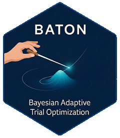
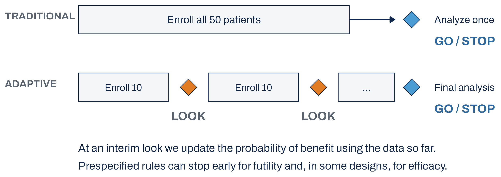
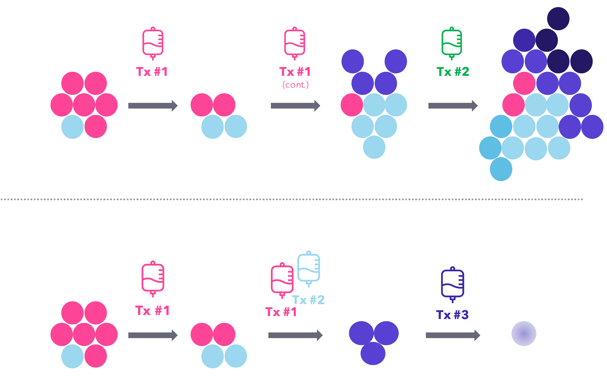
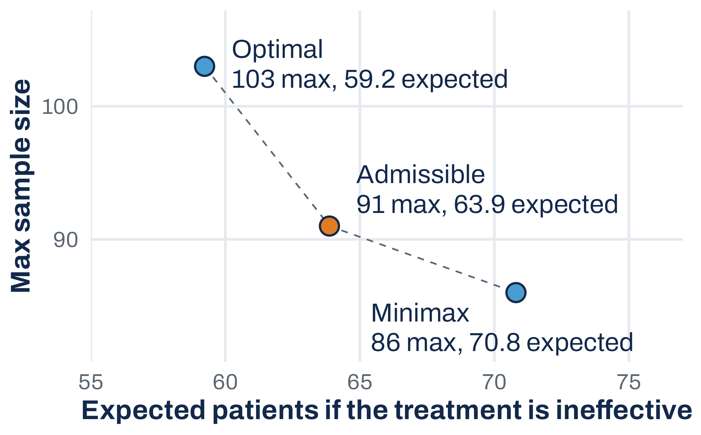
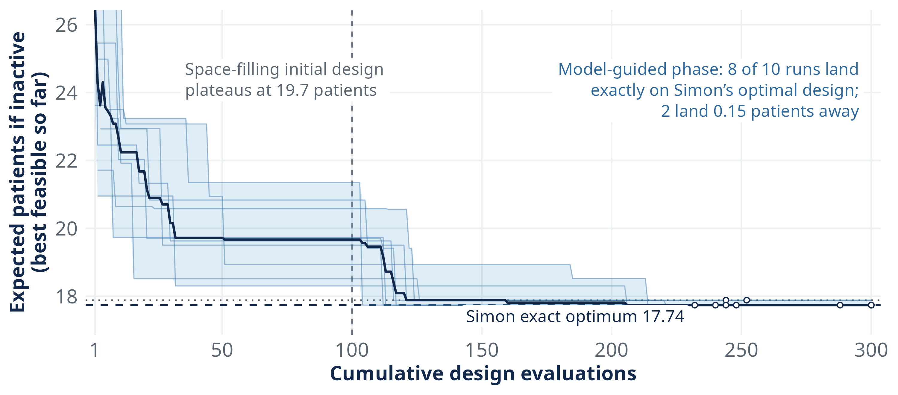
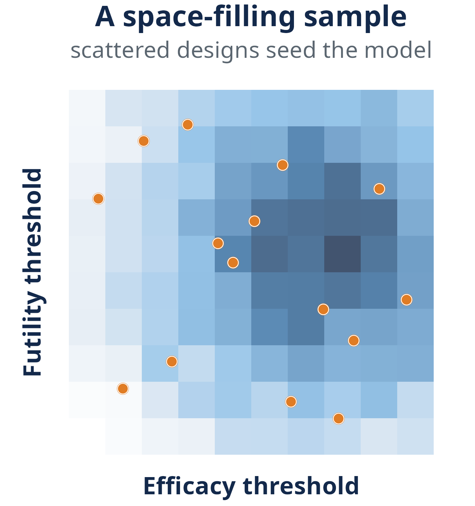
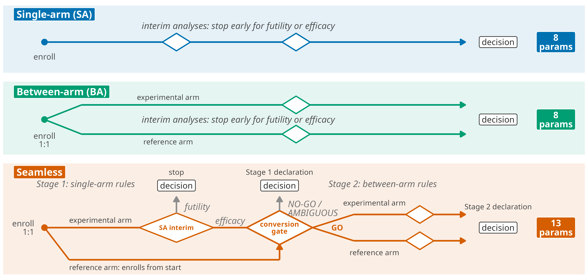

## {.title-slide-custom data-menu-title="Title" data-state="hide-footer"}

::: {style="text-align: center; margin-top: 1.2em;"}



<h1 class="ts-title">Planning under uncertainty</h1>

<p class="ts-subtitle">AI-guided design of efficient clinical trials with BATON</p>

<p class="ts-author">Naim Rashid, PhD</p>
<p class="ts-affil">Associate Professor, Department of Biostatistics, Gillings School of Global Public Health<br/>Member, Lineberger Comprehensive Cancer Center · UNC Chapel Hill</p>

<p class="ts-meta">NextGen TriBix Symposium · November 17, 2026</p>


:::

::: {.notes}
**Pull-from-if-needed:** The [FDA sotorasib review](https://www.accessdata.fda.gov/drugsatfda_docs/nda/2021/214665Orig1s000MultidisciplineR.pdf) describes the postmarketing comparison.

**Q&A pockets:** *What is AI-guided here?* A statistical model guides which candidate design to simulate next, before the trial enrolls.

**Delivery:** Open with “A cancer drug was approved at 960 mg. What would you want to know before deciding whether 240 mg was a better choice?” Pause for a moment. “I’ll come back to that drug. First, let’s look at the choices early trials have to make.”
:::

## {.section-divider data-state="hide-footer" data-background-color="#13294B" data-menu-title="Section 1: The stakes"}

::: {.divider-inner}
::: {.divider-kicker}
Section 1
:::
::: {.divider-rule}
:::
```{=html}
<div class="divider-outline">
<div class="ol-row ol-current"><span class="ol-num">1</span><span class="ol-name">The stakes</span></div>
<div class="ol-q">How much of a drug’s fate is set in its earliest trials?</div>
<div class="ol-row"><span class="ol-num">2</span><span class="ol-name">The design problem</span></div>
<div class="ol-row"><span class="ol-num">3</span><span class="ol-name">BATON</span></div>
<div class="ol-row"><span class="ol-num">4</span><span class="ol-name">BATON in practice</span></div>
<div class="ol-row"><span class="ol-num">5</span><span class="ol-name">Looking to the future</span></div>
</div>
```
:::

## Drug development usually follows three phases before approval {data-menu-title="Phases"}

```{=html}
<div style="width: 100%; text-align: left;">
<div style="position: relative; height: 300px">
<svg role="img" aria-label="Schematic band that narrows from left to right under the three phases, showing that fewer candidate drugs continue at each step, not to scale." viewBox="0 0 1152 300" preserveAspectRatio="none" style="position: absolute; left: 0; top: 0; width: 100%; height: 300px"><polygon points="0,0 1152,70 1152,230 0,300" fill="#4B9CD3" fill-opacity="0.22"></polygon></svg>
<div style="position: absolute; left: 0; top: 0; width: 100%; height: 300px; display: grid; grid-template-columns: 215fr 160fr 215fr 160fr 215fr 40fr 110fr; align-items: center">
<div style="height: 240px; box-sizing: border-box; background: #FFFFFF; border: 1px solid #13294B; padding: 18px 14px; display: flex; flex-direction: column; justify-content: center; gap: 10px; text-align: center"><div style="font-size: var(--fs-sub); font-weight: 800; color: #13294B">Phase I</div><div style="font-size: var(--fs-body); line-height: 1.35; color: #13294B">First trials in people. Is it safe, and at what dose?</div></div>
<div class="fragment" data-fragment-index="0" style="display: flex; flex-direction: column; align-items: center; gap: 4px; padding: 0 10px; text-align: center">
<div style="font-size: var(--fs-lead); font-weight: 800; color: var(--rl-accent-text); line-height: 1.05">3 to 12 months</div>
<div style="align-self: stretch; display: flex; align-items: center"><div style="width: 0; height: 0; border-top: 6px solid transparent; border-bottom: 6px solid transparent; border-right: 10px solid var(--rl-accent-text)"></div><div style="flex: 1 1 auto; height: 0; border-top: 3px dashed var(--rl-accent-text)"></div><div style="width: 0; height: 0; border-top: 6px solid transparent; border-bottom: 6px solid transparent; border-left: 10px solid var(--rl-accent-text)"></div></div>
<div style="font-size: var(--fs-label); line-height: 1.25; color: var(--rl-accent-text); font-weight: 600">typical gap in oncology</div>
</div>
<div class="fragment" data-fragment-index="0" style="height: 200px; box-sizing: border-box; background: #FFFFFF; border: 1px solid #13294B; padding: 16px 14px; display: flex; flex-direction: column; justify-content: center; gap: 10px; text-align: center"><div style="font-size: var(--fs-sub); font-weight: 800; color: #13294B">Phase II</div><div style="font-size: var(--fs-body); line-height: 1.35; color: #13294B">Is there a sign that it works?</div></div>
<div class="fragment" data-fragment-index="1" style="display: flex; flex-direction: column; align-items: center; gap: 4px; padding: 0 10px; text-align: center">
<div style="font-size: var(--fs-sub); font-weight: 800; color: var(--rl-accent-text); line-height: 1.05">17 months</div>
<div style="align-self: stretch; display: flex; align-items: center"><div style="width: 0; height: 0; border-top: 6px solid transparent; border-bottom: 6px solid transparent; border-right: 10px solid var(--rl-accent-text)"></div><div style="flex: 1 1 auto; height: 0; border-top: 3px dashed var(--rl-accent-text)"></div><div style="width: 0; height: 0; border-top: 6px solid transparent; border-bottom: 6px solid transparent; border-left: 10px solid var(--rl-accent-text)"></div></div>
<div style="font-size: var(--fs-label); line-height: 1.25; color: var(--rl-accent-text); font-weight: 600; text-wrap: balance">average gap, where a <span style="white-space: nowrap">Phase II–III</span> gap exists</div>
</div>
<div class="fragment" data-fragment-index="1" style="height: 160px; box-sizing: border-box; background: #FFFFFF; border: 1px solid #13294B; padding: 8px 12px; display: flex; flex-direction: column; justify-content: center; gap: 4px; text-align: center"><div style="font-size: var(--fs-sub); font-weight: 800; color: #13294B; line-height: 1.1">Phase III</div><div style="font-size: var(--fs-label); line-height: 1.25; color: #13294B">Often the pivotal trial. Is there convincing evidence of benefit?</div></div>
<div class="fragment" data-fragment-index="1" aria-hidden="true" style="text-align: center; font-size: var(--fs-sub); color: #2E6A9F">&rarr;</div>
<div class="fragment" data-fragment-index="1" style="box-sizing: border-box; background: #2E6A9F; color: #FFFFFF; font-size: var(--fs-body); font-weight: 700; padding: 14px 0; text-align: center">Approval</div>
</div>
</div>
<div class="source" style="margin-top: 10px; display: flex; justify-content: space-between;"><span>Fewer candidates continue. Schematic.</span><span class="fragment" data-fragment-index="1">17 months: Tufts CSDD · non-expedited approvals, 2008 to 2018 (Getz 2021)</span></div>
<div class="story-question" style="margin-top: 44px;">Phases can overlap or be combined.</div>
</div>
```

::: {.notes}
**Say aloud:** "Drug development is commonly organized into three phases before approval. Phase I is the first trials in people. They are small and ask whether the drug is safe and at what dose. Phase II asks whether there is a sign that it works. Phase III typically provides pivotal evidence, the main evidence used to judge whether a treatment works. It also adds information on safety. Approval decisions depend on the total evidence. The phases can overlap or be combined. The design question is what evidence we need before making each decision."

**Pull-from-if-needed:** The 10.5 years on slide 4 runs from the start of phase I to approval. BIO 2021 splits it as 2.3 years in phase I, 3.6 in phase II, 3.3 in phase III and 1.3 in regulatory review (VERIFIED row of tribix-opening-facts.md).

**Pull-from-if-needed (the gap):** Tufts Center for the Study of Drug Development, reported by [Getz, Applied Clinical Trials, April 2021](https://www.appliedclinicaltrialsonline.com/view/characterizing-white-space-in-the-quest-to-drive-development-speed). Among non-expedited drugs and biologics approved from 2008 to 2018, 82% had a gap between Phase II completion and the start of the pivotal Phase III trial, and that gap averaged 17 months. The other 18% overlapped. The mean was 12 months for 2008 to 2013 and 21.6 months for 2014 to 2018. These are means, no median is reported, and the source is a trade publication. The same analysis could not measure the Phase I to Phase II gap reliably, so the slide gives none.

**Q&A pockets:** *Is it always three separate phases?* [ICH E8(R1), Section 4.3](https://www.ema.europa.eu/en/documents/scientific-guideline/ich-e-8-general-considerations-clinical-trials-step-5_en.pdf) describes phases as an organizing convention and explains that they can overlap or be combined. Section 5 returns to how the final claim determines what earlier studies need to learn.

**Pull-from-if-needed (the band):** The narrowing band only says that fewer candidates continue at each step. Its widths carry no proportions. If a rate is wanted, use the BIO 2021 figure in the slide 4 notes.

**Delivery:** One beat per box. Then say “Zoom out to the full path from the first trial in people to approval.”
:::

## Developing one new therapy is slow and expensive {data-menu-title="Time and cost"}

```{=html}
<div style="display: flex; justify-content: center; gap: 1.7em; margin-top: 6.2em;">
<div style="flex: 0 0 44%; text-align: center;"><span style="font-size: 3.25em; white-space: nowrap; font-weight: 800; color: #13294B; line-height: 1;">10.5 years</span><br/><span style="display:block; margin: 0.4em auto 0 auto; font-size: var(--fs-lead); color: #5B6670;">from Phase I to approval, based on successful transitions</span></div>
<div class="fragment" style="flex: 0 0 44%; text-align: center;"><span style="font-size: 3.25em; white-space: nowrap; font-weight: 800; color: #13294B; line-height: 1;">$1.1 billion</span><br/><span style="display:block; margin: 0.4em auto 0 auto; font-size: var(--fs-lead); color: #5B6670;">median cost per approved drug, failed candidates included (2018 dollars)</span></div>
</div>
```

::: {.landing .fragment}
Each year of development is a year patients wait.
:::

[BIO, Informa, QLS Advisors 2021 · Wouters, McKee, Luyten, JAMA 2020, corrected 2022]{.muted .source style="display:block; text-align:center; margin-top: 1.2em;"}

::: {.notes}
**Sources (VERIFIED rows of tribix-opening-facts.md):** (1) Biotechnology Innovation Organization, Informa Pharma Intelligence, QLS Advisors. Clinical Development Success Rates and Contributing Factors 2011 to 2020. February 2021. https://go.bio.org/rs/490-EHZ-999/images/ClinicalDevelopmentSuccessRates2011_2020.pdf. Mean 10.5 years from phase I to approval, based on 6,151 successful phase transitions, 2011 to 2020 (2.3 years phase I, 3.6 phase II, 3.3 phase III, 1.3 regulatory). Oncology 10.3 years. Trade-association report, not peer reviewed. (2) Wouters OJ, McKee M, Luyten J. Estimated Research and Development Investment Needed to Bring a New Medicine to Market, 2009-2018. JAMA. 2020;323(9):844-853. doi:10.1001/jama.2020.1166, corrected 20 September 2022 (JAMA. 2022;328(11):1110). Median capitalized R&D investment $1141.7 million (95% CI 888.1 to 1480.8), 2018 dollars, failed trials included, 63 of 355 drugs approved 2009 to 2018 with public R&D data.

**Say aloud:** "A drug that makes it from its first trial in people to approval takes about ten and a half years on average. Each approved drug costs a median of about 1.1 billion dollars once the failures are counted."

**Pull-from-if-needed:** Use 1.14 billion if pressed, never the 985 million in the uncorrected abstract. For cancer drugs the same paper gives a median of about 2.77 billion, from a small subgroup with a wide interval. If a success rate is wanted, about 5% of oncology drugs entering phase I reach approval (5.3%, BIO 2021). These are the public concerns behind current federal attention to clinical development, time, cost, early trials moving abroad, and patients waiting. The previous slide names Operation TrialBlazer.

**Q&A pockets:** *Does BATON shorten this?* No result says so. This talk is about one part of the problem, the design of each trial, and the close says which part. *Those cost numbers are contested.* Yes. The sample skews to smaller firms and to products with public filings.

**Delivery:** Say each number with its denominator. Then say “Even after a drug has made it through the early studies, the biggest test can still be ahead.”
:::

## Many problems become apparent only in late-stage trials {data-menu-title="Late failure"}

```{=html}
<div style="display: flex; align-items: center; justify-content: center; gap: 2.4em;">

<div style="max-width: 620px; text-align: left;">
<span style="font-size: 3.6em; font-weight: 800; color: #13294B; line-height: 1;">54%</span><br/>
<span style="display: block; margin-top: 0.4em; font-size: var(--fs-sub); color: #5B6670; text-wrap: balance;">failed in late-stage development<br/>640 therapeutics that entered<br/>pivotal trials in <span style="white-space: nowrap">1998–2008</span></span>
<span style="display: block; margin-top: 0.5em; font-size: var(--fs-lead); color: #13294B; font-weight: 600; text-wrap: balance;">Most often the drug did not show enough benefit (57% of failures).</span>
<span class="source" style="display: block; margin-top: 0.5em;">Hwang et al., JAMA Internal Medicine 2016</span>
</div>
</div>
```

::: {.landing .fragment data-fragment-index="0"}
What can we do in the early trials to make a late failure less likely?
:::

[Late failures have many causes. Earlier-phase trials can also affect later-phase trials in ways that are hard to predict.]{.fragment fragment-index="0" style="display:block; max-width: 74%; margin: 1.3em auto 0 auto; padding: 0.45em 0.9em; text-align:center; font-size: var(--fs-lead); color: #13294B; font-weight: 600; border-left: 3px solid #2E6A9F; background: #F4F6F8;"}


::: {.notes}
**Pull-from-if-needed:** Hwang et al. tracked 640 therapeutics entering phase 3 or other pivotal trials from 1998 through 2008. The study reported inadequate efficacy as the reason for 57% of the failures.

**Q&A pockets:** *Is this a current rate?* It describes this historical cohort. *What do the dots represent?* Each dot represents one percentage point.

**Delivery:** Give the historical denominator and the result. Some late failures are the right conclusion. Name the other causes in one sentence (the wrong target, the wrong patients, the wrong dose, an early endpoint that did not predict the later one), then say that early trial design is the one this talk addresses. Now ask “What can we do in the early trials to make a late failure less likely?”
:::

## How best to design early trials for later success is not yet clear {data-menu-title="The open question"}

```{=html}
<div style="font-size: var(--fs-lead); line-height: 1.5">More patients at <span style="font-weight: 700; padding: 2px 10px; border: 1px solid #13294B; background: #E6F0F8">960 mg</span> cannot show how <span style="font-weight: 700; padding: 2px 10px; border: 1px solid var(--rl-accent-text); background: #FCEEE2; color: var(--rl-accent-text)">240 mg</span> compares.</div>
<div style="margin-top: 62px; display: grid; grid-template-columns: minmax(0, 1.75fr) minmax(0, 1fr); gap: 20px; height: 356px">
<div style="background: #F4F6F8; padding: 22px 26px; box-sizing: border-box; display: flex; flex-direction: column">
<div style="display: flex; align-items: baseline; gap: 12px"><span style="font-family: 'IBM Plex Mono', monospace; font-size: var(--fs-label); font-weight: 500; color: #2E6A9F">1</span><span style="font-size: var(--fs-lead); font-weight: 700">Different measures</span></div>
<div role="group" aria-label="Schematic in two rows. A small early trial reads out a short-term signal, tumor shrinkage and side effects. A large later trial reads out a long-term outcome, survival. A dashed arrow from the short-term signal to the long-term outcome asks whether one predicts the other." style="margin-top: 16px; flex: 1 1 auto; display: grid; grid-template-columns: 214px 130px minmax(0, 1fr); grid-template-rows: auto 1fr auto; column-gap: 18px; align-items: center">
<div style="display: flex; flex-direction: column; gap: 6px">
<div style="font-size: var(--fs-label); font-weight: 600">Early trial (small)</div>
<div style="width: 70px; padding: 9px; background: #FFFFFF; border: 1px solid #13294B; display: flex; flex-wrap: wrap; gap: 8px"><span style="width: 16px; height: 16px; border-radius: 50%; background: #4B9CD3"></span><span style="width: 16px; height: 16px; border-radius: 50%; background: #4B9CD3"></span><span style="width: 16px; height: 16px; border-radius: 50%; background: #4B9CD3"></span><span style="width: 16px; height: 16px; border-radius: 50%; background: #4B9CD3"></span><span style="width: 16px; height: 16px; border-radius: 50%; background: #4B9CD3"></span><span style="width: 16px; height: 16px; border-radius: 50%; background: #4B9CD3"></span></div>
</div>
<div style="display: flex; flex-direction: column; gap: 4px; align-self: end; padding-bottom: 26px"><div style="font-size: var(--fs-label); color: #5B6670; text-align: center">reads out</div><div style="display: flex; align-items: center"><div style="flex: 1 1 auto; height: 2px; background: #13294B"></div><div style="width: 0; height: 0; border-top: 6px solid transparent; border-bottom: 6px solid transparent; border-left: 10px solid #13294B"></div></div></div>
<div style="align-self: end; padding-bottom: 6px">
<div style="font-size: var(--fs-lead); font-weight: 700">A short-term signal</div>
<div style="font-size: var(--fs-label); color: #5B6670">tumor shrinkage, side effects</div>
</div>
<div></div>
<div></div>
<div style="display: flex; align-items: center; gap: 12px; align-self: stretch; padding: 6px 0">
<div style="align-self: stretch; display: flex; flex-direction: column; align-items: center; margin-left: 8px"><div style="flex: 1 1 auto; width: 0; border-left: 3px dashed var(--rl-accent-text)"></div><div style="width: 0; height: 0; border-left: 6px solid transparent; border-right: 6px solid transparent; border-top: 10px solid var(--rl-accent-text)"></div></div>
<div style="font-size: var(--fs-body); font-weight: 700; color: var(--rl-accent-text)">Does one predict the other?</div>
</div>
<div style="display: flex; flex-direction: column; gap: 6px">
<div style="font-size: var(--fs-label); font-weight: 600">Later trial (large)</div>
<div style="width: 184px; padding: 9px; background: #FFFFFF; border: 1px solid #13294B; display: flex; flex-wrap: wrap; gap: 8px"><span style="width: 16px; height: 16px; border-radius: 50%; background: #4B9CD3"></span><span style="width: 16px; height: 16px; border-radius: 50%; background: #4B9CD3"></span><span style="width: 16px; height: 16px; border-radius: 50%; background: #4B9CD3"></span><span style="width: 16px; height: 16px; border-radius: 50%; background: #4B9CD3"></span><span style="width: 16px; height: 16px; border-radius: 50%; background: #4B9CD3"></span><span style="width: 16px; height: 16px; border-radius: 50%; background: #4B9CD3"></span><span style="width: 16px; height: 16px; border-radius: 50%; background: #4B9CD3"></span><span style="width: 16px; height: 16px; border-radius: 50%; background: #4B9CD3"></span><span style="width: 16px; height: 16px; border-radius: 50%; background: #4B9CD3"></span><span style="width: 16px; height: 16px; border-radius: 50%; background: #4B9CD3"></span><span style="width: 16px; height: 16px; border-radius: 50%; background: #4B9CD3"></span><span style="width: 16px; height: 16px; border-radius: 50%; background: #4B9CD3"></span><span style="width: 16px; height: 16px; border-radius: 50%; background: #4B9CD3"></span><span style="width: 16px; height: 16px; border-radius: 50%; background: #4B9CD3"></span><span style="width: 16px; height: 16px; border-radius: 50%; background: #4B9CD3"></span><span style="width: 16px; height: 16px; border-radius: 50%; background: #4B9CD3"></span><span style="width: 16px; height: 16px; border-radius: 50%; background: #4B9CD3"></span><span style="width: 16px; height: 16px; border-radius: 50%; background: #4B9CD3"></span><span style="width: 16px; height: 16px; border-radius: 50%; background: #4B9CD3"></span><span style="width: 16px; height: 16px; border-radius: 50%; background: #4B9CD3"></span><span style="width: 16px; height: 16px; border-radius: 50%; background: #4B9CD3"></span><span style="width: 16px; height: 16px; border-radius: 50%; background: #4B9CD3"></span><span style="width: 16px; height: 16px; border-radius: 50%; background: #4B9CD3"></span><span style="width: 16px; height: 16px; border-radius: 50%; background: #4B9CD3"></span></div>
</div>
<div style="display: flex; flex-direction: column; gap: 4px; align-self: end; padding-bottom: 36px"><div style="font-size: var(--fs-label); color: #5B6670; text-align: center">reads out</div><div style="display: flex; align-items: center"><div style="flex: 1 1 auto; height: 2px; background: #13294B"></div><div style="width: 0; height: 0; border-top: 6px solid transparent; border-bottom: 6px solid transparent; border-left: 10px solid #13294B"></div></div></div>
<div style="align-self: end; padding-bottom: 16px">
<div style="font-size: var(--fs-lead); font-weight: 700">A long-term outcome</div>
<div style="font-size: var(--fs-label); color: #5B6670">survival</div>
</div>
</div>
</div>
<div style="display: grid; grid-template-rows: minmax(0, 1fr) minmax(0, 1fr); gap: 20px">
<div class="fragment" data-fragment-index="0" style="background: #F4F6F8; padding: 22px 26px; box-sizing: border-box; display: flex; flex-direction: column; justify-content: center; gap: 8px">
<div style="display: flex; align-items: baseline; gap: 12px"><span style="font-family: 'IBM Plex Mono', monospace; font-size: var(--fs-label); font-weight: 500; color: #2E6A9F">2</span><span style="font-size: var(--fs-lead); font-weight: 700">Separate designs</span></div>
<div style="font-size: var(--fs-body); line-height: 1.35; padding-left: 23px">Each phase has its own targets.</div>
</div>
<div class="fragment" data-fragment-index="0" style="background: #F4F6F8; padding: 22px 26px; box-sizing: border-box; display: flex; flex-direction: column; justify-content: center; gap: 8px">
<div style="display: flex; align-items: baseline; gap: 12px"><span style="font-family: 'IBM Plex Mono', monospace; font-size: var(--fs-label); font-weight: 500; color: #2E6A9F">3</span><span style="font-size: var(--fs-lead); font-weight: 700">Too many combinations</span></div>
<div style="font-size: var(--fs-body); line-height: 1.35; padding-left: 23px">How many patients in each phase, and what result moves a treatment forward.</div>
</div>
</div>
</div>
```


::: {.landing .fragment data-fragment-index="1"}
More patients later may not answer what the early trial never asked.
:::
::: {.notes}
**Say aloud (the open question, PI 2026-11-14):** "So why not just design early trials with the later ones in mind? Because it is not yet clear how best to do it. Early trials are small and read out short-term signals, tumor shrinkage and side effects, while later trials are judged on long-term outcomes such as survival, so the link from an early signal to late success is uncertain. Each phase is designed on its own, to its own targets, often by different teams. And the number of ways to divide patients and decisions across phases is too large for a formula. We come back to this at the end."

**Pull-from-if-needed:** The schematic replaces the first box's sentence, "Early signals are short-term. Later trials are judged on longer-term outcomes." The trial sizes in it are not to scale. Sotorasib on the previous slide is one example of the first reason. The dose came from phase I, which reads short-term signals, and the later question was about longer-term benefit.

**Q&A pockets:** *Has anyone solved this?* Say that it is an open problem and that this talk does not claim a solution. No numbers here.

**Delivery:** Start with the question from the previous slide. More patients at 960 mg can improve our estimate for that dose. To learn how it compares with 240 mg, we may need to reopen the comparison. Say that more patients later cannot answer a question the early trial never asked, then say “If we want earlier trials to answer better questions, we need a way to test how their rules will behave before enrolling anyone.” Then say “Here is one real case.”
:::

## Early decisions become downstream commitments {data-menu-title="Sotorasib"}

```{=html}
<div style="font-size: var(--fs-body); font-weight: 600; color: #5B6670">Sotorasib · KRAS G12C lung cancer</div>
<div style="margin-top: 18px; display: flex; align-items: stretch; gap: 14px">
<div style="flex: 1 1 0; background: #F4F6F8; padding: 14px 18px; display: flex; flex-direction: column; gap: 6px">
<div style="font-size: var(--fs-body); font-weight: 700">Phase I</div>
<div style="display: flex; align-items: baseline; gap: 10px"><span style="font-size: var(--fs-body); font-weight: 700; padding: 2px 10px; border: 1px solid #13294B; background: #E6F0F8">960 mg</span><span style="font-size: var(--fs-label); color: #5B6670">Highest tested</span></div>
</div>
<div aria-hidden="true" style="align-self: center; font-size: var(--fs-sub); color: #2E6A9F">&rarr;</div>
<div style="flex: 1 1 0; background: #F4F6F8; padding: 14px 18px; display: flex; flex-direction: column; gap: 6px">
<div style="font-size: var(--fs-body); font-weight: 700">Accelerated approval</div>
<div style="display: flex; align-items: baseline; gap: 10px"><span style="font-size: var(--fs-body); font-weight: 700; padding: 2px 10px; border: 1px solid #13294B; background: #E6F0F8">960 mg</span></div>
</div>
<div class="fragment" data-fragment-index="0" aria-hidden="true" style="align-self: center; font-size: var(--fs-sub); color: #2E6A9F">&rarr;</div>
<div class="fragment" data-fragment-index="0" style="flex: 1.25 1 0; background: #FFFFFF; border: 1px solid #2E6A9F; padding: 14px 18px; display: flex; flex-direction: column; gap: 6px">
<div style="font-size: var(--fs-body); font-weight: 700">Postapproval comparison</div>
<div style="display: flex; align-items: baseline; gap: 10px"><span style="font-size: var(--fs-body); font-weight: 700; padding: 2px 10px; border: 1px solid #13294B; background: #E6F0F8">960 mg</span><span style="font-size: var(--fs-label)">vs</span><span style="font-size: var(--fs-body); font-weight: 700; padding: 2px 10px; border: 1px solid var(--rl-accent-text); background: #FCEEE2; color: var(--rl-accent-text)">240 mg</span><span style="font-size: var(--fs-label); color: #5B6670">FDA-required</span></div>
</div>
</div>
```

```{=html}
<div class="fragment" data-fragment-index="1">
<table aria-label="Results of the randomized phase II sotorasib dose comparison" style="margin-top: 28px; width: 100%; border-collapse: collapse; font-variant-numeric: tabular-nums; border: none">
<thead>
<tr>
<th scope="col" style="text-transform: none !important; font-family: inherit !important; letter-spacing: normal !important; text-align: left; padding: 0 0 10px 0; font-size: var(--fs-label); font-weight: 600; color: #5B6670; border-bottom: 2px solid #13294B">Phase II results</th>
<th scope="col" style="text-transform: none !important; font-family: inherit !important; letter-spacing: normal !important; width: 230px; text-align: right; padding: 0 24px 10px 0; font-size: var(--fs-body); font-weight: 700; color: #13294B; border-bottom: 2px solid #13294B">960 mg</th>
<th scope="col" style="text-transform: none !important; font-family: inherit !important; letter-spacing: normal !important; width: 230px; text-align: right; padding: 0 24px 10px 0; font-size: var(--fs-body); font-weight: 700; color: var(--rl-accent-text); border-bottom: 2px solid #13294B">240 mg</th>
</tr>
</thead>
<tbody>
      <tr>
      <th scope="row" style="text-transform: none !important; font-family: inherit !important; letter-spacing: normal !important; text-align: left; padding: 12px 0; font-size: var(--fs-lead); font-weight: 500; border-bottom: 1px solid #C9D1D9">Progression-free survival</th>
      <td style="text-align: right; padding: 12px 24px 12px 0; font-size: var(--fs-sub); font-weight: 700; border-bottom: 1px solid #C9D1D9">5.4 <span style="font-size: var(--fs-body); font-weight: 500">months</span></td>
      <td style="text-align: right; padding: 12px 24px 12px 0; font-size: var(--fs-sub); font-weight: 700; color: var(--rl-accent-text); border-bottom: 1px solid #C9D1D9">5.6 <span style="font-size: var(--fs-body); font-weight: 500">months</span></td>
      </tr>
      <tr>
      <th scope="row" style="text-transform: none !important; font-family: inherit !important; letter-spacing: normal !important; text-align: left; padding: 12px 0; font-size: var(--fs-lead); font-weight: 500; border-bottom: 1px solid #C9D1D9">Severe side effects (grade 3+)</th>
      <td style="text-align: right; padding: 12px 24px 12px 0; font-size: var(--fs-sub); font-weight: 700; border-bottom: 1px solid #C9D1D9">35.6%</td>
      <td style="text-align: right; padding: 12px 24px 12px 0; font-size: var(--fs-sub); font-weight: 700; color: var(--rl-accent-text); border-bottom: 1px solid #C9D1D9">19.2%</td>
      </tr>
      <tr>
      <th scope="row" style="text-transform: none !important; font-family: inherit !important; letter-spacing: normal !important; text-align: left; padding: 12px 0; font-size: var(--fs-lead); font-weight: 500; border-bottom: 1px solid #C9D1D9">Tumor response</th>
      <td style="text-align: right; padding: 12px 24px 12px 0; font-size: var(--fs-sub); font-weight: 700; border-bottom: 1px solid #C9D1D9">32.7%</td>
      <td style="text-align: right; padding: 12px 24px 12px 0; font-size: var(--fs-sub); font-weight: 700; color: var(--rl-accent-text); border-bottom: 1px solid #C9D1D9">24.8%</td>
      </tr>
</tbody>
</table>
<div class="source" style="margin-top: 8px; display: flex; justify-content: space-between;"><span>Descriptive comparison</span><span><a href="https://pubmed.ncbi.nlm.nih.gov/39029295/">Trial</a> · <a href="https://www.fda.gov/media/172698/download" title="FDA advisory committee briefing, Table 29">FDA</a></span></div>
</div>
<div class="fragment inset" data-fragment-index="2" style="margin: 0.7em auto 0 auto; text-align: center; color: #13294B; font-size: var(--fs-lead); font-weight: 600; line-height: 1.35;">The highest dose patients tolerate, or the lowest dose with full benefit?</div>
```

::: {.notes}
**Pull-from-if-needed:** The [FDA review](https://www.accessdata.fda.gov/drugsatfda_docs/nda/2021/214665Orig1s000MultidisciplineR.pdf) and [FDA authors’ retrospective](https://ascopubs.org/doi/10.1200/JCO.24.00310) describe the accelerated approval and dose comparison. The [randomized study](https://pubmed.ncbi.nlm.nih.gov/39029295/) reports the progression-free survival and tumor response estimates. The [ODAC briefing, Table 29](https://www.fda.gov/media/172698/download) reports grade 3 or higher treatment-related adverse events (37 of 104 at 960 mg and 20 of 104 at 240 mg). The Phase II comparison was descriptive and was not powered for formal hypothesis testing. [Collins et al.](https://pubmed.ncbi.nlm.nih.gov/38085161/) counted a broad range of postmarketing requirements for additional dosing information, including interactions, dosing in specific groups, and dose comparisons.

**Pull-from-if-needed (the two dose targets):** The maximum tolerated dose is the highest dose with acceptable side effects, the usual target of a traditional Phase I escalation. The optimal biological dose is the lowest dose that gives the full benefit. Sotorasib’s 960 mg was the highest of four doses tested (180, 360, 720 and 960 mg). The Phase I report recorded no dose-limiting toxic effects, so do not call 960 mg the maximum tolerated dose ([Hong et al., NEJM 2020](https://doi.org/10.1056/NEJMoa1917239)). FDA’s [Project Optimus](https://www.fda.gov/about-fda/oncology-center-excellence/project-optimus) is the public statement of the concern. The link to Phase III is a rationale and not a measured effect. Too high a dose brings side effects, dose reductions and patients stopping treatment, which may blunt the benefit a pivotal trial sees. No study I know of shows that choosing the optimal biological dose raises Phase III success.

**Q&A pockets:** *Did the comparison lead FDA to change the dose?* The FDA authors report that the totality of the evidence did not lead to a dose change.

**Delivery:** Name sotorasib as the drug from the opening. Show the Phase I dose and the accelerated approval, which lets FDA approve earlier based on an outcome expected to predict clinical benefit. Ask “What evidence would you want before carrying that dose into a larger trial?” Give the room a moment, then reveal the comparison requirement. Patients would be assigned to the two doses by chance. On the next click, show the study results. On the last click, name the two dose targets and say that the dose a program carries forward may affect what Phase III can show. Define progression-free survival as the time until the cancer worsens or the patient dies. The observed medians were close. The lower dose had fewer severe treatment-related adverse events, and the higher dose had a numerically higher tumor response rate. The study did not establish equivalence. Land on the timing: the balance between activity and side effects was still an open question at approval. Close with “What would we learn about 240 mg by enrolling more patients at 960 mg?” If time permits, state that 78 of 132 novel oncology drugs approved from 2012 to 2022 had a postmarketing requirement to collect additional dosing information.
:::

## Better early trials are possible. Designing them is the hard part. {data-menu-title="The turn"}

```{=html}
<div style="text-align: center; color: #5B6670; font-size: var(--fs-lead);">So far</div>
<div class="inset" style="display: grid; grid-template-columns: repeat(3, minmax(0, 1fr)); gap: 0.8em; margin: 0.4em auto 0 auto;">
  <div style="border: 1px solid #C9D1D9; background: #F4F6F8; padding: 0.7em 0.8em; text-align: center;"><div style="font-size: 1.9em; font-weight: 800; color: #13294B; line-height: 1.1;">10.5 years</div><div style="font-size: var(--fs-body); color: #5B6670; margin-top: 0.35em; line-height: 1.3;">from Phase I to approval</div></div>
  <div style="border: 1px solid #C9D1D9; background: #F4F6F8; padding: 0.7em 0.8em; text-align: center;"><div style="font-size: 1.9em; font-weight: 800; color: #13294B; line-height: 1.1;">54%</div><div style="font-size: var(--fs-body); color: #5B6670; margin-top: 0.35em; line-height: 1.3;">of late-stage candidates failed</div></div>
  <div style="border: 1px solid #C9D1D9; background: #F4F6F8; padding: 0.7em 0.8em; text-align: center;"><div style="font-size: 1.9em; font-weight: 800; color: #13294B; line-height: 1.1;">960 mg</div><div style="font-size: var(--fs-body); color: #5B6670; margin-top: 0.35em; line-height: 1.3;">chosen early, compared with 240 mg only after approval</div></div>
</div>
<div class="fragment" data-fragment-index="0" style="text-align: center; color: #5B6670; font-size: var(--fs-sub); font-weight: 500; margin-top: 1.3em;">Each phase can use a more efficient design, one that adapts as the data arrive.</div>
```

::: {.thesis-line .fragment data-fragment-index="1" style="margin-top: 0.9em;"}
The hard part is finding a design that is efficient and still meets the evidence requirements. That search is our focus today. We return to the dose question at the end.
:::

::: {.notes}
**Delivery (section close):** Recap the three numbers in one breath. Development takes about ten and a half years, more than half of late-stage candidates failed, and sotorasib’s dose was chosen early and compared only after approval. Then turn. **Say aloud first:** “We can change how a trial is designed. Each change gives us more choices about when to look, what to measure, and what evidence is enough to act.”

**Say once, here:** "When I say efficient, I mean efficient in patients, not faster computation."

**Say aloud (the plain glosses):** "Adaptive designs can stop a trial early when the drug is not working, so fewer patients receive it. Platform designs test several drugs or subgroups under one protocol. Seamless designs move from screening to confirmation without starting a new trial. Each can improve how a team uses patients or time, depending on the rules and the setting." The slide no longer lists these three designs, so name them aloud here. Say “Suppose we want to stop early when a treatment looks unpromising. When should we look, and how much evidence would be enough to stop? Each choice changes how the trial behaves. We can simulate one set of rules. Then we have to decide which set to try next.”

**Pull-from-if-needed:** Adaptive, platform and seamless designs are not new. The [2019 FDA adaptive-design guidance](https://www.fda.gov/regulatory-information/search-fda-guidance-documents/adaptive-design-clinical-trials-drugs-and-biologics-guidance-industry) describes how sponsors can use simulations to evaluate complex adaptive designs, including their statistical operating characteristics. The bottleneck is the calibration work, which is what the rest of the talk is about.

**Q&A pockets:** *If they are better, why are they not used everywhere?* Design time and the expertise needed to calibrate them are part of the answer. Do not claim they are the only reason.

**Delivery:** Pause on the search question, then say “Let’s start with one Phase II decision. Has the treatment shown enough promise to continue?”
:::

## {.section-divider data-state="hide-footer" data-background-color="#13294B" data-menu-title="Section 2: The design problem"}

::: {.divider-inner}
::: {.divider-kicker}
Section 2
:::
::: {.divider-rule}
:::
```{=html}
<div class="divider-outline">
<div class="ol-row"><span class="ol-num">1</span><span class="ol-name">The stakes</span></div>
<div class="ol-row ol-current"><span class="ol-num">2</span><span class="ol-name">The design problem</span></div>
<div class="ol-q">Start with one Phase II decision. Is there enough evidence to continue?</div>
<div class="ol-row"><span class="ol-num">3</span><span class="ol-name">BATON</span></div>
<div class="ol-row"><span class="ol-num">4</span><span class="ol-name">BATON in practice</span></div>
<div class="ol-row"><span class="ol-num">5</span><span class="ol-name">Looking to the future</span></div>
</div>
```
:::

## A clinical trial is an experiment built for a decision {data-menu-title="What a trial is"}

```{=html}
<div style="width: 100%; display: grid; grid-template-columns: repeat(3, minmax(0, 1fr)); gap: 22px">
<div style="background: #F4F6F8; padding: 20px 20px 22px 20px; display: flex; flex-direction: column; gap: 12px; text-align: left">
<div style="font-size: var(--fs-lead); font-weight: 700; color: #13294B">The question</div>
<svg viewBox="0 0 330 170" role="img" aria-label="Two bars. A grey bar marks the benchmark. A taller blue bar for the treatment has a question mark over its top." style="width: 100%; height: 170px; display: block; background: #FFFFFF; font-family: inherit">
<line x1="40" y1="132" x2="290" y2="132" stroke="#13294B" stroke-width="2"></line>
<rect x="76" y="72" width="70" height="60" fill="#C9D1D9"></rect>
<rect x="186" y="40" width="70" height="92" fill="#4B9CD3"></rect>
<line x1="58" y1="72" x2="274" y2="72" stroke="#5B6670" stroke-width="2" stroke-dasharray="6 5"></line>
<text x="221" y="30" text-anchor="middle" font-size="28" font-weight="800" fill="#13294B">?</text>
<text x="111" y="156" text-anchor="middle" font-size="18" fill="#5B6670">Benchmark</text>
<text x="221" y="156" text-anchor="middle" font-size="18" font-weight="700" fill="#13294B">Treatment</text>
</svg>
<div style="font-size: var(--fs-body); line-height: 1.35; color: #1A202C">Does the treatment beat a benchmark or a control?</div>
</div>
<div class="fragment" data-fragment-index="0" style="background: #F4F6F8; padding: 20px 20px 22px 20px; display: flex; flex-direction: column; gap: 12px; text-align: left">
<div style="font-size: var(--fs-lead); font-weight: 700; color: #13294B">How patients are used</div>
<svg viewBox="0 0 330 170" role="img" aria-label="Two rows of six patients. In the single-arm row all six get the treatment. In the randomized row three get the treatment and three get the control." style="width: 100%; height: 170px; display: block; background: #FFFFFF; font-family: inherit">
<text x="10" y="46" font-size="18" font-weight="700" fill="#13294B">Single-arm</text>
<g fill="#4B9CD3"><circle cx="144" cy="40" r="11"></circle><circle cx="174" cy="40" r="11"></circle><circle cx="204" cy="40" r="11"></circle><circle cx="234" cy="40" r="11"></circle><circle cx="264" cy="40" r="11"></circle><circle cx="294" cy="40" r="11"></circle></g>
<text x="219" y="72" text-anchor="middle" font-size="18" fill="#5B6670">all get the treatment</text>
<text x="10" y="122" font-size="18" font-weight="700" fill="#13294B">Randomized</text>
<g fill="#4B9CD3"><circle cx="144" cy="116" r="11"></circle><circle cx="174" cy="116" r="11"></circle><circle cx="204" cy="116" r="11"></circle></g>
<g fill="#B7BDC5"><circle cx="234" cy="116" r="11"></circle><circle cx="264" cy="116" r="11"></circle><circle cx="294" cy="116" r="11"></circle></g>
<text x="174" y="148" text-anchor="middle" font-size="18" fill="#2E6A9F">treatment</text>
<text x="264" y="148" text-anchor="middle" font-size="18" fill="#5B6670">control</text>
</svg>
<div style="font-size: var(--fs-body); line-height: 1.35; color: #1A202C">Everyone gets the treatment, or patients are assigned to treatment or control.</div>
</div>
<div class="fragment" data-fragment-index="1" style="background: #F4F6F8; padding: 20px 20px 22px 20px; display: flex; flex-direction: column; gap: 12px; text-align: left">
<div style="font-size: var(--fs-lead); font-weight: 700; color: #13294B">Two errors</div>
<div role="group" aria-label="Two wrong calls. A treatment that does not work gets a go decision. A treatment that works gets a stop decision." style="height: 170px; box-sizing: border-box; background: #FFFFFF; padding: 0 18px; display: grid; grid-template-columns: minmax(0, 1fr) 60px 96px; grid-template-rows: repeat(2, minmax(0, 1fr)); align-items: center">
<div style="font-size: var(--fs-label); font-weight: 600; color: #13294B">Does not work</div>
<div aria-hidden="true" style="display: flex; align-items: center; padding: 0 8px"><div style="flex: 1 1 auto; height: 2px; background: #13294B"></div><div style="width: 0; height: 0; border-top: 6px solid transparent; border-bottom: 6px solid transparent; border-left: 10px solid #13294B"></div></div>
<div style="height: 44px; box-sizing: border-box; display: flex; align-items: center; justify-content: center; background: #FCEEE2; border: 1px solid var(--rl-accent-text); color: var(--rl-accent-text); font-size: var(--fs-body); font-weight: 800">GO</div>
<div style="font-size: var(--fs-label); font-weight: 600; color: #13294B">Works</div>
<div aria-hidden="true" style="display: flex; align-items: center; padding: 0 8px"><div style="flex: 1 1 auto; height: 2px; background: #13294B"></div><div style="width: 0; height: 0; border-top: 6px solid transparent; border-bottom: 6px solid transparent; border-left: 10px solid #13294B"></div></div>
<div style="height: 44px; box-sizing: border-box; display: flex; align-items: center; justify-content: center; background: #FCEEE2; border: 1px solid var(--rl-accent-text); color: var(--rl-accent-text); font-size: var(--fs-body); font-weight: 800">STOP</div>
</div>
<div style="font-size: var(--fs-body); line-height: 1.35; color: #1A202C">Advance a treatment that fails, or drop one that works.</div>
</div>
</div>
```

::: {.landing .fragment}
Two choices dominate: how many patients, and what evidence is enough to take the treatment to the next phase.
:::

::: {.notes}
**Say aloud (moved off the slide for the 60-word max sample size):** "Traditional development is organized in phases: choose a dose, look for a signal, then confirm it. Each phase is a trial with its own rule for go or stop." Then the caption: for the calibration problems in this talk, two choices dominate.

**Glosses at first use:** benchmark (the response rate the treatment has to beat, fixed before the trial), single-arm (everyone gets the study treatment; we compare with a prespecified benchmark), randomized (patients are assigned to treatment or control), objective (the quantity we try to make small, here patients). PFS, when it comes up: "time until the cancer worsens or the patient dies."

**Delivery:** Start with “Most of the BATON examples today are Phase II screening designs. The decision is whether the treatment has shown enough promise to study further. We’ll follow one EVOLVE breast cancer cohort.” Lead with the two decisions at the bottom. Carry over the example from slide 8. “If we wanted to stop early, how many patients would we enroll before deciding, and what would count as enough evidence to continue?”
:::

## An adaptive trial can act on an interim result {data-menu-title="Fixed versus adaptive"}



::: {.landing .fragment}
When to look and how much evidence is enough are two choices we must tune. Both change how well the trial performs.
:::

::: {.notes}
**Split from the merged slide (CompMed 5, now on its own again).** Order: the figure, then the closing line, which is the CompMed 5 title.

**Say aloud (the patient contrast, PI request 2026-11-14):** "In a traditional fixed trial, every planned patient is enrolled and the results are looked at once, at the end. If the treatment is not working, every one of those patients still receives it, and we learn that only at the end. An adaptive trial looks at the accumulating results at planned points, called interim looks, and can stop early for futility, meaning the treatment looks unlikely to work. Then fewer patients receive a treatment that is not working, the answer can come sooner, and patients and resources are free for the next option."

**Say aloud (the qualifier, required):** "Fixed designs are simpler and well understood. The adaptive benefit holds only if the rules are well chosen, and choosing them well is what the rest of this talk is about."

**Say aloud on the closing line:** "The design is Bayesian because those decisions rest on posterior probabilities under a model and a prior." Then, as the bridge to the next slide: "Maximum N, look timing, futility and efficacy thresholds, priors, margins. Every one is a setting, and every one changes how the trial behaves."

**Pull-from-if-needed:** Where the benefit is counted. Expected patients enrolled when the treatment is inactive, on the EVOLVE objective slides (slides 26 and 27), is this slide's benefit as a number. The 50 and 10 patients in the figure are schematic, not a real design. The precise contrast, per the paper: unlike classical group-sequential designs (Jennison and Turnbull), complex Bayesian adaptive trials generally lack closed-form operating characteristics (Berry 2010; Thall and Simon 1994). The flexibility comes from posterior-probability monitoring, and the cost is that neither formulas nor enumeration reach the behavior.

**Q&A pocket:** *Are adaptive designs always better?* No. They help only when the stopping rules are well chosen, which is the design problem this talk is about.

**Delivery:** 85 seconds. Figure first, top row then bottom row. Say that this example has one treatment group and that a look is a planned review of efficacy data. Futility means there is too little evidence of benefit to justify continuing under the rule.
:::

## A good design has to meet four requirements at once {data-menu-title="Feasibility"}

```{=html}
<div style="width: 100%; text-align: left;">
<div style="font-size: var(--fs-lead); font-weight: 700; letter-spacing: 0.04em; text-transform: uppercase; color: #13294B">Must meet</div>
<div style="margin-top: 10px; display: grid; grid-template-columns: repeat(2, minmax(0, 1fr)); gap: 22px">
<div style="background: #FCEEE2; height: 196px; box-sizing: border-box; padding: 0 26px; display: grid; grid-template-columns: 44px minmax(0, 1fr) auto; align-items: center; column-gap: 16px; text-align: left">
<div style="font-size: 56px; font-weight: 800; color: var(--rl-accent-text); line-height: 1">1</div>
<div><div style="font-size: var(--fs-sub); font-weight: 700; line-height: 1.2; color: #13294B">Rarely advance a treatment that fails</div><div style="font-size: var(--fs-body); color: var(--rl-accent-text); font-weight: 600; margin-top: 6px">Type I error at most</div></div>
<div style="font-size: 80px; font-weight: 800; color: var(--rl-accent-text); line-height: 1">10%</div>
</div>
<div style="background: #E6F0F8; height: 196px; box-sizing: border-box; padding: 0 26px; display: grid; grid-template-columns: 44px minmax(0, 1fr) auto; align-items: center; column-gap: 16px; text-align: left">
<div style="font-size: 56px; font-weight: 800; color: #2E6A9F; line-height: 1">2</div>
<div><div style="font-size: var(--fs-sub); font-weight: 700; line-height: 1.2; color: #13294B">Usually advance one that works</div><div style="font-size: var(--fs-body); color: #2E6A9F; font-weight: 600; margin-top: 6px">Power at least</div></div>
<div style="font-size: 80px; font-weight: 800; color: #2E6A9F; line-height: 1">80%</div>
</div>
</div>
<div class="fragment" data-fragment-index="0" style="margin-top: 40px; font-size: var(--fs-lead); font-weight: 700; letter-spacing: 0.04em; text-transform: uppercase; color: #5B6670">Then improve</div>
<div style="margin-top: 10px; display: grid; grid-template-columns: repeat(2, minmax(0, 1fr)); gap: 22px">
<div class="fragment" data-fragment-index="0" style="background: #FFFFFF; border: 1px solid #8A949E; height: 124px; box-sizing: border-box; padding: 0 26px; display: grid; grid-template-columns: 44px minmax(0, 1fr); align-items: center; column-gap: 16px; text-align: left">
<div style="font-size: 48px; font-weight: 800; color: #5B6670; line-height: 1">3</div>
<div style="font-size: var(--fs-sub); font-weight: 700; color: #13294B">Keep the sample size small</div>
</div>
<div class="fragment" data-fragment-index="0" style="background: #FFFFFF; border: 1px solid #8A949E; height: 124px; box-sizing: border-box; padding: 0 26px; display: grid; grid-template-columns: 44px minmax(0, 1fr); align-items: center; column-gap: 16px; text-align: left">
<div style="font-size: 48px; font-weight: 800; color: #5B6670; line-height: 1">4</div>
<div style="font-size: var(--fs-sub); font-weight: 700; color: #13294B">Stop early if it fails</div>
</div>
</div>
</div>
```

::: {.landing .fragment data-fragment-index="1"}
Calibration tunes the design until it meets 1 and 2. Among designs that do, we then improve 3 and 4.
:::

::: {.notes}
**Delivery:** These are the four requirements from the Lineberger symposium talk, reworded. The first two are fixed targets and every usable design has to meet them, which is what feasible means in the rest of the talk. The last two are what we try to improve among the feasible designs. Do not name EVOLVE yet, it is introduced two slides on.

**Split from the merged slide (CompMed 6 title and boxes, with the CompMed 5 count of choices).** The slide connects the two go rates to the EVOLVE screening example on the next slide.

**Say aloud:** Both conditions are required. A Phase II design in this EVOLVE example is feasible only if its power is at least 80% and its type I error is at most 10%. Say that the null scenario uses the benchmark response rate. The alternative scenario uses the prespecified response rate that would make the treatment worth pursuing. Type I error is the chance of a go under the null. Power is the chance of a go at that alternative. Then read the caption. Calibration means tuning the rules to meet both targets. These are planning targets for the EVOLVE screening example.

**Say aloud (the CompMed 6 table, not shown):** "A typical trial needs one design with a few parameters, and power and type I error often come from a formula. A platform needs many subtrial designs with many interacting parameters, and power and type I error come only from simulation. And we had to design repeatedly, on a clock."

**Q&A pocket:** *Bayesian rule, frequentist error rates?* The monitoring rule is Bayesian (posterior probabilities drive stopping). The FDA describes how simulation can demonstrate the error rates of a complex adaptive design. Calibration is the work of tuning the rule to meet the targets.

**Q&A pocket:** *Why 0.10 here?* These are screening subtrials. The targets are specific to this example and depend on the trial’s purpose.

**Delivery:** 60 seconds. Do not read the boxes, define the two terms in one breath.
:::

## Simulation tests one design in two scenarios {data-menu-title="Count them"}

[Complex designs usually have no straightforward formula for power or type I error, so we use simulation.]{.muted style="display:block; text-align:center; font-size:var(--fs-body); margin-top: 2px;"}

```{=html}
<div role="group" aria-label="Three steps. Fix the design. Assume the truth. Simulate many trials and count." style="display: grid; grid-template-columns: minmax(0, 1fr) auto minmax(0, 1fr) auto minmax(0, 1fr); column-gap: 12px; margin: 12px 0 14px 0">
<div style="background: #F4F6F8; padding: 10px 16px; text-align: left"><div style="font-size: var(--fs-body); font-weight: 700; color: #13294B"><span style="color: #2E6A9F; margin-right: 8px">1</span>Fix the design</div><div style="font-size: var(--fs-label); color: #5B6670; line-height: 1.3; margin-top: 2px">its settings and decision rules</div></div><div aria-hidden="true" style="align-self: center; font-size: var(--fs-lead); color: #2E6A9F">&rarr;</div><div style="background: #F4F6F8; padding: 10px 16px; text-align: left"><div style="font-size: var(--fs-body); font-weight: 700; color: #13294B"><span style="color: #2E6A9F; margin-right: 8px">2</span>Assume the truth</div><div style="font-size: var(--fs-label); color: #5B6670; line-height: 1.3; margin-top: 2px">treatment effect, enrollment, outcomes</div></div><div aria-hidden="true" style="align-self: center; font-size: var(--fs-lead); color: #2E6A9F">&rarr;</div><div style="background: #F4F6F8; padding: 10px 16px; text-align: left"><div style="font-size: var(--fs-body); font-weight: 700; color: #13294B"><span style="color: #2E6A9F; margin-right: 8px">3</span>Simulate many trials</div><div style="font-size: var(--fs-label); color: #5B6670; line-height: 1.3; margin-top: 2px">count how often the rules say go</div></div>
</div>
```

```{=html}
<div style="width: 100%;">
<div role="img" aria-label="Two bars, each showing the share of 50,000 simulated trials that reach a go decision. Illustrative numbers. If the treatment is ineffective, 2,100 trials say go, a type I error of 4.2 percent, under the dashed target line at 10 percent. If the treatment is effective, 41,000 trials say go, a power of 82 percent, just past the dashed target line at 80 percent." style="margin-top: 48px; display: flex; flex-direction: column; gap: 56px">
<div style="display: grid; grid-template-columns: 180px minmax(0, 1fr) 330px; column-gap: 24px; align-items: end">
<div style="text-align: right; color: var(--rl-accent-text); font-weight: 700; font-size: var(--fs-lead); line-height: 1.2; padding-bottom: 8px">Ineffective<br>(null)</div>
<div>
<div style="position: relative; height: 28px; font-size: var(--fs-label); color: #13294B; text-align: left"><span style="position: absolute; left: 10%; margin-left: 8px; white-space: nowrap; bottom: 6px">target: at most 10%</span></div>
<div style="position: relative; height: 68px; background: #E6EAEF">
<div style="position: absolute; left: 0; top: 0; bottom: 0; width: 4.2%; background: var(--rl-accent-text)"></div>
<div style="position: absolute; left: 10%; top: -28px; bottom: -8px; border-left: 3px dashed #13294B"></div>
</div>
</div>
<div style="color: var(--rl-accent-text); line-height: 1.05; text-align: left"><div style="display: flex; align-items: baseline; gap: 12px"><span style="font-size: 60px; font-weight: 800">4.2%</span><span style="font-size: var(--fs-body); font-weight: 700">type I error</span></div><div style="font-size: var(--fs-label); color: #5B6670; margin-top: 4px">2,100 of 50,000 say go</div></div>
</div>
<div style="display: grid; grid-template-columns: 180px minmax(0, 1fr) 330px; column-gap: 24px; align-items: end">
<div style="text-align: right; color: #2E6A9F; font-weight: 700; font-size: var(--fs-lead); line-height: 1.2; padding-bottom: 8px">Effective<br>(alternative)</div>
<div>
<div style="position: relative; height: 28px; font-size: var(--fs-label); color: #13294B; text-align: left"><span style="position: absolute; right: 20%; margin-right: 8px; white-space: nowrap; bottom: 6px">target: at least 80%</span></div>
<div style="position: relative; height: 68px; background: #E6EAEF">
<div style="position: absolute; left: 0; top: 0; bottom: 0; width: 82%; background: #2E6A9F"></div>
<div style="position: absolute; left: 80%; top: -28px; bottom: -8px; border-left: 3px dashed #13294B"></div>
</div>
</div>
<div style="color: #2E6A9F; line-height: 1.05; text-align: left"><div style="display: flex; align-items: baseline; gap: 12px"><span style="font-size: 60px; font-weight: 800">82%</span><span style="font-size: var(--fs-body); font-weight: 700">power</span></div><div style="font-size: var(--fs-label); color: #5B6670; margin-top: 4px">41,000 of 50,000 say go</div></div>
</div>
</div>
<div style="margin-top: 44px; display: flex; justify-content: space-between; font-size: var(--fs-label); color: #5B6670"><span>Fixed: settings, rules, model and assumptions. Only the treatment effect changes.</span><span>Illustrative numbers</span></div>
</div>
```

::: {.landing .fragment}
One design meets both targets. How do we find a design like that for a real trial?
:::

::: {.notes}
**Pull-from-if-needed:** This is the H0-Optimal design from EVOLVE’s triple-negative breast cancer example. The BATON 0.4.0 verification file reports 703 and 41,069 go decisions in 50,000 simulations per scenario and 11.22226 expected patients under the inactive scenario. See manuscript Table 3 and results/retune_xphil/final_summary_designs.csv, row R01. The [FDA adaptive-design guidance, section VI.A](https://www.fda.gov/media/78495/download#page=22) describes using simulation to check operating characteristics, including error rates and power.

**Q&A pockets:** *Why these two scenarios?* The first estimates how often an inactive treatment would pass. The second estimates how often a treatment with the prespecified benefit would pass. *What does 11.2 mean?* Some simulated trials stop early and some enroll longer, so the average can be fractional.

**Pull-from-if-needed (illustrative numbers, PI 2026-11-16):** The 4.2% and 82% on this slide are illustrative and are labelled so on screen. They are not the EVOLVE design. The verified TNBC design is on backup B8, with 1.4% type I error (703 of 50,000), 82.1% power (41,069 of 50,000) and 11.2 expected patients when ineffective. Do not describe the slide 13 numbers as results.

**Delivery:** Say why we simulate. A simple fixed design has a formula for power and type I error. A complex adaptive design with interim looks does not, so we run the trial many times on the computer and count. Say what is held fixed before reading the bars. The candidate design, its decision rules, the analysis model and the trial assumptions (accrual, the outcome distribution, the benchmark) do not change. We run 50,000 simulated trials under the null, where the treatment is ineffective, and 50,000 under the alternative, where it has the prespecified benefit. Each bar is the share of 50,000 simulated trials that end in a go decision, and the dashed line is the target. After the bottom line, say “Now repeat this for every subtrial and every rule we might try.” Return to the EVOLVE Phase II cohort introduced at the start of the section. Use the same two scenarios from slide 12. Read the ineffective row first, then the effective row. Point out that the simulation assumes the effect in each row and estimates how often the trial reaches a go decision. Explain that this is one candidate, with a rule fixed before simulation. Reveal the enrollment outcome and ask whether another acceptable design might enroll fewer patients. Use the next slide to show why EVOLVE had to repeat this exercise. Verified EVOLVE designs appear on slide 26.
:::

## ARPA-H ADAPT’s EVOLVE trial can host 10 to 15 subtrials {data-menu-title="10-15 subtrials"}

```{=html}
<div class="inset" style="display: grid; grid-template-columns: 568px minmax(0, 1fr); column-gap: 40px; align-items: stretch; margin: 0 auto; text-align: left;">
  <div style="border: 1px solid #C9D1D9; background: #FFFFFF; padding: 14px 16px 10px 16px; box-sizing: border-box;">
    <div style="display: flex; align-items: center; justify-content: space-between; gap: 16px;">
      <div style="font-size: var(--fs-body); font-weight: 700; color: #13294B; line-height: 1.25; text-wrap: balance;">ADAPT is an ARPA-H program to identify and target changes in metastatic cancers.</div>
      
    </div>
    <div style="position: relative; margin-top: 8px;"><div style="position: absolute; left: 4px; top: 2px; font-size: var(--fs-label); font-weight: 700; color: #13294B;">Current state</div><div style="position: absolute; left: 4px; top: 190px; font-size: var(--fs-label); font-weight: 700; color: #2E6A9F;">ADAPT’s “future state”</div></div>
    <div class="source" style="display: flex; justify-content: space-between; font-size: var(--fs-label); letter-spacing: -0.012em; white-space: nowrap; margin-top: 4px; margin-right: -8px;"><span></span><span style="text-align: right">Graphic: ARPA-H ADAPT Proposers’ Day, approved for public release</span></div>
  </div>
  <div class="fragment" data-fragment-index="0" style="display: flex; flex-direction: column; justify-content: center; gap: 14px;">
    <div style="text-wrap: balance; font-size: var(--fs-body); font-weight: 700; color: #13294B; line-height: 1.3; text-align: center;">EVOLVE is ADAPT’s breast cancer platform trial. Each biomarker-defined group of patients gets its own subtrial.</div>
    <div role="group" aria-label="A shared protocol supports three example subtrial designs, with 8, 8 and 13 settings to calibrate" style="display: flex; flex-direction: column; gap: 12px;">
      <div style="background: #13294B; color: #FFFFFF; padding: 22px 16px; text-align: center;"><div style="font-size: var(--fs-sub); font-weight: 700; color: #FFFFFF;">EVOLVE master protocol</div><div style="font-size: var(--fs-body); margin-top: 4px; color: #FFFFFF;">Metastatic breast cancer</div></div>
      <div style="font-size: var(--fs-body); font-weight: 700; color: #13294B; text-align: center;">Three example subtrial designs</div>
      <div style="display: grid; grid-template-columns: repeat(3, minmax(0, 1fr)); gap: 10px;">
        <div style="background: #E6F0F8; border-top: 3px solid #2E6A9F; padding: 16px 6px; text-align: center;"><div style="font-size: var(--fs-body); font-weight: 700; color: #13294B;">Single-arm</div><div style="font-size: var(--fs-label); color: #5B6670;">8 settings</div></div>
        <div style="background: #E6F0F8; border-top: 3px solid #2E6A9F; padding: 16px 6px; text-align: center;"><div style="font-size: var(--fs-body); font-weight: 700; color: #13294B;">Randomized</div><div style="font-size: var(--fs-label); color: #5B6670;">8 settings</div></div>
        <div style="background: #E6F0F8; border-top: 3px solid #2E6A9F; padding: 16px 6px; text-align: center;"><div style="font-size: var(--fs-body); font-weight: 700; color: #13294B;">Seamless</div><div style="font-size: var(--fs-label); color: #5B6670;">13 settings</div></div>
      </div>
    </div>
  </div>
</div>
```

::: {.landing .fragment data-fragment-index="1"}
ARPA-H asked for a flexible, adaptive protocol. That flexibility gives each subtrial eight or more interacting settings to tune.
:::

::: {.notes}
**Pull-from-if-needed:** The BATON 0.4.0 manuscript describes plans for 10 to 15 biomarker-defined subtrials. Each cohort is a group of patients studied in its own subtrial. The three cards give examples of trial architecture. The settings counts (8, 8 and 13) are the numbers of design parameters calibrated for each architecture in the BATON 0.4.0 manuscript and supplement, shown in backup B13.

**Q&A pockets:** *Why can’t we reuse one design?* Cohorts can differ in eligibility, expected outcomes, and available control data. *Does classification uncertainty always lower power?* It depends on who is misclassified and which decisions use the result. Check power, false-go rate, and enrollment under plausible scenarios.

**Delivery:** Say what EVOLVE is before the count. It is one master protocol in metastatic breast cancer, and each biomarker-defined group of patients is studied in its own subtrial. Point to the three design types and the number of settings each one has. Examples of settings are the max sample size, the timing of interim looks, and the thresholds for stopping. Then say “Every one of those subtrials needs its own rules. I started by tuning one of them by hand.”
:::

## I could not verify that a hand-tuned design met the power target {data-menu-title="Manual tuning"}

```{=html}
<div class="story-intro">Eight design parameters (settings) in the EVOLVE calibration example</div>
<div style="text-align: center; color: #5B6670; font-size: var(--fs-lead); margin-top: 0.35em;">The outcome is progression-free survival, analyzed with a Bayesian piecewise exponential model. Interim reviews can stop the trial if benefit looks unlikely.</div>
<div class="inset fragment" data-fragment-index="0" style="display: grid; grid-template-columns: repeat(4, 1fr); gap: 0.55em; font-size: var(--fs-body); margin: 1.1em auto 0 auto;">
<div style="border: 1px solid #13294B; background: #F4F6F8; padding: 0.55em 0.5em; display: flex; align-items: center; justify-content: center; text-align: center; font-weight: 600; color: #13294B;">Max sample size</div>
<div style="border: 1px solid #13294B; background: #F4F6F8; padding: 0.55em 0.5em; display: flex; align-items: center; justify-content: center; text-align: center; font-weight: 600; color: #13294B;">Spacing of interim looks</div>
<div style="border: 1px solid #13294B; background: #F4F6F8; padding: 0.55em 0.5em; display: flex; align-items: center; justify-content: center; text-align: center; font-weight: 600; color: #13294B;">Events needed before a decision</div>
<div style="border: 1px solid #13294B; background: #F4F6F8; padding: 0.55em 0.5em; display: flex; align-items: center; justify-content: center; text-align: center; font-weight: 600; color: #13294B;">Futility threshold</div>
<div style="border: 1px solid #13294B; background: #F4F6F8; padding: 0.55em 0.5em; display: flex; align-items: center; justify-content: center; text-align: center; font-weight: 600; color: #13294B;">Efficacy threshold</div>
<div style="border: 1px solid #13294B; background: #F4F6F8; padding: 0.55em 0.5em; display: flex; align-items: center; justify-content: center; text-align: center; font-weight: 600; color: #13294B;">Margin over the benchmark</div>
<div style="border: 1px solid #13294B; background: #F4F6F8; padding: 0.55em 0.5em; display: flex; align-items: center; justify-content: center; text-align: center; font-weight: 600; color: #13294B;">Strength of the prior</div>
<div style="border: 1px solid #13294B; background: #F4F6F8; padding: 0.55em 0.5em; display: flex; align-items: center; justify-content: center; text-align: center; font-weight: 600; color: #13294B;">Resolution of the survival model</div>
</div>
<div class="fragment" data-fragment-index="1" style="text-align: center; color: #13294B; font-weight: 700; font-size: var(--fs-sub); margin-top: 0.9em;">Changing one setting can change which values work for the others.</div>
```

::: {.fragment data-fragment-index="1" style="text-align: center; font-size: var(--fs-sub); color: var(--rl-accent-text); font-weight: 700; margin-top: 0.6em;"}
Target power: at least 80%
:::

::: {.landing .fragment data-fragment-index="1"}
Several more subtrials were waiting. How could we search so many settings systematically?
:::

::: {.notes}
**Pull-from-if-needed:** Tell this as experience, without numbers.

**Q&A pocket:** *How long did it take, and how close did you get?* "Long enough that more subtrials were waiting. I did not keep a record I can cite, so I will not give a number."

**Pull-from-if-needed (the eight settings):** These are the calibrated single-arm parameters listed in backup B3, in plain words. The minimum-events gate is the number of progression events needed before a decision counts. The hazard intervals set the resolution of the piecewise exponential model. The single-arm and randomized EVOLVE designs reported in the BATON 0.4.0 manuscript stop early for futility only and decide efficacy at the end. The seamless design stops in both directions (backup B6).

**Delivery:** Show the eight interacting settings in the documented EVOLVE calibration example. Name a few that the audience already knows, such as the max sample size, timing of looks, and stopping thresholds. Then tell the manual attempt as a separate recollection: “I started by tuning one subtrial by hand. I couldn’t verify that the design met our power target, and several more subtrials were waiting.” Ask how we could search systematically.
:::

## A grid search can produce 100 million candidate designs {data-menu-title="Alternatives fail"}

```{=html}
<div style="text-align: center;"></div>
```

::: {.landing .fragment}
Think hyperparameter tuning for trial rules.<br/>
Is there a smarter way to pick the next design to test?
:::

::: {.notes}
**Say aloud:** "Ten options for each of eight settings is already 100 million designs, and each one has to be tested on thousands of simulated trials. Some settings meet both statistical targets. Within that group, we look for designs that enroll fewer patients. A grid has to walk the whole haystack. Random search throws darts at it." Then ask the question at the bottom.

**Pull-from-if-needed (grid arithmetic):** With three values per setting, a grid has 9 designs for two settings, 6,561 for eight, and 1,594,323 for thirteen. The haystack and the zoomed map are schematic. Slide 24 shows the measured comparison on an eight-setting EVOLVE between-arm task (Scenario B).

**Pull-from-if-needed (matched-budget evidence):** BATON 0.4.0 manuscript Table 5. Three Simon scenarios with exact answers, 15 runs per method at matched budgets. Random search’s median relative gap in expected enrollment under the inactive scenario was 16.4%, and it found the exact best in 1 of 15 runs. BATON's side of the same table comes in the notes for slide 23.

**Q&A pocket:** *Didn't the paper once report a random-search tally?* Yes, a count of how many random designs met the targets. It was dropped because it described the search box, not a method, and the matched-budget comparison above replaced it. *What about a grid at BATON's budget?* Manuscript Section 4.4 and Table 5 give a comparison on Scenario B, a separate between-arm design problem. Slide 24 shows the measured three-level grid and the BATON comparison runs on the same Scenario B task.

**Delivery:** 70 seconds. Haystack first, then the zoom. Call the grid size illustrative. Point to the two axes: the evidence thresholds to declare success or to stop for futility. One cell pairs one value from each axis while the other six settings stay fixed. Green combinations meet both targets. Outlined combinations also have lower expected enrollment. Say “In machine learning, you try a set of hyperparameters and see how it performs. Here the settings are trial rules, such as when to look at the data and how much evidence is enough to stop. Simulate many trials with those rules to see whether the design meets the power and false-go targets.” Land on “Is there a smarter way to pick the next design to test?” Advance to the same map with BATON’s search path.
:::

## {.section-divider data-state="hide-footer" data-background-color="#13294B" data-menu-title="Section 3: BATON"}

::: {.divider-inner}
::: {.divider-kicker}
Section 3
:::
::: {.divider-rule}
:::
```{=html}
<div class="divider-outline">
<div class="ol-row"><span class="ol-num">1</span><span class="ol-name">The stakes</span></div>
<div class="ol-row"><span class="ol-num">2</span><span class="ol-name">The design problem</span></div>
<div class="ol-row ol-current"><span class="ol-num">3</span><span class="ol-name">BATON</span></div>
<div class="ol-q">How do we search intelligently?</div>
<div class="ol-row"><span class="ol-num">4</span><span class="ol-name">BATON in practice</span></div>
<div class="ol-row"><span class="ol-num">5</span><span class="ol-name">Looking to the future</span></div>
</div>
```
:::

## BATON in one picture {data-menu-title="BATON in one picture"}

```{=html}
<div style="font-size: var(--fs-label); color: #5B6670">BATON stands for Bayesian Adaptive Trial Optimization. It applies Bayesian optimization, the machine learning method used to tune model hyperparameters, to trial rules.</div>
<div style="margin-top: 20px; display: grid; grid-template-columns: 286px minmax(0, 1fr); gap: 36px; height: 430px">
<div style="background: #F4F6F8; padding: 22px 24px; box-sizing: border-box; display: flex; flex-direction: column; text-align: left">
<div style="font-size: var(--fs-lead); font-weight: 700">You supply</div>
<ul style="list-style: none !important; margin: 16px 0 0 0 !important; padding: 0 !important; display: flex; flex-direction: column; gap: 14px; font-size: var(--fs-body); line-height: 1.25">
<li style="padding-left: 16px; border-left: 3px solid #2E6A9F; list-style: none !important; margin: 0 !important">a trial simulator</li>
<li style="padding-left: 16px; border-left: 3px solid #2E6A9F; list-style: none !important; margin: 0 !important">an analysis model</li>
<li style="padding-left: 16px; border-left: 3px solid #2E6A9F; list-style: none !important; margin: 0 !important">a performance evaluator</li>
<li style="padding-left: 16px; border-left: 3px solid #2E6A9F; list-style: none !important; margin: 0 !important">targets and an objective</li>
</ul>
<div style="margin-top: auto; font-size: var(--fs-label); line-height: 1.35; color: #5B6670">Start from a known design or specify your own trial</div>
</div>
<div style="display: flex; flex-direction: column">
<div style="display: grid; grid-template-columns: 26px 322px minmax(0, 1fr) 26px 322px; align-items: center; row-gap: 6px">
<div></div>
<div style="font-size: var(--fs-lead); font-weight: 700; text-align: center">Space-filling start</div>
<div></div>
<div></div>
<div class="fragment" data-fragment-index="0" style="font-size: var(--fs-lead); font-weight: 700; text-align: center">Model-guided search</div>
<div style="writing-mode: vertical-rl; transform: rotate(180deg); text-align: center; font-size: var(--fs-label); color: #5B6670">Futility threshold</div>

<div class="fragment" data-fragment-index="0" style="display: flex; flex-direction: column; align-items: center; gap: 2px; color: #2E6A9F"><span style="font-size: var(--fs-label); font-weight: 700">Fit model</span><span aria-hidden="true" style="font-size: var(--fs-sub); line-height: 1">&rarr;</span></div>
<div class="fragment" data-fragment-index="0" style="writing-mode: vertical-rl; transform: rotate(180deg); text-align: center; font-size: var(--fs-label); color: #5B6670">Futility threshold</div>

<div></div>
<div style="font-size: var(--fs-label); color: #5B6670; text-align: center">Efficacy threshold</div>
<div></div>
<div></div>
<div class="fragment" data-fragment-index="0" style="font-size: var(--fs-label); color: #5B6670; text-align: center">Efficacy threshold</div>
</div>
<div style="margin-top: auto; display: flex; justify-content: space-between; align-items: center; font-size: var(--fs-label)">
<span>Two settings shown. Each dot is one design tested in many simulated trials.</span>
<span class="fragment" data-fragment-index="0" style="display: flex; align-items: center; gap: 18px; white-space: nowrap"><span style="display: flex; align-items: center; gap: 7px"><span style="width: 15px; height: 15px; background: #5DB573; border: 1px solid #13294B; box-sizing: border-box"></span>Meets both targets</span><span style="display: flex; align-items: center; gap: 9px"><span style="width: 13px; height: 13px; background: var(--rl-accent); border: 1px solid #13294B; box-sizing: border-box; transform: rotate(45deg)"></span>Candidate to verify</span></span>
</div>
</div>
</div>
<div class="fragment" data-fragment-index="1" style="text-align: center; color: #2E6A9F; font-weight: 700; font-size: var(--fs-lead); margin-top: 0.45em;">Simulate &rarr; Fit &rarr; Choose, and repeat. Then check the best design with fresh simulations.</div>
```

::: {.notes}
**Say aloud:** “Start with designs spread across the space. Simulate those designs and fit a model to the results. Then let the model guide which designs we test next.”

**Delivery:** 80 seconds. Point to the starting sample and follow the jumps through steps four and five. The diamond marks a candidate for verification. Reveal the measured grid comparison. Both numbers are allocated compute for the same EVOLVE design task. The grid tried combinations systematically. BATON used what it had already learned to choose which designs to test next.

**Pull-from-if-needed:** BATON stands for Bayesian Adaptive Trial Optimization. A team can start from a known design type or specify its own trial by connecting a simulator, an analysis model, and code for calculating trial performance. EVOLVE took the second route, since no existing calibration tool covered the designs it needed. The planned BATON Workbench would help teams connect their own designs, reproduce a run, and review how the design was selected and checked.

**Q&A pockets:** *What is the approximation in the diagram?* The surrogate is a prediction model fitted to completed simulations. The team supplies the trial’s analysis model. BATON fits a separate model to guide its search.

**Delivery:** Expand BATON as Bayesian Adaptive Trial Optimization. Say “The team supplies how to simulate the trial, how to analyze each simulated run, and how to measure performance across runs.” Define operating characteristics as how a design behaves when we repeat the trial under specified assumptions. Point to BATON’s prediction model, also called a surrogate. The trial analysis model measures evidence within one simulated trial. BATON’s separate model predicts performance for designs it has yet to try. Point to the space-filling start first. It is the left square from the previous slide and it runs once, before any model is fitted. Then follow the loop. The model learns from every design simulated so far, chooses the next design, and that design is simulated. The return line goes from that test back to the model. At the end of the search, reveal the independent check. The team can review the selected rules and the verification results. Keeping the same inputs and run settings lets the team reproduce the run. If a classifier drives routing or stopping, simulate plausible calls and apply the actual decision rules to them. Before enrollment, BATON chooses which design to simulate next. During enrollment, the trial follows the rules the team approved. One sentence on the planned Workbench if time permits.

**Pull-from-if-needed (verification, from the former verification slide, now slide 21):** Selection-induced optimism occurs when a noisy estimate helped a design win the search. Independent Monte Carlo runs check the selected design under the simulated scenarios. Reported operating characteristics come from verification.

**Say aloud on the last click:** “The design that looked best during the search may have benefited from simulation noise. So before BATON reports a design, fresh simulations check that it still meets both targets.”
:::

## A nonlinear model predicts how untested designs might behave {data-menu-title="Fitting the prediction model"}

```{=html}
<div style="display: grid; grid-template-columns: 492px 660px; gap: 0; width: 1152px; margin: 0 auto; text-align: left; color: #13294B;">
  <div role="group" aria-label="Illustrative numeric matrices X and Y. Each design settings row in X aligns with its simulated outcomes in Y. The results for the next design are pending." style="font-variant-numeric: tabular-nums;">
    <div style="display: flex; align-items: flex-end; height: 58px;">
      <div style="width: 84px;"></div>
      <div style="width: 184px; text-align: center;"><div style="font-size: var(--fs-lead); font-weight: 700; color: #2E6A9F; line-height: 1.1;">X</div><div style="font-size: var(--fs-label); font-weight: 700; line-height: 1.2;">Design parameters</div></div>
      <div style="width: 36px;"></div>
      <div style="width: 188px; text-align: center;"><div style="font-size: var(--fs-lead); font-weight: 700; color: #2E6A9F; line-height: 1.1;">Y</div><div style="font-size: var(--fs-label); font-weight: 700; line-height: 1.2;">Simulated outcomes</div></div>
    </div>
    <div style="display: flex; align-items: center; height: 50px; margin-top: 6px;">
      <div style="width: 84px; font-size: var(--fs-label); line-height: 1.15; color: #5B6670; transform: translateY(27px);">Initial<br/>sample</div>
      <div style="width: 184px; height: 50px; display: grid; grid-template-columns: repeat(4, minmax(0, 1fr)); align-items: center; text-align: center; font-size: var(--fs-body); background: #DCE9F4;"><span>.3</span><span>.9</span><span>32</span><span>6</span></div>
      <div style="width: 36px;"></div>
      <div style="width: 188px; height: 50px; display: grid; grid-template-columns: repeat(3, minmax(0, 1fr)); align-items: center; text-align: center; font-size: var(--fs-body); background: #DCE9F4;"><span>72%</span><span>3%</span><span>16.2</span></div>
    </div>
    <div style="display: flex; align-items: center; height: 50px; margin-top: 4px;">
      <div style="width: 84px;"></div>
      <div style="width: 184px; height: 50px; display: grid; grid-template-columns: repeat(4, minmax(0, 1fr)); align-items: center; text-align: center; font-size: var(--fs-body); background: #DCE9F4;"><span>.2</span><span>.8</span><span>36</span><span>5</span></div>
      <div style="width: 36px;"></div>
      <div style="width: 188px; height: 50px; display: grid; grid-template-columns: repeat(3, minmax(0, 1fr)); align-items: center; text-align: center; font-size: var(--fs-body); background: #DCE9F4;"><span>88%</span><span>13%</span><span>19.5</span></div>
    </div>
    <div style="display: flex; align-items: center; height: 50px; margin-top: 4px;">
      <div style="width: 84px; font-size: var(--fs-label); line-height: 1.15; color: #2E6A9F; font-weight: 600; transform: translateY(27px);">Guided<br/>search</div>
      <div style="width: 184px; height: 50px; display: grid; grid-template-columns: repeat(4, minmax(0, 1fr)); align-items: center; text-align: center; font-size: var(--fs-body); background: #C3DAEC;"><span>.3</span><span>.8</span><span>30</span><span>5</span></div>
      <div style="width: 36px;"></div>
      <div style="width: 188px; height: 50px; display: grid; grid-template-columns: repeat(3, minmax(0, 1fr)); align-items: center; text-align: center; font-size: var(--fs-body); background: #C3DAEC;"><span>77%</span><span>8%</span><span>14.6</span></div>
    </div>
    <div style="display: flex; align-items: center; height: 50px; margin-top: 4px;">
      <div style="width: 84px;"></div>
      <div class="fragment" data-fragment-index="0" style="width: 184px; height: 50px; box-sizing: border-box; display: grid; grid-template-columns: repeat(4, minmax(0, 1fr)); align-items: center; text-align: center; font-size: var(--fs-body); font-weight: 700; background: #A6C9E4; border: 1px solid #13294B;"><span>.3</span><span>.8</span><span>32</span><span>5</span></div>
      <div class="fragment" data-fragment-index="1" aria-hidden="true" style="width: 36px; text-align: center; font-size: var(--fs-lead); color: #2E6A9F;">&rarr;</div>
      <div class="fragment" data-fragment-index="1" style="width: 188px; height: 50px; box-sizing: border-box; display: grid; grid-template-columns: repeat(3, minmax(0, 1fr)); align-items: center; text-align: center; font-size: var(--fs-body); font-weight: 700; background: #A6C9E4; border: 1px solid #13294B;"><span>82%</span><span>8%</span><span>15.1</span></div>
    </div>
    <div class="fragment" data-fragment-index="4" style="display: flex; align-items: center; height: 50px; margin-top: 18px;">
      <div style="width: 84px; font-size: var(--fs-label); line-height: 1.15; color: var(--rl-accent-text); font-weight: 700;">Next<br/>design</div>
      <div style="width: 184px; height: 50px; box-sizing: border-box; display: grid; grid-template-columns: repeat(4, minmax(0, 1fr)); align-items: center; text-align: center; font-size: var(--fs-body); color: var(--rl-accent-text); border: 1px dashed var(--rl-accent-text);"><span>.3</span><span>.8</span><span>31</span><span>5</span></div>
      <div style="width: 36px;"></div>
      <div style="width: 188px; height: 50px; box-sizing: border-box; display: flex; align-items: center; justify-content: center; font-size: var(--fs-body); color: var(--rl-accent-text); border: 1px dashed var(--rl-accent-text);">Pending</div>
    </div>
    <div style="display: flex; align-items: flex-start; margin-top: 6px; color: #5B6670;">
      <div style="width: 84px;"></div>
      <div style="width: 184px; display: grid; grid-template-columns: repeat(4, minmax(0, 1fr)); text-align: center; font-size: var(--fs-label); font-style: italic;"><span>x<sub>1</sub></span><span>x<sub>2</sub></span><span>x<sub>3</sub></span><span>x<sub>4</sub></span></div>
      <div style="width: 36px;"></div>
      <div style="width: 188px; display: grid; grid-template-columns: repeat(3, minmax(0, 1fr)); text-align: center; font-size: var(--fs-label); line-height: 1.2;"><span>Power</span><span>Type I<br/>error</span><span>Expected<br/>enrollment</span></div>
    </div>
  </div>
  <svg class="fragment" data-fragment-index="2" role="img" aria-label="Illustrative plot. Power estimates for nine tested settings with error bars and a dashed line at the 80 percent power target. A bracket joins the blue rows of X and Y to a nonlinear regression curve with an uncertainty band. An orange diamond marks the point on the curve chosen as the next design, and an orange arrow carries it back to the next design row." viewBox="0 0 660 400" width="660" height="400" style="display: block; font-family: 'Archivo', sans-serif;">
    <text x="110" y="20" font-size="20" font-weight="700" fill="#13294B">Nonlinear regression of Y on X, fit to the blue rows</text>
    <text class="fragment" data-fragment-index="3" x="110" y="42" font-size="18" fill="#5B6670">The curve predicts power between tested settings</text>
    <line x1="110" y1="60" x2="640" y2="60" stroke="#E3E8ED" stroke-width="1"></line>
    <line x1="110" y1="161" x2="640" y2="161" stroke="#E3E8ED" stroke-width="1"></line>
    <line x1="110" y1="211.5" x2="640" y2="211.5" stroke="#E3E8ED" stroke-width="1"></line>
    <line x1="110" y1="262" x2="640" y2="262" stroke="#C9D1D9" stroke-width="1"></line>
    <text x="102" y="66" text-anchor="end" font-size="18" fill="#5B6670">1.0</text>
    <text x="102" y="116" text-anchor="end" font-size="18" fill="#5B6670">0.8</text>
    <text x="102" y="167" text-anchor="end" font-size="18" fill="#5B6670">0.6</text>
    <text x="102" y="217" text-anchor="end" font-size="18" fill="#5B6670">0.4</text>
    <text x="102" y="268" text-anchor="end" font-size="18" fill="#5B6670">0.2</text>
    <text x="66" y="161" text-anchor="middle" font-size="18" font-weight="700" fill="#13294B" transform="rotate(-90 66 161)">Power</text>
    <text x="375" y="283" text-anchor="middle" font-size="18" font-weight="700" fill="#13294B">One design setting</text>
    <g class="fragment" data-fragment-index="3">
      <path d="M12,64 L4,64 M12,276 L4,276 M12,64 L12,276 M12,170 L32,170" fill="none" stroke="#2E6A9F" stroke-width="3"></path>
      <polygon points="43,170 31,163 31,177" fill="#2E6A9F"></polygon>
      <text x="19" y="160" font-size="18" font-weight="700" fill="#2E6A9F">fit</text>
      <path d="M110,164 C145,175 180,184 216,184 S290,175 322,161 S390,134 428,123 S500,102 534,98 S610,90 640,90" fill="none" stroke="#CFE2F3" stroke-width="40"></path>
    </g>
    <line x1="110" y1="110.5" x2="640" y2="110.5" stroke="#2E6A9F" stroke-width="2" stroke-dasharray="7 6"></line>
    <text x="118" y="102" font-size="18" font-weight="700" fill="#2E6A9F">80% power target</text>
    <g class="fragment" data-fragment-index="3">
      <path d="M110,164 C145,175 180,184 216,184 S290,175 322,161 S390,134 428,123 S500,102 534,98 S610,90 640,90" fill="none" stroke="#2E6A9F" stroke-width="3.5"></path>
      <text x="336" y="218" font-size="18" font-weight="600" fill="#2E6A9F">model’s prediction for</text>
      <text x="336" y="238" font-size="18" font-weight="600" fill="#2E6A9F">designs never simulated</text>
      <text x="118" y="240" font-size="18" fill="#5B6670">wider band = less certain</text>
    </g>
    <g stroke="#13294B" stroke-width="2">
      <line x1="142" y1="156" x2="142" y2="186"></line><line x1="195" y1="163.5" x2="195" y2="193.5"></line><line x1="253" y1="179" x2="253" y2="209"></line><line x1="301" y1="146" x2="301" y2="176"></line><line x1="359" y1="128.5" x2="359" y2="158.5"></line><line x1="417" y1="111" x2="417" y2="141"></line><line x1="460" y1="101" x2="460" y2="131"></line><line x1="523" y1="80.5" x2="523" y2="110.5"></line><line x1="587" y1="62" x2="587" y2="90"></line>
    </g>
    <g fill="#13294B">
      <circle cx="142" cy="171" r="5.5"></circle><circle cx="195" cy="178.5" r="5.5"></circle><circle cx="253" cy="194" r="5.5"></circle><circle cx="301" cy="161" r="5.5"></circle><circle cx="359" cy="143.5" r="5.5"></circle><circle cx="417" cy="126" r="5.5"></circle><circle cx="460" cy="116" r="5.5"></circle><circle cx="523" cy="95.5" r="5.5"></circle><circle cx="587" cy="75.5" r="5.5"></circle>
    </g>
    <g class="fragment" data-fragment-index="4">
      <path d="M556,108 L556,319 L12,319" fill="none" stroke="#E07C24" stroke-width="3" stroke-dasharray="8 6"></path>
      <polygon points="0,319 14,311 14,327" fill="#E07C24"></polygon>
      <polygon points="556,84 567,95 556,106 545,95" fill="#E07C24" stroke="#13294B" stroke-width="1.5"></polygon>
      <text x="30" y="309" font-size="19" font-weight="700" fill="#934516">The model picks the next design</text>
      <text x="30" y="343" font-size="18" fill="#934516">highest potential improvement, likely to be feasible</text>
    </g>
  </svg>
</div>
<div style="text-align: center; color: #2E6A9F; font-weight: 700; font-size: var(--fs-lead); margin-top: 0.7em;"><span class="fragment" data-fragment-index="1">Simulate</span><span class="fragment" data-fragment-index="3"> &rarr; Fit <i>Y</i> from <i>X</i></span><span class="fragment" data-fragment-index="4"> &rarr; Choose</span></div>
<div class="source" style="text-align: center; margin-top: 0.3em;">Illustrative values</div>
```

::: {.notes}
**Pull-from-if-needed:** BATON uses Gaussian process regression to fit a nonlinear relationship between sampled design parameters and their simulation-estimated operating characteristics. The figure illustrates power as one output and one setting as the input. The actual search uses several design parameters and fits models for the quantities it needs to predict. The uncertainty helps it decide which designs to simulate next.

**Q&A pockets:** *What are operating characteristics?* They describe how the trial behaves when repeated under specified assumptions. Power, type I error, and expected enrollment are examples.

**Delivery:** Show how one row of settings (X) pairs with one row of simulation results (Y). On the first click, reveal the new design. On the second, show the simulation results for that row. On the third, bring in the plot of simulated power for the tested settings. On the fourth, show how the fit predicts power for untested settings, with a band indicating uncertainty. Point to the 80% target. On the fifth, reveal the dashed row. BATON chooses the next design by weighing potential improvement and feasibility. Its outcomes are pending until that design is simulated.
:::

## BATON balances potential improvement with feasibility {data-menu-title="Choosing the next design"}

::: {.thesis-line}
Which candidate is worth the next simulation?
:::


::: {.landing .fragment}
Test the orange point. It could reduce enrollment and still meet both targets.

Simulate it, update the predictions, and choose again.
:::

::: {.notes}
**Pull-from-if-needed:** This is a schematic of constrained expected improvement. BATON weighs potential improvement in the objective against the estimated chance of meeting the constraints. [Gardner et al., Bayesian Optimization with Inequality Constraints](https://proceedings.mlr.press/v32/gardner14.html) describes the underlying method. Backup B1 has the technical details.

**Q&A pockets:** *What can the objective be?* EVOLVE used enrollment objectives. In a design problem whose simulator reports duration, the team could instead define an objective based on duration or a weighted combination of duration and enrollment. *When does the search stop?* It follows its stopping rules or reaches its evaluation budget. It can report the best feasible design found if one passes verification.

**Delivery:** About 50 seconds. Move from one setting to two. Say that each axis is a decision threshold: how much evidence is needed to stop for lack of benefit or to declare success. Feasible means meeting both statistical targets. Here the map predicts where those designs might be. Ask “Which would you simulate next, the white diamond or the orange point?” Pause, then reveal the choice. Say “We simulate the new candidate, update the model, and repeat. We’re searching for a feasible design with the smallest value of the objective we chose. When the search meets its stopping rule or uses its budget, we take the best candidate it found to fresh simulations.” In EVOLVE the objective was enrollment. A simulator that reports duration could support a duration objective or a weighted combination.
:::

## Verifying the final design with fresh simulations {data-menu-title="Verification"}


::: {.landing .fragment}
Fresh simulations check both targets before BATON reports a design.
:::

::: {.notes}
**Selection and certification (BATON 0.4.0, manuscript Methods and Web Appendix D.4):** Re-simulate the 10 lowest-loss designs among those feasible in search. Select by loss among candidates that meet both targets on re-screening. Check the selected candidate at five further seeds with 10,000 simulations per seed as part of selection. Independent certification then uses fresh seeds and 50,000 trials per hypothesis for the single-arm example or 100,000 for the between-arm example. The exact one-sided Clopper–Pearson bounds use a Bonferroni adjustment across the certification family. The seamless designs have a separate family. The figure illustrates the single-arm path.

**Pull-from-if-needed:** Selection-induced optimism occurs when a noisy estimate helped a design win the search. Independent Monte Carlo runs check the selected design under the simulated scenarios. Reported operating characteristics come from verification.

**Q&A pockets:** *Why run fresh simulations?* A design can look good partly because the initial simulations were noisy. Fresh simulations give an independent check against the targets.

**Delivery:** After the search reaches its stopping rule or budget, say “The design that looked best during the search may have benefited from simulation noise. Fresh runs check whether it still meets both targets.” Fresh runs check the design under the assumptions supplied. Then ask how close BATON got when the best answer was known, and what options it gave EVOLVE.
:::

## {.section-divider data-state="hide-footer" data-background-color="#13294B" data-menu-title="Section 4: BATON in practice"}

::: {.divider-inner}
::: {.divider-kicker}
Section 4
:::
::: {.divider-rule}
:::
```{=html}
<div class="divider-outline">
<div class="ol-row"><span class="ol-num">1</span><span class="ol-name">The stakes</span></div>
<div class="ol-row"><span class="ol-num">2</span><span class="ol-name">The design problem</span></div>
<div class="ol-row"><span class="ol-num">3</span><span class="ol-name">BATON</span></div>
<div class="ol-row ol-current"><span class="ol-num">4</span><span class="ol-name">BATON in practice</span></div>
<div class="ol-q">What did it find for a real trial?</div>
<div class="ol-row"><span class="ol-num">5</span><span class="ol-name">Looking to the future</span></div>
</div>
```
:::

## First, check BATON where we know the exact answer {data-menu-title="Known answer and 12 benchmarks"}

```{=html}
<div style="width: 100%; display: grid; grid-template-columns: 590px minmax(0, 1fr); column-gap: 36px; align-items: start">
<div></div>
<div style="display: flex; flex-direction: column">
<div class="fragment" data-fragment-index="1" style="display: grid; grid-template-columns: repeat(3, minmax(0, 1fr)); gap: 14px">
<div style="background: #E6F0F8; padding: 16px 16px 18px 16px; text-align: left"><div style="font-size: 46px; font-weight: 800; color: #2E6A9F; line-height: 1">3.6%</div><div style="font-size: var(--fs-label); line-height: 1.3; margin-top: 8px; color: #1A202C">above the exact best design, on average</div></div>
<div style="background: #E6F0F8; padding: 16px 16px 18px 16px; text-align: left"><div style="font-size: 46px; font-weight: 800; color: #2E6A9F; line-height: 1">4</div><div style="font-size: var(--fs-label); line-height: 1.3; margin-top: 8px; color: #1A202C">exact matches (dark points)</div></div>
<div style="background: #E6F0F8; padding: 16px 16px 18px 16px; text-align: left"><div style="font-size: 46px; font-weight: 800; color: #2E6A9F; line-height: 1">All 12</div><div style="font-size: var(--fs-label); line-height: 1.3; margin-top: 8px; color: #1A202C">test problems met both targets</div></div>
</div>
<div style="margin-top: 26px; padding-top: 20px; border-top: 1px solid #C9D1D9; display: flex; flex-direction: column; gap: 16px">
<div style="text-align: left"><div style="font-size: var(--fs-body); font-weight: 700; color: #13294B">Simon’s two-stage design</div><div style="font-size: var(--fs-label); line-height: 1.35; margin-top: 2px; color: #1A202C">Stop after a first group if too few respond.</div></div>
<div style="text-align: left"><div style="font-size: var(--fs-body); font-weight: 700; color: #13294B">Only four settings</div><div style="font-size: var(--fs-label); line-height: 1.35; margin-top: 2px; color: #1A202C">Every possible design can be listed, so the best is known exactly.</div></div>
<div style="text-align: left"><div style="font-size: var(--fs-body); font-weight: 700; color: #13294B">Three ways to define best</div>
<div style="margin-top: 6px; display: grid; grid-template-columns: 116px minmax(0, 1fr); row-gap: 4px; font-size: var(--fs-label); line-height: 1.35; color: #1A202C">
<div style="font-weight: 700">Optimal</div><div>fewest patients on average</div>
<div style="font-weight: 700">Minimax</div><div>smallest maximum</div>
<div style="font-weight: 700">Admissible</div><div>a compromise</div>
</div>
</div>
</div>
</div>
</div>
```

::: {.notes}
**Pull-from-if-needed:** BATON 0.4.0 manuscript Section 4.3 and Web Appendix D.1. Each of the 12 benchmarks is one run with wide search bounds. The worst case, 13.5%, is the scenario with response rates 0.15 versus 0.35. The ten-start trace in B2 used narrower bounds on one scenario. Manuscript Table 5 gives the matched-budget comparison. Across three Simon scenarios and five starts each using exact operating characteristics, the median relative gap from the optimum was 3.5% for BATON and 16.4% for random search. That is a separate 15-run matched-budget comparison. The slide’s 3.6% is the mean relative gap across the 12 wide-bound benchmark runs.

**Q&A pockets:** *Why is the optimum known?* Simon’s two-stage designs have four integer settings (first-stage size, first-stage cutoff, maximum size, final cutoff), so they are simple enough to enumerate and check by exact binomial calculation. [Simon, 1989](https://pubmed.ncbi.nlm.nih.gov/2702835/). *What happens on EVOLVE?* For the more complex trial designs, estimates come from fresh simulations. The benchmark checks the search against a known answer.

**Delivery:** Give the context first. A Simon two-stage design has four settings, the size of the first group, the response cutoff for stopping after it, the maximum size, and the final response cutoff. With so few settings we can loop over every possible design and know exactly which is best. Best has three standard meanings. Optimal has the fewest expected patients if the treatment is ineffective, Minimax has the smallest maximum size, and Admissible is a compromise between them. These three names come back on the EVOLVE slides. The comparison here is against the Optimal design. Set up the comparison before revealing the plot. Simon’s two-stage design enrolls a first group and can stop if too few patients respond. In this design family, we can check each candidate by exact calculation and find the one with the lowest expected enrollment under the null that meets both statistical targets. Ask how close BATON gets to that independently known answer. Each point is a scenario. The x-axis is the exact Simon design and the y-axis is BATON, both evaluated under the same null scenario. The dashed line is equality. Four designs match, all 12 meet both targets, and the average relative extra enrollment is 3.6%. The largest gap is about two expected patients. EVOLVE’s more complex designs use fresh simulations for verification. Turn from the benchmark to the decision EVOLVE had to make before the cohort opened.
:::

## A better EVOLVE design with about 47 times less computing {data-menu-title="Grid contrast"}

```{=html}
<div style="display: grid; grid-template-columns: repeat(2, minmax(0, 1fr)); gap: 20px">
<div style="background: #F4F6F8; padding: 14px 20px; font-size: var(--fs-body); line-height: 1.35"><div style="font-weight: 700">Simon</div><div>4 settings. Every design can be listed.</div></div>
<div style="background: #F4F6F8; padding: 14px 20px; font-size: var(--fs-body); line-height: 1.35"><div><span style="font-weight: 700">EVOLVE</span> (the breast cancer platform trial)</div><div>8 to 13 settings. Listing every design is not possible.</div></div>
</div>
<div class="fragment" data-fragment-index="0" style="margin-top: 22px; font-size: var(--fs-label); color: #5B6670">One randomized EVOLVE subtrial, 8 settings. The score blends max sample size and expected enrollment.</div>
<div class="fragment" data-fragment-index="0" role="group" aria-label="Score by search method. BATON 51.3 with 76 core-hours. Grid with the same effort 101.3. Finer grid 70.5 with 3,594 core-hours. Lower is better." style="margin-top: 10px; display: grid; grid-template-columns: 300px minmax(0, 1fr) 190px; column-gap: 20px; align-items: center; font-variant-numeric: tabular-nums">
<div style="padding-bottom: 8px; border-bottom: 2px solid #13294B"></div>
<div style="padding-bottom: 8px; border-bottom: 2px solid #13294B; font-size: var(--fs-label); font-weight: 700">Score <span style="font-weight: 700; color: var(--rl-accent-text)">(lower is better)</span></div>
<div style="padding-bottom: 8px; border-bottom: 2px solid #13294B; font-size: var(--fs-label); font-weight: 700; text-align: right">Computing</div>
<div style="padding: 13px 0; border-bottom: 1px solid #C9D1D9; align-self: stretch"><div style="font-size: var(--fs-lead); font-weight: 700; color: #2E6A9F">BATON</div><div style="font-size: var(--fs-label); color: #5B6670">model-guided search</div></div>
<div style="padding: 13px 0; border-bottom: 1px solid #C9D1D9; align-self: stretch; display: flex; align-items: center; gap: 14px"><div style="width: 258px; height: 40px; background: #2E6A9F"></div><div style="font-size: var(--fs-sub); font-weight: 800; color: #2E6A9F">51.3</div></div>
<div style="padding: 13px 0; border-bottom: 1px solid #C9D1D9; align-self: stretch; display: flex; align-items: center; justify-content: flex-end; font-size: var(--fs-body); font-weight: 600">76 core-hours</div>
<div style="padding: 13px 0; border-bottom: 1px solid #C9D1D9; align-self: stretch"><div style="font-size: var(--fs-lead); font-weight: 700">Grid, same effort</div><div style="font-size: var(--fs-label); color: #5B6670">2 values per setting, 256 designs</div></div>
<div style="padding: 13px 0; border-bottom: 1px solid #C9D1D9; align-self: stretch; display: flex; align-items: center; gap: 14px"><div style="width: 510px; height: 40px; background: #8A949E"></div><div style="font-size: var(--fs-sub); font-weight: 800">101.3</div></div>
<div style="padding: 13px 0; border-bottom: 1px solid #C9D1D9; align-self: stretch; display: flex; align-items: center; justify-content: flex-end; font-size: var(--fs-body); font-weight: 600">matched to BATON</div>
<div style="padding: 13px 0; border-bottom: 1px solid #C9D1D9; align-self: stretch"><div style="font-size: var(--fs-lead); font-weight: 700">Grid, finer</div><div style="font-size: var(--fs-label); color: #5B6670">3 values per setting, 6,561 designs</div></div>
<div style="padding: 13px 0; border-bottom: 1px solid #C9D1D9; align-self: stretch; display: flex; align-items: center; gap: 14px"><div style="width: 355px; height: 40px; background: #8A949E"></div><div style="font-size: var(--fs-sub); font-weight: 800">70.5</div></div>
<div style="padding: 13px 0; border-bottom: 1px solid #C9D1D9; align-self: stretch; display: flex; align-items: center; justify-content: flex-end; font-size: var(--fs-body); font-weight: 600">3,594 core-hours</div>
</div>
```


::: {.landing style="font-size: var(--fs-lead);"}
[A coarse grid does worse. A finer grid costs about 47 times more and still does worse.]{.fragment data-fragment-index="1"}<br/>[It is the hyperparameter tuning problem.]{.fragment data-fragment-index="2"}
:::
::: {.notes}
**Pull-from-if-needed (source):** BATON 0.4.0 manuscript Section 4.4 and Web Appendix D.5.4. On the Scenario B Admissible between-arm problem, the three-level grid attempted 6,561 evaluations and used 3,593.9 allocated core-hours. BATON comparison runs used a median 76.3 allocated core-hours, including search and certification. The grid selected a certified design with loss 70.45, versus BATON’s mean of 51.28. Core-hours measure allocated computing resources, for example 16 cores for one hour is 16 core-hours. The search pictures are schematic. A randomized, space-filling design supplies the initial sample when eligible prior evaluations are unavailable, and some EVOLVE runs reused earlier evaluations.

**Q&A pocket:** *Is it faster than other optimizers?* On this example the fine grid used much more compute. Under matched search budgets in Table 5, BATON achieved lower mean certified loss at overlapping compute spend. BATON used no tuning runs in that comparison. *Is the AI a neural network?* BATON uses a statistical model of the map, explained on the next slides.

**Pull-from-if-needed (the three numbers):** BATON 0.4.0 manuscript Table 5, Section 4.4 and Web Appendix D.5.3, Scenario B, the between-arm Admissible problem with eight active settings. The score is the certified weighted loss, a blend of maximum sample size and expected enrollment, and lower is better. BATON’s 51.28 is the mean over five runs, with a median of 76.3 allocated core-hours per run. The two-value grid evaluated all 256 designs within a budget of 282 evaluations per run, matched to BATON, and its mean certified loss was 101.25 over five runs (range 99.68 to 107.55). The three-value grid is a single run of 6,561 designs that used 3,593.9 allocated core-hours and certified at 70.45. The manuscript claims no computational saving against the other optimizers at matched budgets, so keep the claim to these grids.

**Delivery:** About 60 seconds. Remind the room that EVOLVE is the breast cancer platform trial from Section 2. Contrast with the sanity check. Simon’s design has four settings, so we could list every design. An EVOLVE design has eight to thirteen, so we cannot. If we try anyway, a grid with the same effort as BATON gives a design about twice as bad on this score, and a finer grid needs about 47 times the computing and is still worse. This is the same problem as tuning hyperparameters in machine learning by grid search.
:::

## EVOLVE had to settle each subtrial’s max sample size in advance {data-menu-title="Operational impact"}

::: {.thesis-line style="text-wrap: balance;"}
The team needed a max sample size about three months before first enrollment.
:::

```{=html}
<div role="img" aria-label="Timeline. The max sample size is needed about three months before first enrollment." style="margin: 26px auto 0 auto; width: 920px; display: grid; grid-template-columns: 260px minmax(0, 1fr) 260px; align-items: center; row-gap: 10px">
<div style="justify-self: center; width: 26px; height: 26px; border-radius: 50%; background: var(--rl-accent-text)"></div>
<div style="display: flex; align-items: center; margin: 0 -117px"><div style="flex: 1 1 auto; height: 4px; background: #13294B"></div><div style="width: 0; height: 0; border-top: 8px solid transparent; border-bottom: 8px solid transparent; border-left: 13px solid #13294B"></div></div>
<div style="justify-self: center; width: 26px; height: 26px; border-radius: 50%; background: #2E6A9F; position: relative"></div>
<div style="text-align: center; font-size: var(--fs-body); font-weight: 700; color: var(--rl-accent-text)">Max sample size needed</div>
<div style="text-align: center; font-size: var(--fs-body); font-weight: 600; color: #5B6670">about three months</div>
<div style="text-align: center; font-size: var(--fs-body); font-weight: 700; color: #2E6A9F">First enrollment</div>
</div>
```

[This EVOLVE design has eight settings. We estimated its performance by simulation.]{.muted style="display:block; text-align:center; font-size:var(--fs-label); margin-top: 22px;"}

```{=html}
<div class="fragment" style="width: 100%; margin: 22px 0 0 0; display: flex; flex-direction: column; gap: 12px">
<div style="background: #F4F6F8; padding: 18px 24px; display: grid; grid-template-columns: 290px minmax(0, 1fr); column-gap: 24px; align-items: baseline; text-align: left"><div style="font-size: var(--fs-lead); font-weight: 700; color: #13294B">Interim schedule</div><div style="font-size: var(--fs-body); line-height: 1.35; color: #1A202C">The calibrated rules fixed when the interim reviews happen.</div></div>
<div style="background: #F4F6F8; padding: 18px 24px; display: grid; grid-template-columns: 290px minmax(0, 1fr); column-gap: 24px; align-items: baseline; text-align: left"><div style="font-size: var(--fs-lead); font-weight: 700; color: #13294B">Capacity across subtrials</div><div style="font-size: var(--fs-body); line-height: 1.35; color: #1A202C">The steering committee weighed the max sample size against expected enrollment before choosing a design for the first subtrial.</div></div>
</div>
```

::: {.landing .fragment}
How large should the max sample size be when an early stop could leave part of it unused?
:::

::: {.notes}
**Pull-from-if-needed:** BATON 0.4.0 manuscript Section 5. The steering committee used the trade-off displays to weigh maximum and expected enrollment when choosing a design for the first subtrial. Slide 24 gives the measured compute comparison on the randomized cohort.

**Q&A pockets:** *What if an interim analysis happens at a different time?* The reported operating characteristics apply to the schedule that was simulated. A revised schedule needs a new check.

**Delivery:** Open by contrasting with the sanity check. A Simon design has four settings (the two stage sizes and the two response cutoffs), so every design can be enumerated. An EVOLVE design has the eight settings from slide 15, a progression-free survival outcome and a Bayesian model, so there is no exact answer to compare against. Then lead with the enrollment-max sample size deadline. Explain that sites had to reserve capacity before the cohort opened. The committee used maximum and expected enrollment to weigh those options. These deadlines and the trial designs the team wanted to consider motivated BATON: we needed a faster way to calibrate more ambitious designs. Briefly connect the deadline to planning interim reviews and resources across cohorts. Ask how large the max sample size should be when an early stop could leave part of it unused. The next slide puts numbers on that choice.
:::

## Would you plan for up to 91 patients or 103? {data-menu-title="Two designs"}

```{=html}
<div class="story-intro">EVOLVE’s ER-positive subtrial, doublet against triplet (patients in both arms)</div>
<table class="design-choice inset">
  <thead><tr><th scope="col"> </th><th scope="col">Optimal (fewest patients if ineffective)</th><th scope="col">Admissible (compromise)</th></tr></thead>
  <tbody>
    <tr><th scope="row">Max sample size</th><td><strong>103</strong></td><td><strong>91</strong></td></tr>
    <tr class="fragment" data-fragment-index="0"><th scope="row">Average enrollment if ineffective</th><td><strong>59.2</strong></td><td><strong>63.9</strong></td></tr>
    <tr class="fragment" data-fragment-index="1"><th scope="row">Power</th><td>80.4%</td><td>81.0%</td></tr>
    <tr class="fragment" data-fragment-index="1"><th scope="row">Type I error</th><td>8.2%</td><td>8.6%</td></tr>
  </tbody>
</table>
<div class="story-question fragment" data-fragment-index="0">Planning for 12 fewer patients at most means enrolling about 5 more on average if the treatment is ineffective.</div>
<div class="story-question design-choice-targets fragment" data-fragment-index="1">Both designs met the power and type I error targets in simulation.</div>
```


::: {.notes}
**Pull-from-if-needed:** BATON 0.4.0 manuscript Table 4. The Optimal design (H0-Optimal in the manuscript) is first shown on this slide. Slide 13 uses illustrative numbers and is not this design. Rows R23 and R24 of final_summary_designs.csv are used for the comparison, with totals across both arms. The TNBC single-arm designs that were shown here before are on backup B8. All three verified designs cleared the 80% power floor and 10% type I error max sample size at five fresh seeds. The hand-tuning experience on slide 15 motivated this work. It was not a controlled comparison.

**Q&A pockets:** *Why are the expected values fractional?* They average over simulations. Some simulated trials stop early and others run to the max sample size. *Are these designs stable across restarts?* The five restarts behind each design had maximum-size standard deviations of 9.7 for Optimal, 4.1 for Admissible and 1.6 for Minimax (supplement Web Appendix D.3), so the 103 against 91 difference is about the size of the restart spread for Optimal. *Why do powers differ?* All had to clear the same floor. The searches prioritized enrollment under different criteria.

**Delivery:** Return to the capacity EVOLVE had to reserve, then introduce the Optimal design. Call the second design a compromise between reducing the max sample size and reducing average enrollment. Give the group a moment to choose whether to lower the max sample size by 12 at the cost of enrolling about five more patients on average if the treatment is inactive. Then reveal the performance rows: both designs passed the same targets in fresh simulations. Use the options to ask how changing the objective gives the team different designs.
:::

## Change the objective. Keep the evidence targets. {data-menu-title="Objectives and frontier"}

::: {.columns style="align-items: center;"}
::: {.column width="59%"}

:::
::: {.column width="41%"}
::: {style="font-size: var(--fs-lead);"}

**What can the team prioritize?**

- **Optimal:** Fewest patients on average if the treatment is ineffective
- **Admissible:** Balance average and maximum enrollment
- **Minimax:** Smallest maximum enrollment

[Simon defined these for his two-stage design. BATON carries them to the wider family of adaptive trials by swapping in an objective built to mimic each one.]{style="display:block; font-size:var(--fs-body); color:#13294B; margin-top:0.6em;"}


:::
:::
:::

::: {.landing .fragment}
Different priorities give different verified options. For its first subtrial, EVOLVE’s steering committee chose Admissible, inside the three-month window.
:::

::: {.notes}
**Pull-from-if-needed:** The dashed line guides the eye between the three returned designs. The Optimal criterion (H0-Optimal in the manuscript) minimizes expected enrollment when the treatment is inactive, Minimax minimizes the max sample size, and Admissible weights both. Optimal and Minimax are Simon’s 1989 criteria and Admissible is the compromise of Jung and colleagues. In Simon’s setting each can be found by enumeration, as on slide 23. Here the design is Bayesian and adaptive with a time-to-event outcome, so BATON searches for the design that best meets each criterion by simulation. The original two-stage criteria are in [Simon, 1989](https://pubmed.ncbi.nlm.nih.gov/2702835/) and [Jung et al., 2004](https://pubmed.ncbi.nlm.nih.gov/14755389/). BATON 0.4.0 manuscript Table 4 reports the designs and verification numbers (rows R23 to R25 of final_summary_designs.csv).

**Decision (PI, 2026-11-17):** The steering committee chose the Admissible design, and the choice was made within the three-month window. The slide states this for the first subtrial and does not attach it to the 91-patient design shown.

**Q&A pockets:** *Which design went into this protocol?* The manuscript says the comparison informed the steering committee’s choice for the first subtrial. Confirm this specific protocol before claiming it used the displayed design.

**Delivery:** Say that Optimal, Minimax and Admissible were defined for Simon’s two-stage design, where the best design can be enumerated. We carried the same ideas to the wider family of Bayesian adaptive trials by swapping the objective function, with one objective built to mimic each criterion. The impact is that physicians have a choice of design preference. Point to the orange option the room just considered. Hand tuning made it hard to verify even one candidate. BATON gave the team several verified designs to compare before committing to a max sample size. Sites could see what they would gain from a smaller max sample size and what they might give up in expected enrollment. Going from Optimal to Admissible lowers the max sample size from 103 to 91 and raises expected enrollment if the treatment is inactive from 59.2 to 63.9. Minimax goes further, to 86 and 70.8. Name the three criteria in plain language: fewer patients on average if the treatment is inactive, the lowest max sample size, and a compromise. Then ask whether the same workflow could handle a different question: screening and comparison in one trial.
:::

## Same search, different trial rules {data-menu-title="Seamless design example"}

```{=html}
<div class="seamless-flow inset" style="font-size: var(--fs-lead);" role="group" aria-label="Stage one screens the experimental arm. A go decision leads to the randomized comparison. A no-go or ambiguous decision follows the prespecified stage-one rules.">
  <div class="seamless-start fragment" data-fragment-index="0">Randomize patients from the start</div>
  <div class="seamless-screen fragment" data-fragment-index="0">
    <div class="story-card"><strong>Stage 1</strong><span>Screen the experimental arm against a historical benchmark.</span></div>
    <span class="story-arrow" aria-hidden="true">&rarr;</span>
    <div class="story-card"><strong>Decision to proceed</strong><span>Apply the planned rule.</span></div>
  </div>
  <div class="seamless-paths fragment" data-fragment-index="1">
    <div class="story-card"><strong>No-go or ambiguous</strong><span>Resolve under Stage 1 rules.</span></div>
    <span class="story-arrow" aria-hidden="true" style="visibility: hidden">&rarr;</span>
    <div class="story-card story-result"><strong>Go to Stage 2</strong><span>Compare experimental and reference arms.</span></div>
  </div>
</div>
<div style="text-align: center; margin-top: 0.5em;">
  <svg viewBox="-10 -8 1020 228" role="img" aria-label="Schema of the seamless design. Patients are randomized one to one from the start. The experimental arm passes a single-arm interim that can stop for futility, then a conversion gate. A no-go or ambiguous result ends with a Stage 1 declaration. A go result continues both arms into Stage 2 under between-arm rules, each with further interim looks." style="width: 1020px; height: 228px; display: block; margin: 0 auto; font-family: 'Archivo', sans-serif;">
  <rect x="-10" y="-8" width="1020" height="228" fill="#E6EAEF"></rect>
  <rect x="0" y="0" width="97" height="26" fill="#13294B"></rect>
  <text x="48.5" y="19.5" text-anchor="middle" font-size="18" font-weight="700" fill="#FFFFFF">Seamless</text>
  <text x="62" y="50" font-size="18" font-style="italic" fill="#5B6670">Stage 1: single-arm rules</text>
  <text x="350" y="20" text-anchor="middle" font-size="18" fill="#5B6670">stop</text>
  <text x="610" y="20" text-anchor="middle" font-size="18" fill="#5B6670">Stage 1 declaration</text>
  <text x="700" y="50" font-size="18" font-style="italic" fill="#5B6670">Stage 2: between-arm rules</text>
  <g fill="#FFFFFF" stroke="#13294B" stroke-width="1"><rect x="305" y="30" width="90" height="28" rx="3"></rect><rect x="565" y="30" width="90" height="28" rx="3"></rect></g>
  <text x="350" y="50" text-anchor="middle" font-size="18" fill="#13294B">decision</text>
  <text x="610" y="50" text-anchor="middle" font-size="18" fill="#13294B">decision</text>
  <g stroke="#5B6670" stroke-width="1"><line x1="350" y1="100" x2="350" y2="68"></line><line x1="610" y1="92" x2="610" y2="68"></line></g>
  <g fill="#5B6670"><polygon points="344,68 356,68 350,60"></polygon><polygon points="604,68 616,68 610,60"></polygon></g>
  <text x="362" y="86" font-size="18" font-style="italic" fill="#5B6670">futility</text>
  <text x="632" y="76" font-size="18" font-style="italic" fill="#5B6670">NO-GO /</text>
  <text x="632" y="98" font-size="18" font-style="italic" fill="#5B6670">AMBIGUOUS</text>
  <g fill="none" stroke="#2E6A9F" stroke-width="1"><polyline points="78,132 268,132"></polyline><polyline points="432,132 514,132"></polyline><polyline points="706,132 800,100 914,100"></polyline><polyline points="966,100 994,100"></polyline><polyline points="706,132 800,164 914,164"></polyline><polyline points="966,164 994,164"></polyline><polyline points="78,132 128,190 610,190 610,182"></polyline></g>
  <g fill="#FFFFFF" stroke="#2E6A9F" stroke-width="1"><polygon points="268,132 350,100 432,132 350,164"></polygon><polygon points="514,132 610,92 706,132 610,172"></polygon><polygon points="914,100 940,84 966,100 940,116"></polygon><polygon points="914,164 940,148 966,164 940,180"></polygon></g>
  <g fill="#2E6A9F"><circle cx="78" cy="132" r="5"></circle><polygon points="604,182 616,182 610,173"></polygon><rect x="994" y="93" width="3" height="14"></rect><rect x="994" y="157" width="3" height="14"></rect></g>
  <text x="64" y="127" text-anchor="end" font-size="18" fill="#5B6670">enroll</text>
  <text x="64" y="150" text-anchor="end" font-size="18" fill="#5B6670">1:1</text>
  <text x="112" y="122" font-size="18" fill="#5B6670">experimental arm</text>
  <text x="350" y="138" text-anchor="middle" font-size="18" font-weight="700" fill="#2E6A9F">SA interim</text>
  <text x="473" y="122" text-anchor="middle" font-size="18" font-style="italic" fill="#5B6670">efficacy</text>
  <text x="610" y="128" text-anchor="middle" font-size="18" font-weight="700" fill="#2E6A9F">conversion</text>
  <text x="610" y="149" text-anchor="middle" font-size="18" font-weight="700" fill="#2E6A9F">gate</text>
  <text x="752" y="139" font-size="18" font-weight="700" fill="#2E6A9F">GO</text>
  <text x="845" y="90" text-anchor="middle" font-size="18" fill="#5B6670">experimental arm</text>
  <text x="845" y="190" text-anchor="middle" font-size="18" fill="#5B6670">reference arm</text>
  <text x="128" y="211" font-size="18" fill="#5B6670">reference arm: enrolls from start</text>
  </svg>
  <div style="color: #5B6670; font-size: var(--fs-body); margin-top: 0.4em;">The seamless design as calibrated, with 13 possible settings</div>
</div>
```

::: {.landing .fragment data-fragment-index="1" style="font-size: var(--fs-lead);"}
BATON calibrated this 13-setting design with the same search and verification.
:::

::: {.notes}
**Pull-from-if-needed:** The seamless design has 13 possible settings, up to 11 active in the reported calibrations. It was used to test whether BATON could calibrate a substantially more complex architecture. BATON reused the search and verification workflow from the single-arm and randomized examples with design-specific simulation, decision rules, and targets. Manuscript Section 5 and Web Appendices A.4 and E describe the design and calibration. In stage one, participants are randomized to both arms. The experimental arm is first screened against a historical benchmark. The concurrent reference data contribute to the decision to proceed and to the later comparison. If the conversion rule does not send the trial to Stage 2, the prespecified Stage 1 rules determine the outcome.

**Q&A pockets:** *What does this demonstrate?* The framework can accept a different trial design and use the same basic calibration workflow. In the calibrated examples the randomized stage stopped at its first look in every run. Backup B13 has more detail. *Does the team alter the rules after seeing data?* The rule for proceeding is chosen and calibrated before enrollment.

**Delivery:** About 45 seconds. The slide opens on the schematic alone. The first click brings in the summary boxes above it, and the second reveals the two paths. “We wanted to see how far the same workflow could stretch, so we tried a more complicated design. Both groups enroll from the start. We first screen the experimental group against a benchmark, then use a rule to decide whether to proceed to a direct comparison.” Reveal the second stage. “We swapped in the new trial rules, simulator, and targets. The search and verification steps were the same in outline.” Ask what the team needs to get right in the new simulator.
:::

## What if the simulator assumes perfect classification? {data-menu-title="Imperfect biomarkers"}

```{=html}
<div class="program-label biomarker-status">Work in progress</div>
<div class="story-intro biomarker-intro" style="margin-top: 0.15em; max-width: 1100px;">Keep the trial rules fixed. Vary how often the biomarker test misclassifies patients.</div>
<div class="inset" style="display: grid; grid-template-columns: 560px minmax(0, 1fr); align-items: center; column-gap: 1.6em; margin: 1.3em auto 0 auto;">
<div style="text-align: center;"><div style="font-weight: 700; color: #13294B; font-size: var(--fs-lead); margin-bottom: 0.25em;">Power lost as the test misclassifies more patients</div><svg viewBox="0 0 620 285" role="img" aria-label="Chart of power lost in simulated screening trials as a biomarker test misclassifies more patients. The band is the range across three trial outcomes. Power falls by about 4 to 6 points at 5 percent misclassified, 8 to 11 points at 10 percent, and 13 to 15 points at 15 percent." style="width: 100%; height: auto; display: block; margin: 4px auto 0 auto; font-family: 'Archivo', sans-serif;">
<text x="130" y="20" font-size="20" fill="#5B6670" text-anchor="start">Patients misclassified by the test</text>
<text x="130" y="48" text-anchor="middle" font-size="22" font-weight="700" fill="#13294B">0%</text>
<text x="277" y="48" text-anchor="middle" font-size="22" font-weight="700" fill="#13294B">5%</text>
<text x="423" y="48" text-anchor="middle" font-size="22" font-weight="700" fill="#13294B">10%</text>
<text x="570" y="48" text-anchor="middle" font-size="22" font-weight="700" fill="#13294B">15%</text>
<line x1="115" y1="120" x2="600" y2="120" stroke="#E3E8ED" stroke-width="1"></line>
<line x1="115" y1="180" x2="600" y2="180" stroke="#E3E8ED" stroke-width="1"></line>
<line x1="115" y1="240" x2="600" y2="240" stroke="#E3E8ED" stroke-width="1"></line>
<text x="105" y="67" text-anchor="end" font-size="20" fill="#5B6670">0</text>
<text x="105" y="127" text-anchor="end" font-size="20" fill="#5B6670">−5 points</text>
<text x="105" y="187" text-anchor="end" font-size="20" fill="#5B6670">−10 points</text>
<text x="105" y="247" text-anchor="end" font-size="20" fill="#5B6670">−15 points</text>
<polygon points="130,60 277,108 423,156 570,216 570,240 423,192 277,132" fill="#4B9CD3" fill-opacity="0.35"></polygon>
<line x1="115" y1="60" x2="600" y2="60" stroke="#13294B" stroke-width="2"></line>
<circle cx="130" cy="60" r="6" fill="#13294B"></circle>
<g stroke="#13294B" stroke-width="7" stroke-linecap="round">
<line x1="277" y1="108" x2="277" y2="132"></line>
<line x1="423" y1="156" x2="423" y2="192"></line>
<line x1="570" y1="216" x2="570" y2="240"></line>
</g>
<text x="263" y="154" text-anchor="end" font-size="21" font-weight="700" fill="#13294B">4 to 6 points</text>
<text x="409" y="214" text-anchor="end" font-size="21" font-weight="700" fill="#13294B">8 to 11 points</text>
<text x="556" y="266" text-anchor="end" font-size="21" font-weight="700" fill="#13294B">13 to 15 points</text>
</svg><div style="color: #5B6670; font-size: var(--fs-body); margin-top: 0.2em;">The band is the range across three trial outcomes.</div></div>
<div style="display: flex; flex-direction: column; gap: 8px; text-align: left">
<div style="background: #F4F6F8; padding: 14px 18px; text-align: center; font-size: var(--fs-body); font-weight: 700; color: #13294B">Same specimen</div>
<div class="fragment" data-fragment-index="0" aria-hidden="true" style="text-align: center; font-size: var(--fs-lead); line-height: 1; color: #2E6A9F">&darr;</div>
<div class="fragment" data-fragment-index="0" style="background: #F4F6F8; padding: 14px 18px; text-align: center; font-size: var(--fs-body); font-weight: 700; color: #13294B">Different test call</div>
<div class="fragment" data-fragment-index="1" aria-hidden="true" style="text-align: center; font-size: var(--fs-lead); line-height: 1; color: #2E6A9F">&darr;</div>
<div class="fragment" data-fragment-index="1" style="background: #FFFFFF; border: 1px solid #2E6A9F; padding: 14px 18px; text-align: center; font-size: var(--fs-body); font-weight: 700; color: #13294B">Different subtrial or treatment decision</div>
<div class="fragment" data-fragment-index="2" style="margin-top: 14px; font-size: var(--fs-body); line-height: 1.35; color: #13294B">With 10% misclassified, power fell by about 8 to 11 points. Type I error barely moved.</div>
</div>
</div>
<div class="story-question biomarker-landing fragment" data-fragment-index="3" style="margin-top: 0.5em; max-width: 1100px;">Simulate plausible error rates in BATON. Recheck power and type I error, then recalibrate.</div>
```

::: {.notes}
**Say aloud:** “A biomarker is the characteristic we want to measure. The assay measures it, and a rule or classifier uses the result to decide whether the person qualifies, which cohort they enter, or whether to switch treatments. Suppose two workflows give different calls on the same specimen. If the trial uses that call, it can change who enters the cohort or which treatment they receive. We can simulate plausible error rates and see what they do to power, false positives, and enrollment before we calibrate the rules.”

**Pull-from-if-needed (the figure):** The chart summarizes the left panel of the figure on the slide “Biomarker uncertainty propagates to screening power” in the FDA OSEL talk *When Biomarkers, Assays, and Protocols Co-evolve*. It shows the change in detection probability (power) from a clean assay, averaged across simulated conditions, with 95% intervals, for three endpoints (progression-free survival, objective response and circulating tumor DNA). At 10% classification error the drop is about 8 to 11 points, and at 15% about 13 to 15. The band on the slide is the range of the three endpoint averages at each error rate, and the 95% intervals are not drawn. The false-promotion probability moved by less than 1 point in either direction. This holds for classification error that is unrelated to site, outcome or treatment. Biomarker is used broadly here and can be any measurement, tool or model that steers the trial, including machine learning models, digital twins and AI-generated biomarkers.

**Pull-from-if-needed:** This example adapts the FDA OSEL talk *When Biomarkers, Assays, and Protocols Co-evolve*. Vary sensitivity and specificity over plausible ranges for the intended population and setting. Error rates may also differ by subgroup or time point. BATON-C studies which trial rules hold up across such scenarios.

**Q&A pockets:** *Who checks the simulator?* The trial team supplies and checks it. BATON works on simulated trials at design time. The model ranks candidate designs and the team reviews the final design.

**Delivery:** Connect to the preceding slide: the search can reuse the framework as soon as the team supplies a simulator for the new design. Use the example of one specimen that receives a different test call, adapted from the FDA OSEL talk *When Biomarkers, Assays, and Protocols Co-evolve*. If eligibility depends on the biomarker, simulate both kinds of errors using plausible rates. That changes who is enrolled and may change the evidence at the interim review. Check how the same stopping rule behaves under the plausible scenarios, then tune it if needed. Close with “Now imagine asking an AI tool to write that simulator. Which test does it assume?”
:::

## A public service announcement on AI-written code {data-menu-title="PSA: AI-written code"}

::: {.columns .media-pair style="align-items: center;"}
::: {.column width="65%"}
::: {.frame-box style="font-size: var(--fs-sub);"}
**The help:** AI can write analysis code quickly, including a custom trial simulator for BATON.

**The danger:** The code runs and the results look plausible, yet it can answer a different question than the one you asked.

**The check:** Can you say what the code assumes, and would you defend each assumption?
:::
:::
::: {.column width="28%"}
::: {style="text-align: center;"}
```{=html}
<a href="https://github.com/naimurashid/staying-in-drivers-seat-resources"></a>
```

[StatsUpAI companion resources](https://github.com/naimurashid/staying-in-drivers-seat-resources)
:::
:::
:::

::: {.thesis-line .fragment style="margin-top: 0.9em;"}
If you cannot explain or defend a choice you made with AI’s help, you may be delegating too much.
:::

::: {.notes}
**Pull-from-if-needed:** Adapted from the StatsUpAI talk Staying in the Driver’s Seat, slides “In your own research” and “Correct code, wrong question.” The linked companion repository has the handout, checklists, and templates.

**Q&A pockets:** *Does BATON see patient data?* This use of AI is model-guided search over simulated trials, before enrollment. The StatsUpAI example is a broader lesson about what a researcher needs to judge.

**Delivery:** Keep the tone light, this is a public service announcement and not a warning against using AI. Take the question from the preceding slide. Start with the benefit. An AI coding tool can speed up the implementation, and that makes custom designs practical for teams that could not have built a simulator before. This applies to BATON and to any analysis. It might leave out test errors, and the resulting power estimate can look perfectly plausible. Ask the audience what they would check first. Before trusting the estimate, list what the code assumes. In the biomarker example, that means tracing who the code puts into each subtrial. Point briefly to the StatsUpAI companion resources. Reveal the last line and offer it as a test people can apply to their own work. If you cannot explain or defend a choice you made with AI’s help, you may be delegating too much. Then say “Writing and running the code is one job. Knowing what it has to represent is ours.” Before leaving the slide say “BATON automates the search, not the judgment. The team still sets the targets and picks among the options.”
:::

## You can’t evaluate what you don’t know, and you should never outsource your judgment to an external tool. {.judgment-slide data-menu-title="Judgment stays with you"}

::: {.notes}
**Pull-from-if-needed:** In this example the team owns the objective, the clinical assumptions, and the final decision.

**Q&A pockets:** *What can we delegate?* BATON can propose which design to evaluate next. The team judges whether the problem and assumptions are appropriate and reviews the result.

**Delivery:** Having just asked what the code assumes, read the line once and pause. Then widen the question: “So far we’ve been deciding what one trial needs to learn. What changes when an early trial’s decision shapes what the next one can learn?”
:::

## {.section-divider data-state="hide-footer" data-background-color="#13294B" data-menu-title="Section 5: Whole-program calibration"}

::: {.divider-inner}
::: {.divider-kicker}
Section 5
:::
::: {.divider-rule}
:::
```{=html}
<div class="divider-outline">
<div class="ol-row"><span class="ol-num">1</span><span class="ol-name">The stakes</span></div>
<div class="ol-row"><span class="ol-num">2</span><span class="ol-name">The design problem</span></div>
<div class="ol-row"><span class="ol-num">3</span><span class="ol-name">BATON</span></div>
<div class="ol-row"><span class="ol-num">4</span><span class="ol-name">BATON in practice</span></div>
<div class="ol-row ol-current"><span class="ol-num">5</span><span class="ol-name">Looking to the future</span></div>
<div class="ol-q">What changes when one trial shapes what the next can learn?</div>
</div>
```
:::

## What BATON has shown, and what it has not {data-menu-title="Shown and not yet shown"}

```{=html}
<div class="inset" style="display: grid; grid-template-columns: repeat(2, minmax(0, 1fr)); gap: 36px; align-items: stretch; text-align: left; margin-top: 10px">
<div style="background: #F4F6F8; padding: 22px 30px 12px 30px">
<div style="font-family: 'IBM Plex Mono', monospace; font-size: var(--fs-label); font-weight: 600; letter-spacing: 0.08em; text-transform: uppercase; margin-bottom: 6px; color: #2E6A9F">Shown in EVOLVE · Phase II</div>
<div style="padding: 15px 0"><div style="font-size: var(--fs-lead); font-weight: 700; color: #13294B; line-height: 1.2">Verified designs</div><div style="font-size: var(--fs-label); color: #5B6670; line-height: 1.3; margin-top: 3px">checked in fresh simulations</div></div>
<div style="border-top: 1px solid #D5DBE1; padding: 15px 0"><div style="font-size: var(--fs-lead); font-weight: 700; color: #13294B; line-height: 1.2">Real choices</div><div style="font-size: var(--fs-label); color: #5B6670; line-height: 1.3; margin-top: 3px">max sample size against average enrollment</div></div>
<div style="border-top: 1px solid #D5DBE1; padding: 15px 0"><div style="font-size: var(--fs-lead); font-weight: 700; color: #13294B; line-height: 1.2">About 47 times less computing</div><div style="font-size: var(--fs-label); color: #5B6670; line-height: 1.3; margin-top: 3px">than a finer grid search</div></div>
<div style="border-top: 1px solid #D5DBE1; padding: 15px 0"><div style="font-size: var(--fs-lead); font-weight: 700; color: #13294B; line-height: 1.2">More complex trials</div><div style="font-size: var(--fs-label); color: #5B6670; line-height: 1.3; margin-top: 3px">a seamless design with 13 settings</div></div>
</div>
<div class="fragment" data-fragment-index="0" style="background: #FFFFFF; border: 1px dashed #934516; padding: 22px 30px 12px 30px">
<div style="font-family: 'IBM Plex Mono', monospace; font-size: var(--fs-label); font-weight: 600; letter-spacing: 0.08em; text-transform: uppercase; margin-bottom: 6px; color: #934516">Not yet shown</div>
<div style="padding: 15px 0"><div style="font-size: var(--fs-lead); font-weight: 700; color: #934516; line-height: 1.2">Phase I</div><div style="font-size: var(--fs-label); color: #5B6670; line-height: 1.3; margin-top: 3px">Can BATON guide dose finding?</div></div>
<div style="border-top: 1px solid #D5DBE1; padding: 15px 0"><div style="font-size: var(--fs-lead); font-weight: 700; color: #934516; line-height: 1.2">Phases I and II</div><div style="font-size: var(--fs-label); color: #5B6670; line-height: 1.3; margin-top: 3px">How do early choices shape Phase III?</div></div>
<div style="border-top: 1px solid #D5DBE1; padding: 15px 0"><div style="font-size: var(--fs-lead); font-weight: 700; color: #934516; line-height: 1.2">The whole program</div><div style="font-size: var(--fs-label); color: #5B6670; line-height: 1.3; margin-top: 3px">Less time, fewer patients, lower cost?</div></div>
</div>
</div>
```

::: {.landing .fragment data-fragment-index="1"}
The rest of this talk is about the second list.
:::

::: {.notes}
**Pull-from-if-needed:** Left column sources. Verification in fresh simulations and the hand-tuning story are slides 15, 21 and 26. The trade-off options are slides 26 and 27. The 76 core-hours and the 47 times figure are the grid comparison on slide 24, for one randomized subtrial. The seamless design is slide 28. Everything on the left is a simulation result for EVOLVE designs, before enrollment. Nothing on the right has been demonstrated.

**Delivery:** Read the left column as what EVOLVE got from BATON in Phase II. Click, then read the three open questions slowly. Say that the rest of the talk is about these three, and that they are proposals and work in progress, not results.
:::

## What does Phase III inherit? {data-menu-title="What Phase III inherits"}

```{=html}
<div class="program-handoff-example inset">
  <div class="late-failure-callback">
    <strong>54%</strong>
    <div><b>of 640 therapeutics failed in late-stage development</b></div>
  </div>
  <div class="story-flow program-handoff-row">
    <div class="story-card">
      <strong>Phase I</strong>
      <span class="phase-enrollment">20–100</span>
      <div class="phase-dots" aria-hidden="true"><i></i><i></i></div>
      <span class="phase-role">Informs dose choice</span>
    </div>
    <span class="story-arrow" aria-hidden="true">&rarr;</span>
    <div class="story-card">
      <strong>Phase II</strong>
      <span class="phase-enrollment">Up to several hundred</span>
      <div class="phase-dots" aria-hidden="true"><i></i><i></i><i></i><i></i><i></i><i></i><i></i><i></i></div>
      <span class="phase-role">Tests for activity</span>
    </div>
    <span class="story-arrow" aria-hidden="true">&rarr;</span>
    <div class="story-card story-result fragment" data-fragment-index="0">
      <strong>Phase III</strong>
      <span class="phase-enrollment">300–3,000</span>
      <div class="phase-dots" aria-hidden="true"><i></i><i></i><i></i><i></i><i></i><i></i><i></i><i></i><i></i><i></i><i></i><i></i><i></i><i></i><i></i><i></i><i></i><i></i><i></i><i></i><i></i><i></i><i></i><i></i></div>
      <span class="phase-role">Tests benefit at that dose</span>
    </div>
  </div>
  <div class="phase-scale-key">Typical enrollment. One dot is 25 participants.</div>
  <div class="story-question fragment" data-fragment-index="1">What should earlier trials learn to help Phase III confirm real benefit?</div>
  <p class="program-source source"><a href="https://www.fda.gov/patients/drug-development-process/step-3-clinical-research">FDA trial sizes</a> &middot; <a href="https://jamanetwork.com/journals/jamainternalmedicine/fullarticle/2565686">Hwang et al. (2016)</a> &middot; <a href="https://www.fda.gov/about-fda/reports/22-case-studies-where-phase-2-and-phase-3-trials-had-divergent-results">FDA case studies (2017)</a></p>
</div>
```

::: {.notes}
**Delivery:** Bring back slide 5. Of 640 therapeutics entering Phase III or other pivotal trials in 1998–2008, 344 (54%) failed in late-stage development. Among those 344, about 57% were attributed to inadequate efficacy, 17% to safety, 22% to commercial reasons, and 5% had unknown reasons (rounded). Some failures correctly rule out an ineffective or unsafe option.

Phase III inherits both a choice and the uncertainty around it. The FDA reviewed 22 selected cases where Phase III overturned promising Phase II findings. For example, torcetrapib raised HDL cholesterol in Phase II, but patients on the drug had more major cardiac events in Phase III. That is a concrete example of how the choice of what to measure affects the evidence available when deciding to advance. Short follow-up can also leave harms uncertain. These case studies illustrate specific gaps. The share of the historical 54% attributable to earlier design choices is unknown. Point to the left cards first, then reveal the jump in patient and time commitment at Phase III. The labels are FDA’s general drug development ranges. The dots illustrate trials of 50, 200, and 600 participants. Actual designs vary and the ranges overlap. The listed years refer to study duration. On the last click, ask what uncertainty is worth resolving before the larger commitment. Call back to the open question on slide 6, that more patients later may not answer what the early trial never asked. Earlier studies can help choose the dose and population and plan which outcomes to carry forward. That planning can improve the chance of valid confirmation when there is real benefit and help stop weak candidates earlier. Transition: “One decision we can change is which dose we carry forward.”
:::

## An early dose rule can shape Phase III confirmation {data-menu-title="Illustrative confirmation paths"}

```{=html}
<div class="confirmation-teaser inset">
  <div class="program-label">Illustrative example</div>
  <p class="story-question confirmation-prompt">Two doses shrink tumors about equally. The higher dose has more side effects, as with sotorasib.</p>
  <div class="confirmation-paths">
    <div class="story-card"><strong>A · Tolerability first</strong><span>Choose the dose by a toxicity limit.</span><span style="display: block; margin-top: 0.45em; padding-top: 0.45em; border-top: 1px solid #C9D1D9; color: #13294B; font-weight: 600;">The higher dose advances. More patients may cut back or stop.</span></div>
    <div class="story-card fragment" data-fragment-index="0"><strong>B · Activity and tolerability</strong><span>Compare the doses on both measures.</span><span style="display: block; margin-top: 0.45em; padding-top: 0.45em; border-top: 1px solid #C9D1D9; color: #13294B; font-weight: 600;">The lower dose advances. It may take more patients early.</span></div>
  </div>
  <div class="story-question fragment" data-fragment-index="1"><span style="display: block; font-size: var(--fs-label); font-weight: 700; letter-spacing: 0.06em; text-transform: uppercase; color: #2E6A9F; margin-bottom: 0.3em;">To test in simulation</span>From Phase I onward, how often does each rule yield valid Phase III confirmation, and with how many patients?</div>
</div>
```

::: {.notes}
**Delivery:** Recall the opening sotorasib comparison of 960 mg and 240 mg. Introduce two illustrative strategies for choosing an oncology dose to carry forward. A tolerability-led strategy can use a prespecified toxicity limit. A comparative strategy can use both early activity and tolerability, which may call for more early evidence. Programs can advance or compare multiple doses. For the next example, assume each rule sends one dose forward. Across simulated programs, track advancement of toxic and ineffective doses separately. Then track whether an acceptably safe and effective dose makes it to confirmation. See [FDA oncology dosage optimization guidance](https://www.fda.gov/media/164555/download).

**Delivery (the example):** Use a hypothetical example inspired by the opening dose question. Both doses meet the early safety limit. Early tumor shrinkage looks similar and the higher dose causes more side effects. Here, a tolerability-led escalation rule advances the higher dose. More interruptions or discontinuations in a longer trial could change the observed benefit. A strategy comparing early activity and tolerability could advance the lower dose and might need more early participants. The simulation would compare the trade-off. Count from Phase I, include programs that stop early in the denominator, and tally patients across all phases. Pause on those two outcomes before moving to PARTNER.
:::

## What else carries forward besides the dose? {data-menu-title="PARTNER and reuse of evidence"}

```{=html}
<div class="partner-example inset">
  <div class="program-label">PARTNER · Early randomized outcomes counted in the final comparison</div>
  <div class="partner-flow" role="group" aria-label="Outcomes from early and later patients are combined within each retained randomized arm for the final comparison.">
    <div class="partner-flow-row partner-flow-header">
      <strong>Treatment arm</strong>
      <strong>Stages 1–2<small>Earlier patients</small></strong>
      <span></span>
      <strong class="fragment" data-fragment-index="0">Stage 3<small>New patients</small></strong>
      <span></span>
      <strong class="fragment" data-fragment-index="1">Final comparison<small>Outcomes from both groups</small></strong>
    </div>
    <div class="partner-flow-row">
      <div class="partner-arm"><strong>Control</strong><small>Chemotherapy alone</small></div>
      <div class="partner-cohort partner-early-data" aria-label="Patients randomized in stages 1 and 2"><span class="partner-people partner-early" aria-hidden="true"><i></i><i></i><i></i></span></div>
      <span class="partner-operator fragment" data-fragment-index="0" aria-hidden="true">+</span>
      <div class="partner-cohort partner-later-data fragment" data-fragment-index="0" aria-label="New patients randomized in stage 3"><span class="partner-people partner-later" aria-hidden="true"><i></i><i></i><i></i></span></div>
      <span class="partner-operator fragment" data-fragment-index="1" aria-hidden="true">&rarr;</span>
      <div class="partner-cohort partner-final-data fragment" data-fragment-index="1" aria-label="Outcomes from both groups included for this arm"><span class="partner-people partner-early" aria-hidden="true"><i></i><i></i><i></i></span><span class="partner-people partner-later" aria-hidden="true"><i></i><i></i><i></i></span></div>
    </div>
    <div class="partner-flow-row">
      <div class="partner-arm"><strong>Selected schedule</strong><small>Olaparib 48 hours after chemotherapy</small></div>
      <div class="partner-cohort partner-early-data" aria-label="Patients randomized in stages 1 and 2"><span class="partner-people partner-early" aria-hidden="true"><i></i><i></i><i></i></span></div>
      <span class="partner-operator fragment" data-fragment-index="0" aria-hidden="true">+</span>
      <div class="partner-cohort partner-later-data fragment" data-fragment-index="0" aria-label="New patients randomized in stage 3"><span class="partner-people partner-later" aria-hidden="true"><i></i><i></i><i></i></span></div>
      <span class="partner-operator fragment" data-fragment-index="1" aria-hidden="true">&rarr;</span>
      <div class="partner-cohort partner-final-data fragment" data-fragment-index="1" aria-label="Outcomes from both groups included for this arm"><span class="partner-people partner-early" aria-hidden="true"><i></i><i></i><i></i></span><span class="partner-people partner-later" aria-hidden="true"><i></i><i></i><i></i></span></div>
    </div>
    <div class="partner-flow-row">
      <div class="partner-arm"><strong>Other schedule</strong><small>Olaparib before chemotherapy</small></div>
      <div class="partner-cohort partner-early-data" aria-label="Patients randomized early to the other schedule"><span class="partner-people partner-early" aria-hidden="true"><i></i><i></i><i></i></span></div>
      <div class="partner-stopped fragment" data-fragment-index="0">Schedule dropped &middot; outside the primary comparison</div>
    </div>
  </div>
  <div class="story-question fragment" data-fragment-index="1">Compare how often pathology found no invasive cancer at surgery (pathologic complete response).</div>
  <div class="partner-source source"><a href="https://www.nature.com/articles/s41586-024-07384-2">Abraham et al., Nature 2024</a> &middot; Dots are schematic. Orange marks earlier patients, blue marks new ones.</div>
</div>
```

::: {.notes}
**Source:** Abraham et al., [PARTNER trial, Nature 2024](https://www.nature.com/articles/s41586-024-07384-2), Methods and results. In the reported germline BRCA wild-type cohort of this Phase II–III breast cancer trial, an independent committee used prespecified criteria to select the schedule that started olaparib 48 hours after carboplatin–paclitaxel. The primary comparison included patients assigned to the control or selected schedule in stages 1 and 2 alongside those assigned in stage 3. The primary endpoint was pathologic complete response at surgery. The observed rates were 52% with chemotherapy alone and 51% with the selected olaparib schedule.

**Delivery:** “The dose is one thing we carry forward. The evidence is another.” Blue icons mark patients who were already randomized. On the first click, show the two arms enrolling new patients in stage 3 and the schedule that was dropped. On the second click, trace the blue icons into the final column. Each early patient stays in their original arm and contributes the recorded outcome alongside patients enrolled later. Compare how often surgery found no residual invasive cancer in the retained olaparib arm versus the control arm. The selected schedule did not improve the primary endpoint in this cohort. The icons show inclusion and are schematic. For BATON-Phaseless the proposed question is how much early evidence can count and how many new patients are needed, with an analysis that accounts for selection and protects type I error. See [FDA adaptive design guidance](https://www.fda.gov/media/78495/download).
:::

## Extend BATON from one trial to the whole program {data-menu-title="Whole-program search and early evidence"}

```{=html}
<div class="program-bridge"><strong>Proposed extension</strong><span>PARTNER planned for reuse within one trial. What could count across a development program?</span></div>
<div role="group" aria-label="Three phases shown as boxes of patient dots. Orange dots are patients from Phase I and Phase II. In Phase III, orange dots appear beside the blue dots for new patients, showing that outcomes from earlier patients count in the final analysis." style="margin-top: 14px; display: grid; grid-template-columns: minmax(0, 1fr) 40px minmax(0, 1fr) 40px minmax(0, 1.5fr); row-gap: 6px; align-items: stretch">
<div style="background: #F4F6F8; padding: 18px 16px; height: 168px; box-sizing: border-box; display: flex; flex-direction: column; align-items: center; justify-content: space-between">
<div style="font-size: var(--fs-lead); font-weight: 700">Phase I</div>
<div aria-hidden="true" style="display: grid; grid-template-columns: repeat(2, 14px); gap: 6px"><span style="width: 14px; height: 14px; border-radius: 50%; background: var(--rl-accent)"></span><span style="width: 14px; height: 14px; border-radius: 50%; background: var(--rl-accent)"></span></div>
<div style="font-size: var(--fs-body)">Choose the dose</div>
</div>
<div aria-hidden="true" style="display: flex; align-items: center; justify-content: center; font-size: var(--fs-sub); color: #2E6A9F">&rarr;</div>
<div style="background: #F4F6F8; padding: 18px 16px; height: 168px; box-sizing: border-box; display: flex; flex-direction: column; align-items: center; justify-content: space-between">
<div style="font-size: var(--fs-lead); font-weight: 700">Phase II</div>
<div aria-hidden="true" style="display: grid; grid-template-columns: repeat(8, 14px); gap: 6px"><span style="width: 14px; height: 14px; border-radius: 50%; background: var(--rl-accent)"></span><span style="width: 14px; height: 14px; border-radius: 50%; background: var(--rl-accent)"></span><span style="width: 14px; height: 14px; border-radius: 50%; background: var(--rl-accent)"></span><span style="width: 14px; height: 14px; border-radius: 50%; background: var(--rl-accent)"></span><span style="width: 14px; height: 14px; border-radius: 50%; background: var(--rl-accent)"></span><span style="width: 14px; height: 14px; border-radius: 50%; background: var(--rl-accent)"></span><span style="width: 14px; height: 14px; border-radius: 50%; background: var(--rl-accent)"></span><span style="width: 14px; height: 14px; border-radius: 50%; background: var(--rl-accent)"></span></div>
<div style="font-size: var(--fs-body)">Test for activity</div>
</div>
<div aria-hidden="true" style="display: flex; align-items: center; justify-content: center; font-size: var(--fs-sub); color: #2E6A9F">&rarr;</div>
<div style="background: #FFFFFF; border: 1px solid #2E6A9F; padding: 16px 16px; height: 168px; box-sizing: border-box; display: flex; flex-direction: column; align-items: center; justify-content: space-between">
<div style="font-size: var(--fs-lead); font-weight: 700">Phase III</div>
<div aria-hidden="true" style="display: grid; grid-template-columns: repeat(12, 14px); gap: 6px"><span class="fragment" data-fragment-index="0" style="width: 14px; height: 14px; border-radius: 50%; background: var(--rl-accent)"></span><span class="fragment" data-fragment-index="0" style="width: 14px; height: 14px; border-radius: 50%; background: var(--rl-accent)"></span><span class="fragment" data-fragment-index="0" style="width: 14px; height: 14px; border-radius: 50%; background: var(--rl-accent)"></span><span class="fragment" data-fragment-index="0" style="width: 14px; height: 14px; border-radius: 50%; background: var(--rl-accent)"></span><span class="fragment" data-fragment-index="0" style="width: 14px; height: 14px; border-radius: 50%; background: var(--rl-accent)"></span><span class="fragment" data-fragment-index="0" style="width: 14px; height: 14px; border-radius: 50%; background: var(--rl-accent)"></span><span class="fragment" data-fragment-index="0" style="width: 14px; height: 14px; border-radius: 50%; background: var(--rl-accent)"></span><span class="fragment" data-fragment-index="0" style="width: 14px; height: 14px; border-radius: 50%; background: var(--rl-accent)"></span><span class="fragment" data-fragment-index="0" style="width: 14px; height: 14px; border-radius: 50%; background: var(--rl-accent)"></span><span class="fragment" data-fragment-index="0" style="width: 14px; height: 14px; border-radius: 50%; background: var(--rl-accent)"></span><span style="width: 14px; height: 14px; border-radius: 50%; background: #2E6A9F"></span><span style="width: 14px; height: 14px; border-radius: 50%; background: #2E6A9F"></span><span style="width: 14px; height: 14px; border-radius: 50%; background: #2E6A9F"></span><span style="width: 14px; height: 14px; border-radius: 50%; background: #2E6A9F"></span><span style="width: 14px; height: 14px; border-radius: 50%; background: #2E6A9F"></span><span style="width: 14px; height: 14px; border-radius: 50%; background: #2E6A9F"></span><span style="width: 14px; height: 14px; border-radius: 50%; background: #2E6A9F"></span><span style="width: 14px; height: 14px; border-radius: 50%; background: #2E6A9F"></span><span style="width: 14px; height: 14px; border-radius: 50%; background: #2E6A9F"></span><span style="width: 14px; height: 14px; border-radius: 50%; background: #2E6A9F"></span><span style="width: 14px; height: 14px; border-radius: 50%; background: #2E6A9F"></span><span style="width: 14px; height: 14px; border-radius: 50%; background: #2E6A9F"></span><span style="width: 14px; height: 14px; border-radius: 50%; background: #2E6A9F"></span><span style="width: 14px; height: 14px; border-radius: 50%; background: #2E6A9F"></span><span style="width: 14px; height: 14px; border-radius: 50%; background: #2E6A9F"></span><span style="width: 14px; height: 14px; border-radius: 50%; background: #2E6A9F"></span><span style="width: 14px; height: 14px; border-radius: 50%; background: #2E6A9F"></span><span style="width: 14px; height: 14px; border-radius: 50%; background: #2E6A9F"></span><span style="width: 14px; height: 14px; border-radius: 50%; background: #2E6A9F"></span><span style="width: 14px; height: 14px; border-radius: 50%; background: #2E6A9F"></span><span style="width: 14px; height: 14px; border-radius: 50%; background: #2E6A9F"></span><span style="width: 14px; height: 14px; border-radius: 50%; background: #2E6A9F"></span><span style="width: 14px; height: 14px; border-radius: 50%; background: #2E6A9F"></span><span style="width: 14px; height: 14px; border-radius: 50%; background: #2E6A9F"></span><span style="width: 14px; height: 14px; border-radius: 50%; background: #2E6A9F"></span><span style="width: 14px; height: 14px; border-radius: 50%; background: #2E6A9F"></span></div>
<div style="font-size: var(--fs-body)">Confirm benefit</div>
</div>
<div class="fragment" data-fragment-index="0" style="grid-column: 1 / span 3; height: 16px; box-sizing: border-box; border: 3px solid var(--rl-accent); border-top: none"></div>
<div></div>
<div style="display: flex; align-items: center; justify-content: center; gap: 8px; font-size: var(--fs-label); color: #5B6670; white-space: nowrap"><span style="width: 12px; height: 12px; border-radius: 50%; background: var(--rl-accent)"></span>earlier patients<span style="width: 12px; height: 12px; border-radius: 50%; background: #2E6A9F; margin-left: 12px"></span>new Phase III patients · dots are schematic</div>
<div class="fragment" data-fragment-index="0" style="grid-column: 1 / span 3; text-align: center; font-size: var(--fs-body); font-weight: 700; color: var(--rl-accent-text)">Eligible earlier outcomes could count in the final analysis</div>
</div>
<div style="margin-top: 22px; display: grid; grid-template-columns: 225px repeat(3, minmax(0, 1fr)); gap: 14px; align-items: stretch">
<div style="font-size: var(--fs-body); font-weight: 700; align-self: center; text-align: left">BATON would vary</div>
<div style="background: #F4F6F8; border-left: 3px solid #2E6A9F; padding: 12px 16px; font-size: var(--fs-body); line-height: 1.25; display: flex; align-items: center; text-align: left">patients per phase</div>
<div style="background: #F4F6F8; border-left: 3px solid #2E6A9F; padding: 12px 16px; font-size: var(--fs-body); line-height: 1.25; display: flex; align-items: center; text-align: left">which dose advances and when to stop</div>
<div style="background: #F4F6F8; border-left: 3px solid #2E6A9F; padding: 12px 16px; font-size: var(--fs-body); line-height: 1.25; display: flex; align-items: center; text-align: left">how much early evidence counts</div>
</div>
<div style="margin-top: 10px; font-size: var(--fs-label); color: #5B6670">Each candidate program is simulated from Phase I to confirmation. The best is rechecked with fresh simulations.</div>
<div class="story-question endpoint-goal fragment" data-fragment-index="1">Can we confirm benefit with fewer new patients or less time, while controlling false positives?</div>
```

::: {.notes}
**Delivery:** Return to the BATON workflow from slide 18. We would replace the single-trial simulator and evaluator with ones that simulate and score the full program. Change the amount of enrollment in each stage, how many doses can remain in play, safety and activity thresholds, and the rule for what earlier data can contribute to confirmation. For each candidate, simulate complete paths under plausible dose–efficacy and toxicity scenarios. The search uses completed results to choose what to test next. Final candidates would be checked on fresh full-program simulations. BATON-D supplies the early dose-selection piece, and BATON-C helps ask which choices hold up across plausible assumptions. Then say “The hard part is the simulator, which must say how early signals relate to survival. We will vary those assumptions, as on slide 29.”

**Delivery (early evidence):** Take overall survival as an example of a Phase III endpoint. An early randomized trial can plan to track survival with standardized follow-up or suitable linked records. Earlier patients start contributing follow-up sooner. If their outcomes are eligible under a prespecified analysis that accounts for selection, some events may already count when Phase III begins. That could reduce new recruitment or the wait for enough events. A separate option uses an early signal such as tumor response to forecast later event accrual and plan enrollment and follow-up. Predictions guide planning. The confirmatory analysis still uses observed outcomes. As in EVOLVE, set a minimum chance of valid confirmation when a safe and effective dose exists, limit false positives, and limit advancement of unsuitable doses. Count all simulated programs from Phase I onward, including those that stop. Compare total enrollment and time only among designs meeting the evidence targets. These are potential gains for the proposed extension to evaluate. See [FDA adaptive design guidance](https://www.fda.gov/media/78495/download) and [Stallard et al. on using early endpoints in interim decisions](https://pubmed.ncbi.nlm.nih.gov/24697322/).
:::

## Where BATON goes next {data-menu-title="BATON roadmap"}

```{=html}
<div class="story-intro">In EVOLVE, BATON found designs that met prespecified targets in simulation.</div>
<div class="program-close inset">
  <div class="story-card"><strong>BATON-D</strong><span>Phase I dose finding and seamless Phase I/II research</span><small>Which doses are worth advancing?</small></div>
  <div class="story-card"><strong>BATON-C</strong><span>Robustness work in progress</span><small>Which trial rules still work if our assumptions are off?</small></div>
  <div class="story-card story-result fragment" data-fragment-index="0"><strong>BATON-Phaseless</strong><span>Proposed <span style="white-space: nowrap; font-size: inherit; display: inline;">whole-program</span> calibration</span><small>Can we preserve Phase III confirmation with fewer patients overall?</small></div>
</div>
```

::: {.notes}
**Delivery:** Return to slide 8, where the bottleneck was finding efficient trial rules that still meet the evidence requirements. “The EVOLVE examples showed that BATON could search complex trial designs and verify that the selected rules met prespecified evidence targets in simulation.” Then turn to the roadmap. BATON-D studies early dose-finding decisions, including designs that continue from Phase I into Phase II within one trial. BATON-C asks which rules hold up across plausible scenarios, such as when the treatment effect is smaller or the biomarker classifier is less accurate than assumed. BATON-Phaseless is the proposed extension to calibrate decisions together from Phase I through Phase III, including what earlier evidence can count. Then return to the decisions and stakes from the opening.
:::

## Design early trials for the evidence Phase III will need {data-menu-title="Conclusion"}

```{=html}
<div class="tribix-conclusion">
  <div class="tribix-conclusion-row">
    <strong>The stakes</strong>
    <span>A large Phase III trial can take years and still leave the dose question open.</span>
  </div>
  <div class="tribix-conclusion-row">
    <strong>What BATON showed</strong>
    <span>In EVOLVE, BATON found designs that met evidence targets in simulation and made enrollment trade-offs visible.</span>
  </div>
  <div class="tribix-conclusion-row tribix-conclusion-next">
    <strong>The next test</strong>
    <span>Can we stop weak options sooner and reach valid confirmation with fewer patients and less time?</span>
  </div>
</div>
```

::: {.notes}
**Delivery:** “We opened with 10.5 years to approval, and many candidates still fail late. The sotorasib example showed why a larger trial at one dose can leave the dose question open. In EVOLVE, BATON found designs that met evidence targets in simulation and let teams compare enrollment trade-offs. The next test asks whether earlier dose choices and follow-up can avoid rework, stop weak options sooner, and bring valid confirmation forward. Before we ask hundreds of patients to join Phase III, what should we learn while we still have choices?”

**Pull-from-if-needed:** The grid comparison measured computing resources used to find and check designs. The proposed program evaluation would track time to a valid confirmation and time to an early stop separately, starting at first enrollment, along with total enrollment. Compare designs under the same confirmation and error targets. Enrollment and elapsed time both affect the resources a program requires.
:::

## BATON is designed as a general framework, not an EVOLVE-specific tool {data-menu-title="Framework, manuscript and package"}

::: {.columns style="align-items: center; margin-top: 0.6em;"}
::: {.column width="60%"}

:::
::: {.column width="40%"}


::: {style="text-align: center; font-size: var(--fs-lead); line-height: 1.6; color: #13294B;"}
**Manuscript in revision at JASA**<br/>
**Open-source R package**<br/>
**Bring your own trial simulator**

[github.com/rashidlab/BATON](https://github.com/rashidlab/BATON){style="font-size: var(--fs-body);"}
:::
:::
:::

::: {.notes}
**Delivery:** 20 seconds. “It is written up and in revision at JASA, and the package is open source. Bring your own simulator.” Then go to the acknowledgments.

**Pull-from-if-needed:** Ported from the CompMed deck (2026-09-04), with the status changed from under review to in revision.
:::

## Acknowledgments {data-menu-title="Acknowledgments"}

```{=html}
<div style="display: grid; grid-template-columns: minmax(0, 1fr) minmax(0, 1.25fr) minmax(0, 1fr); gap: 40px">
<div style="display: flex; flex-direction: column; text-align: left">
<div style="font-size: var(--fs-body); font-weight: 700; padding-bottom: 8px; border-bottom: 2px solid #13294B">EVOLVE / ADAPT</div>
<div style="margin-top: 14px; font-family: 'IBM Plex Mono', monospace; font-size: var(--fs-label); letter-spacing: 0.08em; text-transform: uppercase; color: #5B6670">MPIs</div>
<ul style="list-style: none !important; margin: 6px 0 0 0 !important; padding: 0 !important; display: flex; flex-direction: column; gap: 5px; font-size: var(--fs-body); line-height: 1.3">
<li style="margin: 0 !important"><span style="font-weight: 700">Lisa Carey</span> <span style="color: #5B6670">UNC</span></li>
<li style="margin: 0 !important"><span style="font-weight: 700">Ian Krop</span> <span style="color: #5B6670">Yale</span></li>
<li style="margin: 0 !important"><span style="font-weight: 700">Chuck Perou</span> <span style="color: #5B6670">UNC</span></li>
<li style="margin: 0 !important"><span style="font-weight: 700">Eric Winer</span> <span style="color: #5B6670">Yale</span></li>
<li style="margin: 0 !important"><span style="font-weight: 700">Antonio Wolff</span> <span style="color: #5B6670">Hopkins</span></li>
</ul>
<div style="margin-top: 16px; font-size: var(--fs-label); line-height: 1.3">EVOLVE steering committee and TBCRC site investigators</div>
<div style="margin-top: 8px; font-size: var(--fs-label); line-height: 1.3">ARPA-H ADAPT program leadership</div>
</div>
<div style="display: flex; flex-direction: column; text-align: left">
<div style="font-size: var(--fs-body); font-weight: 700; padding-bottom: 8px; border-bottom: 2px solid #13294B">Statistics / BATON</div>
<ul style="list-style: none !important; margin: 14px 0 0 0 !important; padding: 0 !important; display: flex; flex-direction: column; gap: 14px; font-size: var(--fs-body); line-height: 1.3">
<li style="margin: 0 !important"><div><span style="font-weight: 700">Amber Young</span> <span style="color: #5B6670">Rashid Lab PhD student</span></div><div style="font-size: var(--fs-label); margin-top: 2px">who led BATON's design and validation, and co-leads BATON-C</div></li>
<li style="margin: 0 !important"><div><span style="font-weight: 700">Dinelka Nanayakkara</span> <span style="color: #5B6670">Rashid Lab PhD student</span></div><div style="font-size: var(--fs-label); margin-top: 2px">who leads BATON-D</div></li>
<li style="margin: 0 !important"><span style="font-weight: 700">Didong Li</span> <span style="color: #5B6670">UNC</span></li>
<li style="margin: 0 !important"><span style="font-weight: 700">Rashid Lab</span></li>
</ul>
</div>
<div style="display: flex; flex-direction: column; text-align: left">
<div style="font-size: var(--fs-body); font-weight: 700; padding-bottom: 8px; border-bottom: 2px solid #13294B">ARPA-H Statistics Working Group</div>
<ul style="list-style: none !important; margin: 14px 0 0 0 !important; padding: 0 !important; display: flex; flex-direction: column; gap: 5px; font-size: var(--fs-body); line-height: 1.3">
<li style="margin: 0 !important"><span style="font-weight: 700">Susan Hilsenbeck</span> <span style="color: #5B6670">Baylor</span></li>
<li style="margin: 0 !important"><span style="font-weight: 700">Nabihah Tayob</span> <span style="color: #5B6670">DFCI</span></li>
<li style="margin: 0 !important"><span style="font-weight: 700">Ruizhe Chen</span> <span style="color: #5B6670">Hopkins</span></li>
</ul>
</div>
</div>
<div style="margin-top: 30px; padding: 18px 24px 20px 24px; background: #F4F6F8; display: grid; grid-template-columns: 150px minmax(0, 1fr); column-gap: 20px; font-size: var(--fs-label); line-height: 1.55; color: #5B6670; text-align: left">
<div style="font-size: var(--fs-label); font-weight: 700; color: #13294B">BATON funding</div>
<div>
<div>ARPA-H ADAPT (ARPA-H-MAI-24-01-03, award 140D042590009) · DoD HT9425241103100121</div>
<div>NIH/NCI U01 CA274298, P50 CA257911, T32 CA106209, P30 CA016086, and P50 CA058223</div>
<div>UNC Lineberger Comprehensive Cancer Center and its University Cancer Research Fund</div>
</div>
</div>
```

## {.section-divider data-state="hide-footer" data-background-color="#13294B" data-menu-title="Questions"}

::: {.divider-inner}
::: {.divider-kicker}
Thank you
:::
::: {.divider-rule}
:::
::: {.divider-title}
Questions
:::
::: {.divider-recap}
On 12 problems with a known best design, BATON met both targets, 3.6% above the best on average.<br/>
On one EVOLVE subtrial, BATON beat a grid search that used about 47 times the computing.
:::
::: {.divider-question}
naim@unc.edu · rashidlab.github.io<br/>
BATON R package: <a href="https://github.com/rashidlab/BATON">github.com/rashidlab/BATON</a><br/>
Manuscript in revision
:::
:::

::: {.notes}
**Q&A routing index (TriBix numbering)**
- *Clinical phases* → slide 3. *Operation TrialBlazer and trials abroad* → B15. *Development time and cost* → slide 4.
- *Late failure and sotorasib* → slides 5–7 and 34. *PARTNER and early randomized evidence* → slide 36.
- *Why efficient designs are hard to find* → slides 8 and 12–16.
- *Fixed versus adaptive and what patients gain* → slides 11 and 26–27.
- *EVOLVE and the hand-tuning story* → slides 14, 15 and 26.
- *Grid and random search* → slides 16 and 24 and the notes for slide 23. *Other optimizers* → B4.
- *Surrogate, acquisition, and fresh simulations* → slides 18–21 and B1. *Search initialization* → B12.
- *Benchmark and seed details* → slide 23 and B11 for all 12 scenarios, B2 and B7 for ten starts on one scenario.
- *Choosing among feasible designs* → slides 25–27 and B3. *Seamless design* → slide 28 and B13.
- *AI, assumptions, and judgment* → slides 29–31 and B5.
- *Bidirectional stopping* → B6. *TNBC single-arm designs* → B8.
- *Early dose selection and Phase III confirmation* → slide 35. *Whole-program calibration and borrowing* → slides 36–37. *What is shown and what is not yet shown* → slide 33. *Status of BATON extensions* → slide 38. *ADAPT background* → B9 and B10.
- *Company or translation* → disclose the relationship verbally in one sentence.
:::

## References {data-menu-title="References"}

```{=html}
<ol style="columns: 2; column-gap: 2.4em; font-size: 0.6em; line-height: 1.3; max-width: 1180px; margin: 1.2em auto 0 auto; padding-left: 1.4em; color: #1A202C;">
<li style="margin: 0 0 0.42em 0;"><a href="https://go.bio.org/rs/490-EHZ-999/images/ClinicalDevelopmentSuccessRates2011_2020.pdf">Biotechnology Innovation Organization, Informa Pharma Intelligence, QLS Advisors. Clinical Development Success Rates and Contributing Factors 2011–2020. 2021.</a></li>
<li style="margin: 0 0 0.42em 0;"><a href="https://doi.org/10.1001/jama.2020.1166">Wouters OJ, McKee M, Luyten J. JAMA 2020;323(9):844–853, corrected 2022.</a></li>
<li style="margin: 0 0 0.42em 0;"><a href="https://www.hhs.gov/sites/default/files/operation-trialblazer.pdf">U.S. Department of Health and Human Services. Operation TrialBlazer roadmap. 2026.</a></li>
<li style="margin: 0 0 0.42em 0;"><a href="https://pubmed.ncbi.nlm.nih.gov/38923830/">Hitchen et al. Adult solid-tumor Phase I trials with an Australian site. 2024.</a></li>
<li style="margin: 0 0 0.42em 0;"><a href="https://www.appliedclinicaltrialsonline.com/view/characterizing-white-space-in-the-quest-to-drive-development-speed">Getz K. Characterizing white space in the quest to drive development speed. Applied Clinical Trials, 2021.</a></li>
<li style="margin: 0 0 0.42em 0;"><a href="https://jamanetwork.com/journals/jamainternalmedicine/fullarticle/2565686">Hwang et al. JAMA Internal Medicine 2016.</a></li>
<li style="margin: 0 0 0.42em 0;"><a href="https://doi.org/10.1056/NEJMoa1917239">Hong et al. KRAS G12C inhibition with sotorasib in advanced solid tumors. NEJM 2020;383:1207–1217.</a></li>
<li style="margin: 0 0 0.42em 0;"><a href="https://pubmed.ncbi.nlm.nih.gov/39029295/">Sotorasib 960 mg and 240 mg randomized dose comparison. 2024.</a></li>
<li style="margin: 0 0 0.42em 0;"><a href="https://www.fda.gov/media/172698/download">FDA Oncologic Drugs Advisory Committee briefing document, sotorasib, Table 29.</a></li>
<li style="margin: 0 0 0.42em 0;"><a href="https://www.fda.gov/media/78495/download">FDA. Adaptive Designs for Clinical Trials of Drugs and Biologics. Guidance for industry, 2019.</a></li>
<li style="margin: 0 0 0.42em 0;"><a href="https://pubmed.ncbi.nlm.nih.gov/2702835/">Simon R. Optimal two-stage designs for phase II clinical trials. Controlled Clinical Trials 1989.</a></li>
<li style="margin: 0 0 0.42em 0;"><a href="https://pubmed.ncbi.nlm.nih.gov/14755389/">Jung SH, Lee T, Kim K, George SL. Admissible two-stage designs for phase II cancer clinical trials. Statistics in Medicine 2004.</a></li>
<li style="margin: 0 0 0.42em 0;"><a href="https://rashidlab.github.io/talks/2026-05-fda-cdrh-osel-coevolve-deck/when-biomarkers-assays-protocols-coevolve.html">Rashid N. When Biomarkers, Assays, and Protocols Co-evolve. FDA CDRH OSEL seminar, 2026.</a></li>
<li style="margin: 0 0 0.42em 0;"><a href="https://www.fda.gov/patients/drug-development-process/step-3-clinical-research">FDA. Step 3: Clinical Research (trial sizes by phase).</a></li>
<li style="margin: 0 0 0.42em 0;"><a href="https://www.fda.gov/about-fda/reports/22-case-studies-where-phase-2-and-phase-3-trials-had-divergent-results">FDA. 22 Case Studies Where Phase 2 and Phase 3 Trials Had Divergent Results. 2017.</a></li>
<li style="margin: 0 0 0.42em 0;"><a href="https://www.nature.com/articles/s41586-024-07384-2">Abraham et al. The PARTNER trial. Nature 2024.</a></li>
<li style="margin: 0 0 0.42em 0;"><a href="https://github.com/rashidlab/BATON">BATON software and manuscript (in revision).</a></li>
</ol>
```

::: {.notes}
**Delivery:** Leave this up only if someone asks for a source. The entries are in the order the sources appear in the talk, and each links to the source.
:::

## {.section-divider data-state="hide-footer" data-background-color="#13294B" data-menu-title="Backup"}

::: {.divider-inner}
::: {.divider-kicker}
Backup
:::
::: {.divider-rule}
:::
::: {.divider-title}
Reference slides
:::
:::

## Backup: the surrogate and the acquisition {.backup-slide data-menu-title="B1: GP + ECI"}

::: {.columns style="align-items: center;"}
::: {.column width="55%"}

:::
::: {.column width="45%"}

- Gaussian process models for the **weighted loss** and each constraint.
- Proportion constraints use design-specific binomial Monte Carlo variances.
- **Expected constrained improvement** multiplies expected objective gain by modeled feasibility.
- The reported calibrations used DiceKriging GP fits.

:::
:::

::: {.notes}
**BATON 0.4.0:** The supplementary methods describe fixed, design-specific Monte Carlo noise for the proportion constraints and a fallback for the objective when a variance is unavailable. The separate repeated-design hetGP path was unused in the reported calibrations.

**Q&A pocket:** *How is the incumbent defined under noise?* Best posterior mean, not best observed value: take the evaluated designs whose observed metrics satisfy the constraints, predict the objective surrogate's posterior mean at each, and use the minimum. Feasibility classification is a plug-in on the simulated metrics; the objective value is de-noised through the surrogate. This is the plug-in form of Picheny (2013), and the manuscript states it that way. A best-observed option exists in the code but is not the default and was not used.

**Q&A pocket:** *Constrained EI multiplies marginal feasibility probabilities; power and type I come from the same evaluation. Independence?* Independent surrogates and a product of marginals, deliberately. The noise justification: power and type I are simulated under disjoint scenarios from non-overlapping segments of the RNG stream, so their Monte Carlo errors are independent even though they share an evaluation call. The latent surfaces can still be correlated as functions of the design, the paper says so, and the approximation affects only the search: every reported design is verified by direct simulation, never through the product. (Wording caveat: the supplement says "distinct random seeds"; the code uses consecutive segments of one stream. Independent either way.)

**Q&A pocket:** *Common random numbers?* Search evaluations used distinct seeds. Later checks used a common seed set across designs. The certification seeds were held apart from search and selection.

**Q&A pocket:** *Isn't plug-in feasibility for the incumbent inconsistent with a smoothed objective?* A real asymmetry, concede it: feasibility of the incumbent set uses observed metrics while its value uses the surrogate mean. Mitigations: the search applies a buffered (tightened) constraint threshold, and no design is reported without high-fidelity multi-seed verification.
:::

## Backup: ten starts on one Simon benchmark {.backup-slide data-menu-title="B2: Benchmark plot"}



::: {.landing}
All ten runs finished within 1% of the optimum under narrower search bounds. Eight matched the known design.
:::

::: {.notes}
**Pull-from-if-needed:** Single benchmark scenario with response rates 0.20 versus 0.40. Runs used narrower search bounds than the twelve-scenario benchmark. See BATON 0.4.0 manuscript Section 4.3 and Web Appendix D.2. B7 gives the run summary.

**Q&A pockets:** *What does the trace show?* It shows how the best feasible candidate changed as more designs were evaluated on this scenario.

**Delivery:** Point to the guided-search part of the trace and the final distance from the known answer.
:::

## Backup: what the constraints and parameters actually are {.backup-slide data-menu-title="B3: Parameters"}

::: {.columns}
::: {.column width="50%"}

**Calibrated (searched) parameters, single-arm:**

- maximum enrollment; interim spacing; minimum-events gate before decisions count
- posterior futility threshold; posterior efficacy threshold
- decision margin over the historical benchmark
- analysis-prior concentration; hazard-model resolution (piecewise intervals)

Seamless adds conversion and second-stage settings (13 possible, up to 11 active in the reported calibrations).

**Why the TNBC designs tie at 30**<br/>
On backup B8, Admissible and Minimax both reach the lowest maximum enrollment searched. Minimax also requires at least eight events before an interim decision.

:::
::: {.column width="50%"}

**Constraints (headline scenarios):**

- type I error at most the ceiling (0.10 in the scenarios shown)
- power at least the floor (0.80)
- seamless designs add gate-behavior constraints (null conversion rate bounded, alternative conversion rate floored)

**Objectives, by philosophy:** expected null enrollment (H0-Optimal), maximum enrollment (Minimax), weighted blends (Admissible family), expected alternative enrollment (H1-Optimal).

::: {.muted}
Scenario A truths: null median 3.8 months, alternative 9 (median ratio 0.42), Weibull shape 1.3, accrual 2 per month; maximum enrollment searched in [30, 120]. Two Simon scenarios use a 0.05 ceiling with 0.90 power.
:::

:::
:::

## Backup: related work and what BATON adds {.backup-slide data-menu-title="B4: Related work"}

::: {.columns}
::: {.column width="50%"}

**Existing approaches**

- **BOP2 / GBOP2** (Zhou; Zhao): grid or particle-swarm search over posterior-probability stopping thresholds; return one design under one criterion.
- **Operating-characteristic acceleration** (Golchi 2022): speeds the estimation, does not optimize the design.
- **Single-objective BO for trial design** (Richter 2022): one objective, without multi-constraint feasibility.
- **gsDesign / rpact**: group-sequential design tools. **BATSS**: Bayesian adaptive trial simulation.

:::
::: {.column width="50%"}

**What BATON adds, jointly in one framework**

1. finds **feasible** designs under **multiple noisy** behavior constraints;
2. carries design-specific Monte Carlo variance into the proportion constraint models;
3. optimizes under **philosophy-specific** sample-size objectives.

It returns certified designs that can be compared across enrollment objectives.

:::
:::

## Backup: known failure modes and limits {.backup-slide data-menu-title="B5: Limitations"}

- **Budget exhaustion**: 3 of 10 reproducibility runs used the full 300-evaluation budget rather than stopping early; quote evaluations used, not "convergence."
- **Approximate optimization**: worst single-run benchmark gap was 13.5%. For certified designs, the constraint statements have 95% familywise confidence within each certification family at the simulated scenarios.
- **Correlated constraints**: the acquisition multiplies marginal feasibility probabilities; latent surfaces for power and type I error can be correlated. Affects the search only; reported designs are verified directly.
- **No common random numbers in the loop**: candidate comparisons carry full independent Monte Carlo noise; verification uses a shared seed set.
- **One assumed truth per calibration**: every current result conditions on an assumed clinical scenario; robustness across scenarios is BATON-C, in progress.

## Backup: bidirectional stopping variants {.backup-slide .backup-explainer data-menu-title="B6: Bidirectional"}

The single-arm and between-arm headline scenarios use futility-only interim stopping (interims can stop for futility; efficacy is decided at the end). The seamless design is calibrated with bidirectional stopping throughout, because its conversion gate is efficacy-driven.

- The choice between stopping structures is itself a design decision upstream of the philosophy choice.

::: {.notes}
**Pull-from-if-needed:** The earlier version of this backup described single-arm and between-arm reruns with early efficacy stopping. The BATON 0.4.0 supplement does not report those reruns, so the bullets were removed. The seamless design's bidirectional stopping is in supplement Web Appendix E.

**Q&A pocket:** *Why futility-only for the headline designs?* That is the EVOLVE protocol's choice for screening subtrials. Efficacy is judged at the end.

**Delivery:** Backup. One sentence.
:::

## Backup: ten seeds, one design {.backup-slide data-menu-title="B7: Reproducibility"}

::: {.columns .backup-detail style="align-items: center;"}
::: {.column width="50%"}

The whole pipeline, rerun end to end at ten independent random seeds:

| | |
|:--|:-:|
| Runs returning a feasible design | **10 / 10** |
| Runs within 1% of Simon's optimum | **10 / 10** |
| Runs returning Simon's exact optimal design | **8 / 10** |
| Expected null enrollment, mean (spread) | **17.77** (0.06) |
| Evaluations used, median | 250 of a 300 budget |

:::
::: {.column width="50%"}

::: {.note-box .fragment}
The other two seeds return a near-neighbor design (max sample size 29 instead of 25) whose expected enrollment differs by 0.15 patients. What reproduces is the design's behavior, and usually the design itself.
:::

::: {.landing}
Rerunning the search shows how much the returned design and its behavior change with the seed.
:::

:::
:::

::: {.notes}
**Pull-from-if-needed:** Expected null enrollment takes two values across the ten seeds: 17.74 in eight runs and 17.89 in two. Simon's exact optimum for this scenario (response rates 0.20 versus 0.40) is 17.74, so the modal BATON design matches the Simon optimum. The mean gap across all ten runs was about 0.2%. Three of ten runs used the full 300-evaluation budget; quote evaluations used, never "convergence." These runs searched a narrower box that contained the optimum (supplement Web Appendix D.2, Web Table 7). Continuous thresholds vary across seeds while mapping onto the same integer stopping boundaries: the behavior surface is piecewise constant in the thresholds, which is why behavior reproduces exactly.

**Q&A pocket:** *Do all ten seeds return the identical parameter vector?* No, and say so plainly: eight of ten return the identical vector, which is Simon's optimum; two return capacity 29 instead of 25. The design vector is the contract with sites and budget, so the honest claim is "one of two designs, the modal one exactly optimal," not "one design, always."

**Delivery:** Fast slide. Lead with all ten within 1% of the optimum, then 8 of 10 exactly.
:::

## Backup: the TNBC single-arm frontier {.backup-slide data-menu-title="B8: TNBC frontier"}


::: {.landing}
TNBC single-arm subtrial. Optimal: 32 max, 11.2 expected. Admissible: 30 and 13.3. Minimax: 30 and 21.4.
:::

::: {.notes}
**Pull-from-if-needed:** BATON 0.4.0 package, manuscript Table 3 and Section 4.1 (results/retune_xphil/final_summary_designs.csv, rows R01 to R03). Verified power and type I error are 82.1% and 1.4% for Optimal, 86.1% and 1.5% for Admissible, and 96.1% and 1.2% for Minimax. The randomized ER-positive designs are on main slides 26 and 27.

**Q&A pocket:** *Why does Minimax sit to the right of Admissible at the same max sample size?* Minimax required at least eight observed events before an interim decision, which excluded the Admissible design’s four-event rule. The Minimax design also had higher verified power.

**Delivery:** Backup for the single-arm question on slide 27.
:::

## Backup: the ARPA-H ask and the N-of-1 addition {.backup-slide data-menu-title="B9: ARPA-H ask"}

```{=html}
<!-- Full requirements list in vector text (viewer-proof), quoting the user's
     own program-solicitation excerpts; length of the list is the point. The
     two highlighted lines carry the eye. Meme stays as the only image. -->
<div style="margin: 0 auto;">
<div style="display:flex; gap: 1.3em; align-items: flex-start;">
<div style="flex: 56 0 0;">
<div style="border: 1px solid #C9D1D9; border-left: 3px solid #2E6A9F; padding: 0.5em 0.9em; background: #fff; font-family: Georgia, serif; font-size: var(--fs-label); line-height: 1.4; text-wrap: pretty;">
<em>(ii) Clinical trial characteristics:</em>
<ol style="margin: 0.3em 0 0.3em 1.4em; padding: 0;">
<li>Clinical trial for metastatic cancer patients.</li>
<li>Clinical trial that includes multiple lines of therapy under a single protocol.</li>
<li style="background: #EAF2FA; font-weight: 600;">Flexible clinical trial protocol that enables changes in design (e.g., randomized, adaptive, etc.).</li>
<li>Strong capability to collect tumor and blood-based measurements.</li>
<li>Possess a treatment line with a Progression Free Survival (PFS) rate of &lt;9 months average.</li>
<li>Mechanisms for biomarker evaluation.</li>
<li style="background: #EAF2FA; font-weight: 600;">Modular clinical trial design enabling rapid dissemination and protocol uptake by different sites.</li>
</ol>
<em>(iii) General characteristics:</em> key clinical needs; evolutionary design examples and rapid-enrollment plans; treatment lines; biomarker testing and integration plans.
</div>
<p class="source" style="margin-top: 0.5em;">excerpts from the ARPA-H solicitation and program-manager correspondence</p>
</div>
<div style="flex: 44 0 0;">
<div class="fragment" data-fragment-index="1" style="border: 1px solid #C9D1D9; border-left: 3px solid var(--rl-accent); padding: 0.45em 0.9em; background: #fff; margin: 0 0 0.7em 0; font-size: var(--fs-body);"><strong style="color:#13294B;">Follow up</strong> (program-manager email): integrate an "N-of-1" trial component.</div>
<div class="fragment" data-fragment-index="2" style="font-size: var(--fs-sub); font-weight: 700; color: #13294B; line-height: 1.35;">The ask: design an <span style="color:#2E6A9F;">adaptive multi-line</span> trial to <span style="color:#2E6A9F;">discover, evaluate, and implement novel biomarkers</span>, with an additional <span style="color:#2E6A9F;">N-of-1 subcomponent</span></div>

</div>
</div>
</div>
```

::: {.notes}
**Delivery:** Three keypresses, one element at a time, in the spirit of the original PowerPoint build: solicitation excerpts, then the new-ask line, then the summary ask, then the meme as the punchline. Let each be read, not read aloud. If asked, the full source slides (complete requirement list and program-manager email) are in the pptx decks.
:::

## Backup: ADAPT technical areas and the EVOLVE team {.backup-slide data-menu-title="B10: ADAPT + team"}

::: {.columns style="align-items: flex-start; margin-top: 1.6em; padding-top: 1.5em;"}
::: {.column width="50%"}

:::
::: {.column width="50%"}

:::
:::

::: {.notes}
**Pull-from-if-needed:** For questions about the program: three technical areas (our team leads the clinical-trial component), metastatic breast cancer, master protocol, biomarker-defined subtrials, TBCRC network.
:::

## Backup: Across 12 benchmarks: feasible in all 12, mean objective gap 3.6% {.backup-slide data-menu-title="B11: Benchmark table"}

[One run per scenario; ratio = BATON's expected null enrollment / Simon's exact optimum.]{.muted style="display:block; font-size: 0.85em; margin-bottom: 0.4em;"}

::: {.fullwidth-table .roomy-table style="font-size: 1.15em;"}
| Claim | Value |
|:--|:-:|
| Feasible design returned | 12 / 12 |
| Exact Simon design returned | 4 / 12 |
| Mean ratio, BATON / Simon (SD) | 1.036 (0.041) |
| Worst-case ratio | 1.135 |
| Best-case ratio | 1.000 |
:::

::: {.landing .fragment}
Feasibility is verified directly. Objective optimization remains approximate.
:::

::: {.notes}
**Say the full sentence:** across 12 benchmark scenarios BATON returned a feasible design in all 12, and the mean objective gap was 3.6%.

**Pull-from-if-needed:** BATON 0.4.0 package, manuscript Section 4.3, results/validation/multiscenario_simon_summary.csv. One wide-bounds run per scenario. The worst case (ratio 1.135) is the 0.15 vs 0.35 scenario. Never compress this to "recovers the optimum" in every scenario: exact match in 4 of 12, mean gap 3.6%, worst 13.5%. The plot is backup B2.

**Q&A pocket:** *Median?* 1.025, from the same file. The paper leads with the mean.

**Delivery:** Backup. Read the table only if asked.
:::

## Backup: The seed sketches the map. Then BATON proposes each batch. {.backup-slide data-menu-title="B12: Search initialization"}

```{=html}
<div style="display: flex; justify-content: center; align-items: center; gap: 2.5em; margin-top: 0.6em;">


</div>
```

::: {.landing .fragment}
Initial points learn broadly; later points concentrate where the answer may improve.
:::

::: {.notes}
**Delivery:** "Step one is not clever: scatter a small sample so the model has something to learn from. After that, every batch is placed by the model." One beat per panel.

**Pull-from-if-needed:** In the BATON 0.4.0 runs behind the paper's tables, each search starts from 60 or 90 space-filling designs at low fidelity, or from 3 designs carried over from a related search, then hands over to model-guided selection (results/retune_xphil/final_search_selected.csv). Points here are illustrative (synthetic surface), not real design coordinates.
:::

## Backup: Calibrating a seamless design {.backup-slide data-menu-title="B13: Seamless trial"}

::: {.r-stack style="margin-top: 0.2em;"}


<div class="backup-seamless fragment story-card" data-fragment-index="1">
<strong style="display: block;">Stage 1</strong><span style="display: block; margin-bottom: 0.6em;">Randomize from the start. Screen the experimental arm against the historical benchmark, then apply the conversion rule.</span>
<strong style="display: block;">Stage 2</strong><span style="display: block;">For trials that continue, compare the randomized arms. The reported calibrations stopped at the first Stage 2 look.</span>
</div>
:::

::: {.landing .fragment data-fragment-index="2"}
The seamless design had 13 possible settings. At most 11 were active in the reported calibrations.
:::

::: {.notes}
**Say aloud:** "This is the kind of design we can now seriously consider, because calibration is tractable." And: "The first stage lets us screen with fewer patients before committing to randomized evidence."

**Pull-from-if-needed (BATON 0.4.0 package, supplement Web Appendix E):** four criteria were calibrated on the seamless design (Minimax, H0-Optimal, a balanced blend and H1-Optimal, no Admissible), maximum 76 to 132 patients, each search 13 to 30 minutes on 19 workers after a 300-design starting screen whose cost is excluded. At most 11 of the 13 settings were active. When the treatment is inactive, 2.2% to 4.0% of simulated trials moved to the randomized stage. The earlier "two objectives collapse onto one design" story belonged to a different version of the analysis and has been removed from the deck.

**Q&A pockets:** *Is the seamless design a headline result?* No, it is in the supplement. In all four designs the randomized stage stopped every trial at its first look, so treat it as a demonstration that the search can handle 13 settings, not as a recommended design.

**Delivery:** 80 seconds. Title, full figure (single-arm 8, between-arm 8, seamless 13 settings), then reveal the two stages and the scope of the reported calibration. Gloss "interim gate" aloud as the point where the trial decides whether to move to the randomized stage.
:::

## Backup: the U.S. is concerned about its lead in early clinical research {.backup-slide data-menu-title="B15: Operation TrialBlazer"}

::: {.columns .media-pair style="align-items: center;"}
::: {.column width="45%"}
::: {.frame-box style="font-size: var(--fs-sub);"}
**U.S. Department of Health and Human Services**

HHS reports that China's global share of Phase I trials first exceeded the U.S. share in 2021.

[[Operation TrialBlazer roadmap, 2026](https://www.hhs.gov/sites/default/files/operation-trialblazer.pdf)]{.source}
:::
:::
::: {.column width="49%"}
[Australia · adult solid-tumor Phase I trials]{style="display:block; text-align:center; color:#13294B; font-weight:700; font-size:var(--fs-lead); margin-bottom:0.3em;"}


[Adult solid-tumor Phase I trials with an Australian site. [Hitchen et al., 2024](https://pubmed.ncbi.nlm.nih.gov/38923830/){style="white-space:nowrap"}]{.source style="display:block; text-align:center; margin:0.25em auto 0;"}
:::
:::

::: {.notes}
**Pull-from-if-needed:** HHS’s Operation TrialBlazer roadmap is the source for the US leadership concern and the relative-share statement. The underlying series has not been independently verified. The Hitchen et al. chart counts adult solid-tumor Phase I trials with an Australian site in two years. See the verified entries in tribix-opening-facts.md. Page 6 of the [HHS roadmap](https://www.hhs.gov/sites/default/files/operation-trialblazer.pdf#page=6) discusses alternative trial designs and recruitment.

**Q&A pockets:** *Why do sponsors go abroad?* Industry testimony to Congress cites cost and speed to a first signal. These slides describe two observations and do not estimate their causes.

**Delivery:** About 35 seconds. Attribute the U.S. concern to HHS and give the Australian counts as a separate observation. Then say “That’s one pressure on the earliest stage. Zoom out to the full path from the first trial in people to approval.”
:::
