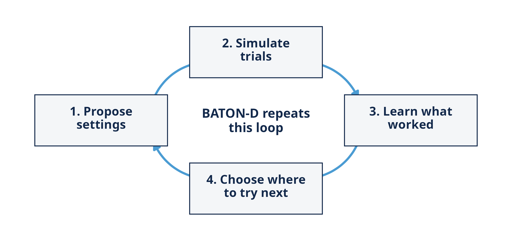
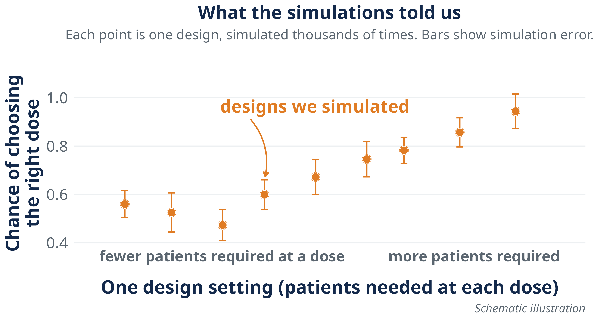
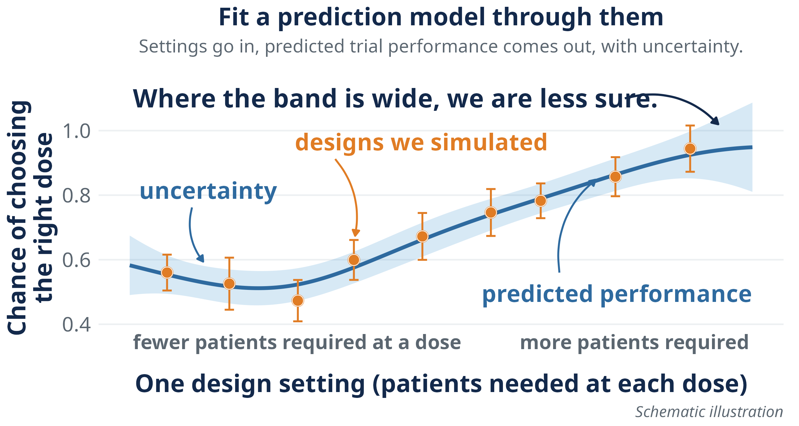
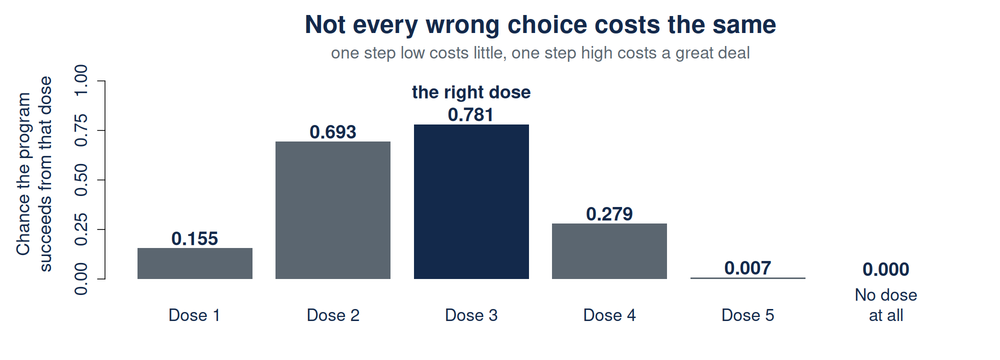

```{r setup}
#| include: false
# EVERY FINDING NUMBER ON THIS DECK IS COMPUTED, in `numbers.R`, from the same locked artifacts
# the two manuscripts read, through the paper repository's own `R/metrics.R`. Nothing is typed
# and a missing artifact stops the render rather than producing a default.
#
# THE PREDECESSOR DECK IS WHY THIS IS WRITTEN THIS WAY. The 2026-08-13 paper deck holds 24
# assertions that no longer match their artifacts and does not render, which is the guard working.
# No number was carried across from it.
source("numbers.R")
```

## {.title-slide-custom data-menu-title="Title" data-state="hide-footer"}

::: {style="text-align: center; margin-top: 1.6em;"}

<h1 class="ts-title">Which dose, and how would we know?</h1>

<p class="ts-subtitle">Using simulation and search to choose better early-trial designs</p>

<p class="ts-author">Naim Rashid</p>
<p class="ts-affil">Department of Biostatistics · Lineberger Comprehensive Cancer Center · UNC Chapel Hill</p>

<p class="ts-meta">tbd-venue · 2026</p>


:::

::: {.notes}
**Delivery:** No lab intro. Open on the problem, not the program.

**Say aloud:** "Everything I show is simulated trials, and the model I will describe chooses which
design to simulate next. It does not make any clinical decision. We do."

**Blocker to resolve before delivery:** venue and date are placeholders, here, in the footer and
in the directory name.
:::


## Overview {data-menu-title="Overview"}

```{=html}
<div style="display: grid; grid-template-columns: 1fr 1fr 1fr; gap: 1.2em; margin-top: 3em;">
  <div style="border: 1px solid #E6EAEF; background: #F4F6F8; padding: 1.1em 1.2em; min-height: 6.4em;">
    <div style="font-family: 'IBM Plex Mono', monospace; font-size: 0.62em; letter-spacing: 0.08em; color: #2E6A9F; text-transform: uppercase;">Section 1</div>
    <div style="font-weight: 700; color: #13294B; font-size: 0.95em; margin: 0.25em 0 0.6em 0;">The problem</div>
    <div style="color: #1A202C; font-size: 0.78em; line-height: 1.4;">Choosing a dose is a search problem in disguise.</div>
  </div>
  <div style="border: 1px solid #E6EAEF; background: #F4F6F8; padding: 1.1em 1.2em; min-height: 6.4em;">
    <div style="font-family: 'IBM Plex Mono', monospace; font-size: 0.62em; letter-spacing: 0.08em; color: #2E6A9F; text-transform: uppercase;">Section 2</div>
    <div style="font-weight: 700; color: #13294B; font-size: 0.95em; margin: 0.25em 0 0.6em 0;">The method</div>
    <div style="color: #1A202C; font-size: 0.78em; line-height: 1.4;">Search proposes. Verification decides.</div>
  </div>
  <div style="border: 1px solid #E6EAEF; background: #F4F6F8; padding: 1.1em 1.2em; min-height: 6.4em;">
    <div style="font-family: 'IBM Plex Mono', monospace; font-size: 0.62em; letter-spacing: 0.08em; color: #2E6A9F; text-transform: uppercase;">Section 3</div>
    <div style="font-weight: 700; color: #13294B; font-size: 0.95em; margin: 0.25em 0 0.6em 0;">The evidence</div>
    <div style="color: #1A202C; font-size: 0.78em; line-height: 1.4;">What we learned, and why the dose choice matters later.</div>
  </div>
</div>
```

::: {.notes}
**Delivery:** 30 seconds, spoken over the cards. Section 3 is the destination. Promise it, do not
spoil it.
:::


## {.section-divider data-state="hide-footer" data-background-color="#13294B" data-menu-title="Section 1: The problem"}

::: {.divider-inner}
::: {.divider-kicker}
Section 1
:::
::: {.divider-rule}
:::
::: {.divider-title}
The problem
:::
::: {.divider-question}
Why is choosing one dose harder than it looks?
:::
:::


## A small early trial can determine the dose used in everything that follows {data-menu-title="What a dose trial does"}

::: {.columns style="margin-top: 2.2em;"}
::: {.column width="33%"}
::: {.frame-box style="min-height: 9em; font-size: 0.8em;"}
**The setting**<br/>A few dose levels, a few dozen patients.
:::
:::
::: {.column width="33%" .fragment}
::: {.frame-box style="min-height: 9em; font-size: 0.8em;"}
**The decision**<br/>Which one dose is carried into the next trial.
:::
:::
::: {.column width="33%" .fragment}
::: {.frame-box style="min-height: 9em; font-size: 0.8em;"}
**The catch**<br/>What happens to one small group determines which dose the next group receives.
:::
:::
:::

::: {.notes}
**Say aloud, and it is the line the caption used to carry:** "Everything downstream inherits this
choice."

**Say aloud, glosses at first use:** dose level (one of a small ordered set of amounts the
protocol allows), cohort (the small group of patients assigned together, often three), phase I
(the first study in people, sized in the dozens), phase II (the next study, which asks whether
the drug works at the dose phase I chose).

**Delivery:** 90 seconds. Slow. The headline is the reason to care and it lands before the three
boxes. This is the slide a genomicist needs, and everything later assumes it.
:::


## Every patient contributes two facts {data-menu-title="Two endpoints"}

::: {.columns style="margin-top: 2.2em;"}
::: {.column width="50%"}
[Harm]{.endpoint-key style="color:#E07C24;"}

::: {.frame-box style="font-size: 0.82em; min-height: 6.4em; border-color: #E07C24;"}
**A side effect, or none**<br/>
Did this patient have a serious toxic reaction in the first cycle?
:::
:::
::: {.column width="50%" .fragment}
[Benefit]{.endpoint-key style="color:#2E6A9F;"}

::: {.frame-box style="font-size: 0.82em; min-height: 6.4em; border-color: #2E6A9F;"}
**A response, or none**<br/>
Did this patient's tumour shrink?
:::
:::
:::

::: {.landing .fragment}
More dose can mean more benefit, and more harm.
:::

::: {.notes}
**Say aloud:** "Toxicity here is a protocol-defined serious adverse event in a fixed early window,
not any side effect. Response is a protocol-defined tumour measurement. Both are recorded as yes
or no for each patient, which is what the designs I will show read."

**Q&A pocket:** *Richer endpoints?* Graded toxicity, ordinal response, time to progression and
late-onset toxicity all exist in the design literature. The framework does not care what the
simulator computes. What is evaluated here is binary in both endpoints, and that is a limit of
the evidence rather than of the method.
:::


## The highest tolerable dose is not always the right dose {data-menu-title="Highest is not best"}


::: {.landing .fragment}
Push to the ceiling and you can buy far more harm than benefit.
:::

::: {.notes}
**Delivery:** The turn of Section 1. Walk the left panel dose by dose, then say the right panel in
one sentence: sometimes the two coincide, and a design has to work in both worlds.

**Say the left panel exactly, and never say the two doses give the same benefit.** Dose 3 does add
benefit over dose 2, two points of it, and it adds twelve points of harm. The lesson is the
exchange rate and not an absence of benefit. The figure prints both numbers so neither can drift.

**Say aloud:** "For decades the first trial in people looked for the highest dose patients could
tolerate. That made sense for chemotherapy, where more drug meant more cell kill. For targeted
agents and immune therapies the response often levels off well below that ceiling, and the
regulator has now said so." Cite aloud: FDA Project Optimus.

**Provenance:** both curves are the study's frozen scenarios, drawn through the package's own
truth derivation, with the two marked targets asserted rather than typed.
:::


## A dose choice fails in two opposite directions {data-menu-title="Two ways to fail"}

::: {.columns style="margin-top: 2.4em;"}
::: {.column width="50%"}
::: {.frame-box style="font-size: 0.82em; min-height: 6.6em; border-color: #4B9CD3;"}
**Too low, lose benefit**<br/>
Nothing looks wrong inside the trial.
:::
:::
::: {.column width="50%" .fragment}
::: {.frame-box style="font-size: 0.82em; min-height: 6.6em; border-color: #E07C24;"}
**Too high, cause avoidable toxicity**<br/>
The next trial can stop for safety.
:::
:::
:::

::: {.landing .fragment}
Both mistakes can make a promising drug look unsuccessful.
:::

::: {.notes}
**Delivery:** This is the pair that replaces the two error rates a confirmatory trial is judged
on. Say it that way if the room has statisticians in it. "In a confirmatory trial you are judged
on two error rates. Here the two errors are directional in the dose, and they fail differently."

**Say aloud, the sharper version of the caption:** "Neither direction is visible from inside the
trial. Both of them look, from the outside, like a drug that did not work."

**Say aloud:** the asymmetry is the reason a design cannot simply be conservative. Section 3
measures both directions on simulated programs.
:::


## A trial design is really a bundle of choices {data-menu-title="Settings"}

::: {.columns style="margin-top: 1.6em;"}
::: {.column width="55%"}
::: {.frame-box style="font-size: 0.78em;"}
**Settings that get chosen**

when to move up · when to move down · when to abandon a dose · how many patients to enroll
:::
:::
::: {.column width="45%" .fragment}
::: {.frame-box style="font-size: 0.78em; border-color: #2E6A9F;"}
**Usually chosen by convention**

published defaults, reused. Tuning advice that does not say to what.
:::
:::
:::

::: {.landing .fragment}
Change any one and the trial behaves differently.
:::

::: {.notes}
**Say aloud, the fuller list, because the slide now carries four of it:** the escalation and
de-escalation boundaries, the rule that drops a dose permanently, how many patients a dose needs
before it can be judged, the size of the group assigned together, and the ceiling on the whole
trial. The key idea is that these are choices rather than natural laws.

**Say aloud, and this is the gloss that carries Section 2:** "An objective is the quantity we try
to make small. Here it is trial size, and there are two versions of it that pull apart. The
expected number of patients, and the ceiling the network has to reserve. We trade them off on a
weight and we sweep the weight."

**Pull-from-if-needed:** the published advice, quoted exactly, is to calibrate "to ensure
desirable operating characteristics." It does not say what desirable means, which quantities must
hold, or what to do with a design that fails. An investigator following it has a simulation study
and no procedure.
:::


## A design is acceptable only if it clears all three requirements {data-menu-title="Acceptable"}

::: {.columns style="margin-top: 1.2em;"}
::: {.column width="33%"}
::: {.frame-box style="min-height: 8.6em; font-size: 0.76em; border-color: #2E6A9F;"}
**Find the dose**<br/>Get the right one often enough.
:::
:::
::: {.column width="33%"}
::: {.frame-box style="min-height: 8.6em; font-size: 0.76em; border-color: #E07C24;"}
**Stop when you should**<br/>If no dose is safe, pick none.
:::
:::
::: {.column width="33%"}
::: {.frame-box style="min-height: 8.6em; font-size: 0.76em; border-color: #E07C24;"}
**Do not overexpose**<br/>Rarely treat above the tolerable dose.
:::
:::
:::

[Program success is a different quantity.]{.muted style="display:block; text-align:center; font-size:0.66em; margin-top:0.5em;"}

::: {.landing .fragment}
Only simulation says whether a design meets them.
:::

::: {.notes}
**The acronym is off the slide entirely and lives here, spoken once.** For a generalist room the
letters teach nothing, and the plain phrase carries every later use. But the room has
statisticians in it who cannot otherwise find their own quantity, so say the pairing in one
breath: "finding the right dose often enough is the probability of correct selection, PCS, and
whether the development program succeeds is a different quantity that I will come back to."

**Say aloud, since it left the caption:** for these designs there is no formula.

**Say once, here:** "When I say efficient, I mean efficient in patients, not faster computation."

**Say aloud:** each requirement names the situation it is judged in, and they are different
situations. Finding the dose is judged where a best dose exists. Stopping is judged where no dose
is acceptable, because stopping is the wrong action when a good dose is available.

**Q&A pocket:** *The exact thresholds?* Pick the right dose at least 0.80 of the time on the
simulation track and 0.50 on the track anchored to the real protocol, stop at least 0.80 of the
time when nothing is safe, and overexpose at most 0.10 of the time. Backup B2 carries all of them
with what fixed each.
:::


## Simulation says how one design behaves. It does not say which design to try next. {data-menu-title="The turn"}

<br/>

::: {style="text-align: center; margin-top: 1.2em;"}
::: {.frame-box style="max-width: 74%; margin: 0 auto; font-size: 0.92em; line-height: 1.7;"}
One design<br/>
<span style="color:#5B6670;">↓ thousands of simulated trials</span><br/>
<span style="font-family: var(--rl-font-mono); font-size: 0.74em; letter-spacing: 0.06em; color:#13294B;">RIGHT DOSE &nbsp;·&nbsp; SAFE STOPPING &nbsp;·&nbsp; OVEREXPOSURE</span><br/>
<span style="color:#E07C24;">↓</span><br/>
**But which settings should we try next?**
:::
:::

::: {.notes}
**Delivery:** The title is the conclusion. Say it twice if the room is quiet. This is the central
turn of the talk. We already know how to score a design. We do not know what to try next, and the
space of candidates is large enough that trying them all is sometimes impossible and sometimes
trivial, which is the finding on the slide after next.

**Say aloud:** the conventional report is a simulation table. It reports quantities. It does not
say what value was required, whether another setting would do better, or whether the difference is
larger than simulation noise. And when the same simulations both tune and report a design, the
favourable number carries an optimism the table cannot show.
:::


## The trial that motivated this picked the right dose only about half the time in its own simulations {data-menu-title="The trial"}

::: {style="text-align: center; margin-top: 0.7em;"}
[`r pct(PUB_OBD_SELECT_S1, 1)`]{.bignum}

[A pancreatic cancer trial at Lineberger]{style="display:block; font-size:0.8em; color:#13294B; font-weight:600;"}
:::

::: {.landing .fragment}
Reasonable choices. Nothing establishes they meet a stated requirement.
:::

[LCCC2220-DCT · NCT06483555]{.muted style="display:block; text-align:center; font-size:0.55em; margin-top:0.4em;"}

::: {.notes}
**Say aloud, so the big number is scoped:** "That is the best exact best-dose selection its own
published simulations report, on the scenario where one dose is acceptable, across six dose
levels and forty patients."

**Pull-from-if-needed, the design it ran:** six dose levels, a toxicity stage followed by a
benefit-against-harm stage, and thresholds fixed before the trial opened. Backup B3 carries the
reconstruction.

**Delivery, and the framing is load-bearing:** this is not a criticism of that trial. Its choices
follow the published recommendations, which is good practice. The point is what the standard
workflow does not establish. Two authors of designs shown later are collaborators, and one is a
potential co-author here. Never present a published design as failing.

**Say aloud:** "Those published numbers are that design under its own scenarios. They are a
reference point, and they bound nothing about what calibration reaches elsewhere."

**Q&A pocket:** *Is 0.50 low?* It is what an exact single-dose target costs when six doses
compete and forty patients are available. Half of downstream programs then start on a dose other
than the intended one.
:::


## Three design families, three different targets {data-menu-title="Three families"}

::: {.columns style="margin-top: 2.6em;"}
::: {.column width="33%"}
::: {.frame-box style="min-height: 7.6em; text-align: center; font-size: 0.8em;"}
**Find the highest safe dose**<br/>[Toxicity only]{.family-tag}
:::
:::
::: {.column width="33%" .fragment}
::: {.frame-box style="min-height: 7.6em; text-align: center; font-size: 0.8em;"}
**First find safety, then optimize benefit**<br/>[Toxicity, then benefit]{.family-tag}
:::
:::
::: {.column width="33%" .fragment}
::: {.frame-box style="min-height: 7.6em; text-align: center; font-size: 0.8em;"}
**Balance benefit and harm from the start**<br/>[Benefit against harm throughout]{.family-tag}
:::
:::
:::

::: {.landing .fragment}
Each is scored on the target it pursues, never on one it never aims at.
:::

::: {.notes}
**Say aloud, and this is what makes the comparison fair rather than rigged:** "The target has to
be defined outside the candidate design. If you inherit the definition of the right answer from
one of the designs you are comparing, that design wins and you cannot see why, because the target
and the winner move together."

**Say aloud:** every design is still scored on both quantities descriptively. Calibration does not
make a toxicity-only design learn about benefit, and no slide here claims it does.
:::


## Sometimes we can try every possible design. Sometimes there are infinitely many {data-menu-title="Enumerate or search"}

::: {.columns style="margin-top: 2.4em;"}
::: {.column width="50%"}
::: {.frame-box style="min-height: 6.8em; font-size: 0.8em;"}
**`r bu_size` possible designs**<br/>
Test all `r bu_size`. An optimizer here measures nothing.
:::
:::
::: {.column width="50%" .fragment}
::: {.frame-box style="min-height: 6.8em; font-size: 0.8em; border-color: #2E6A9F;"}
**Continuous settings**<br/>
There is no list to write down.
:::
:::
:::

::: {.landing .fragment}
First ask whether search is even necessary.
:::

::: {.notes}
**Say aloud:** "Both of these are real calibration problems in this study. Counting comes before
optimizing."

**Delivery:** This slide is why the talk is not a sales pitch for optimization. The honest finding
is that the appropriate engine differs by problem, and which one applies is measurable before any
calibration runs, at a fraction of the calibration cost.

**Say aloud:** "Grid search is the usual alternative and it is beaten in this literature already.
Chen and Mozgunov replace the full grid with sequential coordinate updates. Barnett and colleagues
calibrate several designs under a common two-stage procedure. Neither of those is what is new
here, and we say so in the paper."
:::


## {.section-divider data-state="hide-footer" data-background-color="#13294B" data-menu-title="Section 2: The method"}

::: {.divider-inner}
::: {.divider-kicker}
Section 2
:::
::: {.divider-rule}
:::
::: {.divider-title}
The method
:::
::: {.divider-question}
How do we decide what to simulate next, and when do we trust the answer?
:::
:::


## This is a familiar computational problem {data-menu-title="ML bridge"}

[This is the same problem as tuning a machine-learning model.]{style="display:block; text-align:center; font-size:0.85em; color:#13294B; font-weight:600; margin-top:0.6em;"}

::: {.columns style="margin-top: 2.2em;"}
::: {.column width="50%"}
::: {.frame-box style="text-align: center;"}
**Machine learning**<br/><br/>
hyperparameters<br/>↓<br/>expensive training run<br/>↓<br/>validation performance
:::
:::
::: {.column width="50%" .fragment}
::: {.frame-box style="text-align: center;"}
**Dose-finding design**<br/><br/>
design settings<br/>↓<br/>expensive simulated trials<br/>↓<br/>right dose, safe stopping, overexposure
:::
:::
:::

::: {.landing .fragment}
Same shape as tuning, except all three requirements must be met.
:::

::: {.notes}
**Delivery:** This is where the room recognizes the problem as theirs. One sentence on the
difference, then move. Do not motivate Bayesian optimization to this audience.
:::


## BATON-D needs a simulator, not a formula {data-menu-title="The loop"}



::: {.landing .fragment}
You supply a simulator and the requirements. It returns settings that meet them.
:::

::: {.notes}
**Say aloud, the third part that left the slide:** "Underneath it is a model of how settings map
to behaviour, fitted to the simulations already run. It returns the settings and the trial size
together, with the evidence for each."

**The method is named exactly once, here.** Constrained Bayesian optimization with Gaussian
process surrogates on the objective and on each requirement. Say the name, say that the room
already knows it, and move.

**Say aloud:** "We do not need a formula from settings to behaviour. We need to be able to
simulate a design." Do not say the two words that mean opaque machine learning to this room.

**Q&A pocket:** *Which parts are not off the shelf?* Settings that live on a finite lattice are
optimized on that lattice rather than relaxed and rounded, so every proposal is realizable.
Different setting vectors can produce the identical decision table, and proposals are
de-duplicated on the behaviour rather than on the coordinates. And exhausting a finite space is
reported as completion rather than as a search that stopped finding things.
:::


## The model fills in the expensive simulations we have not run {data-menu-title="Surrogate"}

::: {.r-stack}



:::

::: {.notes}
**Say aloud, the caption that left the slide because the artwork now carries it:** "Settings go
in, behaviour comes out, and the model says how sure it is."

**Delivery, about 20 seconds:** Open with "you do not need to read this plot." Then: "Every
simulated design becomes a point. We fit a flexible surface through them, with uncertainty. Near a
requirement boundary that uncertainty is the whole game, because we do not yet know which side of
the line a candidate is on."

**Say aloud, and it is on the slide as a small line:** this panel is a schematic illustration
rather than a result, drawn to teach the shape of the model.

**Q&A pocket:** *Noise?* Each requirement is a proportion over a known number of simulated trials,
so the noise is supplied to the model rather than inferred from the fit. The trial-size objective
is continuous and the current implementation carries no replicate-level noise model for it, which
sharpens or blunts the search and changes no reported verdict.
:::


## The next simulation goes where a promising design can most improve {data-menu-title="Where to spend"}


::: {.landing .fragment}
Weigh the possible gain against the chance every requirement holds.
:::

::: {.notes}
**The obvious generalist question, and the artwork answers it without a word.** *Why not simply
try the middle of the best-predicted region?* Because we already predict what happens there, so a
simulation spent inside it buys almost no information. The orange candidate deliberately sits ON
the boundary, where the model does not yet know which side a design falls on, and where a single
simulation can move the answer. That is the trade between exploring and exploiting, and the room
recognizes it from tuning.

**Name it once if asked:** expected improvement multiplied by the modelled probability that every
requirement holds. Backup B1 has the formula and the two approximations it makes.

**Q&A pocket:** *Independent requirements?* The rule multiplies per-requirement probabilities,
and the three requirements are computed from the same simulated trials, so they are correlated.
That approximation affects the search and reaches no reported claim, because verification
recomputes every requirement on fresh simulations and this rule plays no part in it.
:::


## Search proposes. Verification decides. {data-menu-title="Search then verify"}

```{=html}
<div style="display:flex; align-items:center; justify-content:center; gap:0.7em; margin: 2.2em auto 0 auto; max-width: 96%;">
<div style="border:1px solid #13294B; background:#F4F6F8; padding:0.6em 1.0em; text-align:center; min-height:4.4em; display:flex; flex-direction:column; justify-content:center; font-size:0.82em;"><strong style="color:#13294B;">Search</strong><br/>find a promising winner<br/><span style="color:#5B6670; font-size:0.8em;">`r format(wo_R_search, big.mark = ",")` simulated trials each</span></div>
<div style="text-align:center; color:#5B6670; font-size:0.72em;">lock the winner<br/><span style="font-size:1.6em; color:#4B9CD3;">&rarr;</span></div>
<div style="border:2px solid #2E6A9F; background:#FFFFFF; padding:0.6em 1.0em; text-align:center; min-height:4.4em; display:flex; flex-direction:column; justify-content:center; font-size:0.82em;"><strong style="color:#13294B;">Verify</strong><br/>test that winner on <strong>fresh simulations</strong><br/><span style="color:#5B6670; font-size:0.8em;">`r format(wo_R_verify, big.mark = ",")` of them, separate randomness</span></div>
<div style="text-align:center; color:#5B6670; font-size:0.72em;">bound each<br/>requirement<br/><span style="font-size:1.6em; color:#4B9CD3;">&rarr;</span></div>
<div style="border:2px solid #E07C24; background:#FFFFFF; padding:0.6em 1.0em; text-align:center; min-height:4.4em; display:flex; flex-direction:column; justify-content:center; font-size:0.82em;"><strong style="color:#13294B;">Met, not met,<br/>or unresolved</strong></div>
</div>
```

::: {.landing .fragment}
The winner of a noisy search looks better than it is, exactly because it won.
:::

::: {.notes}
**What the code runs, checked against the campaign artifact's own provenance rather than against
prose:** `r format(wo_R_search, big.mark = ",")` simulated trials per scenario during the search,
the chosen design locked with its settings, trial size and the situations it will be judged in,
then `r format(wo_R_verify, big.mark = ",")` per scenario on a stream disjoint from the one that
chose it. Both counts are read from the artifact, not typed.

**Say aloud:** "The bound is exact and one-sided in the direction the requirement is written, and
all three requirements are bounded together, so passing means passing all three at once."

**Say aloud, the honest history:** those two counts were not chosen against a precision target.
They travelled in from a configuration validated on a different problem, and we say that in the
paper rather than inventing a rationale afterwards. Their consequence is unresolved verdicts, not
wrong ones.
:::


## Optimization does not remove human judgment. It forces us to declare it in advance {data-menu-title="The specification"}

```{=html}
<div style="display:flex; flex-wrap:wrap; justify-content:center; gap:0.7em; margin: 2.6em auto 0 auto; max-width: 92%;">
  <div class="pill">Situations</div>
  <div class="pill">Requirements</div>
  <div class="pill">Settings</div>
  <div class="pill">Objective</div>
  <div class="pill">Simulation budget</div>
</div>
```

::: {.landing .fragment}
Every one of them written down, read back, and fixed before anything runs.
:::

::: {.notes}
**Say aloud, unpacking each pill, because the slide now carries only the labels:** the situations
a design is judged in, the requirements and their thresholds, the range of settings searched, what
is minimized, how many simulated trials at search and at verification, and how the bounds are
adjusted so that all three claims hold at once.

**Say aloud, and do not overclaim it:** "Replacing informal tuning with an optimizer relocates the
freedom rather than removing it, and it relocates it somewhere that looks more formal, which is
worse. So we treat an analysis as a simulator plus one frozen object listing every one of these
choices. Changing any of them after a result exists creates a new analysis. It does not revise the
old verdict."

**Say aloud, the disclosure:** the object was derived from the campaign it governs, and that
campaign was not registered in advance. Two of its components were not fixed before results
existed, both named in the paper, and a future application should deposit the object before the
analysis runs.

**Q&A pocket:** *Then what is the contribution?* Not the elimination of discretion. That the
discretion becomes explicit, auditable and fixable in advance. Backup B2 is the object itself.
:::


## {.section-divider data-state="hide-footer" data-background-color="#13294B" data-menu-title="Section 3: The evidence"}

::: {.divider-inner}
::: {.divider-kicker}
Section 3
:::
::: {.divider-rule}
:::
::: {.divider-title}
The evidence
:::
::: {.divider-question}
What was established, and what does it cost later?
:::
:::


## Across `r wo_n` calibration problems, search nominated `r wo_found` and verification established `r cp_feas` {data-menu-title="The campaign"}

```{=html}
<div style="display:flex; align-items:center; justify-content:center; gap:0.9em; margin: 0.9em auto 0 auto;">
<div style="border:1px solid #E6EAEF; background:#F4F6F8; padding:0.6em 1.1em; text-align:center; min-width:7.4em;"><div style="font-size:1.9em; font-weight:800; color:#13294B;">`r wo_n`</div><div style="color:#5B6670; font-size:0.66em;">calibration problems</div></div>
<div style="font-size:1.6em; color:#4B9CD3;">&rarr;</div>
<div style="border:2px solid #13294B; background:#FFFFFF; padding:0.6em 1.1em; text-align:center; min-width:7.4em;"><div style="font-size:1.9em; font-weight:800; color:#13294B;">`r wo_found`</div><div style="color:#5B6670; font-size:0.66em;">nominated by search</div></div>
</div>
<div style="text-align:center; color:#5B6670; font-size:0.6em; letter-spacing:0.08em; margin-top:0.5em;">AND THOSE `r wo_found` SPLIT INTO</div>
<div style="display:flex; align-items:center; justify-content:center; gap:0.8em; margin: 0.35em auto 0 auto;">
<div style="border:2px solid #2E6A9F; background:#FFFFFF; padding:0.6em 1.0em; text-align:center; min-width:7.4em;"><div style="font-size:1.9em; font-weight:800; color:#2E6A9F;">`r cp_feas`</div><div style="color:#5B6670; font-size:0.66em;">verified as meeting all three</div></div>
<div style="font-size:1.5em; color:#5B6670;">+</div>
<div style="border:2px solid #E07C24; background:#FFFFFF; padding:0.6em 1.0em; text-align:center; min-width:7.4em;"><div style="font-size:1.9em; font-weight:800; color:#E07C24;">`r cp_unr`</div><div style="color:#5B6670; font-size:0.66em;">unresolved</div></div>
<div style="font-size:1.5em; color:#5B6670;">+</div>
<div style="border:1px solid #E6EAEF; background:#F4F6F8; padding:0.6em 1.0em; text-align:center; min-width:7.4em;"><div style="font-size:1.9em; font-weight:800; color:#13294B;">0</div><div style="color:#5B6670; font-size:0.66em;">shown to fail</div></div>
</div>
```

::: {.landing .fragment}
Search is deliberately optimistic. Verification stops us claiming more than the evidence supports.
:::

::: {.notes}
**Say aloud, the scale:** `r format(wo_evals, big.mark = ",")` distinct designs were simulated
across the campaign.

**Say aloud:** "A calibration problem here is one combination of a clinical situation, a design
family and a weight in the trial-size trade-off. Each carries its own search, its own lock and its
own independent verification." Three studies contribute, one built on published simulations, one
on the real protocol's own thresholds, one on a second design's published evaluation.

**Say the full sentence:** search chooses on a point estimate and verification decides on an
interval, so a candidate whose interval straddles its requirement is neither established nor
refuted. Reporting it as met would be exactly the optimism the procedure exists to prevent.

**Pull-from-if-needed:** in `r wo_nofeas` of the `r wo_n` the search reported no acceptable
candidate at all, and `r wo_err` stopped for a stated structural reason, namely that those
situations put two doses too close together for an exact single-dose target to be meaningful.
:::


## Unresolved is not failure, and it is not almost {data-menu-title="Unresolved"}

::: {.columns style="margin-top: 1.4em;"}
::: {.column width="33%"}
::: {.frame-box style="min-height: 7.2em; font-size: 0.76em; border-color: #2E6A9F;"}
**Met**<br/>Enough evidence, yes.
:::
:::
::: {.column width="33%" .fragment}
::: {.frame-box style="min-height: 7.2em; font-size: 0.76em; border-color: #E07C24;"}
**Unresolved**<br/>Not enough evidence either way.
:::
:::
::: {.column width="33%" .fragment}
::: {.frame-box style="min-height: 7.2em; font-size: 0.76em;"}
**Not met**<br/>Enough evidence, no. This happened `r sum(CENS$corrected_pipeline$infeasible)` times.
:::
:::
:::

::: {.landing .fragment}
Never settled by falling back to the point estimate.
:::

::: {.notes}
**Delivery:** Slow. This is the slide that makes the previous one honest, and it is the one a
sceptic will test. Say the three in one breath as a traffic light, and then kill the wrong reading
immediately: "the middle one is not intermediate performance. It is intermediate evidence."

**Say aloud, the mechanics:** met means the bound clears the requirement, not met means the bound
falls on the wrong side, and unresolved means the evidence collected does not separate the design
from its requirement at all.

**Say aloud:** of the `r cp_unr` unresolved, `r cp_sel_un` are unresolved on finding the dose and
`r cp_exp_un` on overexposure. Stopping was established in all `r cp_stop_ok`. Every one is
unresolved on exactly one requirement.

**Q&A pocket:** *How much more simulation would settle them?* Holding each observed rate fixed,
the implied budget ranges from within reach to far beyond any realistic one, because the required
count grows roughly as the inverse square of the margin. And one of the problems has no finite
answer at all, because its estimate is already on the far side. That projection sizes a future
study. It does not convert any verdict here.
:::


## A verdict is conditional on the situations chosen in advance {data-menu-title="Conditionality"}

::: {.fullwidth-table style="margin-top: 1.6em; font-size: 1.02em;"}
| Which situations the design had to handle | Problems | Established |
|:--|:-:|:-:|
| From published simulations | `r wo_cells("simulation")` | `r cp_cert_s("simulation")` (`r pct(cp_cert_s("simulation") / wo_cells("simulation"))`) |
| From the real protocol's thresholds | `r wo_cells("application")` | `r cp_cert_s("application")` (`r pct(cp_cert_s("application") / wo_cells("application"))`) |
| From a second design's evaluation | `r wo_cells("boin12")` | `r cp_cert_s("boin12")` (`r pct(cp_cert_s("boin12") / wo_cells("boin12"))`) |
:::

::: {.landing .fragment}
A design can be declared successful only for the situations we chose to test.
:::

::: {.notes}
**Say aloud, the line the caption used to carry:** "Same settings searched, same dimensions. Only
the declared situations differ. That is a finding, not a caveat."

**The framing is ruled and is not open.** This is verification being conditional on what was
declared. It is not verification having failed, and no sentence may imply that. Every verdict is
exactly as strong as it was computed to be, over the situations the specification named.

**Say aloud:** "The practical consequence is that the list of situations is a scientific
commitment on the same footing as a threshold. It gets declared in advance and frozen with them."

**Say aloud, for the third row:** we offer no mechanism for it, because the campaign as run does
not isolate one, and inventing a plausible reason for a clean result is how a defect survives.

**Pull-from-if-needed:** the same conclusion arrives from the other side. Locked designs re-scored
on six further plausible situations, with no re-calibration, move materially on the constrained
quantities.
:::


## What a design reaches depends on the settings searched {data-menu-title="Domain dependence"}


::: {.landing .fragment}
Searching a wider space changed what was reachable. Best found, never a best possible.
:::

::: {.notes}
**Say aloud, and this ordering is the point rather than a technicality:** "The prespecified range
determines the verdict. The wider range is a separate analysis that diagnoses whether the verdict
was a property of those ranges. It does not reach back and overwrite the first answer. Widening a
range until a requirement is met gives you a verdict about how many ranges you tried."

**Say aloud:** the left-hand result is unresolved rather than shown to fail, and it stands exactly
as reported.

**Q&A pocket:** *What was the conflict?* As the per-dose cap rises, stopping improves and
overexposure worsens, and in that range no cap cleared both. Relaxing the overexposure tolerance
to 0.20 also removes it. Which resolution is right is a clinical judgement about acceptable risk
and not something the calibration settles.
:::


## Every guided run that returned a design beat every random run at the same budget {data-menu-title="Search reliability"}


::: {.landing .fragment}
Five runs, no known best design. This is a diagnostic, not a general ranking.
:::

::: {.notes}
**This slide exists because search reliability is a result in this project, not an aside.** It was
a speaker note until 2026-09-04 and the failure was invisible. A method that sometimes returns
nothing has to show that on the slide where its performance is claimed.

**Say aloud, and the scope goes first, before the numbers:** "`r bb_seeds` runs per arm, no
enumerable answer, so nothing here is a general ranking of optimizers. It is a diagnostic."

**Say aloud, the pair, and never one without the other:** guided search returned a verified design
in `r bb_nfound("batond")` of `r bb_seeds` runs and random search in `r bb_nfound("random")` of
`r bb_seeds`. Conditional on returning one, guided averaged `r fmt(bb_cond("batond"))` against
`r fmt(bb_cond("random"))`, `r fmt(bb_cond("batond") - bb_cond("random"))` higher. Scoring the
empty run as zero across all `r bb_seeds`, `r fmt(bb_oper("batond"))` against
`r fmt(bb_oper("random"))`. That second convention is deliberately harsh on the method that failed
and is one of several defensible choices.

**Say aloud, on the failure:** it is a search failure and not evidence that the wider setting range
is infeasible, because `r bb_nfound("batond")` other runs found verified feasible designs in it.
Random search never failed here, so it was reliable and consistently poor rather than fragile.

**Q&A pocket:** *Only random search?* Yes, and that is the honest inventory. There is no
hand-tuning arm and no grid-search arm anywhere in this work. Cyclic calibration was addressed in
related work rather than run, because an unvalidated reimplementation of someone else's method is
worse evidence than a precise account of why the problems differ. Backup B4.
:::


## Where every design could be listed, the search matched the best one {data-menu-title="Known answer"}


::: {.landing .fragment}
This validates the search where the answer is known. It does not show search was needed.
:::

::: {.notes}
**Say aloud, the reach:** against `r ba_size` designs here, and elsewhere in this study a space of
`r bu_size` that needed no search at all.

**Why this is a table of characteristics and not a distance.** The enumeration holds each
requirement quantity for every one of the `r ba_size` designs, so the comparison can be made
requirement by requirement, which is what the room can check. A single distance number hides that.

**Say aloud, the honest scope, and say it before the match:** "This validates the optimizer where
the answer is known. It does not establish that search is necessary. On a space this small,
enumeration is exact and is the right engine, and search cannot improve on it."

**The word is matched, and it is not recovered.** Every run at the larger budget returned a design
carrying the enumerated best selection value. Among safety-feasible designs that value belongs to
one tied group of `r ba_n_tied`, and every member of it carries the same stopping value and the
same exposure value, which is why the other two rows can be printed. Which member came back is not
claimed and does not matter, since a run returning a different design at the identical value has
not failed.

**Say aloud, on budget:** `r ba_budgets[2]` designs simulated out of `r ba_size`. At half that
budget guided search reached the enumerated best in `r ba_zero("batond", ba_budgets[1])` of
`r ba_seeds` runs against random search's `r ba_zero("random", ba_budgets[1])`.

**Say aloud:** the spread here is between independent optimizer runs, `r ba_seeds` of them, and it
is a number of runs and never a number of simulated trials.
:::


## A better dose choice does not always buy a better program {data-menu-title="Three-way trade-off"}


::: {.landing .fragment}
Where response levels off, a sharper dose choice buys almost nothing downstream.
:::

::: {.notes}
**The three quantities sit on one row of one artifact.** Nothing here is joined across sets, and
that is the only reason a three-way display is honest. The framework article's own frontier trades
picking the right dose against trial size and carries no downstream quantity at all, so a
three-way view built from it would have had to be joined to something else.

**Gloss aloud, and it is a reminder rather than a first use:** the vertical axis is the next
trial, the one that asks whether the drug works at the dose this one chose. A standard two-stage
design with a toxicity monitor, simulated downstream of each locked design's own dose choice.

**Say aloud, walking the panels left to right, and the panel order was swapped on 2026-09-05 so
that the rule comes before its exception:** "On the left, response keeps rising, and buying a
better dose choice buys confirmation. On the right, response levels off, and the same purchase
buys almost nothing downstream. The horizontal axis moves by `r fmt(tw_span("OBD_plateau",
"select_estimate")[["boin12"]])` for the widest family and the vertical axis barely moves."

**Note the ordering against slide 6, because a question can turn on it.** Slide 6 draws the
plateau on the left. This slide draws it on the right, because here the general result belongs
first and the exception second. Say which shape each panel is, never which side it is on.

**Say aloud, the exception precisely:** going from the smallest ceiling to the largest, the
toxicity-only family LOSES
`r fmt(abs(tw_span("OBD_plateau", "marg_conf")[["boin"]]))` on confirmation under the plateau
while the other two gain. Under the rising response all three gain.

**Say aloud, the exclusion, so nobody has to ask:** the uncalibrated reference design is not on
this plot. Its selection is observed rather than independently verified, and putting a weaker
number on the same axis as stronger ones with nothing to separate them is how a display misleads.
It returns three slides from now, where the comparison is drawn on quantities it does carry.

**Q&A pocket:** *Why does one line bend down?* The toxicity-only family under a plateau, on the
right-hand panel. Extra patients sharpen a dose choice made without reference to benefit, which is
the whole finding of the second half of this talk.
:::


## Meeting the requirements is easy if you spend enough patients {data-menu-title="The spine"}

::: {.columns style="margin-top: 2.4em;"}
::: {.column width="50%"}
::: {.frame-box style="min-height: 7.4em; font-size: 0.8em; border-color: #2E6A9F;"}
**Spend more**<br/>
Growing the trial from `r min(tw_nmax)` to `r max(tw_nmax)` patients improved correct dose selection by `r pp(tw_d_sel[1])` to `r pp(tw_d_sel[2])` percentage points.
:::
:::
::: {.column width="50%" .fragment}
::: {.frame-box style="min-height: 7.4em; font-size: 0.8em; border-color: #E07C24;"}
**It stops paying**<br/>
Where response levels off, those extra patients improved the next trial by at most `r pp(max(tw_span("OBD_plateau", "marg_conf")))` points.
:::
:::
:::

::: {.landing .fragment}
Not easier requirements. The smallest design that still meets them.
:::

::: {.notes}
**This is the spine of the whole talk and it is worth thirty seconds of silence before the
caption.** Say it plainly: "Any of these requirements can be met by enrolling more patients. That
is not a discovery and it is not free. The question a trial team actually has is how few patients
it takes, and that is the question the method answers."

**Say the caption as a full sentence, since the slide carries it clipped for the word cap:** "The
contribution is not easier requirements. It is the smallest design that still meets them."

**Say aloud, the objective, exactly:** "What the search minimizes is trial size, and there are two
versions of it. The expected number of patients, and the ceiling the network has to reserve. We
combine them on a weight, we sweep the weight, and everything on the requirement list is a hard
constraint rather than something traded off. So the design that comes back is the smallest one that
still passes."

**Say aloud, the sharpest single number available:** on the enumerated two-stage utility settings,
`r bu_nmax[3] - bu_nmax[2]` extra patients bought `r fmt(bu_best(96) - bu_best(60), 4)` on picking
the right dose, which is smaller than the simulation can resolve. Established by enumeration, so it
is an attainable ceiling rather than a search failure.

**The forbidden framing, and the profile bans the word from the visible deck.** Say fewest
patients, never a synonym for inexpensive. Efficiency here is patients, never compute.
:::


## What a trial team receives {data-menu-title="The deliverable"}

::: {.fullwidth-table style="font-size: 0.96em; margin-top: 0.8em;"}
| Requirement | Minimum needed | Estimated result | Conservative bound | Verdict |
|:--|:-:|:-:|:-:|:--|
| Picks the right dose | `r fmt(DLV$selection_floor, 2)` | `r fmt(DLV_REQ$estimate[DLV_REQ$constraint == "select"])` | `r fmt(DLV_REQ$bound_corrected[DLV_REQ$constraint == "select"])` | met |
| Stops when nothing is safe | `r fmt(DLV_REQ$limit[DLV_REQ$constraint == "stop0"], 2)` | `r fmt(DLV_REQ$estimate[DLV_REQ$constraint == "stop0"])` | `r fmt(DLV_REQ$bound_corrected[DLV_REQ$constraint == "stop0"])` | met |
| Rarely overexposes | `r fmt(DLV_REQ$limit[DLV_REQ$constraint == "expose"], 2)` | `r fmt(DLV_REQ$estimate[DLV_REQ$constraint == "expose"])` | `r fmt(DLV_REQ$bound_corrected[DLV_REQ$constraint == "expose"])` | met |
:::

[Bound, the value we are confident it exceeds, or stays below.]{.muted style="display:block; font-size: 0.7em; margin-top: 0.4em;"}

::: {.landing .fragment}
Plus the design, `r DLV$n_max` patients in groups of `r DLV$cohort_size`.
:::

::: {.notes}
**Say aloud, and it is the line that left the top of the slide:** this design was chosen before
its verdict was read. The frozen list of choices ships with it.

**Say aloud, why two numbers per row:** "The estimated result is what the fresh simulations
actually produced. The conservative bound is the value we are confident the design exceeds, or
stays below, allowing for simulation error and for the fact that all three claims are made at
once. The verdict is read off the bound and never off the estimate."

**Delivery:** This is what makes the whole thing operational rather than academic. The protocol
paragraph writes itself from this table, before anyone enrols.

**Open by closing the previous slide, because this table is the answer to it:** "`r DLV$n_max`
patients. That is what the smallest design meeting all three of these looks like on the track
anchored to the real protocol."

**Say aloud:** "All three bounds hold at once at the stated error level, over the situations the
specification declared. What the team does not receive is a promise about a situation nobody
declared, or about the design family, or about a wider range of settings. Each of those is a
separate analysis."

**Speak the bridge here, and then advance. Nothing goes between this and the next slide.** The
bridge changed on 2026-09-04, because the trade-off slide already showed that picking the right
dose and confirming are not the same quantity, so asking whether they differ would now be asking a
question the room has watched answered. Ask the sharper one instead: "So we can find the smallest
design that meets a stated list of requirements. But does that list rank designs the way a
development program does?"
:::


## The two ways a dose choice fails do not fail the same way {data-menu-title="Position"}


::: {.landing .fragment}
Forwarding low loses benefit quietly. Forwarding high turns the next trial into a safety stop.
:::

::: {.notes}
**Gloss aloud, and it is the full version of what the trade-off slide previewed:** "A phase
boundary is where one trial ends, a single dose is written into the next protocol, and everything
not carried across is gone. We simulate what happens after that boundary, with a standard
two-stage phase II design and a toxicity monitor."

**Say aloud:** how bad forwarding low is depends entirely on the shape of the response. Where every
dose has some activity, a cautious choice still confirms much of the time and the program merely
settles below the best dose. Where the low doses are genuinely inactive, the same caution is fatal.

**Say aloud:** to the sponsor, a program that stops for toxicity and a program that fails to
confirm look the same. The direction is only visible against the truth, which is to say only in
simulation.
:::


## A program can report success and still be on the wrong dose {data-menu-title="The gap"}


::: {.landing .fragment}
Judged on confirmation alone, this would be recorded as a clear success.
:::

::: {.notes}
**Delivery:** This is the first punchline of the ending. Let the left bar land, then reveal the
right one, then say the gap.

**Say aloud, with the scope:** "One design, one situation, single dose carried forward, so no
carrying rule intervenes and the divergence is attributable to the dose choice alone. It is the
largest such gap on the two frozen situations, `r pp(wf_gap_hd$gap)` percentage points."

**Say aloud, and be fair to the older designs:** across a portfolio where every design faces a
situation built against its own weakness, the design most often strictly worst is the calibrated
toxicity-only one, not the traditional design. Calibration, verification and more patients do not
repair a target that leaves benefit out.
:::


## Optimizing dose selection can choose the wrong design for the whole program {data-menu-title="Discordance"}

[Once confirmation is included.]{.muted style="display:block; text-align:center; font-size:0.66em; margin: -0.2em 0 0.1em 0;"}


::: {.notes}
**This was one build with the next slide and is now two slides, so the crossing lines survive the
printed handout.** A faded-out fragment is not printed, so the reversal itself was missing from
every exported PDF while the live talk was correct.

**The build, and it is two clicks.** The crossing lines are the whole ranking reversal and they
stand alone. Only then reveal the cost bars, which are the reason. Say the bridge between them:
"why would a design that picks the right dose more often produce a worse program? Because not
every wrong choice costs the same."

**The title states what can happen. What actually happened is stronger and is spoken, so the
qualifier has to be visible either way.** It is on the slide under the title and it is also
spoken: "The chance of picking the right dose ranked these two designs in the opposite order from
program-level success, once confirmation is included." Never say it without the last clause.

**Say the two pairs of numbers, because the title asserts a direction:** the design ahead on
picking the right dose, `r fmt(unname(E7Q$PCS[e7_pair_structural$A]))` against
`r fmt(unname(E7Q$PCS[e7_pair_structural$B]))`, is behind on program success,
`r fmt(unname(E7Q$POS[e7_pair_structural$A]))` against
`r fmt(unname(E7Q$POS[e7_pair_structural$B]))`.

**Say aloud, the scope, and do not let it drop:** `r e7_P_total` pairwise comparisons on one
situation, `r e7_observed` disagreed in direction before any correction and
`r e7_supported_n` survived the frozen family. The clearer one holds across all `r e7_n_modules`
prespecified phase II variants. The second holds at the primary variant only, in
`r sum(e7_persist_primary$holds)` of `r e7_n_modules`.

**The second geometry bounds this result and does not disprove it, and both halves get said.**
On the situation where response levels off, the gate admitted `r e9_P_total` comparisons, all from
one family, and `r e9_n_supported_inversions` inversions appeared, so the result did not recur
there. The design classes that carried the original inversion were not eligible to be tested on
that geometry at all, so the cross-family question was not answerable rather than answered no.
That gate outcome was stated as a finding in advance.
:::


## Not every wrong dose costs the same {data-menu-title="Cost of a miss"}



::: {.landing}
The usual measure scores every wrong dose alike. The program does not.
:::

::: {.notes}
**Delivery.** Say the bridge as you advance. "Why would a design that picks the right dose more
often produce a worse program? Because not every wrong choice costs the same."

**Say the cost bars honestly, and the figure now draws all six.** One step LOW is cheap,
`r fmt(unname(e7_qmap[as.character(e7_dstar - 1L)]))` against
`r fmt(unname(e7_qmap[as.character(e7_dstar)]))` at the right dose. One step HIGH is not, and
picking no dose at all is worth zero. Never say a near miss is cheap without saying which
direction.
:::


## What transfers, and what does not {data-menu-title="Geometry"}

::: {.columns style="margin-top: 2.0em;"}
::: {.column width="50%"}
::: {.frame-box style="min-height: 7.4em; font-size: 0.78em; border-color: #2E6A9F;"}
**Transfers**<br/>Keeping both doses. Carrying the earlier evidence across the boundary.
:::
:::
::: {.column width="50%" .fragment}
::: {.frame-box style="min-height: 7.4em; font-size: 0.78em; border-color: #E07C24;"}
**Does not**<br/>Paying for a stage that re-picks one dose, when a plateau leaves the two nearly alike.
:::
:::
:::

::: {.landing .fragment}
A re-picking stage reads response. Where response cannot tell the doses apart, it is a coin flip.
:::

::: {.notes}
**This slide moved ahead of the quantitative one on 2026-09-05.** The plain-language distinction
is easier to hold before the plot than after it, so state it here and let the next slide be the
evidence.

**Delivery:** Derived, not narrated. On the dominant carried pair under the plateau, the two doses
differ chiefly in toxicity, which is not the signal a response-based re-pick reads. Keeping both
never pays that cost, because it never asks the two doses to compete for one slot.

**Say aloud:** "So the design question at the boundary is not only whether to hold uncertainty
open. It is whether the evidence you will have can resolve it."
:::


## Carrying both doses through confirmation raises the chance of ending on the right one {data-menu-title="Architectures"}

<!-- TITLE IS DELIBERATELY NARROWER THAN "keeping both doses". Three of the four categories
     on this figure begin "carry both", and only the first one clearly helped, which is what
     the artwork's own callout says. A title generalising over all of them would claim more
     than the picture beneath it supports. -->


::: {.landing .fragment}
Carrying a second dose is insurance. What it is worth depends on the shape of the response.
:::

::: {.notes}
**The plain-language slide now comes first, on the owner's ruling, so this slide is the evidence
for a distinction the room already holds.** Open by pointing back: "that is the picture behind
what transfers and what does not."

**Say aloud, and read the fourth category correctly.** The first three contrasts are architectures
measured against forwarding a single dose. The FOURTH is not an architecture at all. It is the
difference between two re-pick rules, one that keeps the earlier data and one that discards it,
so it isolates the value of carrying that evidence across the boundary. Never describe it as
carrying one dose.

**Say aloud:** four contrasts fixed before any number existed, one endpoint in the family, ending
on a dose that belongs to the truly best set. Paired at the replicate level and tested two-sided
at `r fmt(0.05/4, 4)`.

**Say aloud, the diagnostic:** on `r length(e8_sign_dis_cellkeys)` of the nine problems, tracing to
`r length(e8_sign_dis_policies)` calibrated design, re-picking raised the chance that some arm
confirms while lowering the chance of ending on the right dose. A program can raise its chance
of a positive result and lower its chance of a correct one.

**Q&A pocket:** *Just more patients?* Held at the single-dose route's own expected enrolment, every
architecture stayed workable with a modest drop, so the advantage is not unconstrained spending.
:::


## Early decisions become downstream commitments {data-menu-title="Sotorasib"}

<br/>

::: {.frame-box style="max-width: 64%; margin: 0 auto; text-align: center; font-size: 0.86em;"}
**Sotorasib**, an approved cancer drug<br/><br/>
**960 mg**, the highest dose tested early<br/>
<span style="color:#5B6670;">↓ approved at that dose</span><br/>
**240 versus 960 mg** compared only after approval<br/>
<span style="color:#E07C24;">↓</span><br/>
**time to worsening was similar at both**
:::

::: {.landing .fragment}
The dose question stayed open until after approval. That dose was not shown wrong.
:::

[CodeBreaK 100 · Ann Oncol 2023 · Eur J Cancer 2024]{.muted style="display:block; text-align:center; font-size:0.55em; margin-top:0.4em;"}

::: {.notes}
**Confirmed against the source, and the caveats are not optional.** Median time until the cancer
worsens or the patient dies was 5.4 against 5.6 months. Response rate and overall survival both
trended toward the higher dose. The regulator considered the requirement fulfilled in December
2023 and 960 mg remains the labelled dose. Never say "similar efficacy," and never say the
approved dose was wrong.

**Say aloud, the honest boundary:** "Nothing here says that early trial was analysed incorrectly,
and nothing here says dose choice explains why late-stage trials fail. It says the question that
trial was optimized to answer was narrower than the decision the rest of the program needed."

**Gloss aloud:** time to worsening means the time until the cancer worsens or the patient dies.

**The three-word gloss on the slide is deliberate and is the whole outside context we import.**
Sotorasib is an approved cancer drug. Nothing else about the compound, the indication or the
sponsor belongs on this slide.
:::


## Each phase transition closes some options {data-menu-title="The larger idea"}

```{=html}
<div class="fragment semi-fade-out" data-fragment-index="1" style="display:flex; align-items:center; justify-content:center; gap:0.7em; margin: 0.6em auto 0.2em auto; max-width: 92%;">
<div style="border:1px solid #13294B; background:#F4F6F8; padding:0.5em 1.0em; text-align:center; min-height:3.6em; display:flex; flex-direction:column; justify-content:center; font-size:0.88em;"><strong style="color:#13294B;">Choose a dose</strong></div>
<div style="text-align:center; color:#5B6670; font-size:0.72em;">one dose crosses<br/><span style="font-size:1.5em; color:#4B9CD3;">&rarr;</span></div>
<div style="border:1px solid #13294B; background:#F4F6F8; padding:0.5em 1.0em; text-align:center; min-height:3.6em; display:flex; flex-direction:column; justify-content:center; font-size:0.88em;"><strong style="color:#13294B;">Look for a signal</strong></div>
<div style="text-align:center; color:#5B6670; font-size:0.72em;">what is left<br/><span style="font-size:1.5em; color:#4B9CD3;">&rarr;</span></div>
<div style="border:1px solid #13294B; background:#F4F6F8; padding:0.5em 1.0em; text-align:center; min-height:3.6em; display:flex; flex-direction:column; justify-content:center; font-size:0.88em;"><strong style="color:#13294B;">Confirm it</strong></div>
</div>
```

::: {.fragment style="max-width: 80%; margin: 0.5em auto 0 auto; border: 2px solid #2E6A9F; background: #FFFFFF; text-align: center; padding: 0.6em 1em; font-size: 0.88em; line-height: 1.45;" fragment-index="1"}
At each boundary you decide<br/>
**1 which doses survive · 2 which earlier data still count · 3 which questions can still be answered**
:::

::: {.landing .fragment style="font-size: 1.15em;"}
Which patients choose a dose, and which patients support the claim about it.
:::

::: {.notes}
**Delivery:** Slowest slide in the talk. Narrate the build, then the reversal.

**Say aloud, and this is the payoff:** "A program that runs it all inside one protocol does
better here on both things anyone cares about. It reaches the right dose more often and finishes
`r round(sv_mo_rng[1])` to `r round(sv_mo_rng[2])` months sooner, because it never pays the gap
between two protocols. It has one liability. When it confirms on the same patients whose outcomes
chose the dose, its false-positive rate under a null runs `r fmt(sv_ratio[[1]], 1)` to
`r fmt(sv_ratio[[2]], 1)` times where it belongs."

**Say aloud, the fix and its price:** "Reserve any positive fraction of the same fixed accrual as
an independent look and the error rate returns to where it should be, down to `r rc_res_min`
patients. Validity comes from those patients taking no part in the choice, and it does not improve
with size. Usefulness does. Six patients carries `r fmt(rc_power(rc_res_min), 2)` power against
`r fmt(rc_power(rc_res_max), 2)` at `r rc_res_max`, so size the reserve as you would size a
confirmatory trial."

**Land it:** "What a seamless program saves is the transition and the data a restart throws
away. Not the confirmatory patients. And that is the same separation of search from verification I
showed you inside the calibration, appearing again one level up."
:::


## Where this goes {data-menu-title="Extensions"}

<br/>

```{=html}
<div class="ext-grid">
<div class="ext-card fragment">
<h4>More realistic outcomes</h4>
<span class="ext-status">richer endpoints &middot; next</span>
<p>Graded toxicity, ordinal response, late-onset events. The layer does not care what the simulator computes.</p>
</div>
<div class="ext-card fragment">
<h4>More possible truths</h4>
<span class="ext-status">BATON-C &middot; with Amber Young</span>
<p>Calibrate against a declared family of plausible truths rather than one.</p>
</div>
<div class="ext-card fragment">
<h4>Optimize the whole program</h4>
<span class="ext-status">long-term</span>
<p>Choose dose, population and boundaries together, as one design.</p>
</div>
</div>
```

::: {.notes}
**Say aloud:** the honest limit on the first card. What is demonstrated here is three
model-assisted families with yes-or-no toxicity and response, under independence, on a small
frozen set of situations. The generality is a property of the interface and of the requirement and
verification layers, which do not care what the simulator computes. It is not a demonstrated range.

**Say aloud, on independence:** we swept the association between the two endpoints and every
mechanism held. That sweep reaches a correlation of at most `r fmt(ASSOC$rho_swept_max_abs, 3)`,
against `r fmt(ASSOC$rho_fh_hi_max, 2)` for what these marginals could attain, so it establishes
nothing about strong dependence. Backup B8.
:::


## What I hope you remember {data-menu-title="Summary"}

<br/>

::: {.incremental}
- Choosing a trial design is a search problem. Simulation alone does not tell you what to try next.

- Verify the chosen design on fresh simulations before making a claim.

- The design most likely to pick the right dose is not always the design most likely to produce a successful program, once confirmation is included.
:::

::: {.notes}
**Delivery:** Three beats, then stop.

**Spoken close:** "We started because one trial's design choices had no procedure behind them. The
procedure exists now and it says what its own claims rest on. But the last point is the one I would
keep. We optimize a trial. What succeeds or fails is a development program, and the boundary
between them is something we can design rather than something we inherit."

**The reassurance line, worth speaking:** this replaces the part of the work that was a person
running simulations by hand for two weeks. It does not replace the judgement about what to
require.
:::


## Acknowledgments {data-menu-title="Acknowledgments"}

```{=html}
<div style="display: grid; grid-template-columns: 1fr 1fr; gap: 1.6em; font-size: 0.74em;">
<div class="ack-col">
<h4>Clinical and trial</h4>
<ul>
<li>The LCCC2220-DCT investigators and study team</li>
<li>UNC Lineberger Comprehensive Cancer Center</li>
</ul>
</div>
<div class="ack-col">
<h4>Statistics</h4>
<ul>
<li><strong>Amber Young</strong> (UNC), who co-leads the confirmatory-trial calibration work</li>
<li>Rashid Lab</li>
</ul>
</div>
</div>
```

::: {.notes}
**Blocker, and the placeholder line is no longer printed on the slide, on the owner's review of
2026-09-05.** An internal note must never be visible to a room. The funding line is still missing.
Both manuscripts still carry a funding placeholder too. Check the venue's rules and add a funding
and disclosure line here before delivery.
:::


## {.section-divider data-state="hide-footer" data-background-color="#13294B" data-menu-title="Questions"}

::: {.divider-inner}
::: {.divider-kicker}
Thank you
:::
::: {.divider-rule}
:::
::: {.divider-title}
Questions
:::
::: {.divider-question}
naim@unc.edu · rashidlab.github.io
:::
:::

::: {.notes}
**Q&A routing index. Renumbered 2026-09-04 when three slides were added at 26, 28 and 29, and
checked again 2026-09-05 when slides 34 and 35 traded places and the discordance slide became a
two-build slide.**
- *The model, the rule that picks the next design, the approximations* -> backup B1.
- *Exact thresholds, what was frozen, was it registered* -> backup B2, slide 20 notes.
- *The reference trial, its published numbers* -> backup B3, slide 11 notes.
- *How is this different from cyclic calibration or from published calibration comparisons* -> backup B4, slide 13 notes, slide 26 notes.
- *Known limits, failure modes, search reliability* -> backup B5, slide 26.
- *Why 0.10 for overexposure, does the conclusion move* -> backup B6, slide 25 notes.
- *Would a wider set of situations change it* -> backup B7, slide 24 notes.
- *Does independence between the endpoints matter* -> backup B8, slide 38 notes.
- *What did you compare against* -> slide 26. Random search at an equal budget, and on slide 27 an exhaustive listing where the true best design is known. There is no hand-tuning arm and no grid-search arm, and neither is claimed.
- *Is the older design really worse* -> slide 32 notes. Answer with the portfolio, not with reputation.
- *What is worth carrying across the phase boundary* -> slide 34 states it plainly and slide 35 is the evidence. The fourth contrast on 35 compares two re-pick rules and is not a fourth architecture.
- *Did you show the approved sotorasib dose was wrong* -> no. Slide 36 notes carry the exact wording.
:::


## {.section-divider data-state="hide-footer" data-background-color="#13294B" data-menu-title="Backup"}

::: {.divider-inner}
::: {.divider-kicker}
Backup
:::
::: {.divider-rule}
:::
::: {.divider-title}
Reference slides
:::
:::


## Backup: the model and the rule that picks the next design {.backup-slide data-menu-title="B1: Model and selection rule"}

::: {.columns}
::: {.column width="50%"}

::: {.backup-head}
How search works
:::

- A Gaussian process surrogate on the objective and on **each** constraint.
- Candidates scored by **expected improvement multiplied by the modelled probability that every constraint holds**.
- With nothing feasible seen yet there is no incumbent, so the rule minimizes expected constraint violation with an exploration term. The best observed value is never substituted, because an attractive objective can come from violating a constraint.
- **Lattice coordinates are optimized on the lattice**, so every proposal is realizable, and proposals are deduplicated by the induced decision rule rather than by coordinates.

:::
::: {.column width="50%"}

::: {.backup-head}
Approximations and limitations
:::

1. Common random numbers correlate the Monte Carlo errors of different candidates, and the surrogate likelihood treats observations as independently noisy.
2. The selection rule multiplies per-constraint feasibility probabilities, and the three constraints are computed from the same simulated trials.
3. Observation noise on each constraint is supplied from the known replicate count rather than inferred from the fit. The trial-size objective carries no replicate-level noise model.

**Neither approximation reaches a claim.** Both affect the efficiency and calibration of the search only. Verification recomputes every constraint on an independent stream, and this rule plays no part in it.

:::
:::


## Backup: the frozen calibration specification {.backup-slide data-menu-title="B2: The specification"}

::: {.columns}
::: {.column width="52%"}

::: {.backup-head}
Fixed in advance
:::

- the situations and their truth definitions
- the constraint set, its thresholds and the situation class each is judged over
- how a constraint is aggregated across situations, worst case by default
- the range of settings searched
- the objective and the weights swept, `r paste(fmt(wo_w, 1), collapse = ", ")`
- the replicate counts, `r format(wo_R_search, big.mark = ",")` at search and `r format(wo_R_verify, big.mark = ",")` at verification
- how the bounds are adjusted so that all `r INF$m` requirement claims hold at once, at total error `r fmt(FAMILYWISE, 2)`

:::
::: {.column width="48%"}

::: {.backup-head}
Thresholds in force
:::

- pick the right dose at least `r fmt(wo_floor_of("simulation"), 2)` (simulation track) or `r fmt(wo_floor_of("application"), 2)` (application track)
- stop without selecting at least `r fmt(pd_stop, 2)` of the time where no dose is acceptable
- treat more than 60 percent of enrolled patients above the tolerable dose at most `r fmt(pd_expose, 2)` of the time

::: {.backup-head}
Disclosures
:::

::: {.backup-box}
**Two of them, and neither was discovered afterwards.** The object was derived from the campaign it governs, and that campaign was not registered in advance. Two of its components were not fixed before results existed, and both are named in the paper.

**A post-result alteration creates a new analysis.** It does not revise the verdict the prespecified object supports.
:::

:::
:::


## Backup: the reference trial and its reconstruction {.backup-slide data-menu-title="B3: The reference trial"}

::: {.columns}
::: {.column width="50%"}

::: {.backup-head}
Reference trial
:::

**The protocol** (LCCC2220-DCT, NCT06483555), six dose levels, a toxicity-only first stage on a boundary table, then a stage ranking admissible doses by posterior mean utility over the four toxicity-by-response outcomes.

**Two toxicity thresholds, deliberately different.** Admissibility uses the maximum tolerable rate `r fmt(PANGEA$pi_T, 2)`. The first stage aims below it, at `r fmt(PANGEA$phi_T_I, 2)`, so early exploration sits under the ceiling.

**Published exact best-dose selection, `r pct(PUB_OBD_SELECT_S1, 1)` and `r pct(PUB_OBD_SELECT_S3, 1)`**, for its own reference design under its own scenarios. That is a reference point and it bounds nothing about what calibration reaches elsewhere.

:::
::: {.column width="50%"}

::: {.backup-head}
Reconstruction limitations
:::

Every decision rule the protocol states was audited against the protocol text, including both boundary tables row by row. **Two quantities are not reproduced.**

1. **Expected first-stage size** in three of four scenarios. It enters no constraint and can move no verdict.
2. **Allocation to doses above those the design opened.** This one does bear on overexposure and is therefore not orthogonal to the safety conclusion.

::: {.backup-box}
Verified exposure here spans `r fmt(min(bu$expose))` to `r fmt(max(bu$expose))` against a `r fmt(pd_expose, 2)` ceiling, so the second discrepancy would have to more than double the quantity it affects before a verdict moved. The application that produced those numbers is closed and postdates the trial's design.
:::

:::
:::


## Backup: what BATON-D adds beyond existing calibration approaches {.backup-slide data-menu-title="B4: What this adds"}

::: {.columns}
::: {.column width="55%"}

::: {.backup-head}
Four differences, and optimization is not one of them
:::

1. **An open constraint set** rather than a single fixed overdose rule, with each constraint declaring its own situation class and aggregation rule.
2. **The maximum trial size is calibrated jointly** with the tuning settings. The closest prior work fixes it at 36 patients.
3. **The target is family-specific** rather than common to every design compared, which is what admits toxicity-only and utility designs into one comparison.
4. **Every reported quantity is re-estimated on independent simulations** with exact bounds before any feasibility statement. Prior calibrations report point estimates without uncertainty bounds, which cannot support a feasibility claim.

:::
::: {.column width="45%"}

::: {.backup-head}
Existing approaches
:::

[**Cyclic calibration** (Chen and Mozgunov), sequential coordinate updates in place of a full grid, changing growth from multiplicative to additive, with a procedure for reducing the calibration scenario set.]{style="font-size:0.86em;"}

[**Common two-stage calibration** (Barnett et al.), several combination designs calibrated on correct selection, then each overdose rule calibrated against a working criterion that at least 85 percent of trials recommend no combination under an overly toxic scenario. That is the closest precedent for the safe-stopping requirement here.]{style="font-size:0.86em;"}

[Published defaults and tabulated decision rules for model-assisted designs.]{style="font-size:0.86em;"}

::: {.backup-box}
**Cyclic calibration was not run as a numerical arm here**, and no numerical comparison with it is claimed.
:::

:::
:::


## Backup: known limits and failure modes {.backup-slide data-menu-title="B5: Limits"}

::: {.columns}
::: {.column width="50%"}

::: {.backup-head}
Search evidence
:::

[Search reliability is on slide 26 now, not here, because it is a result. What that slide does not carry is that the two comparisons answer different questions, and that a user meeting an empty result would more plausibly rerun from another seed, fall back to an enumerable subset, or report no recommendation, each of which scores the failure differently.]{style="font-size:0.88em;"}

::: {.backup-box}
**`r bb_seeds` runs and no known best design is a DIAGNOSTIC.** It is not evidence of general superiority to random search. The enumerable benchmark is the stronger of the two, and it is the one measured against a known best design.
:::

::: {.backup-head}
Comparators, the complete inventory
:::

[Random search at an identical domain, budget, replicate counts, safety screen, seeds and verification path, with the proposer as the only difference. Exhaustive enumeration where the domain permits, which gives a known best design to measure against. **No hand-tuning arm and no grid-search arm exist in this work**, and cyclic calibration is confronted in related work rather than run.]{style="font-size:0.88em;"}

:::
::: {.column width="50%"}

::: {.backup-head}
Reconstruction
:::

[One family's reconstruction carries the weakest evidence of the three, because no independent implementation exists to check it against. It reproduces seven of eight published scenarios with the eighth disclosed, and that limitation is restated wherever its results appear.]{style="font-size:0.88em;"}

::: {.backup-head}
Generalizability
:::

[Binary toxicity and response, independence, a small frozen scenario set, no nominal categorical settings varied. The generality is a property of the interface and the verification layer, not a demonstrated range.]{style="font-size:0.88em;"}

::: {.backup-head}
Implementation
:::

[The implementation sweeps a grid of trial sizes and calibrates independently at each, so no information is shared between neighbouring sizes and half the realizable sizes are never examined. Searching the group count directly would double the resolution at no extra cost.]{style="font-size:0.88em;"}

:::
:::


## Backup: the overexposure tolerance {.backup-slide data-menu-title="B6: Exposure tolerance"}

The `r fmt(pd_expose, 2)` tolerance is a working value, so every verified verdict was re-evaluated at `r fmt(ao_levels[1], 2)` and `r fmt(ao_levels[3], 2)`. The re-evaluation is **exact** for a locked design, because a verified bound does not depend on the threshold it is compared against, and no simulation is rerun.

::: {.fullwidth-table style="margin-top: 0.6em;"}
| Safety tolerance | Cross-family verdicts that moved | Exhaustive designs clearing safety | Exactness |
|:-:|:-:|:-:|:--|
| `r fmt(ao_levels[1], 2)` | none | `r ao_ex$n_safety_feasible_0.05` of `r ao_ex$n_verified` | exact |
| `r fmt(ao_levels[2], 2)`, in force | the baseline | `r ao_ex$n_safety_feasible_0.10` of `r ao_ex$n_verified` | exact |
| `r fmt(ao_levels[3], 2)` | none | `r ao_ex$n_safety_feasible_0.20` of `r ao_ex$n_verified` | lower bound |
:::

- **No overall verdict moves in the cross-family analysis**, because every configuration already fails on finding the dose and that requirement does not involve the tolerance.
- **The `r fmt(ao_levels[3], 2)` count is a lower bound**, because `r ao_ex$n_excluded_at_search_screen` designs were screened out at the working value and never verified. Tightening carries no such gap, so the zero at `r fmt(ao_levels[1], 2)` is exact.

::: {.backup-box}
**The constraint carries a second chosen constant**, the patient fraction the probability is evaluated against, and it is the more consequential of the two. Its origin is recorded as unestablished. That is not evidence the value is right. It is why a constraint definition belongs in the frozen specification rather than in its implementation.
:::


## Backup: a wider set of situations {.backup-slide data-menu-title="B7: Scenario sensitivity"}

Six further situations were constructed on the trial's full six-dose set and all `r pd_n_rows` locked configurations were re-scored on each at `r format(R_verify, big.mark = ",")` simulated trials, **with no re-calibration**. These never enter a feasibility claim and are never averaged with one.

::: {.fullwidth-table style="margin-top: 0.6em;"}
| Added situation | Toxicity only | The two utility families |
|:--|:-:|:-:|
| Worst-case overexposure against a `r fmt(pd_expose, 2)` ceiling | up to `r fmt(gs_max_expose)`, on `r gs_n_exceed` of `r pd_n_rows` locked configurations | within the ceiling |
| Response fails, stops without recommending a dose | at most `r pct(gs_fut_boin, 1)` | `r pct(gs_fut_util[1], 1)` to `r pct(gs_fut_util[2], 1)` |
| Best dose is the lowest admissible level, finds it | at most `r pct(gs_low_boin, 1)` | `r pct(gs_low_util[1], 1)` to `r pct(gs_low_util[2], 1)` |
:::

- **Safe stopping was judged on the all-toxic failure mode**, and it does not transfer to a response failure mode for a design that never observes response. Every overexposure exceedance above is from the toxicity-only family.
- Re-calibrating on the widened grid, and again with the hardest added situation removed by a rule fixed in advance, **left the coarse-domain conclusion unchanged**, so it is not an artefact of three situations and does not hinge on the single hardest one.


## Backup: dependence between the two endpoints {.backup-slide data-menu-title="B8: Association"}

The association structure is a **`r ASSOC$model_name`**. The marginals are preserved exactly at every value of its parameter, so the true best dose a situation defines does not move as the parameter is swept, and zero is exactly independence.

```{=html}
<div style="position:relative; height: 7.4em; margin: 0.7em 0 0.2em 0;">
  <div style="position:absolute; top:0; left:0; right:0; text-align:center; font-size:0.78em; color:#5B6670;">what any pair of yes-or-no endpoints with these marginals could attain</div>
  <div style="position:absolute; top:2.3em; left:0; right:0; height:12px; background:#E6EAEF;"></div>
  <div style="position:absolute; top:2.3em; left:`r fmt(assoc_pos(-ASSOC$rho_swept_max_abs), 1)`%; width:`r fmt(assoc_pos(ASSOC$rho_swept_max_abs) - assoc_pos(-ASSOC$rho_swept_max_abs), 1)`%; height:12px; background:#2E6A9F;"></div>
  <div style="position:absolute; top:1.85em; left:`r fmt(assoc_pos(0), 1)`%; width:2px; height:22px; background:#13294B;"></div>
  <div style="position:absolute; top:1.85em; left:`r fmt(assoc_pos(ASSOC$rho_family_sup_max), 1)`%; width:2px; height:22px; background:#E07C24;"></div>
  <div style="position:absolute; top:1.15em; left:0; font-size:0.78em; color:#5B6670;">`r fmt(ASSOC$rho_fh_lo_min, 2)`</div>
  <div style="position:absolute; top:1.15em; right:0; font-size:0.78em; color:#5B6670;">`r fmt(ASSOC$rho_fh_hi_max, 2)`</div>
  <div style="position:absolute; top:3.5em; left:0; right:0; text-align:center; font-size:0.78em; color:#2E6A9F; font-weight:700;">in blue, everything the sweep covered, independence out to &plusmn;`r fmt(ASSOC$rho_swept_max_abs, 3)`</div>
  <div style="position:absolute; top:5.0em; left:0; right:0; text-align:center; font-size:0.78em; color:#E07C24; font-weight:700;">orange tick, this dependence model's own limit at `r fmt(ASSOC$rho_family_sup_max, 3)`</div>
</div>
```

- The sweep's realized correlation reaches at most **`r fmt(ASSOC$rho_swept_max_abs, 3)`** in magnitude across every dose of both swept situations.
- This dependence family's **own** supremum over those doses is `r fmt(ASSOC$rho_family_sup_max, 3)`, so the grid covers well under half of what the model itself admits.
- What any pair of yes-or-no endpoints with these marginals could attain reaches `r fmt(ASSOC$rho_fh_hi_max, 2)` positive and `r fmt(ASSOC$rho_fh_lo_min, 2)` negative.
- What the sweep DID establish, against the expectation going in, is that a toxicity-only selection rule's own response estimates carry no comparable bias even when the endpoints are associated, because its terminal rule fits a curve across the whole dose trajectory rather than taking a maximum over per-dose noise.

::: {.backup-box}
**This checks only modest dependence. It does not establish robustness to endpoint association in general.** This family does not span attainable dependence, and stronger dependence needs a different model rather than a wider grid of this one.
:::
