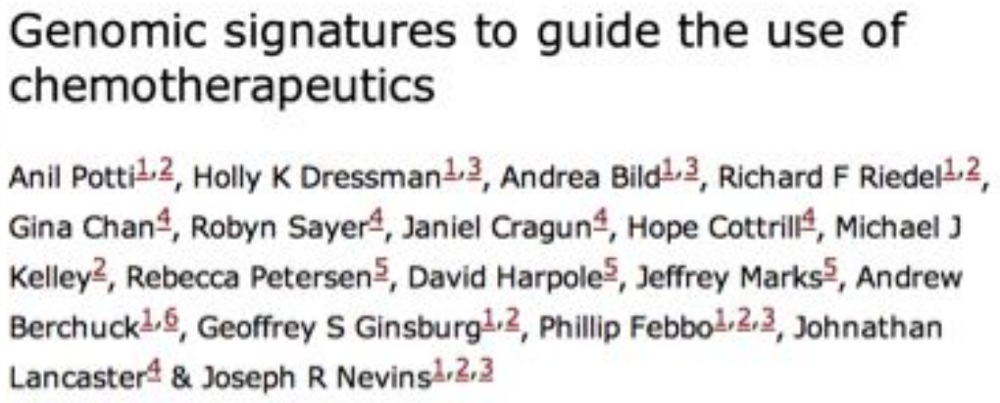
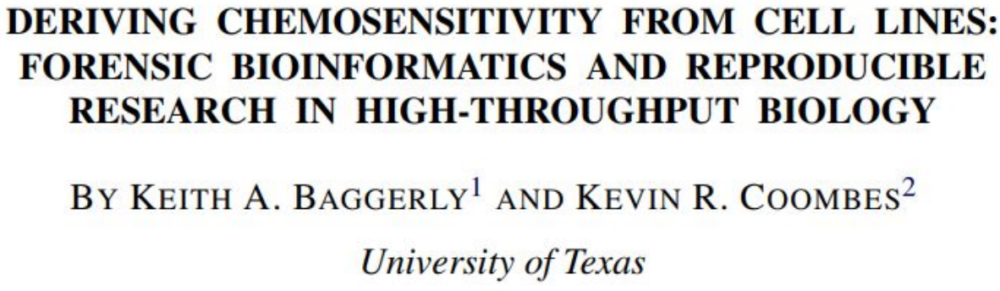
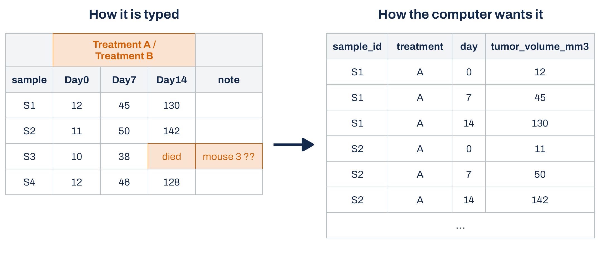
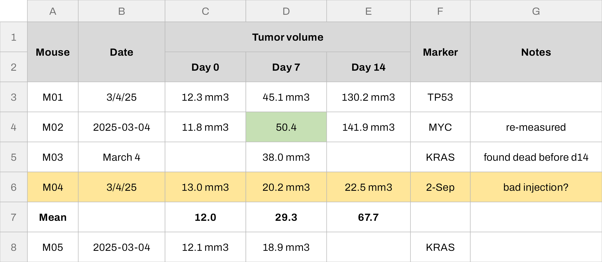
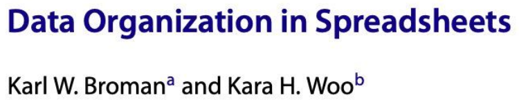
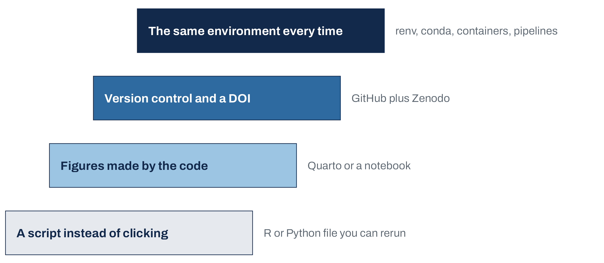
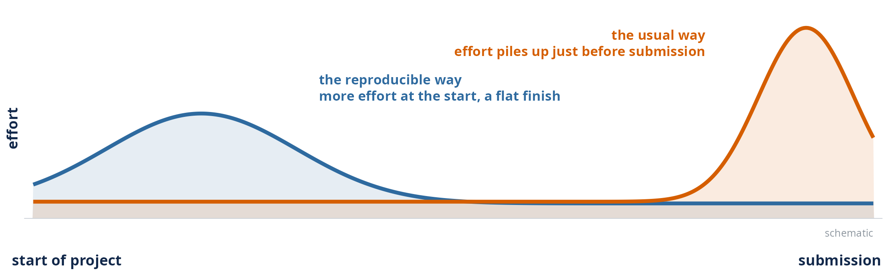
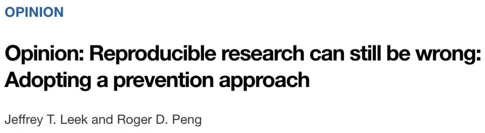

## {.title-slide-custom data-menu-title="Title" data-state="hide-footer"}

::: {style="text-align: center; margin-top: 1.1em;"}

<h1 class="ts-title">Analyzing the Data to Ensure Reproducibility</h1>

<p class="ts-subtitle">What to hand off, how to keep track of it, and how to let someone rerun it</p>

<p class="ts-author">Naim Rashid</p>
<p class="ts-affil">Department of Biostatistics · Lineberger Comprehensive Cancer Center · UNC</p>

<p class="ts-meta">T32 Rigor and Reproducibility seminar · November 2, 2026</p>

<p style="font-size: 20px; color: #13294B; margin: 0.6em 0 0.2em 0;">Slides, checklist and templates at <span style="white-space: nowrap;">github.com/naimurashid/rigor-reproducibility-resources</span></p>


:::

::: {.notes}
**Pull-from-if-needed:** The resources repo holds the handoff checklist, the codebook template, the messy and tidy example sheets, a recipe in R and in Python, and a short Quarto report. Its README maps slide topics to files.

**Q&A pockets:** *Will the slides be posted?* Yes, at the address on this slide, together with the files.

**Delivery:** No lab introduction. Point at the resources link once, then go straight to the quote.
:::


## {data-menu-title="Quote"}

::: {style="margin-top: 2.4em; text-align: center;"}
::: {style="font-size: 1.0em; line-height: 1.5; margin: 0 2.5em 1.0em 2.5em; color: #1A202C;"}
In 2009 Duke paused its cancer trials after outside statisticians found that a column of sample labels in a spreadsheet had shifted by one row. Duke's review reported that the errors
:::

::: {.thesis-line style="font-size: 1.6em;"}
"... did not affect the findings."
:::

::: {.muted}
Duke, as reported in 2010 [@naturemed2010]
:::
:::

::: {.landing .fragment}
The trials restarted.
:::

::: {.notes}
**Pull-from-if-needed:** The statement came after MD Anderson statisticians found that a column of sample labels had shifted by one row in Excel. Duke suspended the trials in 2009, and in 2010 reported that a review had found the errors did not affect the findings, so the trials restarted. The Nature Medicine news item is the source for the quote and the restart [@naturemed2010]. The trials were stopped for good later in 2010 [@iom2012]. The 2006 Nature Medicine paper was retracted in January 2011 [@potti2011retraction], and The Cancer Letter's 2015 reporting covers the later events [@cancerletter2015]. Patient counts for the trials stay off the slide until verified from the Cancer Letter or the IOM report.

**Q&A pockets:** *Was this fraud?* In November 2015 the federal Office of Research Integrity found that Potti had engaged in research misconduct [@ori2015], but the first problems anyone could see were bookkeeping errors, and those are errors any lab can make.

**Delivery:** Read the setup line in a level voice, then the quote, pause, then click. Stop there. What happened after the restart is told in the Duke sequence, slides 6 to 10.
:::


## {data-menu-title="The point"}

::: {style="margin-top: 6.4em; font-size: 1.12em;"}
::: {.thesis-line}
Most of reproducibility is what you hand off,
:::

::: {.thesis-line .fragment style="max-width: 100%;"}
the raw data, a clean table, a codebook, and the code that connects them,
:::

::: {.thesis-line .fragment}
and getting that right pays you back when you write the paper.
:::
:::

::: {.notes}
**Pull-from-if-needed:** Say aloud the first gloss here. A codebook is a short file that says what each column of the table means, its units, and how missing values are coded. The old version of this talk put the same idea as "ensuring reproducibility also benefits you while paper writing".

**Q&A pockets:** *Who is the hand-off to?* A biostatistics core, a labmate, a collaborator, or you in a year when a reviewer asks for one more analysis.

**Delivery:** One clause per click. This sentence comes back word for word at the end.
:::


## Overview {data-menu-title="Overview"}

```{=html}
<div style="display: grid; grid-template-columns: 1fr 1fr 1fr; gap: 1.2em; margin-top: 3.4em;">
  <div style="border: 1px solid #E6EAEF; background: #F4F6F8; padding: 1.4em 1.3em; min-height: 9.8em;">
    <div style="font-weight: 700; color: #13294B; font-size: 0.95em; margin: 0 0 0.6em 0;">What goes wrong</div>
    <div style="color: #1A202C; font-size: 0.86em; line-height: 1.45;">Duke, a cancer biology replication project, and Excel.</div>
  </div>
  <div style="border: 1px solid #E6EAEF; background: #F4F6F8; padding: 1.4em 1.3em; min-height: 9.8em;">
    <div style="font-weight: 700; color: #13294B; font-size: 0.95em; margin: 0 0 0.6em 0;">What you hand off</div>
    <div style="color: #1A202C; font-size: 0.86em; line-height: 1.45;">Four things, to the analyst and to yourself.</div>
  </div>
  <div style="border: 1px solid #E6EAEF; background: #F4F6F8; padding: 1.4em 1.3em; min-height: 9.8em;">
    <div style="font-weight: 700; color: #13294B; font-size: 0.95em; margin: 0 0 0.6em 0;">How you make the analysis rerunnable</div>
    <div style="color: #1A202C; font-size: 0.86em; line-height: 1.45;">Four ways, easiest first.</div>
  </div>
</div>
<div style="margin: 1.6em 0 0 0; border: 1px solid #E6EAEF; padding: 1.0em 1.2em; text-align: center;">
  <div style="font-weight: 700; color: #2E6A9F; font-size: 0.95em; white-space: nowrap;">What changes when an AI writes the code</div>
</div>
```

::: {.notes}
**Pull-from-if-needed:** Two other sessions in this series cover collecting data and building a database. This one starts where they stop, with what gets handed to whoever does the analysis.

**Q&A pockets:** *Do I need to code to use any of this?* No for the first two boxes. The third box has a first step that needs no prior coding.

**Delivery:** Thirty seconds over the boxes, not read from them.
:::


## {.section-divider data-state="hide-footer" data-background-color="#13294B" data-menu-title="Is this still happening?"}

::: {.divider-inner}
::: {.divider-title}
Is this still happening?
:::
:::

::: {.notes}
**Delivery:** Clock: about 3 minutes in, on the 51-minute estimate. Read the question, then move.
:::

## A signature that promised to pick the chemotherapy {data-menu-title="The promise"}

::: {.columns style="margin-top: 1.4em;"}
::: {.column width="50%"}
::: {style="font-size: 1.0em; line-height: 1.55; padding-right: 0.8em;"}
In 2006 a Duke group reported gene expression signatures, built from cell lines, said to predict which chemotherapy a patient's tumor would respond to [@potti2006].

::: {.fragment style="margin-top: 1.2em;"}
From 2007, Duke clinical trials assigned patients to chemotherapy by the signatures.
:::
:::
:::
::: {.column width="50%"}

<p class="muted" style="margin-top: 0.4em; text-align: center;">Nature Medicine, November 2006</p>
:::
:::

::: {.notes}
**Pull-from-if-needed:** The signatures came from in vitro drug sensitivity data on the NCI-60 cell lines paired with Affymetrix expression data, validated on independent cell line sets, then applied to patient cohorts [@potti2006]. The paper was retracted in January 2011 [@potti2011retraction]. The three Duke trials on ClinicalTrials.gov (NCT00509366, NCT00545948, NCT00636441) list start dates of May 2007, December 2007 and April 2008, and all three are marked terminated for reproducibility issues with the prediction model. This is the paper the old version of the talk showed as a screenshot of the abstract.

**Q&A pockets:** *Was the idea itself wrong?* The idea of predicting drug response from expression is still pursued. The problem here was that nobody outside Duke could rebuild the published result, and the trials went ahead anyway.

**Delivery:** Give the promise its due before the fall. Say that this looked like exactly the kind of result a cancer center wants.
:::


## Two statisticians tried to rebuild it from the public data {data-menu-title="The reconstruction"}

::: {style="margin: 1.8em 1em 0 1em; font-size: 1.12em; line-height: 1.55;"}
Keith Baggerly and Kevin Coombes at MD Anderson tried to reproduce the signatures from the posted data, and could not [@baggerly2009].

::: {.fragment style="margin-top: 1.2em;"}
The errors they found were simple, and they wrote that the trials "may be putting patients at risk".
:::
:::

<div style="margin: 0.8em auto 0 auto; width: 700px; border: 1px solid #E6EAEF; padding: 10px; background: white;"></div>
<p class="muted" style="text-align: center; margin-top: 0.3em;">Annals of Applied Statistics, 2009</p>

::: {.notes}
**Pull-from-if-needed:** They looked because MD Anderson clinicians asked whether to use the signatures. Baggerly and Coombes called the work "forensic bioinformatics", since the processing was not described well enough to reproduce and they had to infer the methods from the data and the reported results. Their abstract: "Patients in clinical trials are currently being allocated to treatment arms on the basis of these results. However, we show in five case studies that the results incorporate several simple errors that may be putting patients at risk" [@baggerly2009]. They reported spending on the order of fifteen hundred hours on the reconstruction. The paper appeared in the Annals of Applied Statistics in 2009.

**Q&A pockets:** *Why did it take statisticians to find this?* It did not take statisticians, it took people who tried to rerun it. Nobody at the journal or at Duke had.

**Delivery:** Read the quoted phrase slowly. The next slide is the whole arc on one strip, then what the errors actually were.
:::


## What happened at Duke, 2006 to 2011 {data-menu-title="Duke timeline"}


::: {.landing .fragment}
Patients were assigned to treatment using results nobody could rebuild.
:::

::: {.notes}
**Pull-from-if-needed:** Dates checked 2026-11-02 against the IOM report, Appendix B [@iom2012]: trials suspended early October 2009 (October 6 and 19), external review report dated December 22, 2009, trials resumed February 11 and 12, 2010, suspended again July 23, 2010 after The Cancer Letter reported that the Rhodes Scholar claim on Potti's CV was false, two trials terminated November 4, 2010 and the third February 3, 2011, Nature Medicine retraction January 7, 2011. The strip is evenly spaced by event, not by year. One source per point. In 2006 Potti and colleagues published the chemotherapy sensitivity signatures in Nature Medicine [@potti2006]. In 2009 Baggerly and Coombes, who could not reproduce them from the public data, published their reconstruction, and Duke suspended the three trials [@baggerly2009; @naturemed2010]. In 2010 Duke reported that a review had found the errors did not affect the findings, and the trials restarted [@naturemed2010]. The trials were stopped for good later in 2010 [@iom2012]. In January 2011 Nature Medicine retracted the 2006 paper (Nature Medicine 17, 135) [@potti2011retraction]. The Excel label offset is in the Nature Medicine news item [@naturemed2010], and The Cancer Letter's 2015 reporting covers the later events [@cancerletter2015].

**Q&A pockets:** *Why did it take so long?* The raw data and the code were not available with the papers, so outside statisticians had to work backward from the published results, which they called forensic bioinformatics.

**Delivery:** Walk left to right along the strip, one sentence per mark. About ninety seconds.
:::


## The first problems were bookkeeping errors {data-menu-title="Bookkeeping errors"}

::: {.columns style="margin-top: 1.4em;"}
::: {.column width="33%"}
::: {.frame-box style="min-height: 3.6em; font-size: 0.85em; text-align: center;"}
Sample labels off by one row
:::
:::
::: {.column width="33%"}
::: {.frame-box style="min-height: 3.6em; font-size: 0.85em; text-align: center;"}
Sensitive and resistant swapped
:::
:::
::: {.column width="33%"}
::: {.frame-box style="min-height: 3.6em; font-size: 0.85em; text-align: center;"}
Samples duplicated
:::
:::
:::

::: {.fragment style="margin: 1.4em 3em 0 3em; padding: 0.7em 1.1em; border-left: 1px solid #4B9CD3; background: #F4F6F8; font-size: 0.9em;"}
"Poor documentation can shift from an inconvenience to an active danger when it obscures not just methods but errors."

[Baggerly and Coombes, 2009 [@baggerly2009]]{.muted}
:::

::: {.notes}
**Pull-from-if-needed:** The quote is from the abstract of the Annals of Applied Statistics paper [@baggerly2009]. The abstract reads "poor documentation can shift from an inconvenience to an active danger" and "Patients in clinical trials are currently being allocated to treatment arms on the basis of these results." It also says the most common errors are simple ones, such as row or column offsets.

**Q&A pockets:** *Could software have caught these?* A script that read the raw files and matched labels by sample ID rather than by row position would have caught the offset. That is the recipe, which comes later.

**Delivery:** Let the three boxes land, then click to the quote and read it slowly.
:::


## Hope they don't ask for the original data {data-menu-title="The email"}

::: {style="margin: 4.0em 2em 0 2em; text-align: center;"}
::: {.thesis-line style="font-size: 1.5em; max-width: 100%;"}
"I can just hope they don't ask for original data"
:::

::: {.muted style="margin-top: 0.8em; font-size: 0.85em;"}
A coauthor of the 2006 paper, in an internal Duke email from 2008, as reported in The Cancer Letter, 2015 [@cancerletter2015]
:::
:::

::: {.landing .fragment style="font-size: 1.3em; bottom: 150px;"}
Someone will ask.
:::

::: {.notes}
**Pull-from-if-needed:** The line comes from an email by Holly Dressman, the second author of the 2006 Nature Medicine paper [@potti2006], as reported by The Cancer Letter in January 2015 [@cancerletter2015]. The email is to Joseph Nevins, the paper's senior author, dated May 6 2008, and reads "I guess for the review, I can just hope they don't ask for original data and just report what is in the NatMed paper." The Cancer Letter headline on January 16 2015 was "Duke Scientist: I Hope NCI Doesn't Get Original Data".

**Q&A pockets:** *Is it ever fine not to share the raw data?* Patient privacy can limit who gets it, through controlled access, but the data still have to exist in a form someone could check.

**Delivery:** Read the quote slowly, then click. Say "Someone will ask" as the person who will be asked, whether that is a reviewer, a coauthor or you a year later. Bridge to the next slide: that was one lab, and the next two slides ask how common it is.
:::


## Cancer biology tried to replicate itself {data-menu-title="RP:CB numbers"}


::: {.landing .fragment}
Reproducibility Project: Cancer Biology, 2021 [@errington2021challenges]
:::

::: {.notes}
**Pull-from-if-needed:** 193 experiments were planned from 53 papers published from 2010 to 2013, and 51 experiments from 23 papers were completed [@errington2021]. The data needed to compute effect sizes were public for 4 of the 193, and could not be obtained for 68 percent of experiments even after the original authors were contacted [@errington2021challenges]. The overview editorial is [@errington2021editorial]. Do not use the "54 percent failed" framing from press coverage, which is derived.

**Q&A pockets:** *Were the original authors unhelpful?* Some were very helpful. For about a third of experiments the authors were not helpful or did not answer. The usual obstacle was that the data or protocols could not be obtained [@errington2021challenges].

**Delivery:** Read the three numbers left to right, then stop. The 4 is the number to leave hanging.
:::


## The results that could be replicated got smaller {data-menu-title="Effects shrank"}

```{=html}
<div style="display: grid; grid-template-columns: 1fr 1fr; gap: 2.4em; margin: 2.2em 4em 0 4em; text-align: center;">
  <div style="border-top: 1px solid #4B9CD3; padding-top: 0.6em;">
    <div style="font-size: 2.6em; font-weight: 700; color: #13294B; line-height: 1.1;">85%</div>
    <div style="font-size: 0.8em; color: #5B6670;">smaller median effect than the original, for positive original effects</div>
  </div>
  <div style="border-top: 1px solid #4B9CD3; padding-top: 0.6em;">
    <div style="font-size: 2.6em; font-weight: 700; color: #13294B; line-height: 1.1;">40%</div>
    <div style="font-size: 0.8em; color: #5B6670;">of positive effects replicated on three or more of five criteria</div>
  </div>
</div>
```

::: {.landing .fragment}
And for 68 percent of the planned experiments, the original data could not be obtained at all [@errington2021challenges].
:::

::: {.notes}
**Pull-from-if-needed:** Both numbers are for original effects that were positive. The median replication effect was 85 percent smaller than the original, and 40 of 97 positive effects (40 percent) succeeded on three or more of five criteria [@errington2021]. 97 percent of the replication effects were smaller than the original [@errington2021]. Data for computing effect sizes were public for 4 of the 193 planned experiments, and could not be obtained for 68 percent even after the original authors were asked [@errington2021challenges].

**Q&A pockets:** *Does a smaller effect mean the original was wrong?* Not necessarily. It means the original estimate cannot be trusted as stated, and without the original data nobody can say why.

**Delivery:** Two numbers, then the caption. Neither paper assessed misconduct, so add no commentary on it.
:::


## Excel is still changing gene names {data-menu-title="Excel and genes"}

::: {style="margin-top: 1.8em; font-size: 1.22em; line-height: 1.55;"}
SEPT2 becomes 2-Sep.

::: {.fragment}
**31%** of papers with supplementary Excel gene lists, 2014 to 2021, had errors, with no decline after a 2016 warning [@abeysooriya2021].
:::

::: {.fragment}
The fix is to import gene columns as text, or turn off automatic date conversion in Excel.
:::
:::

<p style="margin-top: 2.8em;"><span style="font-family: 'IBM Plex Mono', monospace; font-size: 18px; letter-spacing: 0.1em; color: #2E6A9F; border: 1px solid #4B9CD3; padding: 0.15em 0.5em;">POLL</span> <span style="font-size: 0.9em; color: #13294B;">Have you ever opened a gene list in Excel?</span></p>

::: {.notes}
**Pull-from-if-needed:** Abeysooriya and colleagues found gene name errors in 3,436 of 11,117 PubMed Central articles (30.9 percent) with supplementary Excel gene lists from 2014 to 2021 [@abeysooriya2021]. The 2016 warning was Ziemann and colleagues in Genome Biology. In 2020 the HGNC renamed SEPT and MARCH genes (SEPT1 to SEPTIN1) partly for this reason. Microsoft added a setting in October 2023 under File, Options, Data, "Convert continuous letters and numbers to a date".

**Q&A pockets:** *I use Google Sheets.* It converts some of the same names, so the same fix applies, import the column as plain text. *Bioinformatics people:* read gene lists with code, never through a spreadsheet.

**Delivery:** Launch the Zoom poll as the slide appears, read the result aloud after about ninety seconds. This is the closest example to what someone in the room might do next week.
:::


## Who it costs {data-menu-title="Who it costs"}

::: {.columns style="margin-top: 1.6em;"}
::: {.column width="33%"}
::: {.frame-box style="min-height: 8em; font-size: 0.8em;"}
**Patients**<br/>The Duke trials assigned treatment using signatures that could not be rebuilt.
:::
:::
::: {.column width="33%" .fragment}
::: {.frame-box style="min-height: 8em; font-size: 0.8em;"}
**Coauthors**<br/>In 2024 Dana-Farber asked for six retractions and 32 corrections after reports of duplicated images [@dfci2024].
:::
:::
::: {.column width="33%" .fragment}
::: {.frame-box style="min-height: 8em; font-size: 0.8em;"}
**You**<br/>Original authors were asked for data from their own published papers, and often could not supply it [@errington2021challenges].
:::
:::
:::

::: {.notes}
**Pull-from-if-needed:** After a January 2024 blog post reported duplicated and altered images, Dana-Farber acknowledged errors and requested six retractions and corrections to 32 more papers (NBC News, April 2024) [@dfci2024]. Whether any of it was deliberate is unresolved, so make no claim about intent. The Lesné Alzheimer's paper in Nature was retracted on June 24 2024 [@lesne2024retraction], if a non-cancer example is wanted. Do not call it "the most cited paper ever retracted".

**Q&A pockets:** *Do retractions really end careers?* In my experience a retraction follows everyone on the author list, including people who never touched the data. That is the coauthor column.

**Delivery:** One column per click. Keep it to one sentence each, these are not new stories. Answer the divider's question aloud before leaving: yes, it is still happening, and it costs the people in this room.
:::


## What I am not saying {data-menu-title="Not saying"}

::: {style="margin: 2.2em 3em 0 3em; font-size: 1.05em;"}
::: {.disclaimer}
I am not asking you to become a programmer.
:::
::: {.disclaimer}
I am not telling you to stop using Excel.
:::
::: {.disclaimer}
I am not telling you to stop using AI.
:::
:::

::: {.notes}
**Pull-from-if-needed:** Excel is fine for typing data in. The problems come from opening data that someone else produced in it, and from analysis done by hand inside it.

**Q&A pockets:** *So what should I change on Monday?* Keep a read-only copy of the raw data and start a codebook. Both are in the next section.

**Delivery:** Plain and unhurried. This slide lowers the room's guard before the practical part.
:::


## {.section-divider data-state="hide-footer" data-background-color="#13294B" data-menu-title="What do you hand off?"}

::: {.divider-inner}
::: {.divider-title}
What do you hand to the analyst, and to yourself next year?
:::
:::

::: {.notes}
**Delivery:** Clock: about 17 minutes in, on the 51-minute estimate. Read the question, then move.
:::

## Four things, every time {data-menu-title="Four things"}

::: {.columns style="margin-top: 1.4em;"}
::: {.column width="25%"}
::: {.frame-box style="min-height: 6.6em; font-size: 0.76em;"}
**Raw data**<br/>exactly as the instrument produced it
:::
:::
::: {.column width="25%"}
::: {.frame-box style="min-height: 6.6em; font-size: 0.76em;"}
**Tidy table**<br/>one row per observation
:::
:::
::: {.column width="25%"}
::: {.frame-box style="min-height: 6.6em; font-size: 0.76em;"}
**Codebook**<br/>what each column means
:::
:::
::: {.column width="25%"}
::: {.frame-box style="min-height: 6.6em; font-size: 0.76em;"}
**Recipe**<br/>the steps from raw to tidy
:::
:::
:::

::: {.muted style="text-align: center; margin-top: 0.6em;"}
After Jeff Leek, "How to share data with a statistician"
:::

::: {.landing .fragment}
The analyst might be a core, a labmate, or you in a year.
:::

::: {.notes}
**Pull-from-if-needed:** The four things come from Jeff Leek's datasharing guide on GitHub (github.com/jtleek/datasharing). It is a GitHub guide rather than a paper, so it is credited on the slide by name. The handoff checklist in the resources repo walks through each one.

**Q&A pockets:** *I do not code at all.* Three of the four need no code. The recipe can start as a numbered list of what you did, in order, with the reasons, and someone can turn it into a script later.

**Delivery:** Name the four, then the caption. The next seven slides take them one at a time, with the exercise in the middle.
:::


## The raw data stays raw {data-menu-title="Raw data"}

::: {style="margin-top: 1.2em; font-size: 0.95em;"}
- The file as produced, by instrument, export or hand
- Kept in a read-only folder
- Nothing processed, summarized or deleted

For patient data, a dated read-only REDCap or registry export.
:::

::: {.note-box .fragment style="margin-top: 1.2em;"}
For sequencing data, keep the checksum (a short code computed from the file), which in practice changes whenever the file does.
:::

::: {.notes}
**Pull-from-if-needed:** Read-only means the operating system will not let you save over it. On Longleaf, `chmod -R a-w` on the folder. Large files go on lab storage with a link, not in email or in Git.

**Q&A pockets:** *Imaging and flow cytometry?* The raw file is the microscope or cytometer export, the .czi, .nd2 or .fcs file, kept read-only, with the segmentation or gating settings saved as a file beside it. The Dana-Farber case on the Who it costs slide was about images.

**Q&A pockets:** *What if the raw data have a mistake in them?* Fix it in the recipe, with a comment saying why, and leave the raw file as it was. *Bioinformatics people:* md5 or sha256 sums travel with the FASTQ files.

**Delivery:** About a minute. The checksum line is for the sequencing people, so say it to them.
:::


## One row per observation, one column per variable {data-menu-title="Tidy data"}



::: {.landing .fragment}
This layout is called tidy data, and most analysis software expects it [@wickham2014].
:::

::: {.notes}
**Pull-from-if-needed:** Tidy data means each variable is a column, each observation is a row, and each kind of observation is its own table [@wickham2014]. The example file `tidy-sheet.csv` in the resources repo is in this shape.

**Q&A pockets:** *Is the wide sheet wrong?* It is fine for looking at. It is harder to analyze, because "day" is hidden in the column names instead of being a column.

**Delivery:** Point at one value on the left and follow it to the right. Then click to the caption.
:::


## What is wrong with this sheet? {data-menu-title="Exercise"}

<p style="margin: 0 0 0.4em 0;"><span style="font-family: 'IBM Plex Mono', monospace; font-size: 0.6em; letter-spacing: 0.1em; color: #2E6A9F; border: 1px solid #4B9CD3; padding: 0.15em 0.5em;">EXERCISE</span> <span style="font-size: 0.75em; color: #5B6670;">Three minutes. Type answers in the chat.</span></p>

```{=html}
<div style="display: flex; flex-direction: column; gap: 0.5em; align-items: center;">

</div>
```

::: {.notes}
**Pull-from-if-needed:** The answers, in order. The header spans two rows, so no single row names the columns. M04 is yellow (excluded, but the sheet never says so) and one Day 7 cell is green (re-measured). "mm3" is typed into most cells and missing from one. The blanks for M03 mean "died", "not measured" and, for M07, "below detection". Dates come in three formats and "March 4" has no year. The marker SEPT2 shows as 2-Sep. The Mean row in the middle will be read as a mouse. The file is `messy-sheet.xlsx` in the resources repo, and `recipe.R` fixes each problem with a comment.

**Q&A pockets:** *How do I record why a value is blank?* A separate column for the reason, with codes listed in the codebook.

**Delivery:** Start a three-minute timer. Read a few chat answers aloud, then advance to the next slide for the list. Nothing on this slide gives the answers away.
:::

## What is wrong with this sheet? {data-menu-title="Exercise answers"}

<p style="margin: 0 0 0.4em 0;"><span style="font-family: 'IBM Plex Mono', monospace; font-size: 0.6em; letter-spacing: 0.1em; color: #2E6A9F; border: 1px solid #4B9CD3; padding: 0.15em 0.5em;">ANSWERS</span> <span style="font-size: 0.75em; color: #5B6670;">Seven problems.</span></p>

```{=html}
<div style="display: flex; flex-direction: column; gap: 0.5em; align-items: center;">

<div style="font-size: 0.62em; line-height: 1.4; color: #13294B; text-align: center;">
Two merged header rows · Color carries meaning · Units typed in cells · Blanks mean different things · Three date formats · SEPT2 became a date · A mean row inside the data
</div>
</div>
```

::: {.notes}
**Pull-from-if-needed:** The answers, in order. The header spans two rows, so no single row names the columns. M04 is yellow (excluded, but the sheet never says so) and one Day 7 cell is green (re-measured). "mm3" is typed into most cells and missing from one. Blanks in the Day 0 and Day 14 columns mean dead, not measured, or not yet entered, and nothing says which. Dates appear in three formats. SEPT2 has become 2-Sep. The mean row sits inside the data, so any sort or import carries it along.

**Q&A pockets:** *How do I record why a value is blank?* A separate column for the reason, with codes listed in the codebook.

**Delivery:** Same image as the exercise. Read the seven down, pointing at each on the sheet, then move to the rules.
:::

## Rules for the sheet you type into {data-menu-title="Spreadsheet rules"}

::: {.columns style="margin-top: 1em; font-size: 0.9em;"}
::: {.column width="50%"}
- Be consistent
- One header row
- No color as data
- Document missing values consistently
:::
::: {.column width="50%"}
- Dates as YYYY-MM-DD
- No calculations in the raw sheet
- Save a CSV copy
:::
:::

<div style="margin: 0.8em auto 0 auto; width: 620px; border: 1px solid #E6EAEF; padding: 10px; background: white;"></div>

::: {.landing}
Broman and Woo, 2018 [@broman2018]
:::

::: {.notes}
**Pull-from-if-needed:** Broman and Woo also recommend one thing per cell, a data dictionary (the codebook), and making backups [@broman2018]. "Document missing values consistently" is Broman and Woo's "no empty cells" rule, which means writing NA or a code for missing, and recording what the code means. YYYY-MM-DD is the ISO date format, which sorts correctly and cannot be read two ways. CSV is plain text and keeps no formatting, so nothing hides in it.

**Q&A pockets:** *My lab template breaks half of these.* Keep typing into it, and let the recipe produce the tidy table. Change the template next time it is revised.

**Delivery:** These are the answers to the exercise, turned into rules. Say that link out loud.
:::


## The codebook, the part most often skipped {data-menu-title="Codebook"}

::: {style="font-size: 0.72em; margin-top: 1.2em;"}
| Variable | Description | Units | Allowed values | Missing |
|---|---|---|---|---|
| tumor_volume | caliper volume | mm³ | 0 or more | NA, reason in volume_note |
| group | treatment arm | | Control, Treated | none |
:::

::: {.fragment style="margin-top: 1em; font-size: 0.9em;"}
Also record batch, plate, run date.
:::

::: {.landing .fragment}
Template in the resources repo.
:::

::: {.notes}
**Pull-from-if-needed:** A codebook is one row per column of the tidy table. The template (`codebook-template.csv` and `.md`) has six example rows from the mouse study in the exercise. Batch, plate and run date matter because they can line up with the groups and look like a treatment effect.

**Q&A pockets:** *REDCap already has a data dictionary.* Good, export it and add whatever REDCap does not know, such as which instrument run or which batch.

**Delivery:** Under a minute. Read one row across, then move on.
:::


## The recipe, from raw to tidy with nothing done by hand {data-menu-title="Recipe"}

::: {.big-code style="margin-top: 2.6em;"}
```r
raw <- read.csv("raw/plate_2027-01-15.csv")
# Drop well B7, bubble noted in the lab notebook
tidy <- raw[raw$well != "B7", ]
write.csv(tidy, "data/tidy.csv", row.names = FALSE)
```
:::

::: {.landing .fragment}
Every exclusion, recode and model choice goes in the script, with the N before and after each exclusion.
:::

::: {.notes}
**Pull-from-if-needed:** The resources repo has `recipe.R` and `recipe.py`, which turn the exercise sheet into the tidy table and say why at each step. A recipe reads the raw file, never edits it, and writes a new file.

**Q&A pockets:** *I do not code.* Start with a numbered list in a text file, step by step, with the reasons. That list is already a recipe, and anyone can turn it into a script. *What about exclusions decided after seeing the data?* Write them down with the date and the reason, and report them.

**Delivery:** The script drops well B7 by its ID, not by its row number, which is the fix for the shifted column at Duke. Read the comment line aloud, since the reason for each step is written there rather than remembered. Say that the recipe continues past the tidy table into the analysis, and that it can begin as a numbered list of steps in a text file.
:::


## Your DMS plan, mostly written already {data-menu-title="DMS plan"}

::: {style="font-size: 0.82em; margin-top: 0.6em;"}
| | |
|---|---|
| NIH data sharing (DMS) policy | January 2023 |
| Shorter plan | May 2026 |
| Progress in the RPPR | October 2026 |
| Data repository | GEO, SRA or GDC, then Zenodo or Dryad |
| Code | GitHub, archived with a DOI |
| Patient data | controlled access or none |
:::


::: {.notes}
**Pull-from-if-needed:** The policy is NOT-OD-21-013 and applies to applications due on or after January 25 2023 [@nih_dms_2021]. The new plan format is NOT-OD-26-046, required for due dates on or after May 25 2026 [@nih_dms_format_2026]. NOT-OD-26-100 moves DMS progress into the RPPR from October 1 2026 [@nih_rppr_2026]. GitHub is not a data archive, since a repository can be edited or deleted and has no persistent identifier, so the plan names GitHub for code with a Zenodo DOI for the archived release, which is slide 32. NIH prefers a domain repository first. GEO holds gene expression data, SRA holds sequencing reads, and GDC is the NCI Genomic Data Commons. Generalist repositories come after. K awards no longer need a DMS plan (NOT-OD-26-120, October 2026).

Patient-level data are shared through controlled access or not at all, which the plan says in advance, and they move by the core's transfer route, not by email.

**Q&A pockets:** *Which repository for my RNA-seq?* GEO for the processed counts and SRA for the reads, submitted together through GEO. Controlled-access human data go through dbGaP or GDC.

**Delivery:** Say aloud that the four things are the deliverable. Patient-level data goes through the core, not by email. Gloss the repositories aloud (GEO for gene expression, SRA for sequencing reads, GDC for cancer genomics). Then say that this applies to the research grants your PI holds, since K awards and training awards are exempt, and each of those grants now carries a written promise about its data.
:::


## Bring the analyst in at the design stage {data-menu-title="Analyst early"}

::: {style="margin-top: 1.2em; font-size: 0.95em;"}
Before samples are collected, agree on the design, the sample size and the structure of the data.
:::

::: {.note-box .fragment style="margin-top: 1em;"}
"Agree on data and metadata structure" and design experiments jointly [@robinson2024].
:::

::: {.fragment style="margin-top: 1em; font-size: 0.85em;"}
At UNC, ask the Lineberger Biostatistics Core or Bioinformatics Core.
:::

::: {.notes}
**Pull-from-if-needed:** Robinson and colleagues wrote ten rules for computational biologists working with wet-lab researchers [@robinson2024]. Two of the rules are aimed at the person generating the data, Rule 2, "Agree on data and metadata structure", and Rule 4, "Jointly design the experiments". Rule 7 is "Follow open and reproducible science guidelines", and the paper adds that "a good practice is to agree on a common and systematic way of sharing the metadata". Contact details for both cores are in `links.md`.

**Q&A pockets:** *The core is booked for months.* Ask anyway, early, and bring the four things. A fifteen-minute conversation at design time saves weeks at analysis time.

**Delivery:** About a minute. This closes the hand-off section: the four things are what you bring to that meeting.
:::


## {.section-divider data-state="hide-footer" data-background-color="#13294B" data-menu-title="Rerunnable analysis"}

::: {.divider-inner}
::: {.divider-title}
How do you make the analysis itself rerunnable?
:::
:::

::: {.notes}
**Delivery:** Clock: about 31 minutes in, on the 51-minute estimate. Read the question, then move.
:::

## Four ways to make an analysis rerunnable, from easiest to hardest {data-menu-title="Four ways"}



<p style="margin-top: 0.4em; text-align: center;"><span style="font-family: 'IBM Plex Mono', monospace; font-size: 0.6em; letter-spacing: 0.1em; color: #2E6A9F; border: 1px solid #4B9CD3; padding: 0.15em 0.5em;">POLL</span> <span style="font-size: 0.8em; color: #13294B;">Which of these do you do today?</span></p>

::: {.notes}
**Pull-from-if-needed:** Say aloud the glosses here. Version control keeps every saved version of your code with a note on what changed. A DOI is a permanent link that can be cited. A frozen environment records the exact software versions. A pipeline reruns only the steps whose inputs changed. R and Python work equally well on every step.

**Q&A pockets:** *Do I need all four?* No. Take the next step up from where you are now.

**Delivery:** Launch the Zoom poll, then preview the next four slides as the four steps.
:::


## A script instead of clicking {data-menu-title="Script"}

::: {style="margin-top: 1.4em; font-size: 0.95em;"}
Point-and-click tools such as Prism leave no record that reruns from the raw file.

A script in R, Python, SAS or Stata is that record.
:::

::: {.note-box .fragment style="margin-top: 1.4em;"}
**The test.** Delete the output, rerun the script, and get the same figure.
:::

::: {.notes}
**Pull-from-if-needed:** A script is a text file of commands that R or Python runs from the top. The test catches the usual problems, a file path that only exists on one laptop, a step that was run by hand, or a random seed that was never set.

**Q&A pockets:** *My PI uses Prism, what do I do?* Keep Prism for the figure your PI wants to see, and do the numbers in a script beside it. When the two agree, the script is the record. Prism's own analysis log helps, but it does not rerun from the raw file.

**Delivery:** Say the test slowly. It is the one sentence from this section to remember.
:::


## The figures come out of the code {data-menu-title="Report"}

::: {.columns}
::: {.column width="58%"}
````markdown
---
format: html
---

```{{r}}
tidy <- read.csv("tidy-sheet.csv")
boxplot(tumor_volume ~ group, data = tidy)
```

Figure 1 shows tumor volume by group.
````
:::
::: {.column width="42%"}
::: {style="font-size: 0.82em; margin-top: 1.2em;"}
Quarto turns this file into a report [@quarto2022], as does a Jupyter notebook run from a clean start.

The sentence describes the figure, and any test of the difference is another block of code.
:::
:::
:::

::: {.notes}
**Pull-from-if-needed:** A report like this reruns the code every time it is rendered, so the figure is redrawn from the data each time, and any number in the text can be pulled from the code too. A typed sentence is not checked, so it can still drift from the figure, and a boxplot by itself shows the distributions, not whether the groups differ. The comparison, if the design supports one, is a model fit in another chunk with its output pulled into the text. Quarto renders one file to HTML, PDF or Word, for R and Python. Posit announced it in July 2022 as the next generation of R Markdown [@quarto2022]. Positron, Posit's newer editor for R and Python, is an alternative to RStudio. The full example is `examples/report.qmd` in the resources repo. Google Colab notebooks follow the same rule as Jupyter.

**Q&A pockets:** *Do old R Markdown files still work?* Yes, Quarto renders them.

**Delivery:** Point at the code block, then at the sentence below it. The figure in the paper comes from that file.
:::


## Version control, and a DOI for the code {data-menu-title="Version control"}

::: {style="margin-top: 1.2em; font-size: 0.92em;"}
- Version control (Git, with GitHub) keeps labeled snapshots of your code you can return to.
- Zenodo gives each GitHub release a DOI, a permanent link that can be cited.
- Nature journals ask for a code availability statement.
:::

::: {.landing .fragment}
Git is for code, not patient data.
:::

::: {.notes}
**Pull-from-if-needed:** Each saved version in Git is a commit, with a message saying what changed. Zenodo also gives a concept DOI for the whole project. A CITATION.cff file tells people how to cite the code. Nature Portfolio journals ask for a code availability statement saying where the custom code behind the results can be found (paraphrase of the nature.com reporting standards page, which blocks automated fetching, so check the wording before delivery).

**Q&A pockets:** *Is GitHub safe for patient data?* No. Patient data and anything identifiable never go in Git, public or private. Keep them on storage approved for protected health information, and put only the code in the repository. The lab handbook's Git page lists what never to commit.

**Delivery:** About a minute and a half. The caption is the answer to the most common question, so say it plainly.
:::


## The same environment every time {data-menu-title="Environment"}

::: {.columns style="margin-top: 1.4em;"}
::: {.column width="33%"}
::: {.frame-box style="min-height: 8em; font-size: 0.78em;"}
**Lockfile**<br/>a list of exact package versions (renv, conda, pixi)
:::
:::
::: {.column width="33%" .fragment}
::: {.frame-box style="min-height: 8em; font-size: 0.78em;"}
**Container**<br/>a sealed copy of the whole software setup (Docker, Apptainer on Longleaf)
:::
:::
::: {.column width="33%" .fragment}
::: {.frame-box style="min-height: 8em; font-size: 0.78em;"}
**Pipeline**<br/>reruns only the steps whose inputs changed (targets, Nextflow, Snakemake)
:::
:::
:::

::: {.landing .fragment}
At UNC, ask Research Computing or the Lineberger Bioinformatics Core.
:::

::: {.notes}
**Pull-from-if-needed:** Apptainer is the new name for Singularity since 2021, and it runs on Longleaf where Docker cannot [@apptainer2021]. Pipelines such as Nextflow and Snakemake are standard in bioinformatics cores, and targets is the R version the lab uses.

**Q&A pockets:** *Is this overkill for a single paper?* For one figure from one script, a lockfile is enough. Containers and pipelines pay off for sequencing work and long projects.

**Delivery:** Most of the room can skip this step for now, so say that, and speak the last two boxes to the bioinformatics people.
:::


## What this looks like in a real paper {data-menu-title="Real paper"}

::: {style="margin-top: 0.6em; font-size: 0.9em;"}
Hillary Heiling's 2024 Biometrics paper, from her dissertation work in the lab [@heiling_glmmpen2]
:::

::: {.columns style="margin-top: 0.6em;"}
::: {.column width="50%"}
::: {.frame-box style="min-height: 3.6em; font-size: 0.8em;"}
**Repository**<br/>github.com/hheiling/paper_glmmPen_FA
:::
:::
::: {.column width="50%" .fragment}
::: {.frame-box style="min-height: 3.6em; font-size: 0.8em;"}
**README**<br/>how to install the package and rebuild the tables
:::
:::
:::

::: {.fragment .big-code style="margin-top: 0.6em;"}
```r
install.packages("glmmPen")
source("paper_glmmPen_FA/Replication/replication.R")
```
:::

::: {.landing}
The README gives the commands that rebuild the paper's tables from the saved results.
:::

::: {.notes}
**Pull-from-if-needed:** The paper-materials repository is github.com/hheiling/paper_glmmPen_FA, for the Biometrics paper on the glmmPen_FA method [@heiling_glmmpen2]. Its README says to install glmmPen from CRAN and then source `Replication/replication.R`, which rebuilds the paper's tables from saved summary results of the simulations and the case study. The simulations themselves are in the `Simulations` folder with the cluster commands to rerun them, which takes days on Longleaf and, per the README, a few manual path edits. Checked 2026-11-02: the README on GitHub says to install glmmPen from CRAN, set a path to the Replication folder and source replication.R. I have not rerun it myself, so the claim on the slide is what the README says, not a result I have reproduced. The glmmPen package paper is in The R Journal [@heiling_glmmpen]. glmmPen fits penalized generalized linear mixed models.

**Q&A pockets:** *My project has no package.* The same parts apply to any paper folder, a README, the scripts, the saved results, and one command that reruns them. The lab template linked from the resources page shows that layout.

**Q&A pockets:** *How long did setting this up take?* Most of it was set up at the start of the project and grew with it, which is the point of the next slide.

**Delivery:** Show the real repository in a browser tab if the connection allows, otherwise stay on the slide.
:::


## The work moves to the start of the project {data-menu-title="Time moves"}



::: {.landing .fragment}
Effort moves from the week before submission to the first week of the project.
:::

::: {.notes}
**Pull-from-if-needed:** The figure is drawn after a diagram by Laurent Gatto on relocating time, from his research data management course (unverified, the diagram was not found on the course page that was checked, so do not cite it as his until confirmed). The curves are a sketch of the argument, not measured data.

**Q&A pockets:** *Is it really the same amount of time?* Nobody has measured it in a trial. The point is that the cost does not go away when skipped, it arrives at revision, when a reviewer asks for one more analysis.

**Delivery:** This is the "pays you back" half of the thesis. Say so.
:::


## {.section-divider data-state="hide-footer" data-background-color="#13294B" data-menu-title="AI and code"}

::: {.divider-inner}
::: {.divider-title}
What changes when an AI writes the code?
:::
:::

::: {.notes}
**Delivery:** Clock: about 40 minutes in, 12 minutes of content left before the close, on the 51-minute estimate. Read the question, then move.
:::

## AI can do the execution, the responsibility stays with you {data-menu-title="Responsibility"}

::: {.columns style="margin-top: 1.4em;"}
::: {.column width="50%"}
::: {.frame-box style="min-height: 5.6em; font-size: 0.82em;"}
**What AI can help with**<br/>execution, options, critique, drafting
:::
:::
::: {.column width="50%"}
::: {.frame-box style="min-height: 5.6em; font-size: 0.82em; border-top: 1px solid #4B9CD3;"}
**What stays yours**<br/>what was chosen, why, and what the result means
:::
:::
:::

<p style="margin-top: 1.6em; text-align: center;"><span style="font-family: 'IBM Plex Mono', monospace; font-size: 0.6em; letter-spacing: 0.1em; color: #2E6A9F; border: 1px solid #4B9CD3; padding: 0.15em 0.5em;">POLL</span> <span style="font-size: 0.8em; color: #13294B;">Have you used an AI assistant for analysis code in the last month?</span></p>

::: {.notes}
**Pull-from-if-needed:** The line comes from the StatsUp.AI talk "Staying in the driver's seat" (2026). The line between the two boxes moves over time, and the distinction does not.

**Q&A pockets:** *My PI says not to use it.* Follow the lab's rule. If it is allowed, the next four slides are how to keep the work rerunnable.

**Delivery:** Bridge from the previous section: everything so far assumed you wrote the code, now suppose an AI did. Launch the poll first, then read the two boxes while it runs.
:::


## Same prompt, different answers {data-menu-title="Same prompt"}

::: {style="margin: 2.6em 1em 0 1em; font-size: 1.25em; line-height: 1.55;"}
One task was run **480** times, ten per combination of six models, two prompt styles and four temperature (randomness) settings.

::: {.fragment style="margin-top: 1.4em;"}
The analytical results varied considerably, even within one configuration [@cui2026].
:::
:::

::: {.landing .fragment style="font-size: 1.05em;"}
Rerunning the prompt gives different code, so save the code, not the prompt.
:::

::: {.notes}
**Pull-from-if-needed:** Cui and Alexander (arXiv preprint, February 2026) crossed two prompting strategies, six models and four temperature settings, with ten runs each, for 480 attempts, and report "considerable variation in the analytical results even for consistent configurations" [@cui2026]. It is a preprint, so say so. Kapoor and Narayanan document a related problem in machine learning, where data leakage broke results across 294 papers in 17 fields [@kapoor2023].

**Q&A pockets:** *Can I set the temperature to zero?* It reduces the variation but does not remove it, and the model version changes underneath you anyway. Save the code.

**Delivery:** The caption is the lesson. Pause before it.
:::


## It will invent a package name {data-menu-title="Made-up packages"}

```{=html}
<div style="display: grid; grid-template-columns: 1fr 1fr; gap: 2.4em; margin: 1.6em 4em 0 4em; text-align: center;">
  <div style="border-top: 1px solid #4B9CD3; padding-top: 0.6em;">
    <div style="font-size: 2.4em; font-weight: 700; color: #13294B; line-height: 1.1;">5.2%</div>
    <div style="font-size: 0.8em; color: #5B6670;">of packages named by commercial models did not exist</div>
  </div>
  <div style="border-top: 1px solid #D55E00; padding-top: 0.6em;">
    <div style="font-size: 2.4em; font-weight: 700; color: #13294B; line-height: 1.1;">21.7%</div>
    <div style="font-size: 0.8em; color: #5B6670;">of packages named by open-source models did not exist</div>
  </div>
</div>
```

::: {.muted style="text-align: center; margin-top: 0.8em;"}
Averages over 16 code models, lower bounds [@spracklen2025]
:::

::: {.landing .fragment}
Check that a package exists, who maintains it and for how long. CRAN and Bioconductor review submissions (PyPI does not), but none guarantees safety.
:::

::: {.notes}
**Pull-from-if-needed:** Spracklen and colleagues tested 16 code models on 576,000 code samples, USENIX Security 2025 (arXiv 2406.10279) [@spracklen2025]. The abstract says "the average percentage of hallucinated packages is at least 5.2% for commercial models and 22.7% for open-source models", so the numbers are shares of package names, not shares of code samples. Someone can register an invented package name and put harmful code under it, so an install command copied from a chat can install malware. Do not quote the "19.7 percent overall" figure, which is secondary. In statistics the same failure is often conceptual rather than a missing package, output that runs and looks right but rests on a false premise.

**Q&A pockets:** *How do I check a package?* A package on CRAN or Bioconductor has passed a submission check, which is a check that it builds and documents, not a security audit, and malicious packages have reached CRAN too. A name on PyPI proves nothing by itself, because invented names get registered by attackers, so look at the package page, who maintains it, how long it has existed and how often it is downloaded, and whether it does what you need.

**Delivery:** Two numbers, then the rule. Under a minute.
:::


## What the journals and NIH now require {data-menu-title="Policies"}

::: {style="font-size: 0.82em; margin-top: 0.8em;"}
| | |
|---|---|
| Nature, Science | no AI authors, and AI use disclosed in the paper [@nature2023llm] |
| NIH peer review | reviewers may not use generative AI, since June 2023 [@nih_ai_review_2023] |
| NIH applications | applications substantially developed by AI are not treated as original, from September 2025 [@nih_ai_apps_2025] |
:::

::: {.notes}
**Pull-from-if-needed:** Checked against the official pages on 2026-11-02. Science's editorial policies: AI-assisted technologies "do not meet the Science journals' criteria for authorship and therefore may not be listed as authors or coauthors", and authors who use them "should note this in the cover letter and in the methods section or acknowledgments section". Nature's January 2023 editorial said no language model can be an author and use must be documented in the methods or acknowledgements [@nature2023llm]; the Nature Portfolio AI policy page now frames this as a risk framework, with assigning authorship or accountability to AI, and using an LLM to generate core research reasoning without disclosure, listed as prohibited. NOT-OD-23-149, released June 23, 2023, bars NIH peer reviewers from using generative AI to analyze or write critiques of applications, and from uploading application content to such tools, on confidentiality grounds [@nih_ai_review_2023]. NOT-OD-25-132, released July 17, 2025 and effective for the September 25, 2025 receipt date onward, says applications substantially developed by AI will not be treated as the applicant's original ideas, caps new, renewal, resubmission and revision applications at six per PI per calendar year, permits limited AI use in preparation, and does not require disclosure [@nih_ai_apps_2025]. Three different things: reviewers are prohibited, applicants are policed for originality, journals require disclosure.

**Q&A pockets:** *Can I use ChatGPT to write my methods section?* Check the journal's policy, disclose the use, and check every claim and citation it writes. You are the author, so the text is yours to defend.

**Delivery:** Bridge: those were the risks, these are the rules. Read the table across. Do not editorialize.
:::


## How to use it and still be able to rerun your work {data-menu-title="Four habits"}

::: {style="margin-top: 1em; font-size: 0.92em;"}
1. Keep the generated code with the paper, noting the model and version.
2. Run the saved code twice from a clean start and compare.
3. Read the code as you would a labmate's draft.
4. Be able to explain the code with the AI tool closed.
:::

::: {.notes}
**Pull-from-if-needed:** A clean start means a fresh R or Python session, with the package versions pinned in a lockfile (slide 32), so the second run cannot lean on anything left over from the first. The driver's seat talk puts the reading habit as treating AI output like work "from a capable collaborator who is not accountable for the final product". Where you get stuck explaining it is where your understanding has gaps.

**Q&A pockets:** *What if the two runs differ?* Then you have learned something about the analysis, and it is a question for the analyst before it is a result.

**Delivery:** Four lines, one breath each. Habit two is the test from the script slide, applied to generated code. Two AI slides follow, judgment and then the turn to the close.
:::


## We cannot evaluate what we do not understand {data-menu-title="Judgment"}

::: {style="margin: 1.8em 1em 0 1em; font-size: 1.12em; line-height: 1.55;"}
As AI takes over more of the execution, the intuition and judgment we develop through rigorous training become more important, not less.
:::

::: {.landing .fragment}
The more we rely on AI, the more essential it becomes to know when not to trust it.
:::

::: {.notes}
**Pull-from-if-needed:** The lines are from my October 2026 talk to the biostatistics department. The fuller version of the question: who will know when AI chooses an inappropriate method, overlooks a critical assumption, or produces a convincing but misleading conclusion? When the stakes are high, someone must be able to provide assurance that the approach is sound and the conclusions justified. AI is not a substitute for judgment, or for asking for help when you are not sure, because someone still has to decide whether the output is correct, and that takes the training.

**Q&A pockets:** *So should trainees not use it?* Use it. Keep the training that lets you check it, and keep the people who can. The four habits on the previous slide are how you stay able to check.

**Delivery:** Say the title, then ask the room: but who will know when AI is wrong? Pause, read the sentence, then click. The When to ask slide, two on, is the other half: when you are not sure, ask.
:::


## Reproducible research can still be wrong {data-menu-title="Still wrong"}

::: {.columns style="margin-top: 1.2em;"}
::: {.column width="54%"}
::: {style="font-size: 0.95em; padding-right: 0.8em;"}
Reproducible means the same data and code give the same result, replicable that a new experiment does [@patil2016]. Neither means correct.

::: {.fragment style="margin-top: 0.8em;"}
A rerunnable analysis of a bad design is still wrong. Leek and Peng argue for training before the paper, not review after [@leek2015].
:::
:::
:::
::: {.column width="46%"}

<p class="muted" style="margin-top: 0.4em; text-align: center;">PNAS, 2015</p>
:::
:::

::: {.landing .fragment}
NIH modules cover design, randomization, blinding, sample size.
:::

::: {.notes}
**Pull-from-if-needed:** Leek and Peng (PNAS 2015) argue for prevention, meaning education and evidence-based data analysis, over medication, meaning checks after publication [@leek2015]. Design, randomization, blinding and sample size come from the NIGMS modules, not from that paper. The NIGMS modules are on lack of transparency, blinding and randomization, sample size, outliers and exclusions, and biological and technical replicates, at grants.nih.gov under reproducibility training. NIH has required rigor training in T32 programs since NOT-OD-16-034 [@nih_t32_rigor_2016]. Freedman and colleagues estimated irreproducible preclinical research costs about 28 billion dollars a year in the United States [@freedman2015].

**Q&A pockets:** *Is reproducible the same as replicable?* No. Patil, Peng and Leek lay the research process out as a chain, population, question, hypothesis, design, experimenter, data, analysis plan, analyst, code, estimate, claim, and define reproducibility as fixing everything from the data onward and replicability as repeating from the population onward [@patil2016]. The old version of this talk used their figure as its spine. Statistical modeling is one link in that chain, which is why the analyst belongs at the design stage, slide 26.

**Delivery:** One minute. Turn here, out of AI and into the close: whatever wrote the code, the study still has to be right.
:::


## When to talk to a statistician {data-menu-title="When to ask"}

::: {style="margin: 1.2em 3em 0 3em; font-size: 1.0em;"}
When you are not sure, turn to someone who has the training and expertise.


::: {.disclaimer}
When you are not sure.
:::
::: {.disclaimer}
When you are too sure.
:::
::: {.disclaimer}
When the stakes are high.
:::
:::

::: {.landing .fragment}
Bring the four things, the raw data, the tidy table, the codebook and the recipe.
:::

::: {.notes}
**Pull-from-if-needed:** At UNC, the Lineberger Biostatistics Core takes requests from Lineberger members, and the contact is in `links.md`. You are capable of most of this yourselves. Statisticians are there for the complexity, the edge cases, and a second look before the stakes get high.

**Q&A pockets:** *What does "too sure" mean?* A p-value that looks too good, an effect much larger than anyone expected, or a result that depends on one excluded sample.

**Delivery:** This is the other half of the judgment slide: the training that lets you check the output, and the people who have it when you do not. Warm, not a sales pitch. Then go straight to the sentence.
:::


## {data-menu-title="The point again"}

::: {style="margin-top: 3.6em;"}
::: {.thesis-line}
Most of reproducibility is what you hand off, the raw data, a clean table, a codebook, and the code that connects them, and getting that right pays you back when you write the paper.
:::
:::

::: {.notes}
**Pull-from-if-needed:** The same sentence as at the start, word for word.

**Q&A pockets:** *What is the single first step?* Make a read-only copy of your raw data this week, and start a codebook beside it.

**Delivery:** Read it once, slowly. Then the callback: Duke said the errors did not affect the findings, and nobody could check, because none of these four things had been handed off. Stop talking.
:::


## Resources {data-menu-title="Resources"}

::: {.columns style="margin-top: 0.4em; font-size: 0.8em;"}
::: {.column width="50%"}
**From this talk**

- Handoff checklist
- Codebook template
- Messy and tidy example sheets
:::
::: {.column width="50%"}
**To keep learning**

- The Turing Way
- The Carpentries
- NIH rigor training modules
- Lab handbook, data provenance and project consistency
:::
:::

```{=html}
<div style="display: flex; align-items: center; gap: 32px; margin-top: 0.5em;">

<div style="font-size: 22px; color: #13294B; line-height: 1.5;"><strong>Resources repo</strong><br/><span style="white-space: nowrap;">github.com/naimurashid/rigor-reproducibility-resources</span></div>
</div>
```

::: {.notes}
**Pull-from-if-needed:** The Turing Way is at book.the-turing-way.org. The Carpentries run free workshops at carpentries.org. Ten simple rules papers worth reading are Sandve and colleagues on reproducible computational research [@sandve2013], Wilson and colleagues on good enough practices [@wilson2017], and Schwab and colleagues on research practice [@schwab2022]. The FAIR principles are in Wilkinson and colleagues [@wilkinson2016]. The lab handbook is at rashidlab.github.io/lab-handbook. Survey numbers if asked, Nature 2016 found more than 70 percent of about 1,500 scientists had failed to reproduce another lab's result [@baker2016], and Cobey and colleagues in 2024 found 72 percent of 1,630 biomedical researchers agree there is a crisis, with 16 percent saying their institution has procedures to improve reproducibility [@cobey2024].

**Q&A pockets:** *Where do I start if I have one hour?* The handoff checklist.

**Delivery:** Before questions, say the Monday action: make a read-only copy of your raw data and start a codebook beside it. Then leave this up while questions start.
:::


## {.section-divider data-state="hide-footer" data-background-color="#13294B" data-menu-title="Questions"}

::: {.divider-inner}
::: {.divider-title}
Questions
:::
::: {.divider-rule}
:::
::: {.divider-question}
naim@unc.edu · naimurashid.github.io
:::
:::

::: {.notes}
**Q&A routing index (rendered slide numbers, which count the four dividers):**

- My PI uses Prism, what do I do? Slide 29.
- Is GitHub safe for patient data? Slide 31.
- Which repository for my RNA-seq? Slide 25.
- Can I use ChatGPT to write my methods section? Slide 39.
- I do not code at all. Slides 17 and 24.
- Was Duke fraud? Slides 2 and 9.
- Excel or Google Sheets and gene names. Slide 13.
- How to record why a value is missing. Slides 20 and 23.
- Docker, Apptainer, pipelines. Slide 32.
- Is reproducible the same as replicable, or as correct? Slide 42.
- Survey and cost numbers. Notes on slides 42 and 45.
:::


## References {.backup-slide data-menu-title="References 1"}

::: {#refs .refs-half}
:::

## References, continued {.backup-slide data-menu-title="References 2"}

::: {#refs-continued .refs-half}
:::

```{=html}
<script>
(function () {
  var src = document.getElementById('refs');
  var dst = document.getElementById('refs-continued');
  if (!src || !dst) return;
  var entries = src.querySelectorAll('.csl-entry');
  var half = Math.ceil(entries.length / 2);
  for (var i = half; i < entries.length; i++) dst.appendChild(entries[i]);
})();
</script>
```
